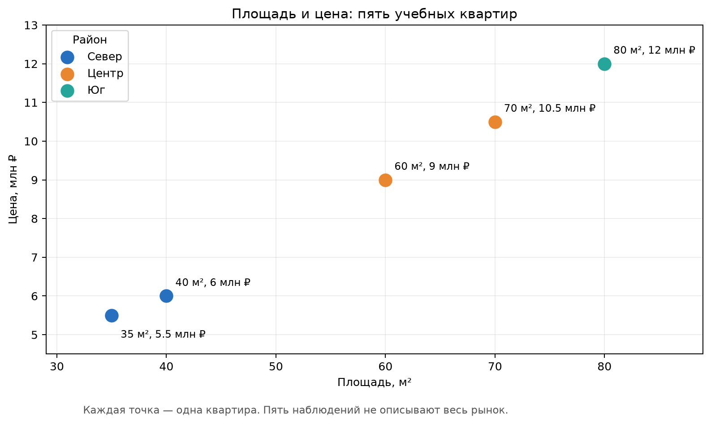
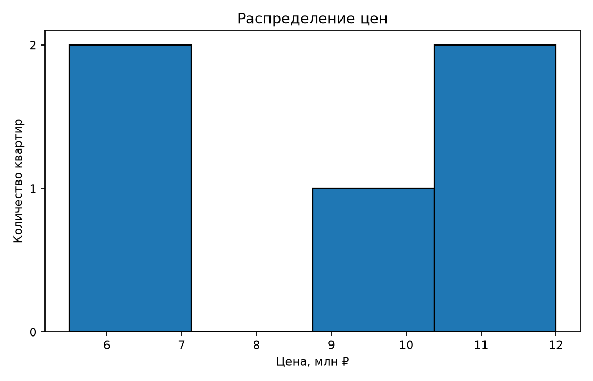
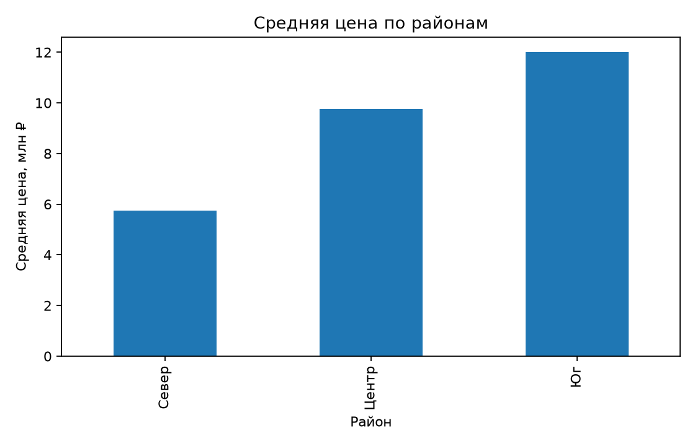
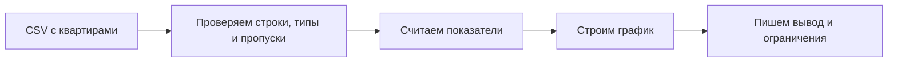

---

# Урок 1. От списка к массиву NumPy

В М4 мы описывали квартиры словарями, обходили их циклом и сами считали ошибку прогноза. Это было полезно: теперь ты понимаешь, что происходит внутри программы. Но когда квартир станет сто тысяч, разбирать каждую строку вручную уже неудобно.

В этом модуле мы перейдём от отдельных переменных и списков к массивам и таблицам. Наши инструменты: **NumPy** для чисел, **pandas** для таблиц и **Matplotlib** для графиков. Не нужно запоминать все методы. Важно научиться задавать данным правильные вопросы и проверять ответы.

**Как запустить примеры:** открой [Google Colab](https://colab.research.google.com/), создай блокнот и выполняй блоки `python` по порядку сочетанием Shift + Enter. Блоки `text` показывают ожидаемый вывод, их выполнять не нужно. После перезапуска среды начни с первого блока: переменные и файлы, созданные раньше, пропадут.

Если работаешь локально, создай окружение и установи зависимости:

```bash
python3 -m venv .venv
source .venv/bin/activate
python -m pip install numpy pandas matplotlib
```

Скопируй код урока в `.py`-файл и запусти `python имя_файла.py`. При запуске отдельных уроков сначала выполни подготовительные блоки, на которые они ссылаются. Версии библиотек со временем меняются, поэтому при ошибке установки ориентируйся на сообщение среды.

В коде после `# Результат:` я показываю ожидаемый вывод. Комментарий не выполняется Python. Для таблиц вывод может немного отличаться внешним видом, но значения должны совпасть.

## 1.1. Почему обычного списка бывает мало?

В М4 мы хранили цены в списке:

```python
prices = [6.0, 9.0, 12.0]
```

Попробуй прибавить к нему единицу:

```python
# prices + 1  # TypeError: список нельзя сложить с числом
```

А `prices * 2` не удвоит цены: Python повторит список два раза. Для числовых данных нам чаще нужно другое: выполнить одну операцию над каждым элементом. Здесь помогает NumPy.

## 1.2. Создаём массив

```python
import numpy as np

prices = np.array([6.0, 9.0, 12.0])
print(prices + 1)  # Результат: [ 7. 10. 13.]
print(prices * 2)  # Результат: [12. 18. 24.]
```

`np.array()` превращает список в массив. NumPy применяет арифметику к каждому элементу. Такое действие часто называют **векторной операцией**. Слово «вектор» здесь уже знакомо нам по М1. Для сравнения:

```python
areas = np.array([40, 60, 80])
price_per_m2 = prices / areas
print(price_per_m2)  # Результат: [0.15 0.15 0.15]
```

Значения измеряются в миллионах рублей за квадратный метр. Мы разделили каждую цену на соответствующую площадь без явного цикла.

## 1.3. Размер и форма

```python
prices = np.array([6.0, 9.0, 12.0])

print(prices.shape)  # Результат: (3,)
print(prices.ndim)   # Результат: 1
print(prices.dtype)  # Тип элементов: float64 (может зависеть от среды)
```

`shape` показывает форму массива (длинну). `(3,)` означает один ряд из трёх элементов. `ndim` - количество измерений (сколько массивов внутри массива). `dtype` - тип элементов. В отличие от обычного списка, массив NumPy обычно хранит элементы одного числового типа.

**Важно:** NumPy не делает несопоставимые массивы «магически совместимыми». Если длины не подходят для операции, будет ошибка. Перед вычислением посмотри на `shape`.

## 1.4. Связь с ML

Когда модель получает несколько квартир, площади можно представить массивом, а её прогнозы - другим массивом той же длины. Тогда ошибки считаются сразу для всех квартир.

---

# Урок 2. Матрицы NumPy и расчёт ошибки

## 2.1. Несколько объектов и признаков

Вернёмся к квартирам. Для каждой есть два признака: площадь в десятках квадратных метров и число комнат.

```python
import numpy as np

X = np.array([
    [4, 1],
    [6, 2],
    [8, 3],
])

print(X.shape)  # Результат: (3, 2)
```

Три строки - три квартиры. Два столбца - два признака. В М1 мы называли такую таблицу чисел матрицей. Буквой `X` в ML часто обозначают матрицу признаков.

```python
print(X[0])     # Результат: [4 1]
print(X[:, 0])  # Результат: [4 6 8]
```

`X[0]` берёт первую строку, а `X[:, 0]` - первый столбец целиком. Двоеточие означает «все строки».

## 2.2. Прогноз сразу для всех квартир

В М4 мы использовали формулу `1.2 × площадь_в_десятках + 0.5 × комнаты + 1`.

```python
weights = np.array([1.2, 0.5])
bias = 1.0

predictions = X @ weights + bias
print(predictions)  # Результат: [ 6.3  9.2 12.1]
```

Символ `@` обозначает матричное умножение. Для каждой строки `X` NumPy умножает два признака на два веса, складывает результаты и прибавляет `bias`. Это та же операция, которую мы считали вручную в М1.

```text
Квартира 1: [4, 1] × [1.2, 0.5] + 1 = 4×1.2 + 1×0.5 + 1 = 6.3
Квартира 2: [6, 2] × [1.2, 0.5] + 1 = 6×1.2 + 2×0.5 + 1 = 9.2
Квартира 3: [8, 3] × [1.2, 0.5] + 1 = 8×1.2 + 3×0.5 + 1 = 12.1
```

Проверь размерности: `(3, 2) @ (2,)` даёт три прогноза. Если веса не совпадают с количеством признаков, вычисление не получится.

## 2.3. Считаем MAE и MSE

```python
real_prices = np.array([6.0, 9.0, 12.0])
errors = predictions - real_prices

mae = np.mean(np.abs(errors))
mse = np.mean(errors ** 2)

print(round(mae, 4))  # Результат: 0.2
print(round(mse, 4))  # Результат: 0.0467
```

`np.abs()` убирает знак ошибки, `np.mean()` считает среднее. Для MSE возводим ошибки в квадрат. Значение MSE совпадает с расчётом М4, только теперь мы обошлись без цикла.

**Не путай:** массивы удобны для чисел, но они не объясняют, что означает каждый столбец. Для таблицы с именами полей перейдём к pandas.

---

# Урок 3. pandas: таблица с именами столбцов

## 3.1. Что такое DataFrame?

Представь обычную таблицу: строка - квартира, столбцы - площадь, комнаты и цена. В pandas такую таблицу называют `DataFrame`.

```python
import pandas as pd

apartments = pd.DataFrame({
    "area": [40, 60, 80],
    "rooms": [1, 2, 3],
    "price": [6.0, 9.0, 12.0],
})

print(apartments)
```

Ожидаемая таблица:

```text
   area  rooms  price
0    40      1    6.0
1    60      2    9.0
2    80      3   12.0
```

В выводе появится ещё и индекс `0, 1, 2`. Это метки строк, а не отдельный признак квартиры. Один столбец `apartments["area"]` - объект `Series`; вся таблица - `DataFrame`.

## 3.2. Первый осмотр данных

```python
print(apartments.shape)       # Результат: (3, 3)
print(apartments.columns.tolist())  # Результат: ['area', 'rooms', 'price']
print(apartments.head(2))
print(apartments.dtypes)
```

Зачем это делать? Чтобы не строить расчёт на предположении, что столбец называется `Price`, когда на самом деле он называется `price`, или что цена уже число, когда в файле она записана текстом. Для крупной таблицы полезны также `info()` и `describe()`:

```python
apartments.info()
print(apartments.describe())
```

`info()` покажет столбцы, типы и количество непустых значений. `describe()` даст основные числовые статистики. Не воспринимай их как готовый анализ: сначала подумай, осмысленно ли среднее для каждого столбца.

## 3.3. Новый столбец

```python
apartments["price_per_m2"] = apartments["price"] / apartments["area"]
print(apartments["price_per_m2"].tolist())  # Результат: [0.15, 0.15, 0.15]
```

Операция применяется построчно. Вспомни: цена в миллионах рублей, значит и новая величина измеряется в миллионах рублей за м². Единицы измерения лучше записать в пояснении к анализу, иначе число `0.15` мало что говорит.

---

# Урок 4. Читаем файл и выбираем нужные строки

## 4.1. CSV — это файл с данными, а не картинка таблицы

CSV хранит строки текста, разделённые символом, обычно запятой. В М4 мы читали его модулем `csv`. pandas сделает то же самое и сразу соберёт таблицу. Чтобы пример работал без скачивания чужого датасета, сначала создадим небольшой файл:

```python
import pandas as pd

apartments = pd.DataFrame({
    "area": [40, 60, 80, 35, 70],
    "rooms": [1, 2, 3, 1, 2],
    "district": ["Север", "Центр", "Юг", "Север", "Центр"],
    "price": [6.0, 9.0, 12.0, 5.5, 10.5],
})
apartments.to_csv("apartments_m5.csv", index=False)

loaded = pd.read_csv("apartments_m5.csv")
print(loaded.shape)  # Результат: (5, 4)
```

`index=False` не записывает служебный индекс в файл. Если забыть его, при чтении может появиться лишний столбец `Unnamed: 0`. В Colab файл живёт в текущей среде выполнения: после её сброса созданный здесь CSV придётся создать заново.

## 4.2. Выбираем столбцы и строки

```python
print(loaded["price"].tolist())  # Результат: [6.0, 9.0, 12.0, 5.5, 10.5]
print(loaded[["area", "price"]].head(2))
print(loaded.loc[0, "price"])  # Результат: 6.0
print(loaded.iloc[0, 3])       # Результат: 6.0
```

`loc` выбирает по меткам строк и столбцов, `iloc` - по их позициям. В этой таблице метка первой строки совпала с позицией, поэтому различие пока незаметно. После фильтрации индексы могут остаться прежними, и путать два способа уже опасно.

## 4.3. Фильтруем квартиры

```python
large = loaded.loc[loaded["area"] >= 60, ["area", "district", "price"]]
print(len(large))  # Результат: 3
```

Выражение `loaded["area"] >= 60` создаёт для каждой строки значение `True` или `False`. pandas оставляет строки с `True`. Если условий два, заключай каждое в скобки и используй `&` для «и», `|` для «или»:

```python
central_large = loaded.loc[
    (loaded["area"] >= 60) & (loaded["district"] == "Центр")
]
print(len(central_large))  # Результат: 2
```

Обычные `and` и `or` предназначены для отдельных логических значений. Здесь у нас целый столбец ответов, поэтому нужны `&` и `|`.

---

# Урок 5. Пропуски, повторы и странные значения

## 5.1. Настоящие данные редко бывают идеальными

Один продавец не указал цену. Другой загрузил объявление дважды. А третья квартира почему-то имеет площадь `-10` м². pandas поможет **найти** проблемы, но решение, что с ними делать, остаётся за нами.

```python
import pandas as pd

raw = pd.DataFrame({
    "area": [40, 60, 80, 60, -10],
    "rooms": [1, 2, 3, 2, 1],
    "price": [6.0, 9.0, None, 9.0, 4.0],
})

print(raw.isna().sum().to_dict())  # Результат: {'area': 0, 'rooms': 0, 'price': 1}
print(raw.duplicated().sum())      # Результат: 1
```

`isna()` отмечает отсутствующие значения. `duplicated()` отмечает полностью повторяющиеся строки, начиная со второго появления. Но две одинаковые квартиры в реальном каталоге не всегда ошибка: это могут быть разные объявления с совпавшими числами.

## 5.2. Что делать с пропуском?

Вариант 1 - удалить строки без цены, если цена нам нужна как правильный ответ для модели:

```python
without_missing_price = raw.dropna(subset=["price"])
print(len(without_missing_price))  # Результат: 4
```

Вариант 2 - заполнить пропуск, например медианой, если этого требует задача:

```python
filled = raw.copy()
filled["price"] = filled["price"].fillna(filled["price"].median())
print(filled["price"].isna().sum())  # Результат: 0
```

Но для **целевой переменной** цена подстановка медианы придумала бы «правильный ответ» за нас. Для обучения модели так делать обычно нельзя. Показываю операцию, чтобы ты понимал инструмент, а не как универсальный рецепт.

Если заполняем пропуски в признаках модели, медиану рассчитываем только на **обучающей части** данных, а затем применяем к проверочной. Иначе в подготовку попадёт информация из будущей проверки. Эту ошибку называют утечкой данных; подробно разберём её в М10.

## 5.3. Проверяем диапазоны

```python
bad_area = raw.loc[raw["area"] <= 0]
print(len(bad_area))  # Результат: 1
```

Число `-10` не является пропуском, поэтому `isna()` его не найдёт. Нужна проверка смысла данных. Прежде чем удалять строку, уточни, откуда взялось значение: ошибка ввода, особый код или сбой загрузки?

---

# Урок 6. Группировки и соединение таблиц

## 6.1. Средняя цена по району

Вернёмся к пяти квартирам из урока 4. Если ты открыл новую сессию Colab, сначала заново выполни ячейку, где создаётся `loaded`.

```python
mean_by_district = loaded.groupby("district")["price"].mean()
print(mean_by_district)
```

Что произошло? pandas разделил строки по району, посчитал среднюю цену внутри каждой группы и собрал результат. Это знакомое действие из статистики М2. Проверим одну группу вручную: в районе `Север` цены 6.0 и 5.5 млн ₽, средняя - 5.75 млн ₽.

```python
print(mean_by_district["Север"])  # Результат: 5.75
```

Средняя цена не равна «типичной цене» при любых данных. Если в группе есть одна очень дорогая квартира, сравни также медиану и количество объектов:

```python
summary = loaded.groupby("district")["price"].agg(["count", "mean", "median"])
print(summary)
```

Если в районе всего одна квартира, делать серьёзный вывод по её «средней» нельзя.

## 6.2. Соединяем таблицы

Допустим, в другом файле лежит расстояние до метро по районам:

```python
metro = pd.DataFrame({
    "district": ["Север", "Центр", "Юг"],
    "metro_minutes": [12, 5, 18],
})

with_metro = loaded.merge(metro, on="district", how="left", validate="many_to_one")
print(with_metro.shape)  # Результат: (5, 5)
```

`merge()` сопоставляет строки по ключу `district`. `how="left"` сохраняет все квартиры слева. `validate="many_to_one"` проверяет наше предположение: квартир в районе может быть много, а строка с расстоянием для района - одна. Если справа случайно окажутся дубли ключа, мы получим ошибку вместо незаметного размножения строк.

После соединения всегда проверяй количество строк и пропуски в новых столбцах. Если название района в двух таблицах записано по-разному, расстояние не найдётся.

---

# Урок 7. Графики: увидеть данные, а не украсить отчёт

## 7.1. Как выбрать график?

Если хотим посмотреть распределение цен, подойдёт гистограмма. Если интересует связь площади и цены - диаграмма рассеяния. Если сравниваем районы - столбчатый график. Сначала формулируем вопрос, потом выбираем картинку.

```python
import matplotlib.pyplot as plt

fig, ax = plt.subplots()
ax.scatter(loaded["area"], loaded["price"])
ax.set_xlabel("Площадь, м²")
ax.set_ylabel("Цена, млн ₽")
ax.set_title("Площадь и цена квартир")
plt.show()
```

Каждая точка - одна квартира. На наших пяти строках видно, что более просторные квартиры обычно дороже. Но пять точек не доказывают причинную связь и не позволяют уверенно судить обо всём рынке.



Так выглядит ожидаемый график для этих данных. В Colab твои цвета и подписи могут немного отличаться: важны расположение точек, названия осей и единицы измерения.

## 7.2. Распределение цен

```python
from matplotlib.ticker import MaxNLocator

fig, ax = plt.subplots()
ax.hist(loaded["price"], bins=4, edgecolor="black")
ax.set_xlabel("Цена, млн ₽")
ax.set_ylabel("Количество квартир")
ax.set_title("Распределение цен")
ax.yaxis.set_major_locator(MaxNLocator(integer=True))
plt.show()
```

`bins=4` задаёт число интервалов. На маленькой выборке форма гистограммы сильно зависит от этого выбора. Не делай по пяти квартирам выводов о «нормальном распределении».



На графике каждая колонка показывает число цен, попавших в интервал. Здесь всего пять значений, поэтому форму распределения нельзя считать устойчивой.

## 7.3. Средняя цена по району

```python
fig, ax = plt.subplots()
mean_by_district.sort_values().plot.bar(ax=ax)
ax.set_xlabel("Район")
ax.set_ylabel("Средняя цена, млн ₽")
ax.set_title("Средняя цена по районам")
plt.tight_layout()
plt.show()
```



У района `Юг` только одна квартира. Её цена и средняя цена района совпадают, но сравнивать такой результат с районами из двух квартир нужно осторожно.

У графика должны быть понятные подписи и единицы измерения. Цвета и красивый шрифт не спасут неверную метрику или ошибочную фильтрацию.

---

# Урок 8. Первый анализ датасета от начала до конца

Теперь соберём весь путь в одном блокноте: загрузка, проверка, расчёт, график и вывод. Для примера снова используем маленький файл из урока 4. На настоящем датасете шаги будут такими же, только проверок понадобится больше.



## 8.1. Задаём вопрос

**Вопрос:** как меняется цена квартиры с площадью и различается ли она по районам в наших данных?

Мы не знаем причин этой связи. Цель сейчас - описать пять наблюдений, а не предсказать весь рынок.

## 8.2. Загружаем и проверяем

```python
import pandas as pd

data = pd.read_csv("apartments_m5.csv")
print(data.shape)             # Результат: (5, 4)
print(data.isna().sum())
print(data.dtypes)
print(data.head())
```

Если файл не найден, вернись к уроку 4 и выполни ячейку, которая его создаёт. В собственном проекте вместо этого можно загрузить CSV в Colab, но тогда укажи в блокноте, откуда файл взялся. Проверим допустимость площадей и цен:

```python
assert (data["area"] > 0).all(), "Есть неположительная площадь"
assert (data["price"] > 0).all(), "Есть неположительная цена"
```

`assert` помогает быстро остановить расчёт, если важное предположение нарушено. Он не заменяет изучение данных: например, цена 600 вместо 6 тоже положительная.

## 8.3. Считаем и сравниваем

```python
data["price_per_m2"] = data["price"] / data["area"]
districts = data.groupby("district")["price"].agg(["count", "mean", "median"])
print(districts)
```

Ожидаемый результат:

```text
          count   mean  median
district
Север         2   5.75    5.75
Центр         2   9.75    9.75
Юг            1  12.00   12.00
```

У нас всего пять квартир. Для района с одной строкой `mean` и `median` совпадут просто потому, что сравнивать нечего. В подписи к выводу обязательно укажи размер группы.

## 8.4. Показываем результат

```python
import matplotlib.pyplot as plt

fig, ax = plt.subplots()
ax.scatter(data["area"], data["price"])
ax.set(xlabel="Площадь, м²", ylabel="Цена, млн ₽", title="Пять квартир из учебного примера")
plt.show()
```

После графика напиши словами, что ты увидел. Например: «В этих пяти строках большая площадь сопровождается большей ценой; данных слишком мало, чтобы переносить этот вывод на весь город». Это и есть начало нормального аналитического отчёта: наблюдение плюс граница применимости.

## 8.5. Где здесь машинное обучение?

Из такой таблицы позже получим `X` - признаки (`area`, `rooms`, возможно, район после кодирования) и `y` - цену. Но прежде чем обучать модель, надо разделить данные на обучение и проверку. Кроме того, не стоит передавать модели `price_per_m2`: мы вычислили этот столбец **из самой цены**, которую хотим предсказывать. Это прямая утечка ответа.

---

# Итоги модуля

Теперь мы умеем переходить от Python-кода для одного объекта к анализу таблицы:

1. **NumPy** хранит числовые массивы и выполняет операции сразу над набором значений.
2. **pandas** загружает таблицы, помогает выбрать строки, проверить типы, пропуски и повторы.
3. **Группировки и соединения** позволяют отвечать на вопросы по категориям и объединять источники.
4. **Matplotlib** показывает распределения и связи, если мы понимаем, что именно изображено.
5. **Проверки и пояснения** защищают от красивого, но неверного вывода.

В М1 мы записывали данные в матрицу, в М2 считали средние и разброс, в М3 разбирали ошибку модели. Теперь умеем делать эти операции на данных в коде. Следующий шаг - обучить модель и проверить, как она работает на новых объектах. Этим займёмся в М6.

---

# Практика: работаем с данными самостоятельно

**Что понадобится:** Google Colab. Разрешены конспект, документация библиотек и собственные заметки.

**Что сдавать:** один блокнот Colab со всеми заданиями и финальным мини-проектом. Выполни ячейки сверху вниз. Под каждым графиком и каждой таблицей с выводами напиши короткое объяснение. Код должен воспроизводить результат после перезапуска среды: исходные данные создаются в блокноте, а не живут только в памяти твоей сессии.

## Часть 1. NumPy

### Задание 1. Массив вместо цикла

Создай массив площадей `[35, 40, 60, 80]`. Посчитай площадь в десятках квадратных метров одной операцией, без цикла. Покажи `shape` и `dtype` обоих массивов.

### Задание 2. Матрица признаков

Собери матрицу из четырёх квартир: площади в десятках `[3.5, 4, 6, 8]` и комнаты `[1, 1, 2, 3]`. Одна строка - одна квартира. Какой должна быть `shape`? Покажи первый столбец через срез.

### Задание 3. Прогноз и метрики

Для матрицы из задания 2 возьми веса `[1.2, 0.5]` и свободный коэффициент `1`. Посчитай прогнозы через `@`. Реальные цены: `[5.5, 6.0, 9.0, 12.0]`. Получи массив ошибок, MAE и MSE. Проверь, что число прогнозов совпадает с числом реальных цен.

### Задание 4. Найди ошибку в форме

Почему выражение `X @ np.array([1.2, 0.5, 0.7])` не работает для матрицы с двумя столбцами? Объясни ожидаемые размерности и исправь веса так, чтобы программа запустилась.

## Часть 2. pandas и CSV

Для следующих заданий создай таблицу сам. Скопируй этот код в первую ячейку раздела:

```python
import pandas as pd

homes = pd.DataFrame({
    "id": [101, 102, 103, 104, 105, 106, 106],
    "area": [35, 40, 60, 80, 50, 70, 70],
    "rooms": [1, 1, 2, 3, 2, 3, 3],
    "district": ["Север", "Север", "Центр", "Юг", "Центр", "Юг", "Юг"],
    "price": [5.5, 6.0, 9.0, 12.0, None, 10.5, 10.5],
})
homes.to_csv("homes_hw.csv", index=False)
```

Последняя строка намеренно повторяет объявление `106`, а у квартиры `105` не указана цена. Это учебные данные, в которых мы заранее знаем причину проблем.

### Задание 5. Прочитай файл как аналитик

Загрузи `homes_hw.csv` через `pd.read_csv()`. Покажи форму, первые строки, типы столбцов и количество пропусков в каждом столбце. Объясни, почему `price` получился числовым столбцом с дробными значениями.

### Задание 6. Фильтруем

Выбери квартиры площадью не меньше 50 м² в районах `Центр` или `Юг`. Выведи только `id`, `area`, `district`, `price`. Сколько строк получилось **до** удаления дубля?

### Задание 7. Пропуск — это вопрос к задаче

Покажи строку без цены. Объясни, почему для задачи прогноза цены нельзя просто заполнить её ценой, посчитанной по другим строкам, и считать это настоящей разметкой. Создай отдельную таблицу без строк с пропущенной ценой.

### Задание 8. Дубликат

Найди полностью повторяющуюся строку. Удали её, сохрани результат в новой переменной и сравни количество строк до и после. Почему в настоящих данных двух квартир с одинаковыми площадью, комнатами и ценой было бы недостаточно для решения об удалении?

### Задание 9. Новый признак

После очистки создай столбец `price_per_m2`. Найди квартиру с максимальным значением. Укажи единицы измерения. Объясни, почему этот столбец нельзя использовать как признак модели, которая предсказывает `price`.

### Задание 10. Группировка

Для каждого района посчитай количество квартир, среднюю и медианную цену после очистки. Укажи, в каком районе меньше всего наблюдений. Сделай вывод не только по среднему, но и по размеру группы.

### Задание 11. Соединение

Создай таблицу с расстоянием до метро:

```python
metro = pd.DataFrame({
    "district": ["Север", "Центр", "Юг"],
    "metro_minutes": [12, 5, 18],
})
```

Присоедини её к очищенной таблице по району. Проверь, что число строк не изменилось и в `metro_minutes` нет пропусков. Используй `validate="many_to_one"` и объясни, что именно он проверяет.

## Часть 3. Графики и выводы

### Задание 12. Площадь и цена

Построй диаграмму рассеяния для очищенных квартир. Подпиши обе оси с единицами измерения и дай графику заголовок. Напиши два предложения: что видно на графике и почему этого пока недостаточно для вывода обо всех квартирах города.

### Задание 13. Распределение цен

Построй гистограмму цен. Попробуй два разных числа интервалов. Как меняется вид графика? Почему на пяти квартирах нельзя уверенно судить о форме распределения?

### Задание 14. Сравни районы

Построй столбчатую диаграмму средних цен по районам. Рядом с каждым средним укажи количество квартир в группе в тексте под графиком. Есть ли район, где средняя основана всего на одной квартире?

# Финальное практическое задание

Представь, что тебе передали небольшой CSV с объявлениями и попросили за один блокнот объяснить, что в нём происходит. Используй `homes_hw.csv` из этой практики. Собери **воспроизводимый мини-отчёт**:

1. Создай или загрузи исходный CSV в первой ячейке.
2. Покажи размеры, типы, пропуски и повторы.
3. Объясни, какие строки убираешь для анализа цены и почему. Сохраняй исходную таблицу отдельно.
4. Посчитай цену квадратного метра и статистику по районам.
5. Построй минимум два разных графика с подписями осей.
6. Напиши 3–5 предложений с наблюдениями и ограничениями. Не выдавай учебные пять квартир за рынок в целом.
7. В отдельной ячейке укажи `X` и `y` для будущей модели прогноза цены. Не включай в `X` столбцы, вычисленные из цены.

**Самопроверка:** после «Перезапустить среду и выполнить все» блокнот работает без ручного добавления файлов; число строк на каждом шаге понятно; таблицы и графики соответствуют пояснениям; итоговый вывод опирается на показанные данные.

## Если хочется усложнить

Придумай ещё одну осмысленную проверку качества данных, например допустимость числа комнат или уникальность `id`. Добавь строку, которая эту проверку нарушает, и покажи, как твой код обнаруживает проблему. Это уже маленький шаг от учебного анализа к инженерной работе с данными.
