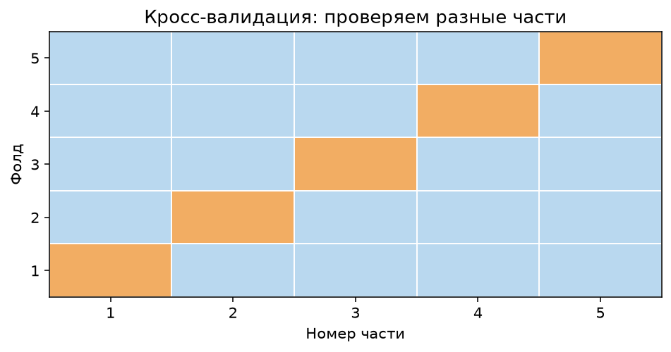
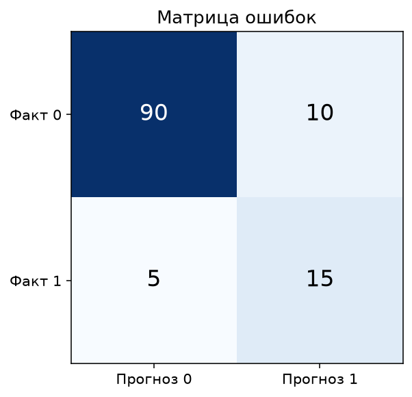
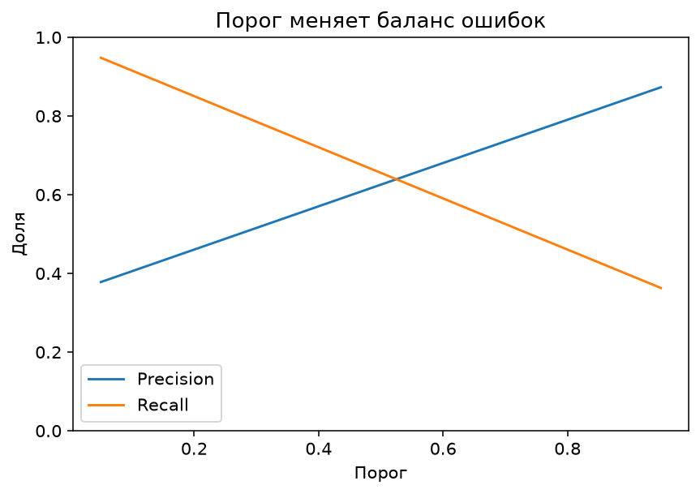
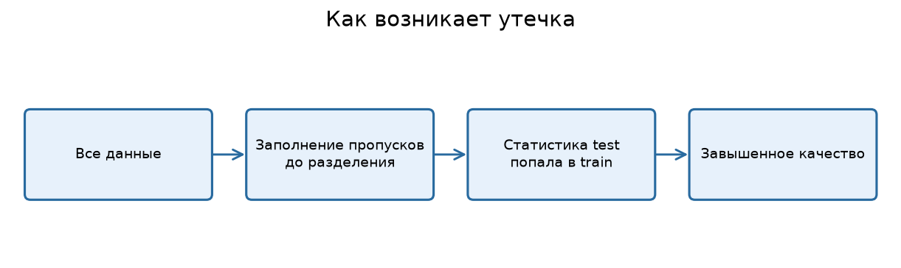

---

# Урок 1. Почему красивая метрика ещё не означает хорошую модель

**Перед началом:** М6–М9, уверенная работа с pandas и scikit-learn.

**После модуля:** ты научишься честно проверять модели, подбирать метрики под бизнес-задачу, избегать утечек данных и строить полезные признаки, не подглядывая в правильный ответ.

**Запуск примеров:** см. [инструкцию к теме](README.md#как-запускать-примеры).

Пожалуй, это один из самых важных модулей для первой ML-работы. Обучить бустинг можно за несколько строк. Гораздо сложнее понять, можно ли вообще доверять полученному результату.

Представь, что ты нашёл модель с точностью 99%. Хочется сразу поставить её в портфолио и написать «разработал искусственный интеллект с точностью 99%».

Но сначала нужно задать неудобные вопросы. На каких данных измеряли точность? Был ли там тот же пользователь, что и в обучении? Использовала ли модель сведения из будущего? Какую проблему вообще решает метрика accuracy? Не опаздывают ли наши данные за реальным миром?

**Validation** - это не просто пункт технического чек-листа. Это способ не обмануть самого себя.

## 1.1. Три набора данных и три разных задачи

- **Train:** алгоритм подбирает веса, деревья и другие обучаемые параметры.
- **Validation:** мы сравниваем модели, выбираем гиперпараметры, признаки и рабочий порог.
- **Test:** один раз оцениваем окончательно зафиксированный вариант.

Если многократно менять модель после просмотра test, он постепенно превращается в ещё один validation и перестаёт быть независимым.

## 1.2. Почему значение метрики зависит от цели?

Рассмотрим две задачи.

**Предсказание цены квартиры.** Ошибка на 0.5 млн ₽ - числовая. Нам подходят MAE, RMSE и другие регрессионные метрики.

**Поиск мошенничества.** Ошибки другого типа: можно пропустить мошенника или зря заблокировать обычную операцию. Нам нужны метрики классификации и понимание цены каждого вида ошибки.

Не бывает одной универсальной метрики, подходящей для любой задачи.

## 1.3. Базовый принцип эксперимента

Сначала формулируем **вопрос**, затем выбираем **метрику**, затем определяем **схему проверки**, и только потом обучаем модели. Если действовать наоборот, можно случайно выбрать ту метрику, на которой уже обученная модель выглядит наиболее выигрышно.

**Проверь себя**

Для задач «стоимость квартиры», «мошенничество», «прогноз продаж» придумай по одной основной метрике и по одному типу ошибки, который особенно дорог для бизнеса.

---

# Урок 2. Как разделять данные: holdout, cross-validation, группы и время

## 2.1. Простой holdout

Мы уже использовали `train_test_split`. Например:

```python
import pandas as pd
from sklearn.model_selection import train_test_split

customers = pd.read_csv("Данные/shop_customers.csv")
X = customers.drop(columns=["user_id", "device", "bought_next_7d"])
y = customers["bought_next_7d"]

X_dev, X_test, y_dev, y_test = train_test_split(
    X, y, test_size=0.2, random_state=42, stratify=y
)
X_train, X_val, y_train, y_val = train_test_split(
    X_dev, y_dev, test_size=0.25, random_state=42, stratify=y_dev
)
```

Здесь получилось приблизительно 60% train, 20% validation и 20% test. `stratify=y` полезен для классификации, но не предназначен для произвольной непрерывной регрессионной цели.

## 2.2. Зачем нужна кросс-валидация?

Один конкретный train/validation split может оказаться необычно удачным или неудачным. **Кросс-валидация (CV)** позволяет несколько раз менять часть данных, используемую для оценки, и получить более устойчивое представление о результате.

При **KFold** данные делятся на K частей. На каждом шаге одна часть используется для проверки, остальные - для обучения. Каждый объект побывает в валидационной части ровно один раз в стандартном KFold без повторений.

Для классификации часто используется **StratifiedKFold**: он старается сохранять похожие доли классов в каждом разбиении.



## 2.3. Кросс-валидация в scikit-learn

```python
import pandas as pd
from sklearn.model_selection import StratifiedKFold, cross_val_score
from sklearn.pipeline import make_pipeline
from sklearn.preprocessing import StandardScaler
from sklearn.linear_model import LogisticRegression

customers = pd.read_csv("Данные/shop_customers.csv")
X = customers.drop(columns=["user_id", "device", "bought_next_7d"])
y = customers["bought_next_7d"]

cv = StratifiedKFold(n_splits=5, shuffle=True, random_state=42)
model = make_pipeline(StandardScaler(), LogisticRegression(max_iter=1000))

scores = cross_val_score(model, X, y, cv=cv, scoring="roc_auc")
print("ROC-AUC по фолдам:", scores.round(3))
print("Среднее:", round(scores.mean(), 3))
```

Здесь `Pipeline` **заново обучает масштабирование на train-фолде каждого разбиения**. Иначе статистики validation-фолда могли бы попасть в подготовку признаков.

Это учебный пример CV на всём наборе. В полноценном проекте с финальным тестом сначала выделяем **отдельный test**, а CV запускаем **только на development/train-части**.

## 2.4. Когда случайная CV не подходит?

**Повторяющиеся пользователи.** Если один клиент встречается в десяти строках, случайная CV может поместить его историю и в train, и в validation. Иногда нужно разбивать по `user_id` через `GroupKFold`.

**Временные данные.** В продажах за январь–декабрь нельзя обучаться на ноябре и оценивать август, если цель - прогноз будущего. Нужна временная схема: например, `TimeSeriesSplit`.

**Дубли и почти дубли.** Если один и тот же объект скопирован в разных файлах, качество может искусственно повыситься.

**Проверь себя**

Представь 1000 заказов от 100 пользователей, у каждого несколько заказов. Почему простое случайное разделение по строкам может быть менее честным, чем разделение по пользователям?

---

# Урок 3. Метрики регрессии: что означает «ошибка 0.8»?

Мы уже сталкивались с MAE, MSE и RMSE, но теперь разберёмся, какую из них выбрать и как объяснить результат человеку, который не занимается ML.

## 3.1. MAE

**Mean Absolute Error** - средняя абсолютная ошибка:

`MAE = (1/n) · Σ|yᵢ − ŷᵢ|`

Если MAE цены равна `0.8` млн ₽, то средняя абсолютная разница между прогнозом и настоящей ценой на оцениваемых объектах составляет 800 тысяч рублей. Это не обещает, что каждый отдельный прогноз ошибается меньше чем на 800 тысяч.

## 3.2. MSE и RMSE

**MSE:**

`MSE = (1/n) · Σ(yᵢ − ŷᵢ)²`

**RMSE:**

`RMSE = √MSE`

RMSE измеряется в тех же единицах, что и целевая переменная, и сильнее MAE реагирует на крупные ошибки.

Например, настоящие значения `[5, 7, 9]`, прогнозы `[5, 7, 12]`:

- Абсолютные ошибки: `[0, 0, 3]`, MAE = 1.
- Квадраты ошибок: `[0, 0, 9]`, MSE = 3.
- RMSE = `√3 ≈ 1.73`.

**Ни одна метрика не делает большую ошибку несущественной.** Различие в том, насколько сильно она влияет на итоговое число.

## 3.3. R²

`R² = 1 − Σ(yᵢ − ŷᵢ)² / Σ(yᵢ − ȳ)²`

Он показывает, насколько модель уменьшила сумму квадратов ошибок относительно константного предсказания среднего **истинных ответов оцениваемой выборки**.

`R² = 1` соответствует идеальным прогнозам. `R² = 0` означает уровень такого ориентира. Отрицательное значение означает результат хуже ориентира по сумме квадратов ошибок. Но `R²` нельзя использовать, чтобы напрямую сказать, на сколько рублей ошибается модель.

## 3.4. Программная оценка

```python
from sklearn.metrics import mean_absolute_error, mean_squared_error, r2_score

real = [5, 7, 9]
pred = [5, 7, 12]

mae = mean_absolute_error(real, pred)
mse = mean_squared_error(real, pred)
rmse = mse ** 0.5
r2 = r2_score(real, pred)

print("MAE:", mae)
print("MSE:", mse)
print("RMSE:", rmse)
print("R²:", r2)
```

## 3.5. Сравнение с бизнес-ограничениями

Если компании важно не ошибаться более чем на 2 млн ₽ для дорогих квартир, одного среднего MAE недостаточно. Нужно дополнительно изучить долю ошибок выше 2 млн ₽ и распределение отклонений по группам объектов.

**Проверь себя**

Для `y=[2,4,6]`, `ŷ=[2,5,8]` вычисли MAE, MSE и RMSE. Какую метрику проще объяснить заказчику, если цены выражены в миллионах рублей?

---

# Урок 4. Метрики классификации: матрица ошибок, precision, recall, F1

Представь антифрод-модель банка. Из 100 транзакций 20 мошеннические. Модель правильно обнаружила 18 мошеннических, пропустила 2, но при этом ошибочно отметила 6 обычных.

Разберём результат подробно.

## 4.1. Матрица ошибок

| Реальность / прогноз | «Мошенничество» | «Обычная» |
|---|---:|---:|
| Мошенничество | TP = 18 | FN = 2 |
| Обычная | FP = 6 | TN = 74 |

**TP (true positive)** - нашли мошенничество и это действительно мошенничество.
**FP (false positive)** - ошибочно подняли тревогу.
**FN (false negative)** - пропустили мошенничество.
**TN (true negative)** - правильно распознали обычную операцию.



## 4.2. Accuracy

`Accuracy = (TP + TN) / (TP + FP + FN + TN)`

В нашем случае:

`(18 + 74) / 100 = 92%`

Звучит хорошо, но сколько мошенничеств нашли - accuracy напрямую не говорит.

## 4.3. Precision — точность положительных срабатываний

`Precision = TP / (TP + FP)`

`18 / (18 + 6) = 18/24 = 75%`

Среди предупреждений модели 75% были правильными. Если ложные тревоги дорого обходятся, precision становится важной метрикой.

## 4.4. Recall — полнота обнаружения

`Recall = TP / (TP + FN)`

`18 / (18 + 2) = 18/20 = 90%`

Мы нашли 90% всех настоящих мошеннических операций. Если пропуск мошенничества крайне дорог, recall особенно важен.

## 4.5. F1-score

`F1 = 2 · Precision · Recall / (Precision + Recall)`

В нашем случае:

`F1 = 2 × 0.75 × 0.9 / 1.65 ≈ 0.818`

F1 - гармоническое среднее precision и recall. Оно полезно, когда важен баланс этих двух характеристик, но **не учитывает напрямую денежную стоимость FP и FN**.

## 4.6. Важен положительный класс

Если мы считаем положительным классом «покупка», то TP - это правильно предсказанная покупка. Если поменяем положительный класс, смысл precision и recall изменится.

При оценке всегда подписывай, **какое событие считается положительным**.

**Проверь себя**

Для TP=30, FP=10, FN=20, TN=140 вручную вычисли accuracy, precision и recall. Какая метрика важнее, если компания боится пропустить опасное событие?

---

# Урок 5. Вероятности, ROC-AUC, PR-AUC и выбор порога

Классификатор часто возвращает **оценку вероятности**. Но для действия - показать рекомендацию, отправить сообщение или проверить транзакцию - нужно принять решение о пороге.

## 5.1. Что меняет порог?

Если положительный класс - мошенничество, то:

- **Низкий порог:** отмечаем больше операций; обычно растёт recall, но ложных тревог тоже становится больше.
- **Высокий порог:** отмечаем меньше операций; обычно растёт precision, но часть мошенничества можем пропустить.



На рисунке кривые **схематические**. Реальные значения зависят от прогнозов, классов и данных.

## 5.2. ROC-AUC

ROC-кривая показывает отношение **TPR (recall)** к **FPR (доля ложноположительных среди реальных отрицательных)** при разных порогах.

`FPR = FP / (FP + TN)`

ROC-AUC - площадь под ROC-кривой. Её также можно понимать как вероятность того, что случайно выбранный положительный объект получит более высокий скор, чем случайно выбранный отрицательный (с учётом половины веса совпадений). AUC около 0.5 соответствует случайному ранжированию, а 1 - идеальному. Значение зависит от оценок, не от конкретного порога.

## 5.3. PR-AUC и average precision

При очень редком положительном классе ROC-AUC может выглядеть неплохо, даже когда операционная польза ограничена. Поэтому часто смотрят **precision–recall кривую** и `average_precision_score`.

`average_precision_score` в scikit-learn - это **взвешенное среднее precision по шагам роста recall**, а не обязательно площадь, рассчитанная обычным методом трапеций. Это важное техническое различие.

## 5.4. Сравним пороги на validation

```python
import pandas as pd
from sklearn.model_selection import train_test_split
from sklearn.pipeline import make_pipeline
from sklearn.preprocessing import StandardScaler
from sklearn.linear_model import LogisticRegression
from sklearn.metrics import precision_score, recall_score, f1_score

customers = pd.read_csv("Данные/shop_customers.csv")
X = customers.drop(columns=["user_id", "device", "bought_next_7d"])
y = customers["bought_next_7d"]
X_train, X_val, y_train, y_val = train_test_split(
    X, y, test_size=0.25, random_state=42, stratify=y
)
model = make_pipeline(StandardScaler(), LogisticRegression(max_iter=1000))
model.fit(X_train, y_train)
prob_val = model.predict_proba(X_val)[:, 1]

for threshold in [0.2, 0.4, 0.6, 0.8]:
    predicted = (prob_val >= threshold).astype(int)
    print(
        threshold,
        "precision:", round(precision_score(y_val, predicted, zero_division=0), 3),
        "recall:", round(recall_score(y_val, predicted, zero_division=0), 3),
        "F1:", round(f1_score(y_val, predicted, zero_division=0), 3),
    )
```

Это демонстрация подбора порога на **валидационной** части. В полноценном эксперименте сначала отдельно откладывают test, а порог выбирают только по оставшимся данным.

## 5.5. Калибровка вероятностей

Модель может хорошо сортировать покупателей от самых вероятных к наименее вероятным, но систематически завышать их вероятности. Например, говорить «80%», когда реально покупают 50% пользователей с такими оценками.

Поэтому **хороший ROC-AUC не гарантирует хорошие вероятности**. Для решений, основанных на рисках и стоимости ошибок, иногда необходима отдельная калибровка - и делать её также нужно без утечки тестовых данных.

**Проверь себя**

Представь, что банк может проверить вручную только 100 операций в день. Почему здесь разумно оценивать не только accuracy, но и качество **топ-100 предупреждений**?

---

# Урок 6. Feature engineering: создаём новые полезные признаки

**Feature engineering** - создание или преобразование признаков, чтобы модели было проще находить нужные закономерности.

Представим интернет-магазин. У нас есть количество посещений и количество добавлений в корзину. А что, если на одной цифре «добавлений» не видно разницы между человеком, который сделал 2 добавления за 2 визита, и человеком, который сделал 2 добавления за 50 визитов?

Можно создать отношение:

`cart_rate = cart_adds_30d / visits_30d`

## 6.1. Пример в pandas

```python
import pandas as pd
import numpy as np

customers = pd.read_csv("Данные/shop_customers.csv")
customers["cart_rate"] = (
    customers["cart_adds_30d"] / customers["visits_30d"].clip(lower=1)
)
customers["log_avg_check"] = np.log1p(customers["avg_check_rub"])
customers["visits_x_purchases"] = (
    customers["visits_30d"] * customers["purchases_90d"]
)
print(customers[["cart_rate", "log_avg_check", "visits_x_purchases"]].head())
```

Пара замечаний:

- `.clip(lower=1)` защищает от деления на ноль. В настоящем проекте нужно отдельно решить, **что означает ноль посещений** и корректен ли такой приём по смыслу.
- `log1p(x)` вычисляет `ln(1+x)` и часто помогает с сильно скошенными неотрицательными числовыми признаками.
- Произведение двух признаков может описывать взаимодействие между ними.

## 6.2. Дата и время как источник признаков

Из даты заказа можно получить день недели, месяц или сезон. Но доступность даты имеет значение: при прогнозе спроса на завтра календарный день завтрашней даты известен заранее, а фактические продажи завтра - нет.

Например:

```python
sales = pd.read_csv("Данные/daily_sales.csv", parse_dates=["date"])
sales["weekday"] = sales["date"].dt.dayofweek
sales["month"] = sales["date"].dt.month
print(sales[["date", "weekday", "month"]].head())
```

## 6.3. Хороший признак — это не всегда сложная формула

Иногда один простой осмысленный признак полезнее десятка автоматически созданных комбинаций. Но **нельзя** оценивать признаки, многократно подбирая их по окончательному test: так мы подгоняем решение под проверочные ответы.

Кроме того, опасно создавать признаки, напрямую производные от целевой переменной. Например, при прогнозе цены квартиры признак `price_per_m2 = price_mln / area_m2` содержит **сам правильный ответ** и вызовет утечку.

**Проверь себя**

Придумай три новых признака для задачи прогнозирования покупки, которые будут доступны **до** начала прогнозируемых семи дней. Для каждого объясни, какую гипотезу он описывает.

---

# Урок 7. Пропуски, категории и Pipeline без утечек

В реальных таблицах почти всегда есть проблемы: пустые ячейки, опечатки, неизвестные категории, странные значения. Нельзя просто подать любой набор строк и чисел в модель и надеяться, что алгоритм во всём разберётся.

## 7.1. Заполняем пропуски

Если в данных квартир отсутствует время до метро, один из простых вариантов - заполнить его **медианой, посчитанной только на train**.

Почему именно train? Если использовать всю таблицу, мы дадим подготовке данных статистику из test. Это и есть утечка.

## 7.2. Что делать с категориальными признаками?

В нашей таблице `district` хранит район как текст: `центр`, `север`, `юг` и так далее. Линейная модель не умеет напрямую складывать слова с числовыми весами.

Можно применить **One-Hot Encoding**: для каждого района создать отдельную бинарную колонку, например `district_центр = 1` или `0`.

Важно, чтобы категории определялись по обучающим данным, а неизвестный район в test не приводил к ошибке программы.

## 7.3. ColumnTransformer + Pipeline

Вот полноценный пример, где для разных столбцов выполняются разные преобразования. Всё обучение преобразований происходит **внутри Pipeline**.

```python
import pandas as pd
from sklearn.compose import ColumnTransformer
from sklearn.impute import SimpleImputer
from sklearn.pipeline import Pipeline
from sklearn.preprocessing import OneHotEncoder, StandardScaler
from sklearn.linear_model import Ridge
from sklearn.model_selection import train_test_split
from sklearn.metrics import mean_absolute_error

apartments = pd.read_csv("Данные/apartments.csv")
X = apartments.drop(columns=["price_mln"])
y = apartments["price_mln"]

num_cols = ["area_m2", "rooms", "floor", "metro_min", "year_built"]
cat_cols = ["district"]

num_pipe = Pipeline([
    ("imputer", SimpleImputer(strategy="median")),
    ("scaler", StandardScaler()),
])
cat_pipe = Pipeline([
    ("imputer", SimpleImputer(strategy="most_frequent")),
    ("onehot", OneHotEncoder(handle_unknown="ignore")),
])

preprocess = ColumnTransformer([
    ("num", num_pipe, num_cols),
    ("cat", cat_pipe, cat_cols),
])

model = Pipeline([
    ("preprocess", preprocess),
    ("regression", Ridge(alpha=10)),
])

X_train, X_test, y_train, y_test = train_test_split(
    X, y, test_size=0.2, random_state=42
)
model.fit(X_train, y_train)
print("MAE:", round(mean_absolute_error(y_test, model.predict(X_test)), 3))
```

В коде есть сразу три важные идеи: разные преобразования для разных типов признаков, обучение статистик только по train и единый объект модели, который можно применять к новым данным.



## 7.4. Почему «сначала обработать всю таблицу» опасно?

Предположим, мы посчитали медиану `metro_min` по **всем** квартирам, включая тестовые, и только потом разделили данные. Тогда сведения о тесте уже повлияли на признаки обучающих объектов.

При небольших различиях это может почти не изменить метрику, но методологически процедура некорректна. А на некоторых данных такая ошибка даёт сильно завышенную оценку качества.

**Проверь себя**

Нарисуй два порядка действий: неправильный «все данные → заполнить пропуски → split» и правильный «split → обучить заполнение на train → применить к validation/test».

---

# Урок 8. Валидация по группам и времени

Случайные train/test-разбиения удобны, но подходят не для всех задач.

## 8.1. Один пользователь — много событий

Представь, что в таблице каждый заказ - отдельная строка. Один покупатель может иметь десятки заказов.

Если его прошлые и будущие заказы случайно смешать между train и test, модель может научиться запоминать специфику клиента и получить завышенную оценку качества для задачи прогнозирования **новых пользователей**.

В таких случаях используют групповую валидацию, например **GroupKFold**, где все строки одного пользователя находятся в одной стороне каждого разбиения.

```python
from sklearn.model_selection import GroupKFold

# Пример структуры; groups должен содержать идентификатор
# пользователя для КАЖДОЙ строки таблицы заказов.
cv = GroupKFold(n_splits=5)
# Затем передаём groups при вызове cross_val_score(..., groups=...)
# или используем split(X, y, groups) вручную.
```

Замечание: в некоторых версиях scikit-learn при включённой маршрутизации метаданных аргумент `groups` для `cross_val_score` передают через `params={"groups": groups}`. Чтобы избежать путаницы, на начальном уровне можно явно использовать `cv.split(X, y, groups)`.

## 8.2. Временные ряды

При прогнозировании будущих продаж нельзя случайно распределять дни по train/test: так модель может обучиться на будущем и проверить себя на прошлом.

Правильнее организовать проверку хронологически:

- train: январь–август;
- validation: сентябрь–октябрь;
- test: ноябрь–декабрь.

Более точная схема зависит от того, **на какой горизонт** нужен прогноз и как часто в реальной жизни модель переобучается.

## 8.3. Самая опасная утечка — информация из будущего

Допустим, мы прогнозируем, опоздает ли доставка, ещё до отправки заказа. Признак «фактическая дата прибытия» уже раскрывает информацию о результате. Он не существует в момент прогноза и не может использоваться в модели.

Неправильный признак иногда выглядит невинно: «статус закрытия заказа», «фактическая сумма возврата», «оплачен ли заказ через неделю». Поэтому спрашивай для каждого столбца:

**«Смогу ли я реально получить это значение в тот момент, когда модель должна делать прогноз?»**

**Проверь себя**

Для задачи «прогноз продаж завтра» перечисли пять разрешённых признаков и три потенциально опасных. Поясни, почему календарная дата завтрашнего дня обычно допустима, а фактические продажи завтра - нет.

---

# Урок 9. Как вести честный ML-эксперимент

Даже если модель дала хорошую метрику, через неделю ты можешь забыть, с какими параметрами она обучалась, какие признаки были использованы и какое разбиение получилось.

В реальной работе **воспроизводимость** не менее важна, чем единичный результат.

## 9.1. Что нужно фиксировать?

1. Версию и источник данных.
2. Дату и логику формирования обучающей выборки.
3. Список признаков и целевую переменную.
4. Схему train/validation/test и случайные состояния.
5. Обработку пропусков, категорий и числовых значений.
6. Модель, её гиперпараметры и версию библиотек.
7. Метрики и сравнение с baseline.
8. Интерпретацию ошибок и ограничения результата.

Удобно вести простую таблицу экспериментов:

| Эксперимент | Признаки | Модель | Validation MAE | Примечание |
|---|---|---|---|---|
| 1 | Только площадь | Линейная | … | Baseline |
| 2 | 5 числовых | Ridge | … | Добавили признаки |
| 3 | + район | Ridge + OHE | … | Категории |
| 4 | + новые признаки | Boosting | … | Проверить на test |

**Не нужно придумывать значения заранее**: заполняем таблицу результатами собственных запусков.

## 9.2. Что делать после выбора модели?

Сначала выбираем вариант по validation/CV, затем обучаем финальную процедуру на разрешённых данных разработки, после чего **один раз проверяем на test**. В отчёте описываем не только финальные метрики, но и границы применимости.

После внедрения начинается новая история: данные и поведение пользователей меняются, поэтому качество необходимо контролировать со временем. Это называют мониторингом модели.

## 9.3. Чего не нужно писать в портфолио?

Плохое описание:

> «Сделал ML, accuracy 99.9%».

Лучше:

> «Построил модель прогнозирования покупки на синтетическом датасете. Зафиксировал момент прогноза, исключил недоступные признаки, использовал stratified train/validation/test, сравнил с DummyClassifier и оценил precision, recall и ROC-AUC. Выбрал порог по validation; тестовую часть использовал один раз».

Второе описание показывает понимание **процесса**, а не только умение вызвать `fit()`.

---

# Итоги модуля
Ты научился различать train/validation/test, понимать назначение кросс-валидации, выбирать метрики регрессии и классификации, читать матрицу ошибок, сравнивать пороги, создавать признаки и предотвращать утечку через Pipeline.

**Главная идея: модель без честной валидации - это не доказательство решения задачи.** Нужно знать, откуда взялись данные, что именно мы измерили и будет ли эта процедура работать за пределами ноутбука.

---

# Практика: Метрики, validation и feature engineering

**Что понадобится:** Colab или Jupyter, scikit-learn и учебные CSV покупателей и квартир.

**Цель:** выбрать метрику, построить честную схему проверки и подготовить признаки без утечки.

**Как сдавать:** один ноутбук и короткий отчёт с таблицей экспериментов и ограничениями.

## Часть 1. Метрики вручную

### Задание 1. Регрессия

Для `y=[5,7,9]` и `ŷ=[6,6,12]` рассчитай MAE, MSE, RMSE. Объясни единицы измерения всех трёх метрик.

### Задание 2. Матрица ошибок

TP=12, FP=8, FN=3, TN=77. Рассчитай accuracy, precision, recall и F1. Положительный класс - «мошенничество».

### Задание 3. Цена ошибок

Представь две модели антифрода. Первая пропускает 2 мошеннические операции и выдаёт 20 ложных предупреждений; вторая пропускает 6 и выдаёт 5 ложных. Какие дополнительные сведения нужны, чтобы решить, какая лучше для банка?

## Часть 2. Разбиение и валидация

### Задание 4. Holdout

Раздели клиентов на train/validation/test в пропорции 60/20/20. Покажи размер частей и долю положительного класса в каждой. Зафиксируй `random_state`.

### Задание 5. Cross-validation

На development-части запусти `StratifiedKFold(n_splits=5)` для логистической регрессии с масштабированием внутри Pipeline. Выведи метрику ROC-AUC для каждого фолда и её среднее. Почему скореру нельзя показывать статистики из validation-фолда при подготовке train?

### Задание 6. Подбор порога

На validation сравни пороги 0.2, 0.4, 0.6 и 0.8. Построй таблицу precision/recall/F1. Выбери порог под две разные цели: «почти не пропускать покупки» и «не отправлять много лишних предложений».

### Задание 7. Утечка данных

Придумай три признака, которые позволили бы искусственно завысить качество модели покупки, но недоступны в момент прогноза. Объясни, как их обнаружить до обучения.

## Часть 3. Feature engineering и Pipeline

### Задание 8. Отношения и логарифмы

Для покупателей создай `cart_rate` и `log_avg_check`. Проверь, что не появились бесконечные значения. Объясни, как обрабатываются нулевые посещения.

### Задание 9. Пропуски

На данных квартир подсчитай пропуски. Построй Pipeline, который заполняет числовые столбцы медианой **только по train**. Почему вычислять медиану на всей таблице до разделения неправильно?

### Задание 10. Категориальный признак

Добавь `district` в модель цены с помощью `OneHotEncoder(handle_unknown="ignore")`. Сравни validation MAE модели с районом и без района. Объясни, почему нельзя просто назначить районам произвольные числа 1,2,3,4,5 и интерпретировать их как расстояния.

### Задание 11. Лишний признак

Объясни, почему `price_mln / area_m2` нельзя использовать как входной признак для прогноза `price_mln`. Придумай похожий пример утечки для интернет-магазина.

## Часть 4. Финальный проект

### Задание 12. Честный эксперимент

На данных квартир подготовь минимум три модели: DummyRegressor, Ridge и бустинг. Собери повторяемую схему сравнения, выбери метрику заранее, подбери настройки только по validation/CV. Зафиксируй список признаков, обработку пропусков и результаты.

### Задание 13. Финальная проверка

После выбора лучшей модели измерь качество на отложенной тестовой части **один раз**. Сравни test и validation. Если результаты сильно отличаются, перечисли возможные причины, не меняя модель задним числом по тестовому набору.

### Задание 14. Короткий отчёт

Напиши одну страницу: что прогнозировали; откуда данные; момент прогноза; схему разбиения; baseline; лучшие параметры; метрики; три риска использования модели в реальном продукте.

# Финальный вопрос

**Почему модель с чуть худшей метрикой на одной проверке может оказаться более разумным выбором для реального бизнеса?**
