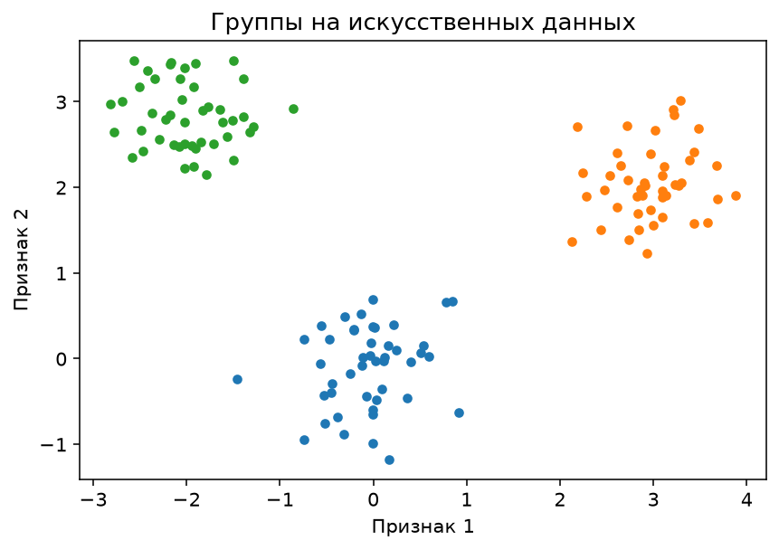
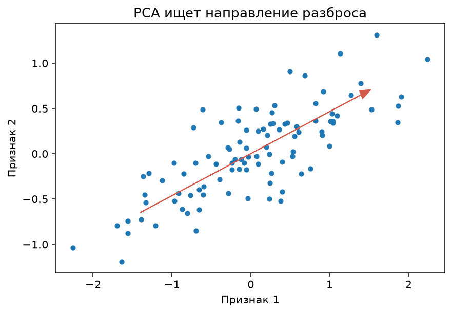
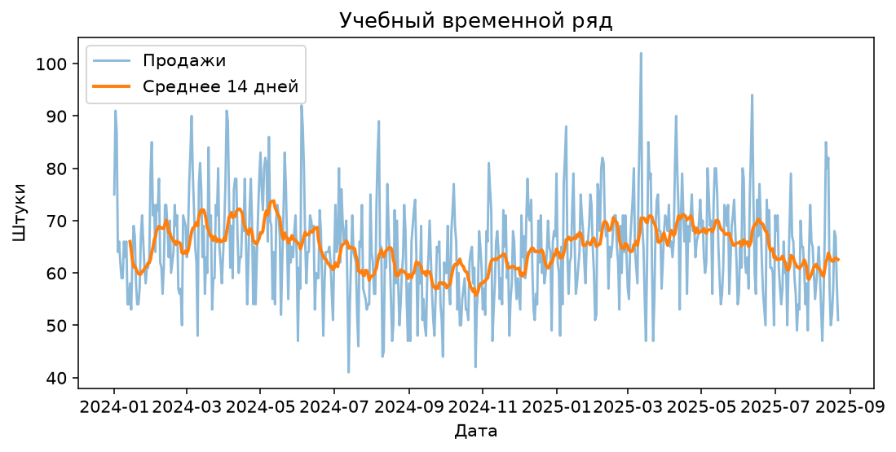
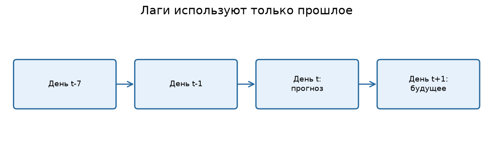
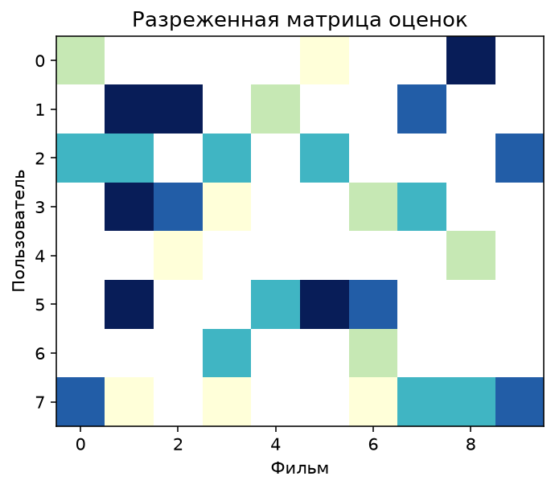

---

**Часть A. Unsupervised ML - обучение без учителя**

# Урок 1. Что такое обучение без учителя?

**Перед началом:** M6–M10, pandas, NumPy, визуализация и базовые модели scikit-learn.

**После модуля:** ты сможешь разделить пользователей на группы без готовых меток, корректно сделать однодневный прогноз продаж и построить простую рекомендательную систему для фильмов.

**Запуск примеров:** см. [инструкцию к теме](README.md#как-запускать-примеры).

Этот модуль объединяет **три направления**: обучение без учителя, прогнозирование временных рядов и рекомендации. У них разные цели и разные правила проверки. Не нужно считать их разновидностями одного алгоритма - их объединяет работа с данными и поиск полезных закономерностей.

До этого почти все наши алгоритмы видели правильные ответы. Мы показывали признаки квартиры и её стоимость; признаки покупателя и факт покупки. Так работает supervised learning.

Но представим другое задание. Компания говорит: «У нас сотни тысяч пользователей. Мы не знаем, какие типы покупателей здесь есть. Найдите интересные группы людей, чтобы маркетологи могли изучить их поведение».

Здесь **нет правильного ответа для каждого пользователя**. Никто заранее не написал «этот клиент - экономный», «этот - активный». Нужно попытаться найти структуру внутри самих признаков. Это и называется **обучением без учителя (unsupervised learning)**.

## 1.1. Основные задачи

**Кластеризация** - группировка похожих объектов. Например, пользователей со схожей активностью и покупательским поведением.

**Снижение размерности** - создание компактного представления данных, которое сохраняет важную часть их структуры. Например, переход от 20 признаков к двум координатам для визуализации.

**Поиск аномалий** - обнаружение необычных объектов, сильно отличающихся от остальных. Например, транзакций с нехарактерными параметрами, которые стоит дополнительно проверить.

**Важно:** необычный объект не обязательно мошеннический, а найденный кластер не обязательно имеет реальный бизнес-смысл.

## 1.2. Чем отличаются X и y?

В классификации покупок у нас были `X` (признаки) и `y` (купил или нет). В кластеризации обучающих ответов **`y` нет**. Есть только `X`: возраст, посещения, покупки, средний чек, добавления в корзину.

Алгоритм создаёт внутренние группы на основании похожести. Названия групп, например «частые покупатели», мы придумываем **после анализа результатов**, а не передаём алгоритму как готовые метки.

## 1.3. Что может пойти не так?

Если включить идентификатор пользователя, алгоритм может группировать людей по бессмысленному номеру. Если не масштабировать признаки, средний чек в рублях будет доминировать над количеством посещений. Если выбрать слишком много кластеров, мы можем получить группы без практической ценности.

Поэтому в unsupervised ML особенно важно сначала понять данные и цель анализа.

**Проверь себя**

Представь таблицу пользователей с возрастом, средним чеком и числом покупок. Какие два признака ты бы выбрал для простой визуализации кластеров? Почему кластеры нельзя автоматически назвать «хорошими» и «плохими» покупателями?

---

# Урок 2. K-Means: группируем пользователей по похожести

Представь точки на плоскости. Часть сосредоточена слева, часть - справа, а ещё одна группа - сверху. Человек легко замечает три «облака». Алгоритм **K-Means** пытается найти похожее разбиение автоматически.



## 2.1. Как работает K-Means?

Мы заранее выбираем число кластеров `k`, например 3. Затем алгоритм повторяет несколько шагов:

1. Выбирает начальные положения центров кластеров.
2. Относит каждый объект к ближайшему центру.
3. Пересчитывает каждый центр как среднее объектов его группы.
4. Повторяет шаги до сходимости или другого условия остановки.

K-Means ищет разбиение, уменьшающее сумму квадратов евклидовых расстояний объектов до центров. Эта величина называется **inertia**.

## 2.2. Почему нужно масштабировать признаки?

Допустим, один признак - количество покупок от 0 до 20, второй - средний чек от 500 до 8000 рублей. Без масштабирования различия в среднем чеке могут доминировать в евклидовом расстоянии.

Поэтому для числовых признаков часто используют `StandardScaler`.

## 2.3. Запустим кластеризацию

```python
import pandas as pd
from sklearn.preprocessing import StandardScaler
from sklearn.cluster import KMeans

customers = pd.read_csv("Данные/shop_customers.csv")
features = ["age", "visits_30d", "purchases_90d", "avg_check_rub", "cart_adds_30d"]
X = customers[features]

scaler = StandardScaler()
X_scaled = scaler.fit_transform(X)

kmeans = KMeans(n_clusters=3, n_init=10, random_state=42)
labels = kmeans.fit_predict(X_scaled)

customers["cluster"] = labels
print(customers.groupby("cluster")[features].mean().round(1))
print(customers["cluster"].value_counts())
```

Мы **не использовали** `bought_next_7d`, потому что это целевая переменная из прежней supervised-задачи. Здесь она не нужна для обучения кластеров. Если после кластеризации мы анализируем долю будущих покупок в группах, это уже отдельная диагностическая проверка, а не разрешение подбирать кластеры по этому ответу без контроля методологии.

## 2.4. Как выбрать k?

Нет волшебного числа, подходящего всем наборам. Можно сравнивать:

- `inertia` при разных `k` (метод «локтя»);
- **silhouette score** - насколько объект ближе к своему кластеру, чем к соседним;
- стабильность групп при изменении выборки;
- понятность и полезность групп для бизнеса.

```python
from sklearn.metrics import silhouette_score

for k in [2, 3, 4, 5, 6]:
    model = KMeans(n_clusters=k, n_init=10, random_state=42)
    labels = model.fit_predict(X_scaled)
    print(k, "inertia:", round(model.inertia_, 1),
          "silhouette:", round(silhouette_score(X_scaled, labels), 3))
```

Высокий silhouette - полезный сигнал, но не доказательство того, что группы имеют бизнес-смысл.

**Проверь себя**

Найди среднее количество посещений и средний чек в каждом кластере. Придумай понятные названия групп. Какие особенности этих названий являются твоей **интерпретацией**, а не готовым ответом алгоритма?

---

# Урок 3. DBSCAN: кластеры без заранее заданного k

K-Means предполагает, что мы заранее выбрали число групп, и обычно лучше работает с достаточно компактными кластерами. Но иногда на плоскости есть вытянутые области, а часть объектов вообще расположена отдельно.

Для таких задач может подойти **DBSCAN** - алгоритм кластеризации на основе плотности.

## 3.1. Основная идея

Представим, что у каждой точки есть небольшая окрестность радиуса `eps`. Если рядом с ней находится достаточно много соседей, точка может стать частью плотной области.

Алгоритм соединяет плотные области в кластеры. Объекты, которые нельзя отнести ни к одной найденной группе, получают метку **`−1`** - шум.

Главные параметры:

- `eps` - радиус окрестности;
- `min_samples` - минимальное число объектов в окрестности для определения основного (core) объекта.

## 3.2. Запускаем DBSCAN

```python
import pandas as pd
from sklearn.cluster import DBSCAN
from sklearn.preprocessing import StandardScaler

customers = pd.read_csv("Данные/shop_customers.csv")
cols = ["visits_30d", "purchases_90d", "avg_check_rub", "cart_adds_30d"]
X_scaled = StandardScaler().fit_transform(customers[cols])

labels = DBSCAN(eps=0.65, min_samples=10).fit_predict(X_scaled)
customers["dbscan_cluster"] = labels
print(customers["dbscan_cluster"].value_counts().sort_index())
```

Здесь `eps=0.65` - **учебный параметр**, не универсальное значение. После масштабирования и для других данных разумный диапазон `eps` может существенно отличаться.

## 3.3. Почему DBSCAN не всегда лучше K-Means?

Потому что алгоритмы делают разные предположения. Если плотность кластеров сильно отличается, DBSCAN может объединять группы или помечать слишком много точек как шум. В очень многомерном пространстве понятие «ближайшего соседа» тоже становится менее информативным.

Метка `−1` **не означает мошенничество, брак или ошибку**. Она всего лишь говорит, что алгоритм не отнёс объект к плотному кластеру при выбранных параметрах.

**Проверь себя**

Измени `eps` на 0.4 и 1.0. Сколько стало кластеров и объектов с меткой −1? Почему нельзя выбирать `eps` только потому, что при нём получилось «красивое число групп»?

---

# Урок 4. PCA: как увидеть многомерные данные

В М1 мы говорили о векторах из сотен признаков. На двухмерном графике нельзя напрямую нарисовать объект с 200 координатами. Поэтому иногда полезно перевести данные в пространство меньшей размерности.

Один из самых известных методов - **PCA, метод главных компонент**.

## 4.1. Идея PCA

Представь облако точек, вытянутое по диагонали. Если провести ось вдоль самой длинной стороны облака и спроецировать на неё точки, мы сохраним значительную часть их изменчивости одним числом вместо двух.



PCA ищет ортогональные направления максимальной дисперсии. Эти направления называются **главными компонентами**. Первые компоненты сохраняют наибольшую долю дисперсии в рамках используемого линейного преобразования.

Но PCA **не знает** целевую переменную. Большая дисперсия не обязана означать полезность признака для конкретного прогноза.

## 4.2. Используем PCA для двумерной визуализации

```python
import pandas as pd
import matplotlib.pyplot as plt
from sklearn.preprocessing import StandardScaler
from sklearn.decomposition import PCA
from sklearn.cluster import KMeans

customers = pd.read_csv("Данные/shop_customers.csv")
cols = ["age", "visits_30d", "purchases_90d", "avg_check_rub", "cart_adds_30d"]
X_scaled = StandardScaler().fit_transform(customers[cols])

pca = PCA(n_components=2)
points = pca.fit_transform(X_scaled)
labels = KMeans(n_clusters=3, n_init=10, random_state=42).fit_predict(X_scaled)

print("Доли объяснённой дисперсии:", pca.explained_variance_ratio_.round(3))
plt.scatter(points[:, 0], points[:, 1], c=labels, s=12, alpha=0.6)
plt.xlabel("Первая главная компонента")
plt.ylabel("Вторая главная компонента")
plt.show()
```

Обрати внимание: **кластеризуем здесь в исходном стандартизованном пространстве**, а PCA используем для картинки. Так группы на плоскости показывают лишь проекцию - на исходных пяти признаках они могут выглядеть иначе.

## 4.3. Как оценить качество сокращения?

Например, если две компоненты объясняют 60% дисперсии, значит, в этом линейном представлении сохранено 60% общей изменчивости, а не «60% полезной информации для покупки». Эти утверждения не равнозначны.

Если используем PCA как часть supervised-модели, обучать его нужно **только на train**, внутри Pipeline. Иначе получится утечка статистики тестовой части.

**Проверь себя**

Сравни `PCA(n_components=2)` и `PCA(n_components=3)`. Как меняется сумма `explained_variance_ratio_`? Почему она не обязана совпадать с качеством будущей классификации?

---

# Урок 5. Поиск аномалий: что делать с необычными объектами?

Представь клиента, который обычно покупает на небольшие суммы, а сегодня за короткое время совершил несколько крупных операций. Такое поведение выглядит необычным. Но сам по себе необычный объект ещё не мошенник.

**Anomaly detection** ищет наблюдения, отличающиеся от основной массы данных по определённому алгоритмом критерию.

## 5.1. Isolation Forest

В библиотеке scikit-learn есть алгоритм **IsolationForest**. Он многократно случайным образом разбивает пространство признаков. Изолировать необычную точку часто удаётся за меньшее число разбиений, чем типичную.

```python
import pandas as pd
from sklearn.ensemble import IsolationForest
from sklearn.preprocessing import StandardScaler

customers = pd.read_csv("Данные/shop_customers.csv")
cols = ["visits_30d", "purchases_90d", "avg_check_rub", "cart_adds_30d"]
X_scaled = StandardScaler().fit_transform(customers[cols])

model = IsolationForest(contamination=0.03, random_state=42)
labels = model.fit_predict(X_scaled)

customers["is_unusual"] = labels == -1
print("Необычных пользователей:", int(customers["is_unusual"].sum()))
```

`contamination=0.03` задаёт предположение об ожидаемой доле выбросов для определения порога. **Это не оценка настоящей доли мошенников** и не гарантированная частота реальных аномалий.

## 5.2. Что делать после обнаружения?

Нужно изучить объекты и проверить, нет ли ошибок сбора данных, редких нормальных сценариев или действительно рискованных ситуаций. При высоких последствиях автоматическое наказание пользователя на основе одной метки аномальности недопустимо.

## 5.3. Unsupervised-метрики не равны бизнес-успеху

У K-Means есть inertia, у кластеризации silhouette, у IsolationForest - собственный скор аномальности. Но ни один из этих показателей напрямую не гарантирует прироста выручки или обнаружения реальных мошеннических операций.

Нужны предметная интерпретация и, где возможно, проверка на размеченных случаях или дальнейший эксперимент.

**Проверь себя**

Измени `contamination` на 0.01 и 0.05. Как меняется число отмеченных пользователей? Почему это не доказывает, что новый параметр «лучше»?

---

**Часть B. Time series - временные ряды**

# Урок 6. Временные ряды: почему даты меняют всё?

Представь, что интернет-магазин хочет узнать, сколько заказов будет завтра. У нас есть продажи за предыдущие 600 дней. Казалось бы, можно передать эти данные в обычную модель регрессии.

Но у временных рядов есть важная особенность: **порядок наблюдений имеет смысл**. Продажи вчера могут помочь предсказать продажи завтра, а продажи следующего месяца пока недоступны.

## 6.1. Из чего состоит временной ряд?

В продажах часто встречаются:

- **Тренд:** постепенный рост или снижение спроса.
- **Сезонность:** повторение закономерностей по дням недели, месяцам или праздникам.
- **Шум:** колебания, которые мы не можем полностью объяснить.
- **События:** акции, отключения сервиса, специальные кампании.



## 6.2. Посмотрим на данные

```python
import pandas as pd
import matplotlib.pyplot as plt

sales = pd.read_csv("Данные/daily_sales.csv", parse_dates=["date"])
sales = sales.sort_values("date").reset_index(drop=True)

plt.figure(figsize=(12, 4))
plt.plot(sales["date"], sales["sales_units"], label="Продажи", alpha=.65)
plt.plot(sales["date"], sales["sales_units"].rolling(14).mean(),
         label="Среднее за 14 дней")
plt.legend()
plt.show()
```

В таблице есть `promo_planned` - признак запланированной акции. Мы будем считать его **известным заранее**, как будто маркетологи утвердили календарь кампаний до момента прогноза. Если в реальной компании акции назначаются только после просмотра будущего спроса, такой признак потребует отдельной проверки на доступность.

## 6.3. Какой именно прогноз нам нужен?

Это ключевой вопрос.

**One-step forecast:** каждый вечер у нас известны сегодняшние продажи, завтра прогнозируем только следующий день.

**Multi-step forecast:** сегодня прогнозируем сразу следующие 30 дней, не имея фактических продаж внутри этого периода.

Это разные задачи. Метод, который использует фактические вчерашние продажи для каждого дня тестового периода, подходит для проверки **последовательного однодневного прогнозирования**, но не для честной оценки прогноза сразу на 30 дней вперёд.

**Проверь себя**

Придумай два примера сезонности: недельную и годовую. Почему продажа в пятницу может быть полезной для прогноза будущей пятницы, но реальная продажа **завтра** не может быть признаком, известным сегодня?

---

# Урок 7. Лаги и скользящие статистики: как превратить ряд в таблицу

Обычные ML-модели ожидают таблицу признаков. А у временного ряда может быть только дата и одно значение продаж. Чтобы использовать регрессию или бустинг, мы создаём признаки из **прошлых значений**.

## 7.1. Лаги

**Лаг 1** - продажи предыдущего дня.
**Лаг 7** - продажи семь дней назад.
**Лаг 14** - продажи две недели назад.

Например, если продажи были `[10, 12, 9, 15]`, то для четвёртого дня `lag_1=9`, а `lag_2=12`.



## 7.2. Создадим лаги в pandas

```python
import pandas as pd

sales = pd.read_csv("Данные/daily_sales.csv", parse_dates=["date"])
sales = sales.sort_values("date").reset_index(drop=True)

sales["lag_1"] = sales["sales_units"].shift(1)
sales["lag_7"] = sales["sales_units"].shift(7)
sales["lag_14"] = sales["sales_units"].shift(14)
sales["weekday"] = sales["date"].dt.dayofweek

print(sales[["date", "sales_units", "lag_1", "lag_7"]].head(10))
```

Первые строки будут содержать пропуски: например, для самого первого дня в нашей таблице нет предыдущего дня.

## 7.3. Скользящее среднее — осторожно!

Можно добавить среднее продаж за предыдущие семь дней. Но важно не включить **сам день, который мы пытаемся предсказать**.

Правильная запись для one-step forecast:

```python
sales["rolling_mean_7"] = sales["sales_units"].shift(1).rolling(7).mean()
```

Сначала `shift(1)` переносит информацию так, чтобы в строке дня `t` находились значения, доступные до дня `t`. Затем `rolling(7)` берёт семь прошлых наблюдений.

Опасная запись для такой задачи:

```python
# НЕЛЬЗЯ для прогноза продаж самого дня t:
# sales["rolling_mean_7"] = sales["sales_units"].rolling(7).mean()
```

Здесь скользящее среднее включает сами продажи дня `t`, которые являются правильным ответом. Получается утечка.

## 7.4. Что делать с пропусками после сдвига?

Обычно первые строки без нужной истории удаляют или обрабатывают отдельно. Например, при `lag_14` первые 14 дней не имеют этого признака.

```python
features = ["lag_1", "lag_7", "lag_14", "rolling_mean_7", "weekday", "promo_planned"]
prepared = sales.dropna(subset=features).copy()
print(prepared[features].head())
```

**Проверь себя**

Для ряда `[10, 12, 9, 15, 13]` запиши вручную lag_1 и среднее за предыдущие два дня для четвёртого и пятого дней. Почему сначала нужно делать `shift`, а потом `rolling`?

---

# Урок 8. Правильная проверка временного прогноза и простые baseline

Одна из самых частых ошибок в прогнозировании - случайно перемешать даты при train/test split. Для временных рядов это может означать обучение на будущем.

## 8.1. Разделяем по хронологии

Мы будем проверять сценарий: каждый день вечером становится известна фактическая продажа этого дня, а на следующий день нужно дать **однодневный прогноз**.

Для этого допустимо, что прогноз для позднего дня тестового периода использует фактические продажи более ранних тестовых дней - к тому моменту они уже были известны. Это **пошаговая one-step оценка**, а не прогноз всех тестовых дней сразу из одной точки времени.

## 8.2. Наивные модели

До сложного бустинга полезно попробовать очень простые правила:

**Naive:** «завтра будет столько же продаж, сколько вчера».
**Seasonal naive:** «завтра будет столько же, сколько в аналогичный день неделю назад».

Если сложная модель не может улучшить такой baseline, возможно, она нам пока не нужна.

## 8.3. Посчитаем MAE baseline

```python
import pandas as pd
from sklearn.metrics import mean_absolute_error

sales = pd.read_csv("Данные/daily_sales.csv", parse_dates=["date"])
sales = sales.sort_values("date").reset_index(drop=True)

sales["lag_1"] = sales["sales_units"].shift(1)
sales["lag_7"] = sales["sales_units"].shift(7)
prepared = sales.dropna().copy()

# Последние 90 дней — последовательный период проверки.
train = prepared.iloc[:-90]
test = prepared.iloc[-90:]

print("Naive MAE:", round(mean_absolute_error(test["sales_units"], test["lag_1"]), 2))
print("Seasonal naive MAE:", round(mean_absolute_error(test["sales_units"], test["lag_7"]), 2))
```

Здесь `lag_1` и `lag_7` рассчитаны по **предыдущим фактическим продажам**; это соответствует нашему сценарию ежедневного обновления информации.

## 8.4. Backtesting

Чтобы оценка не зависела от одного последнего участка, можно повторить эксперимент для нескольких последовательных периодов:

- обучаемся на ранних данных;
- проверяем следующие дни;
- сдвигаем границу вперёд;
- повторяем.

Такую процедуру называют **backtesting**, или историческое тестирование прогноза. В scikit-learn для определённых схем подходит `TimeSeriesSplit`.

```python
from sklearn.model_selection import TimeSeriesSplit

cv = TimeSeriesSplit(n_splits=4)
for train_idx, val_idx in cv.split(prepared):
    print("Train:", len(train_idx), "Validation:", len(val_idx))
```

При регулярном дневном ряде такой способ помогает строить последовательные разбиения. Если данные нерегулярны или прогноз имеет особый горизонт, границы нужно продумать отдельно.

**Проверь себя**

Сравни три способа проверки будущих продаж: случайное перемешивание дней, разделение «первые 80% / последние 20%», несколько последовательных временных фолдов. Какой наиболее соответствует реальному прогнозу и почему?

---

# Урок 9. Обучаем модель прогноза продаж

Теперь у нас есть признаки из прошлого: лаги, скользящее среднее, день недели и известные заранее акции. Значит, можно обучить обычную регрессионную ML-модель.

## 9.1. Подготовка данных

```python
import pandas as pd
from sklearn.ensemble import HistGradientBoostingRegressor
from sklearn.metrics import mean_absolute_error

sales = pd.read_csv("Данные/daily_sales.csv", parse_dates=["date"])
sales = sales.sort_values("date").reset_index(drop=True)

sales["lag_1"] = sales["sales_units"].shift(1)
sales["lag_7"] = sales["sales_units"].shift(7)
sales["lag_14"] = sales["sales_units"].shift(14)
sales["rolling_mean_7"] = sales["sales_units"].shift(1).rolling(7).mean()
sales["weekday"] = sales["date"].dt.dayofweek

features = ["lag_1", "lag_7", "lag_14", "rolling_mean_7", "weekday", "promo_planned"]
prepared = sales.dropna(subset=features).copy()

train = prepared.iloc[:-90]
test = prepared.iloc[-90:]

X_train, y_train = train[features], train["sales_units"]
X_test, y_test = test[features], test["sales_units"]
```

## 9.2. Обучаем бустинг

```python
model = HistGradientBoostingRegressor(
    max_iter=150,
    learning_rate=0.06,
    max_leaf_nodes=10,
    min_samples_leaf=10,
    random_state=42,
)
model.fit(X_train, y_train)
pred = model.predict(X_test)

print("Boosting MAE:", round(mean_absolute_error(y_test, pred), 2))
print("Seasonal naive MAE:", round(mean_absolute_error(y_test, test["lag_7"]), 2))
```

Если бустинг оказался лучше сезонного baseline, это ещё не повод сразу внедрять модель. Нужно проверить устойчивость на других временных периодах и учесть фактический горизонт прогноза.

## 9.3. Критически важная оговорка

В данном коде `lag_1`, `lag_7` и rolling-статистика для поздних тестовых дней используют фактические продажи более ранних тестовых дней. **Это корректно только для поставленной задачи: каждый день прогнозируем следующий, когда предыдущие продажи уже известны.**

Если хотим утром 1 ноября предсказать **весь следующий месяц**, фактических продаж 2, 3, … ноября у нас нет. Тогда нужен другой подход: рекурсивные прогнозы, прямая модель на горизонт или отдельная стратегия многократного прогнозирования.

## 9.4. Какие ещё проблемы бывают?

- Праздники и акции могут менять закономерности.
- Задержки данных могут делать вчерашние продажи недоступными вовремя.
- Резкие внешние события создают структурные сдвиги.
- У разных товаров может быть разный уровень сезонности.
- Важна не только средняя ошибка, но и ошибка на пиковых днях.

**Проверь себя**

Построй график «реальные продажи против прогноза» на последних 90 днях. Найди три даты с наибольшей абсолютной ошибкой и попробуй предположить возможную причину.

---

**Часть C. Рекомендательные системы (recsys)**

# Урок 10. Как работают рекомендации: популярность, контент и поведение

Когда открываешь онлайн-кинотеатр, ты видишь список фильмов, которые могут тебя заинтересовать. Откуда система знает, что показывать?

Есть несколько подходов, и прежде чем строить сложную модель, нужно понять, **какая информация о пользователях и товарах доступна**.

## 10.1. Популярное — самый простой baseline

Начнём с рекомендации самых популярных фильмов. Это не персонализированная система, но понятный ориентир. Если продвинутый рекомендатель не даёт пользователям ничего полезнее популярного списка, его сложность может быть неоправданна.

## 10.2. Content-based рекомендации

Мы рекомендуем объекты, похожие по **содержанию**: жанрам, описаниям, тегам и другим характеристикам самих фильмов.

Например, если пользователю понравилась история о космической экспедиции, можно рекомендовать фильмы, где тоже встречаются темы космоса и путешествий. Для этого тексты превращают в числовые представления и сравнивают их сходство.

Здесь нам снова пригодится косинусное сходство из М1.

## 10.3. Collaborative filtering

Другой подход использует **поведение пользователей**: оценки, просмотры, добавления в избранное, покупки.

Если два пользователя часто любят одни и те же фильмы, интересы одного могут помочь рекомендовать что-то другому. Или если два фильма получают похожие оценки от многих пользователей, их можно считать похожими по взаимодействиям, даже если жанры разные.

## 10.4. Матрица пользователь × объект



Каждая строка - пользователь, каждый столбец - фильм. Внутри - оценка или факт взаимодействия.

**Пустая ячейка не означает «не понравилось».** Человек мог просто никогда не видеть фильм. Это принципиально важно для построения и проверки рекомендательных систем.

## 10.5. Проблема холодного старта

Что предложить новому пользователю, о котором ещё ничего неизвестно? А новый фильм, который никто ещё не смотрел?

Это называется **cold start**. Популярность, информация о контенте, короткое анкетирование и другие сигналы помогают справляться с ним, но универсального решения нет.

**Проверь себя**

Придумай, какие рекомендации ты бы показывал пользователю кинотеатра в трёх случаях: он только зарегистрировался; он оценил десять фантастических фильмов; у тебя есть новый фильм без оценок.

---

# Урок 11. Первый content-based рекомендатель на текстах

Попробуем построить рекомендации, используя описания фильмов. Для этого воспользуемся небольшим учебным каталогом `movies.csv`.

## 11.1. От текста к числам: TF-IDF

Модель не умеет напрямую сравнивать смысл строк на русском языке. Один из простейших инструментов - **TF-IDF**, который превращает текст в вектор весов слов.

Интуиция: слово, которое часто встречается в конкретном описании, но редко встречается во всём каталоге, может быть более информативным, чем очень распространённое слово.

Это не полноценное понимание смысла, а статистическое представление текстов. Но для учебного рекомендателя его вполне достаточно.

## 11.2. Считаем сходство фильмов

```python
import pandas as pd
import numpy as np
from sklearn.feature_extraction.text import TfidfVectorizer
from sklearn.metrics.pairwise import cosine_similarity

movies = pd.read_csv("Данные/movies.csv")
texts = movies["genre"] + " " + movies["description"]

vectorizer = TfidfVectorizer()
X_text = vectorizer.fit_transform(texts)

# Возьмём первый фильм и найдём наиболее похожие.
seed_index = 0
similarity = cosine_similarity(X_text[seed_index], X_text).ravel()
similarity[seed_index] = -1  # Не рекомендуем сам фильм себе.

best_indices = np.argsort(similarity)[::-1][:5]
print("Похожи на:", movies.iloc[seed_index]["title"])
print(movies.iloc[best_indices][["title", "genre"]])
```

Мы превратили описания в числовые векторы и сравнили их с помощью **косинусного сходства**. Это напрямую связывает рекомендательные системы с линейной алгеброй из М1.

## 11.3. Что умеет и чего не умеет такой рекомендатель?

**Плюсы:** способен рекомендовать новый фильм, если его описание уже есть; не требует больших историй просмотров.

**Минусы:** зависит от качества текста и словаря; не знает, как другие зрители реально реагируют на фильм; может рекомендовать слишком много похожего и упускать неожиданно интересные варианты.

Например, слова «путешествие в космос» и «межпланетная экспедиция» могут выражать похожую идею, но обычный TF-IDF не всегда считает их близкими, если слова не совпадают.

**Проверь себя**

Поменяй `seed_index` и найди рекомендации для комедии, детектива и драмы. Какие из них кажутся логичными? Какой подход лучше подходит для нового фильма без рейтингов: content-based или чистый collaborative filtering?

---

# Урок 12. Collaborative filtering: рекомендуем по оценкам пользователей

Теперь допустим, у нас есть настоящие оценки: кто какие фильмы смотрел и сколько звёзд поставил. Мы можем искать фильмы со **схожими профилями оценок**.

## 12.1. Создадим матрицу оценок

```python
import pandas as pd

ratings = pd.read_csv("Данные/movie_ratings.csv")
movies = pd.read_csv("Данные/movies.csv")

matrix = ratings.pivot_table(
    index="user_id",
    columns="item_id",
    values="rating",
    aggfunc="mean",
)
print(matrix.iloc[:5, :6])
```

В таблице много пропусков - не каждый пользователь оценил каждый фильм. Это нормально.

## 12.2. Похожесть фильмов по оценкам

Для первого знакомства применим грубое упрощение: временно заполним пропуски нулями и посчитаем косинусное сходство между **столбцами фильмов**.

```python
import numpy as np
from sklearn.metrics.pairwise import cosine_similarity

item_vectors = matrix.fillna(0).T  # Строки — фильмы, столбцы — пользователи
item_ids = item_vectors.index.to_list()
sim = cosine_similarity(item_vectors)

seed_item = 1
seed_idx = item_ids.index(seed_item)
scores = sim[seed_idx].copy()
scores[seed_idx] = -1

best = np.argsort(scores)[::-1][:5]
recommended_ids = [item_ids[i] for i in best]

print("Похожие фильмы:")
print(movies[movies["item_id"].isin(recommended_ids)][["title", "genre"]])
```

Это **упрощённая демонстрация**, а не готовая промышленная рекомендация. Заполнение пропусков нулями искусственно приравнивает «не оценивал» к числу 0, хотя в исходной шкале рейтингов это значение вообще не является реальной оценкой. Такой подход может искажать сходства.

Более качественные методы учитывают разреженность матрицы, популярность объектов, индивидуальные привычки пользователей и другие особенности данных.

## 12.3. User-based и item-based подходы

**User-based:** ищем похожих пользователей и предлагаем то, что понравилось им.
**Item-based:** ищем похожие объекты и предлагаем их на основании уже понравившихся фильмов.

На больших наборах часто используют более сложные подходы: матричную факторизацию, модели неявной обратной связи, двухбашенные нейросети и гибридные системы. Но вся эта сложность вырастает из простой идеи: **пользователи и объекты связаны через взаимодействия**.

**Проверь себя**

Объясни, почему отсутствие оценки фильма не равно отрицательной оценке. Как может повлиять на результаты то, что один фильм очень популярен, а другой оценили лишь два человека?

---

# Урок 13. Как проверять рекомендательные системы?

У рекомендации есть особая проблема. Мы не можем просто предсказать среднюю оценку всех фильмов и радоваться небольшой ошибке. Пользователю обычно показывают **несколько объектов вверху списка**.

Поэтому важно оценивать **качество ранжирования**.

## 13.1. Precision@K

Представим, что пользователь позже действительно заинтересовался тремя фильмами. Мы показали ему топ-5 рекомендаций, из которых два вошли в эту тройку.

Тогда:

`Precision@5 = 2 / 5 = 40%`

То есть 40% показанных в топ-5 фильмов оказались релевантными по выбранному критерию.

## 13.2. Recall@K

Если всего релевантных фильмов три, а мы нашли два из них:

`Recall@5 = 2 / 3 ≈ 66.7%`

Эти две метрики отвечают на разные вопросы: «какая доля показанных хорошая?» и «какую долю всех интересных мы нашли?».

## 13.3. Как устроена честная проверка?

В идеале для каждого пользователя нужно отделять **прошлые взаимодействия** от будущих. Модель получает только прошлое и рекомендует то, с чем пользователь столкнётся позднее. Если случайно использовать в тренировке уже известные будущие оценки, мы получим утечку.

Наш маленький `movie_ratings.csv` полезен для механики collaborative filtering, но не является полноценным реальным логом взаимодействий с датами и показами. Поэтому на нём мы можем тренировать расчёты, однако **не следует объявлять полученные offline-метрики доказательством промышленной пользы**.

## 13.4. Почему offline-метрики не отражают всю картину?

Рекомендатель сам влияет на то, что увидят люди. Если фильм никому не показывали, никто не мог его оценить. Это смещение наблюдений, и оно затрудняет оценку рекомендаций по одной только истории кликов.

При внедрении часто проверяют также разнообразие рекомендаций, покрытие каталога, новизну, долю повторных просмотров и результаты контролируемых онлайн-экспериментов.

**Проверь себя**

Пользователю показали 5 рекомендаций. Из них релевантны 3. Всего у пользователя 6 релевантных фильмов. Посчитай Precision@5 и Recall@5. Почему эти метрики не обязательно одинаковы?

---

# Урок 14. Как объединить навыки: три настоящих мини-проекта

После М11 ты умеешь решать три разных класса задач. Для портфолио необязательно делать все три сразу - лучше выбрать один, довести до понятного результата и аккуратно описать ограничения.

## 14.1. Проект A: сегментация покупателей

**Задача:** получить осмысленные группы пользователей интернет-магазина.

Шаги:

1. Выбрать исторические признаки без целевой переменной.
2. Масштабировать числовые значения.
3. Сравнить K-Means с несколькими k и DBSCAN.
4. Исследовать silhouette, размер групп и распределение признаков.
5. Построить двумерную визуализацию через PCA.
6. Описать, какие действия бизнес мог бы **проверить**, а не автоматически назначать на основании группы.

**Результат:** сегменты с описаниями и ограничениями метода.

## 14.2. Проект B: ежедневный прогноз продаж

**Задача:** вечером, зная продажи сегодняшнего дня, предсказать продажи завтра.

Шаги:

1. Понять тренд и сезонность.
2. Создать лаги и rolling-статистики без утечки.
3. Провести хронологическое разбиение.
4. Сравнить naive, seasonal naive и бустинг.
5. Проверить качество на нескольких временных окнах.
6. Отдельно рассмотреть праздничные и акционные дни.

**Результат:** воспроизводимый однодневный прогноз с описанием того, какие данные доступны в момент предсказания.

## 14.3. Проект C: рекомендатель фильмов

**Задача:** по понравившемуся фильму предложить похожие.

Шаги:

1. Загрузить каталог и описания.
2. Сделать популярностный baseline по числу оценок.
3. Построить content-based рекомендации через TF-IDF.
4. Сделать простой item-based collaborative пример.
5. Сравнить рекомендации качественно на нескольких фильмах.
6. Показать ограничения: cold start, пропуски, отсутствие настоящей временной валидации.

**Результат:** прототип рекомендаций и честный разбор его слабых сторон.

---

# Итоги модуля
В этом модуле мы вышли за пределы привычной классификации и регрессии.

**Unsupervised ML** помогает находить структуру данных, когда правильные ответы заранее неизвестны.
**Временные ряды** требуют особого отношения к порядку наблюдений и доступности прошлых значений.
**Рекомендательные системы** помогают выбирать и ранжировать объекты, используя содержание и историю взаимодействий.

Эти направления показывают, насколько широким может быть машинное обучение. Но во всех случаях работают знакомые правила: сначала понять задачу, затем данные, затем baseline, затем подходящий алгоритм и честная проверка.

**Главная мысль:** хорошее решение - не обязательно самый сложный алгоритм. Это метод, который действительно соответствует данным, ограничениям и цели продукта.

---

# Практика: Unsupervised ML, временные ряды и рекомендации

**Что понадобится:** Colab или Jupyter и учебные CSV покупателей, продаж, фильмов и оценок.

**Цель:** потренироваться в кластеризации, временном прогнозе и простых рекомендациях.

**Как сдавать:** три независимые практические части; их можно выполнить в отдельных ноутбуках.

## Часть 1. Кластеризация и PCA

### Задание 1. Подготовка данных

Выбери пять числовых признаков покупателей. Исключи `user_id` и целевую переменную `bought_next_7d`. Объясни, почему `StandardScaler` важен для K-Means.

### Задание 2. K-Means

Обучи K-Means при k=2, 3, 4, 5. Для каждого значения запиши inertia, silhouette и количество пользователей в каждом кластере. Можно ли выбрать k только по одному числу?

### Задание 3. Интерпретация сегментов

Для выбранного k выведи средние значения признаков по каждому кластеру. Придумай бизнес-описания групп. Укажи, какие утверждения нуждаются в дополнительной проверке.

### Задание 4. PCA

Построй визуализацию пользователей в координатах первых двух главных компонент, окрась точки по кластерам. Сколько дисперсии сохранилось? Почему на графике группы могут перекрываться?

### Задание 5. DBSCAN и аномалии

Сравни DBSCAN с K-Means, посчитай число точек с меткой −1. Затем запусти IsolationForest и найди несколько необычных пользователей. Почему нельзя автоматически считать их мошенниками?

## Часть 2. Временные ряды

### Задание 6. Изучаем продажи

Построй график `sales_units` из `daily_sales.csv`. Опиши, заметны ли тренд, недельные колебания и необычные пики. В какие дни недели средние продажи выше?

### Задание 7. Создаём лаги

Добавь `lag_1`, `lag_7`, `lag_14` и `rolling_mean_7` через `.shift(1).rolling(7)`. Проверь вручную правильность хотя бы двух строк. Почему опасно рассчитывать rolling без предварительного сдвига?

### Задание 8. Naive baseline

Отложи последние 90 дней, не перемешивая данные. Рассчитай MAE правил «завтра как вчера» и «завтра как неделю назад» при предположении ежедневного one-step прогнозирования.

### Задание 9. Бустинг продаж

Обучи HistGradientBoostingRegressor по лагам, дню недели и признаку запланированной акции. Сравни MAE с baseline. Построй график прогнозов и факта на test.

### Задание 10. Историческая проверка

Продумай три последовательных периода валидации и сравни модель на них. Объясни, чем one-step forecast отличается от прогноза сразу на следующие 30 дней и почему лаги для этих задач нельзя использовать одинаково.

## Часть 3. Рекомендации

### Задание 11. Popularity baseline

По `movie_ratings.csv` найди 5 фильмов с наибольшим количеством оценок. Присоедини названия из `movies.csv`. Почему этот список не персонализирован?

### Задание 12. TF-IDF

Выбери фантастический фильм и найди 5 похожих по описанию с помощью TF-IDF и cosine similarity. Повтори для детектива. Оцени получившиеся рекомендации здравым смыслом.

### Задание 13. Collaborative filtering

Создай матрицу пользователь × фильм и сравни несколько фильмов по косинусному сходству их векторов оценок с заполнением пропусков нулями **как учебное приближение**. Почему пропуск нельзя трактовать как «поставил 0 звёзд»?

### Задание 14. Метрики рекомендаций

Из 10 рекомендованных фильмов 4 оказались релевантными, а всего у пользователя было 8 релевантных фильмов. Посчитай Precision@10 и Recall@10. Что ещё нужно знать, чтобы убедиться в реальной пользе рекомендаций?

# Финальный мини-проект

**Выбери одно направление:** сегментация, прогноз продаж или рекомендации. Подготовь ноутбук и краткое описание проекта для GitHub: постановка задачи, данные, ограничения, простой baseline, основной метод, результаты и три проблемы, которые ты хотел бы проверить перед реальным внедрением.

# Финальный вопрос

**Какая общая идея объединяет кластеризацию, прогнозирование продаж и рекомендации, несмотря на то, что данные и алгоритмы у них разные?**
