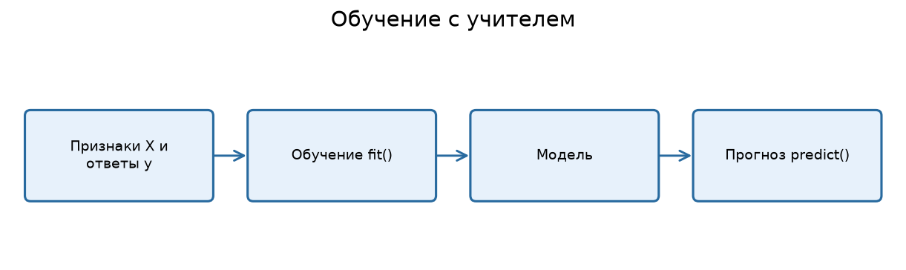
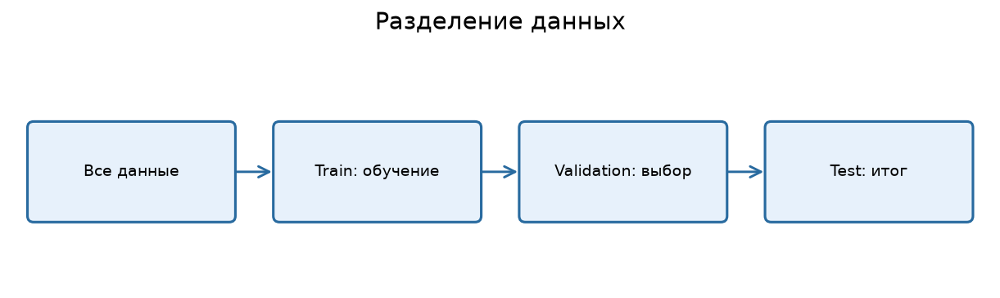
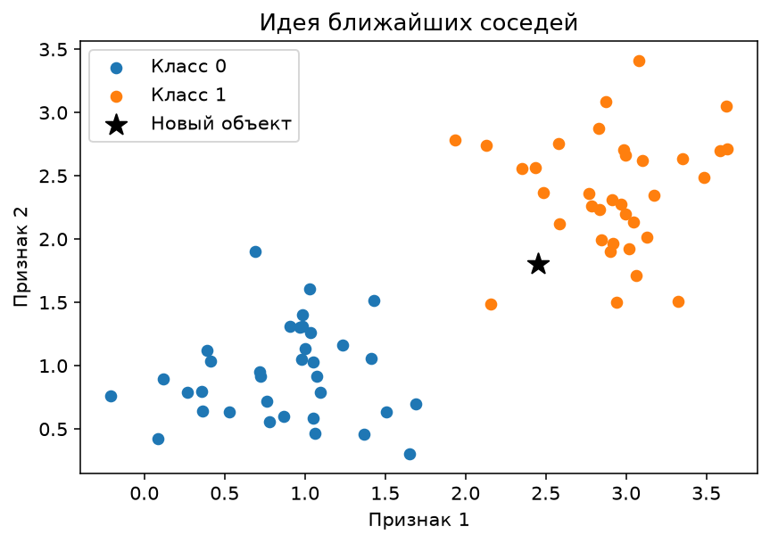

---

# Урок 1. Что такое обучение с учителем?

**Перед началом:** базовый Python, списки, функции, pandas, простые графики из М4–М5.

**После модуля:** ты сможешь сформулировать ML-задачу, отделить признаки от правильных ответов, обучить первую модель, сравнить её с простым ориентиром и объяснить, почему результат на тесте важнее результата на обучении.

**Запуск примеров:** см. [инструкцию к теме](README.md#как-запускать-примеры).

В этом и следующих модулях работаем с **синтетическими учебными датасетами** из папки `Данные/`.

Представь интернет-магазин. Каждый день в него заходят тысячи людей. Кто-то покупает сразу, кто-то добавляет товар в корзину, кто-то просто смотрит. Хотелось бы заранее определить, кто с большей вероятностью купит товар в ближайшую неделю. Как научить компьютер делать такой прогноз?

В математических модулях мы уже говорили, что объект можно представить вектором признаков: возраст, количество посещений, прошлые покупки, средний чек. Но одних признаков недостаточно для обучения. Нам нужно ещё показать компьютеру **правильные ответы для прошлых примеров**: купил пользователь товар или нет.

Это называется **обучением с учителем (supervised learning)**. Важно не представлять «учителя» как человека, который сидит рядом с компьютером. Учитель здесь - это **размеченные данные**, где для каждого обучающего объекта известен целевой ответ.

## 1.1. Признаки X и целевая переменная y

Возьмём маленькую таблицу:

| Посещения за месяц | Добавления в корзину | Покупка в следующие 7 дней |
|---:|---:|---|
| 2 | 0 | Нет |
| 12 | 5 | Да |
| 7 | 1 | Да |
| 1 | 0 | Нет |

Первые два столбца - **признаки**, или features (фичи). Обозначим их `X`. Последний столбец - **целевая переменная**, или target, которую обозначают `y`. Мы хотим, чтобы модель научилась восстанавливать `y` по `X` (иначе говоря предсказывать по `X` - `y`). 

При обучении алгоритм видит и признаки, и ответы. Но для нового пользователя ответ ещё неизвестен: у модели есть только его признаки. Она должна выдать **прогноз** `ŷ` («игрек с крышечкой»).



## 1.2. Два основных типа задач

**Регрессия** - когда мы предсказываем число. Например, стоимость квартиры в миллионах рублей, количество заказов завтра или время доставки в минутах.

**Классификация** - когда выбираем категорию. Например, купит или не купит; мошенническая операция или обычная; кошка, собака или птица (Иногда классов больше, чем 2, и тогда вместо да/нет меткой выступает категория, например, при классификации документов это класс документы: УПД, чек, Счет).

Иногда классификатор выдаёт не только класс, но и оценку вероятности каждого класса. Например, `0.78` для события «покупка». Это **не** означает, что человек гарантированно купит: модель может ошибаться, а вероятности ещё нужно проверять на калибровку.

## 1.3. Как выглядит весь процесс?

1. Определяем, какую бизнес-задачу решаем.
2. Собираем признаки и правильные ответы для прошлых случаев.
3. Отделяем данные для обучения от данных для честной проверки.
4. Обучаем алгоритм на обучающей части.
5. Получаем прогнозы на новых для модели объектах.
6. Измеряем качество, анализируем ошибки и решаем, полезна ли модель.

**Ключевая мысль:** обучение с учителем - не поиск «волшебной формулы», а поиск закономерности между известными входами и ответами.

**Проверь себя**

Определи тип задачи: прогноз цены ноутбука; распознавание спама; прогноз числа посетителей сайта; определение жанра фильма. Для каждой придумай хотя бы три признака и одну целевую переменную.

---

# Урок 2. Постановка ML-задачи: что именно мы предсказываем?

Допустим, руководитель говорит: «Сделайте нам искусственный интеллект для покупателей». С такой постановкой невозможно нормально начать работу. Что должна делать система? Рекомендовать товары? Прогнозировать отток? Вычислять вероятность покупки? Каждой задаче потребуются свои данные и свои критерии успеха.

## 2.1. Выбираем объект, момент прогноза и цель

Для нашего интернет-магазина договоримся:

- **Объект:** один пользователь.
- **Момент прогноза:** сегодня, до наступления следующей недели.
- **Признаки:** данные, известные **на сегодня** - например, покупки за последние 90 дней и посещения за последние 30 дней.
- **Цель:** совершит ли пользователь покупку **в следующие 7 дней** (`1` или `0`).

Это кажется мелочью, но именно момент прогноза защищает от очень серьёзной ошибки. Нельзя включать в признаки данные о покупке, которая случится только завтра: у модели в реальном мире такой информации ещё нет.

## 2.2. Что плохого в идентификаторах?

Откроем синтетический датасет:

```python
import pandas as pd

customers = pd.read_csv("Данные/shop_customers.csv")
print(customers.head())
print(customers.columns.tolist())
```

У нас есть столбец `user_id`. Он нужен для идентификации пользователя, но **номер сам по себе не объясняет**, купит ли человек товар. В учебном проекте не будем отдавать его модели как числовой признак: иначе алгоритм может начать ловить бессмысленные закономерности, связанные с порядком нумерации.

Среди признаков есть `visits_30d`, `purchases_90d`, `cart_adds_30d`, `avg_check_rub` и другие. Цель - `bought_next_7d`.

```python
X = customers.drop(columns=["user_id", "bought_next_7d", "device"])
y = customers["bought_next_7d"]

print("Размер X:", X.shape)
print("Размер y:", y.shape)
print("Доля покупок:", round(y.mean(), 3))
```

Категорию `device` пока убрали: позже в М10 научимся правильно превращать текстовые категории в числовые признаки. Сейчас оставляем только числовые столбцы.

## 2.3. Нужен ориентир: baseline

Если модель предсказывает, что никто ничего не купит, а в данных 80% пользователей действительно не покупали, то accuracy такой модели составит 80%. Выглядит неплохо? Только она не нашла **ни одного** покупателя.

Поэтому перед сложным алгоритмом полезно сделать **baseline** - простейшую отправную точку. Для классификации это может быть предсказание самого частого класса; для регрессии - среднего или медианы целевой переменной.

Простой ориентир не должен быть «соломенным чучелом». Если новый сложный алгоритм не лучше разумного baseline, зачем нам его поддерживать?

**Проверь себя**

Напиши в двух предложениях постановку задачи «предсказать опоздание доставки». Укажи, **когда** делается прогноз и почему нельзя использовать фактическое время прибытия как признак.

---

# Урок 3. Train, validation и test: учим на одном, проверяем на другом

Представь ученика, который заранее выучил ответы на все вопросы экзамена. Если дать ему тот же лист, он получит 100%. Но означает ли это, что он действительно разбирается в предмете? Не обязательно.

ML-модель тоже может просто запомнить обучающие примеры. Нам нужно проверять её на объектах, которых она **не видела во время обучения**.

## 3.1. Три роли данных

**Train** - здесь модель подбирает параметры.
**Validation** - здесь мы сравниваем алгоритмы, настраиваем гиперпараметры и выбираем пороги.
**Test** - здесь один раз оцениваем окончательно выбранную процедуру, не используя этот набор для дальнейшего подбора.



В первой учебной модели можно ограничиться разделением train/test, но уже важно не использовать test для подбора настроек. В М10 мы разберём отдельную validation-часть и кросс-валидацию.

## 3.2. Разделяем данные в Python

```python
from sklearn.model_selection import train_test_split

X_train, X_test, y_train, y_test = train_test_split(
    X,
    y,
    test_size=0.2,
    random_state=42,
    stratify=y,
)

print("Train:", X_train.shape)
print("Test:", X_test.shape)
```

Разберём параметры:

- `test_size=0.2` - около 20% объектов откладываем на тест.
- `random_state=42` - фиксируем случайность ради воспроизводимого разбиения, а не потому, что 42 улучшает модель.
- `stratify=y` - стараемся сохранить близкие доли классов в train и test.

**Важно:** для временных рядов и данных с повторяющимися объектами случайное разбиение может быть опасным. Например, нельзя учиться на будущем и проверяться на прошлом. Это отдельно обсудим в М10–М11.

## 3.3. Подглядывание в тест

Частая ошибка: сначала посчитать среднее или стандартное отклонение по **всем** данным, нормализовать по ним таблицу, а уже потом разделить её на train/test. Тогда сведения из тестовой части попадают в подготовку обучающих признаков.

Чтобы не допускать утечки данных, используем **Pipeline**: он сам применяет обучаемые преобразования правильно в рамках `fit`.

**Проверь себя**

У тебя 1000 строк, 80% на train и 20% на test. Сколько строк в каждой части? Почему нельзя «чуть-чуть» менять параметры после просмотра результата на test?

---

# Урок 4. Первая задача регрессии: прогноз стоимости квартир

Наконец-то обучим первую модель. Возьмём знакомую задачу: прогнозирование цены квартиры по её характеристикам. Здесь правильный ответ - число, поэтому это **регрессия**.

## 4.1. Загружаем датасет

```python
import pandas as pd

apartments = pd.read_csv("Данные/apartments.csv")
print(apartments.head())
print(apartments.isna().sum())
```

Это специально сгенерированные данные. Целевой столбец `price_mln` означает цену в миллионах рублей. Среди признаков: площадь `area_m2`, комнаты `rooms`, этаж `floor`, время до метро `metro_min`, год постройки `year_built`, район `district`.

Пока для простоты возьмём только числовые признаки и удалим строки с пропущенными значениями. Для настоящих проектов такой подход подходит не всегда: иногда пропуски нужно корректно заполнять. Это будет отдельная тема.

```python
apartments = apartments.dropna().copy()

features = ["area_m2", "rooms", "floor", "metro_min", "year_built"]
X = apartments[features]
y = apartments["price_mln"]
```

## 4.2. Наш первый алгоритм: ближайшие соседи

Представь новую квартиру. Чтобы оценить её цену, мы ищем среди известных квартир **похожие** и смотрим, сколько они стоят. Это очень простая идея алгоритма k ближайших соседей, или kNN.

Число соседей выбирается параметром `n_neighbors`. Алгоритм регрессии может использовать среднюю стоимость этих соседей как прогноз.

Поскольку площадь может измеряться десятками и сотнями, а другие признаки - единицами, сначала масштабируем их. Важно делать это **внутри Pipeline**, а не на всей таблице до разбиения.

```python
from sklearn.model_selection import train_test_split
from sklearn.pipeline import make_pipeline
from sklearn.preprocessing import StandardScaler
from sklearn.neighbors import KNeighborsRegressor
from sklearn.metrics import mean_absolute_error

X_train, X_test, y_train, y_test = train_test_split(
    X, y, test_size=0.2, random_state=42
)

model = make_pipeline(
    StandardScaler(),
    KNeighborsRegressor(n_neighbors=5),
)

model.fit(X_train, y_train)
pred = model.predict(X_test)

print("MAE:", round(mean_absolute_error(y_test, pred), 3), "млн ₽")
```

Здесь произошло главное: мы вызвали `fit()` на данных с известными ответами. Алгоритм сохранил информацию, необходимую для прогнозов. Затем `predict()` получил ответы для тестовых квартир.

## 4.3. Сравниваем с примитивной моделью

```python
from sklearn.dummy import DummyRegressor

baseline = DummyRegressor(strategy="mean")
baseline.fit(X_train, y_train)
base_pred = baseline.predict(X_test)

print("MAE baseline:", round(mean_absolute_error(y_test, base_pred), 3))
print("MAE kNN:", round(mean_absolute_error(y_test, pred), 3))
```

`DummyRegressor` всегда прогнозирует среднее по обучающим ответам. Если kNN существенно лучше, значит, признаки действительно помогают делать прогноз.

**Не жди одной обязательной цифры:** значение метрики зависит от состава данных и разбиения. Важно сравнение, а не красивое число на экране.

**Проверь себя**

Измени `n_neighbors` с 5 на 3 и 15. Запиши MAE для каждого варианта. Не подбирай k по тесту бесконечно: это демонстрационный эксперимент; для честной настройки понадобится validation.

---

# Урок 5. Первая классификация: кто совершит покупку?

Для классификации используем интернет-магазин: целевая переменная `bought_next_7d` принимает значения 0 или 1.

## 5.1. Обучаем модель

```python
import pandas as pd
from sklearn.model_selection import train_test_split
from sklearn.preprocessing import StandardScaler
from sklearn.pipeline import make_pipeline
from sklearn.neighbors import KNeighborsClassifier
from sklearn.metrics import accuracy_score, confusion_matrix

customers = pd.read_csv("Данные/shop_customers.csv")
X = customers.drop(columns=["user_id", "device", "bought_next_7d"])
y = customers["bought_next_7d"]

X_train, X_test, y_train, y_test = train_test_split(
    X, y, test_size=0.2, random_state=42, stratify=y
)

model = make_pipeline(StandardScaler(), KNeighborsClassifier(n_neighbors=7))
model.fit(X_train, y_train)
pred = model.predict(X_test)

print("Accuracy:", round(accuracy_score(y_test, pred), 3))
print("Матрица ошибок:\n", confusion_matrix(y_test, pred))
```

`KNeighborsClassifier` ищет ближайших пользователей и определяет класс нового пользователя по голосованию соседей. Здесь числовые признаки масштабируются, чтобы средний чек в рублях не подавлял все другие характеристики только из-за больших чисел.



## 5.2. Класс и вероятность — не одно и то же

```python
prob = model.predict_proba(X_test)
print(prob[:5])
print(model.classes_)
```

Каждая строка содержит оценки вероятностей двух классов. Порядок столбцов соответствует `model.classes_`. Для kNN эти оценки основаны на доле соседей соответствующего класса; они **не обязаны быть хорошо откалиброваны**.

Если порогом считать 0.5, чаще всего получим предсказанный класс по большей оценке вероятности. Но стоимость ошибок может быть разной: пропустить мошенничество и лишний раз проверить обычную операцию - разные последствия.

## 5.3. Почему accuracy может обманывать?

Если 95% транзакций обычные, модель «всегда обычная» получит accuracy 95%. Но она будет бесполезной для поиска мошенничества.

Поэтому всегда важно смотреть не только общую долю правильных ответов, но и **какие именно ошибки** совершает модель. В М10 научимся читать precision, recall, F1 и ROC-AUC.

**Проверь себя**

Сравни долю единиц в `y_train` и `y_test`. Объясни, зачем в данном случае мы использовали `stratify=y`.

---

# Урок 6. Переобучение и недообучение

Представь, что ты запомнил ответы на двадцать задач, но получил новые вопросы на экзамене. Знакомые задания решаешь идеально, а новые - плохо. Это похоже на **переобучение (overfitting)**.

**Недообучение (underfitting)** - противоположная проблема. Модель слишком простая и не видит даже очевидной закономерности.

## 6.1. Баланс сложности

Для kNN сложность можно грубо контролировать числом соседей:

- `k=1` - решение сильно зависит от одного ближайшего объекта; может подстроиться под шум.
- Очень большое `k` - решение слишком усредняется и может терять локальные закономерности.
- Промежуточное `k` иногда оказывается разумным компромиссом.

Но универсального идеального k нет. Мы должны проверять его на данных, не использовавшихся для обучения конкретного варианта модели.

## 6.2. Сделаем отдельную validation-часть

```python
from sklearn.model_selection import train_test_split
from sklearn.metrics import accuracy_score
from sklearn.pipeline import make_pipeline
from sklearn.preprocessing import StandardScaler
from sklearn.neighbors import KNeighborsClassifier

# Используем X и y из урока 5.
X_dev, X_test, y_dev, y_test = train_test_split(
    X, y, test_size=0.2, random_state=42, stratify=y
)
X_train, X_val, y_train, y_val = train_test_split(
    X_dev, y_dev, test_size=0.25, random_state=42, stratify=y_dev
)

scores = {}
for k in [1, 3, 7, 15, 31]:
    candidate = make_pipeline(StandardScaler(), KNeighborsClassifier(n_neighbors=k))
    candidate.fit(X_train, y_train)
    scores[k] = accuracy_score(y_val, candidate.predict(X_val))

print(scores)
```

Так мы сравниваем разные значения k **на validation, а не на test**. После выбора можно обучить итоговую модель на `X_dev` и один раз оценить на отложенном test.

## 6.3. Что ещё может пойти не так?

- **Утечка данных:** в модель попали сведения из будущего.
- **Смещение выборки:** train и будущие пользователи слишком разные.
- **Случайная удача:** модель оказалась хороша на одном маленьком тестовом наборе.
- **Неподходящая метрика:** высокая accuracy скрыла важные пропуски.

Наше следующее направление - научиться распознавать эти проблемы до того, как результат попадёт в продукт.

**Проверь себя**

Выпиши два признака переобучения и два способа его заподозрить. Объясни, почему подбирать `k` по test - плохая идея.

---

# Урок 7. Первое полноценное ML-решение

Теперь соберём работу в понятную последовательность. Нам нужна не просто «ячейка, которая считает accuracy», а маленький воспроизводимый эксперимент.

## 7.1. Фиксируем постановку и метрику

**Бизнес-вопрос:** определить пользователей, вероятно совершающих покупку в ближайшие семь дней.
**Объект:** пользователь.
**Признаки:** информация, известная до начала прогнозируемой недели.
**Цель:** `bought_next_7d`.
**Базовая метрика для первого знакомства:** accuracy.
**Контроль:** сравнение с наиболее частым классом; позже добавим precision и recall.

## 7.2. Код от загрузки до результата

```python
import pandas as pd
from sklearn.model_selection import train_test_split
from sklearn.pipeline import make_pipeline
from sklearn.preprocessing import StandardScaler
from sklearn.neighbors import KNeighborsClassifier
from sklearn.dummy import DummyClassifier
from sklearn.metrics import accuracy_score, classification_report

customers = pd.read_csv("Данные/shop_customers.csv")
X = customers.drop(columns=["user_id", "device", "bought_next_7d"])
y = customers["bought_next_7d"]

X_train, X_test, y_train, y_test = train_test_split(
    X, y, test_size=0.2, random_state=42, stratify=y
)

baseline = DummyClassifier(strategy="most_frequent")
baseline.fit(X_train, y_train)

model = make_pipeline(StandardScaler(), KNeighborsClassifier(n_neighbors=7))
model.fit(X_train, y_train)
pred = model.predict(X_test)

print("Baseline accuracy:", accuracy_score(y_test, baseline.predict(X_test)))
print("Model accuracy:", accuracy_score(y_test, pred))
print(classification_report(y_test, pred, zero_division=0))
```

Обрати внимание: мы не выдаём хорошую цифру за автоматический успех. Сперва сравниваем с ориентиром, затем смотрим, какие классы угадываются, и только после этого делаем вывод.

## 7.3. Как честно объяснить результат?

Хороший комментарий к эксперименту выглядит так:

> «Мы обучили модель на исторических признаках и оценили её на отложенных данных. По выбранной метрике она показывает такой-то результат, а простой baseline - такой-то. Основные ошибки модели - такие-то. Чтобы использовать её в бизнесе, нужно дополнительно проверить качество на будущих пользователях, цену ошибок и калибровку вероятностей».

Это намного профессиональнее, чем «нейросеть определяет покупателей с точностью 99%» без объяснения данных и условий проверки.

---

# Итоги модуля
Теперь ты знаешь, что такое supervised learning, регрессия и классификация; понимаешь разницу между признаками и целевой переменной; умеешь обучить первый алгоритм с `fit()`, получить прогнозы через `predict()` и сравнить их с правильными ответами.

Ты также познакомился с baseline, переобучением, разбиением train/validation/test и утечкой данных. **Главная мысль: качество модели измеряется не тем, насколько она запомнила примеры, а тем, насколько полезно работает на новых данных.**

В М7 мы перейдём к линейным моделям и наконец увидим, как алгоритм самостоятельно подбирает знакомые нам веса `w` и свободный коэффициент `b`.

---

# Практика: Обучение с учителем

**Что понадобится:** Colab или Jupyter, pandas, scikit-learn и учебные CSV из папки `datasets`.

**Цель:** научиться ставить задачу обучения с учителем, строить baseline и проверять первую модель.

**Как сдавать:** один ноутбук с кодом, результатами и коротким выводом своими словами.

## Часть 1. Постановка задачи

### Задание 1. Тип задачи

Для ситуаций «предсказать цену смартфона», «определить спам», «прогнозировать продажи в штуках» и «определить вид цветка» запиши: объект, 3–5 признаков, целевую переменную и тип задачи - регрессия или классификация.

### Задание 2. Данные покупателей

Загрузи `Данные/shop_customers.csv`. Выведи первые пять строк, размер таблицы, типы столбцов и долю целевой переменной `bought_next_7d = 1`. Объясни, почему `user_id` не стоит автоматически считать полезным признаком.

### Задание 3. Что можно знать заранее?

Для задачи прогноза покупки в ближайшие 7 дней распредели признаки по двум группам: **разрешены на момент прогноза** и **содержат информацию из будущего**. Признаки: посещения за прошлые 30 дней; дата будущей покупки; предыдущие покупки; факт оплаты в следующие 7 дней; средний чек прошлых заказов.

## Часть 2. Первые модели

### Задание 4. Разделение данных

Раздели таблицу покупателей на train/test в пропорции 80/20 с `random_state=42` и `stratify=y`. Выведи размер обеих частей и долю положительного класса в каждой.

### Задание 5. Baseline классификации

Обучи `DummyClassifier(strategy="most_frequent")`. Найди его accuracy и объясни, почему даже высокая accuracy ещё не означает, что модель полезна.

### Задание 6. kNN классификация

Создай `Pipeline` из `StandardScaler` и `KNeighborsClassifier(n_neighbors=7)`. Обучи только на train. Рассчитай accuracy и матрицу ошибок на test. Запиши, какая категория ошибок встречается чаще.

### Задание 7. Первая регрессия

Загрузи `Данные/apartments.csv`, временно убери строки с пропусками, оставь только числовые признаки. Обучи `KNeighborsRegressor(n_neighbors=5)` с масштабированием. Выведи MAE. Сравни с `DummyRegressor(strategy="mean")`.

## Часть 3. Разбираемся в результате

### Задание 8. Опасность настройки по тесту

Объясни своими словами, почему выбирать `n_neighbors` по лучшему результату на test неправильно. Какую часть данных следует использовать для сравнения вариантов модели?

### Задание 9. Переобучение

Обучи kNN-классификатор с `n_neighbors=1`. Сравни accuracy на train и test. Что может означать заметный разрыв между этими результатами?

### Задание 10. Финальный мини-проект

Подготовь короткий отчёт «Предсказание покупки»: постановка, признаки, размер данных, baseline, выбранная модель, схема разбиения, две метрики, основные ошибки и один пункт о том, что нужно проверить перед реальным внедрением. Дополнительно объясни, почему данные из будущего недопустимы.

# Финальный вопрос

**Чем модель, которая обучается на данных, отличается от набора правил `if/else`, которые программист написал вручную?** Попробуй объяснить на примере интернет-магазина.
