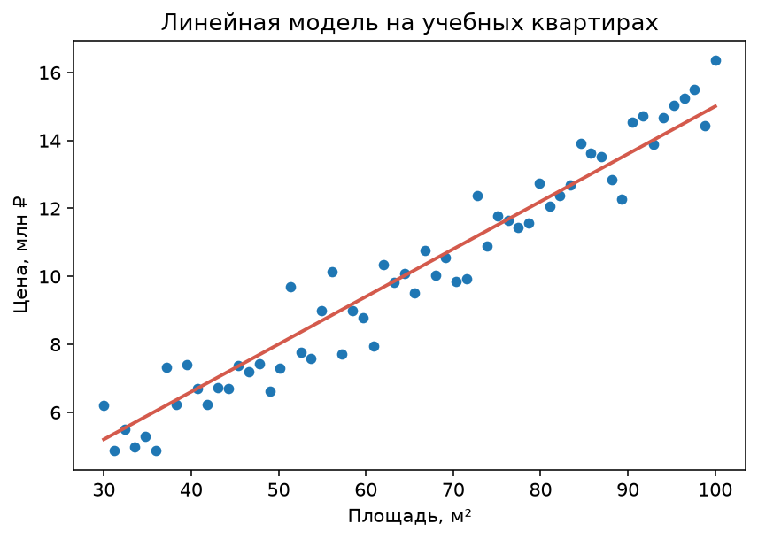
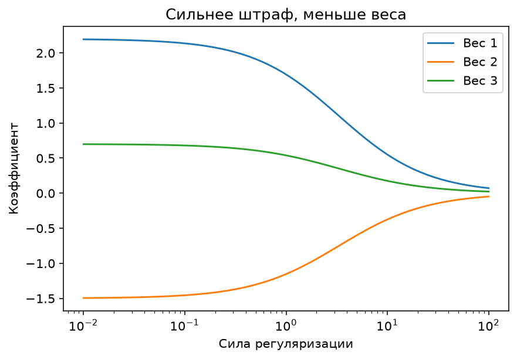
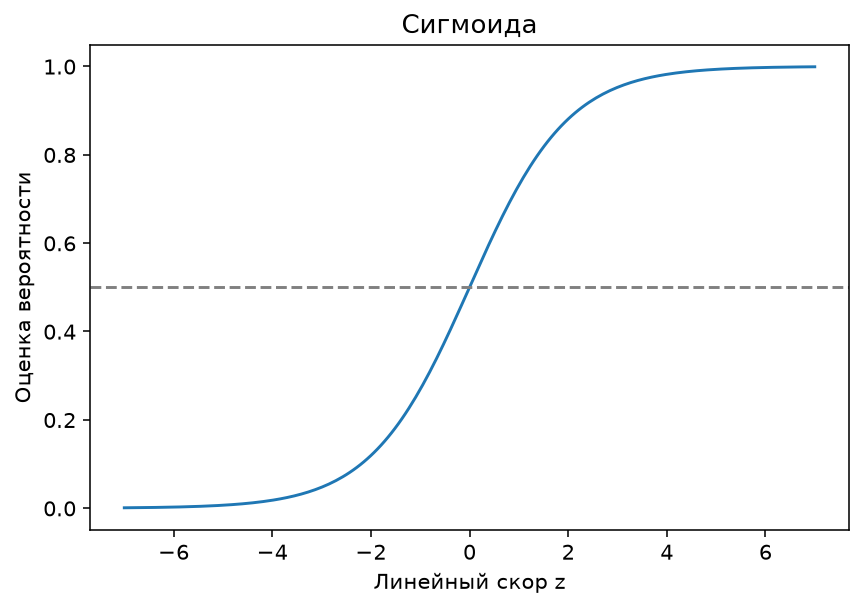

---

# Урок 1. Линейная регрессия: знакомая формула становится моделью

**Перед началом:** М1–М6, базовые NumPy/pandas и первый опыт `fit()` / `predict()`.

**После модуля:** ты сможешь обучить линейную и логистическую регрессию, понимать их веса, использовать регуляризацию и объяснить, когда простой алгоритм оказывается сильным решением.

**Запуск примеров:** см. [инструкцию к теме](README.md#как-запускать-примеры).

Помнишь нашу первую математическую модель квартир? Мы брали площадь и число комнат, умножали их на веса, прибавляли свободный коэффициент и получали прогноз цены. Веса при этом просто придумывали: `1.2`, `0.5` и `1`. Но что, если мы хотим, чтобы компьютер **сам нашёл эти числа**, исходя из данных?

Именно такую задачу решает **линейная регрессия**. Это один из фундаментальных алгоритмов обучения с учителем, и его ценность не только в простоте: он позволяет получить полезный ориентир, понять связь признаков с прогнозом и быстро проверить гипотезу.

## 1.1. Один признак — одна прямая

Самая простая модель выглядит так:

`ŷ = wx + b`

- `x` - признак, например площадь квартиры;
- `w` - вес: насколько меняется прогноз при увеличении `x` на единицу, если остальные параметры фиксированы;
- `b` - свободный коэффициент;
- `ŷ` - предсказанное значение.

Например, если `w = 0.15`, `b = 1`, площадь равна 40 м², то прогноз `ŷ = 0.15 × 40 + 1 = 7` млн ₽. Геометрически это прямая на графике «площадь - стоимость».



В реальной жизни квартира большой площади не обязательно дороже любой маленькой: отличаются район, состояние, этаж. Линия описывает **общую тенденцию**, а не каждую точку идеально.

## 1.2. Как алгоритм находит веса?

На обучающих данных известны настоящие цены `y`. Алгоритм ищет такие `w` и `b`, чтобы прогнозы были близки к правильным ответам. Обычно для обычной линейной регрессии минимизируется сумма квадратов ошибок: `Σ(yᵢ − ŷᵢ)²`.

В модуле М3 мы изучили градиентный спуск. Он действительно может подбирать параметры такой модели. Но в `sklearn.linear_model.LinearRegression` используются численные методы линейной алгебры для задачи наименьших квадратов; **самостоятельно писать цикл градиентного спуска здесь не нужно**.

## 1.3. Обучим первую прямую

```python
import pandas as pd
from sklearn.model_selection import train_test_split
from sklearn.linear_model import LinearRegression
from sklearn.metrics import mean_absolute_error

apartments = pd.read_csv("Данные/apartments.csv").dropna()
X = apartments[["area_m2"]]
y = apartments["price_mln"]

X_train, X_test, y_train, y_test = train_test_split(
    X, y, test_size=0.2, random_state=42
)

model = LinearRegression()
model.fit(X_train, y_train)

pred = model.predict(X_test)
print("Вес:", round(model.coef_[0], 3))
print("Свободный коэффициент:", round(model.intercept_, 3))
print("MAE:", round(mean_absolute_error(y_test, pred), 3), "млн ₽")
```

Здесь `coef_` содержит обученные веса, а `intercept_` - найденный свободный коэффициент. **Они появились из данных**, а не из наших предположений.

**Проверь себя**

Подставь площадь 40 м² в найденную формулу вручную. Сравни ответ с `model.predict(pd.DataFrame({"area_m2": [40]}))`. Он должен совпасть с точностью округления.

---

# Урок 2. Много признаков: как читать коэффициенты

С одной площадью работать просто, но цена квартиры зависит от нескольких характеристик. Поэтому расширим модель:

`ŷ = w₁·area + w₂·rooms + w₃·floor + w₄·metro + w₅·year + b`

В матричной записи это уже знакомое `ŷ = Xw + b`. Только теперь `w` ищет алгоритм.

## 2.1. Обучаем многомерную линейную регрессию

```python
import pandas as pd
from sklearn.model_selection import train_test_split
from sklearn.linear_model import LinearRegression
from sklearn.metrics import mean_absolute_error, mean_squared_error, r2_score

apartments = pd.read_csv("Данные/apartments.csv").dropna()
features = ["area_m2", "rooms", "floor", "metro_min", "year_built"]
X = apartments[features]
y = apartments["price_mln"]

X_train, X_test, y_train, y_test = train_test_split(
    X, y, test_size=0.2, random_state=42
)
model = LinearRegression().fit(X_train, y_train)
pred = model.predict(X_test)

print(pd.Series(model.coef_, index=features).round(3))
print("b:", round(model.intercept_, 3))
print("MAE:", round(mean_absolute_error(y_test, pred), 3))
print("RMSE:", round(mean_squared_error(y_test, pred) ** 0.5, 3))
print("R²:", round(r2_score(y_test, pred), 3))
```

## 2.2. Что означает знак веса?

Если коэффициент площади положительный, то при увеличении площади на 1 м² **при прочих признаках, остающихся неизменными** прогноз увеличится на величину этого коэффициента.

Если вес времени до метро отрицательный, то при увеличении времени до метро прогноз, при прочих равных, уменьшается.

Но здесь два предупреждения:

1. **Коэффициент не доказывает причинность.** Нельзя заключить, что искусственное изменение признака действительно вызовет такое же изменение цены.
2. **Масштаб имеет значение.** Вес площади измеряется в млн ₽ на 1 м², вес времени до метро - в млн ₽ на 1 минуту. Сравнивать их абсолютные величины без учёта шкал некорректно.

## 2.3. Когда признаки похожи друг на друга?

Площадь и число комнат часто связаны. Если признаки сильно коррелируют, отдельные коэффициенты могут быть нестабильными: при небольшом изменении данных алгоритм может перераспределить вес между ними.

Это называется **мультиколлинеарностью**. Она не всегда разрушает качество прогнозов, но мешает простой интерпретации отдельных коэффициентов.

**Проверь себя**

Сравни модель только с площадью и модель с пятью признаками по одной и той же отложенной выборке. Сделай вывод, помогли ли дополнительные признаки, но помни: после множества сравнений на test понадобится отдельная валидация.

---

# Урок 3. Метрики регрессии: MAE, MSE, RMSE и R²

Когда модель предсказывает цену квартиры, недостаточно сказать «вроде нормально». Нужно измерить качество. В М2 мы считали среднеквадратичную ошибку вручную, а теперь знакомимся с несколькими основными метриками.

## 3.1. Рассмотрим три прогноза

Настоящие цены: `y = [6, 9, 12]` млн ₽.
Прогнозы: `ŷ = [7, 8, 13]` млн ₽.
Ошибки: `[1, −1, 1]`.

**MAE** - средняя абсолютная ошибка:

`MAE = (|1| + |−1| + |1|) / 3 = 1` млн ₽.

**MSE** - средняя квадратов ошибок:

`MSE = (1² + (−1)² + 1²) / 3 = 1` (млн ₽)².

**RMSE** - квадратный корень из MSE:

`RMSE = √MSE = 1` млн ₽.

В этом примере MAE и RMSE совпали случайно. На других данных они могут заметно различаться. RMSE сильнее реагирует на большие ошибки.

## 3.2. Что такое R²?

`R²` сравнивает модель с простым прогнозом, который на тестовых данных всегда равен среднему **истинному** значению тестовой выборки. Формула:

`R² = 1 − Σ(y − ŷ)² / Σ(y − ȳ)²`

В этом определении `ȳ` - среднее истинных ответов в оцениваемом наборе. Если R² около 1, модель описывает данные очень хорошо. Если R² равен 0, её сумма квадратов ошибок равна сумме квадратов ошибок константного предсказания средним. **R² может быть отрицательным** - это означает, что по данной метрике модель хуже такого ориентира.

Рассчитывать R² можно только при корректных условиях; для одного тестового объекта он не определён.

## 3.3. Какая метрика лучше?

Если бизнес спрашивает «на сколько миллионов в среднем ошибаемся?», понятнее MAE. Если очень крупные промахи особенно болезненны, полезно смотреть RMSE. Если нужен относительный показатель объяснённой изменчивости - R².

Обычно в отчёте показывают **несколько метрик**, а не одну. И обязательно сравнивают с baseline.

**Проверь себя**

Посчитай вручную MAE, MSE и RMSE для `y=[2,4,6]`, `ŷ=[3,3,7]`. В каких единицах измеряются эти три метрики?

---

# Урок 4. Регуляризация: почему слишком большие веса — проблема?

Допустим, линейная модель получила очень большой положительный вес одного признака и почти такой же отрицательный вес другого. На обучении они могут взаимно компенсироваться, но при небольших изменениях входных данных прогнозы станут нестабильными.

**Регуляризация** добавляет к задаче обучения штраф за сложность параметров. Она помогает контролировать их величины и иногда улучшает обобщение на новых данных.

## 4.1. Ridge: штрафуем квадраты весов

В Ridge-регрессии минимизируем условно:

`сумма квадратов ошибок + α · Σ wⱼ²`

Чем больше `α`, тем сильнее штраф за большие веса. При небольшом `α` результат похож на обычную линейную регрессию; при слишком большом модель может стать чрезмерно простой.

## 4.2. Lasso: штрафуем абсолютные значения

В Lasso-регрессии штраф имеет вид:

`сумма квадратов ошибок + α · Σ |wⱼ|`

Lasso может сделать некоторые коэффициенты **ровно нулевыми**. Это иногда используют для упрощения модели и отбора признаков. Но результат зависит от масштаба признаков и их корреляции.



## 4.3. Почему нужен StandardScaler?

Если площадь измеряется десятками квадратных метров, а год постройки - числами около 2000, одинаковый числовой штраф к весам по этим признакам не означает одинаковое влияние на прогноз. Поэтому перед Ridge и Lasso часто масштабируют числовые признаки.

И делать это нужно **внутри Pipeline**, чтобы `StandardScaler` обучался только на train.

```python
from sklearn.pipeline import make_pipeline
from sklearn.preprocessing import StandardScaler
from sklearn.linear_model import Ridge, Lasso

ridge = make_pipeline(StandardScaler(), Ridge(alpha=10))
lasso = make_pipeline(StandardScaler(), Lasso(alpha=0.05, max_iter=20000))

ridge.fit(X_train, y_train)  # X_train, y_train из урока 2
lasso.fit(X_train, y_train)

print("Ridge MAE:", mean_absolute_error(y_test, ridge.predict(X_test)))
print("Lasso MAE:", mean_absolute_error(y_test, lasso.predict(X_test)))
```

Здесь сравнение служит учебной демонстрацией. Настраивать `alpha` для финального проекта правильнее на validation или с помощью кросс-валидации, а test оставить для последней проверки.

**Проверь себя**

Объясни, чем отличаются Ridge и Lasso. Почему несправедливо сравнивать абсолютные значения коэффициентов признаков, измеренных в разных единицах?

---

# Урок 5. Логистическая регрессия: линейная модель для классификации

Название сбивает с толку: **логистическая регрессия** обычно решает задачу **классификации**, а не прогнозирования непрерывного числа.

Представим интернет-магазин. Мы хотим предсказывать, купит ли пользователь товар в течение следующей недели. Ответ - `0` или `1`. Обычная линейная функция может выдать любое число: −3, 2.7 или 14. Но вероятность должна находиться между 0 и 1.

## 5.1. Линейный скор и сигмоида

Сначала вычисляется линейная комбинация признаков:

`z = w₁x₁ + w₂x₂ + … + b`

Затем применяем **сигмоиду**:

`σ(z) = 1 / (1 + e^(−z))`

Если `z = 0`, то `σ(z)=0.5`. При больших положительных `z` значение приближается к 1, при больших отрицательных - к 0.



Именно так логистическая модель преобразует линейный скор в оценку вероятности положительного класса. При этом даже математически корректное значение между 0 и 1 **не гарантирует хорошую калибровку вероятностей** на реальных данных.

## 5.2. Обучим классификатор

```python
import pandas as pd
from sklearn.model_selection import train_test_split
from sklearn.preprocessing import StandardScaler
from sklearn.pipeline import make_pipeline
from sklearn.linear_model import LogisticRegression
from sklearn.metrics import accuracy_score, roc_auc_score

customers = pd.read_csv("Данные/shop_customers.csv")
X = customers.drop(columns=["user_id", "device", "bought_next_7d"])
y = customers["bought_next_7d"]

X_train, X_test, y_train, y_test = train_test_split(
    X, y, test_size=0.2, stratify=y, random_state=42
)

model = make_pipeline(StandardScaler(), LogisticRegression(max_iter=1000))
model.fit(X_train, y_train)

pred = model.predict(X_test)
prob = model.predict_proba(X_test)[:, 1]

print("Accuracy:", round(accuracy_score(y_test, pred), 3))
print("ROC-AUC:", round(roc_auc_score(y_test, prob), 3))
```

`predict()` выдаёт класс, а `predict_proba()` - вероятности классов в порядке `model.classes_`. В нашем случае классы равны 0 и 1, поэтому столбец с индексом 1 соответствует вероятности покупки.

## 5.3. Почему веса здесь нельзя читать точно так же?

У линейной регрессии вес непосредственно влияет на **числовой прогноз**. У логистической регрессии вес сначала изменяет **логарифм отношения шансов** (*log-odds*), а уже затем применяется сигмоида. Поэтому говорить «увеличили посещения на 1 - вероятность выросла на 3%» по одному коэффициенту некорректно: эффект зависит и от остальных признаков, и от текущего значения вероятности.

Для первого знакомства достаточно запомнить: знак веса показывает, в какую сторону изменяется линейный скор при фиксированных остальных признаках.

**Проверь себя**

Найди вероятности покупки для первых пяти тестовых пользователей. Почему нельзя автоматически трактовать вероятность 0.8 как «модель обязательно права»?

---

# Урок 6. Пороги решения, Log Loss и цена ошибок

Допустим, модель оценила вероятность мошенничества как `0.35`. Если использовать стандартный порог 0.5, транзакция окажется «обычной». А если банк особенно боится пропустить мошенничество, может оказаться разумнее более низкий порог.

Но понизив порог, мы обычно получаем больше ложных предупреждений. Поэтому **порог - не техническая мелочь, а бизнес-решение**.

## 6.1. Превращаем вероятность в класс

```python
# Используем prob из предыдущего урока
threshold = 0.35
pred_custom = (prob >= threshold).astype(int)

from sklearn.metrics import confusion_matrix
print(confusion_matrix(y_test, pred_custom))
```

В М10 мы подробно разберём `precision`, `recall`, F1 и выбор порога на валидационных данных. Пока важно понять, что изменение порога меняет количество положительных предсказаний.

**Нельзя** подобрать оптимальный порог после просмотра результатов на окончательном test и продолжать называть его независимым.

## 6.2. Почему логистическая регрессия обучается не по MSE?

Стандартная логистическая регрессия использует **логистическую потерю** (log loss, бинарную кросс-энтропию). Для одного объекта, где `y` равно 0 или 1, она записывается так:

`L = −[y·ln(p) + (1−y)·ln(1−p)]`

Здесь `p` - прогноз вероятности класса 1. Если правильный ответ `y=1`, модель наказывается сильнее, когда назначает ему очень маленькую вероятность. И наоборот для `y=0`.

Например, для настоящей покупки `y=1` прогноз `p=0.9` даёт гораздо меньшую ошибку, чем `p=0.01`. При `p`, равном ровно 0 или 1, формулу следует понимать с учётом численной устойчивости реализации.

## 6.3. Что делать с редкими классами?

Если позитивных случаев мало, accuracy может обманывать. Для задач вроде мошенничества нужно отдельно считать пропуски мошенничества и ложные предупреждения. Иногда используют `class_weight="balanced"`, но это не универсальное улучшение: изменение весов классов может изменить качество вероятностей и баланс ошибок.

**Проверь себя**

Представь 1000 операций: 10 мошеннических. Модель нашла 8, но ещё 30 обычных отметила ошибочно. Сколько получилось истинно положительных, ложноположительных и ложноотрицательных результатов? Что для банка важнее и почему?

---

# Урок 7. Когда линейная модель хороша, а когда нет?

Линейные модели часто становятся **первым разумным baseline** в реальном проекте. Они относительно быстры, просты в воспроизведении, а их параметры удобно анализировать.

Однако цена квартиры может зависеть от признаков нелинейно: дополнительная площадь в элитном центре и дополнительная площадь на окраине могут влиять на стоимость по-разному. Простая сумма `w₁x₁ + … + b` не всегда уловит подобные зависимости.

## 7.1. Как сделать линейную модель гибче?

Можно добавить **новые признаки**. Например:

- `area_m2²` - квадрат площади;
- `area_m2 × rooms` - взаимодействие площади и комнат;
- `is_center` - признак «квартира находится в центре».

Тогда модель остаётся линейной **по своим коэффициентам**, но способна описывать некоторые нелинейные зависимости от исходных признаков.

Пример полиномиальных признаков:

```python
import pandas as pd
from sklearn.model_selection import train_test_split
from sklearn.pipeline import make_pipeline
from sklearn.preprocessing import PolynomialFeatures, StandardScaler
from sklearn.linear_model import Ridge
from sklearn.metrics import mean_absolute_error

apartments = pd.read_csv("Данные/apartments.csv").dropna()
X_reg = apartments[["area_m2", "rooms"]]
y_reg = apartments["price_mln"]
X_train_reg, X_val_reg, y_train_reg, y_val_reg = train_test_split(
    X_reg, y_reg, test_size=0.25, random_state=42
)

poly_model = make_pipeline(
    PolynomialFeatures(degree=2, include_bias=False),
    StandardScaler(),
    Ridge(alpha=10),
)
poly_model.fit(X_train_reg, y_train_reg)
print("Validation MAE:", mean_absolute_error(y_val_reg, poly_model.predict(X_val_reg)))
```

Мы специально назвали переменные `X_train_reg`, чтобы не перепутать их с классификационной задачей из предыдущего урока. Пример показывает идею преобразования признаков; подбор степени и `alpha` нужно делать на валидации или кросс-валидации, оставив окончательный test нетронутым.

## 7.2. Что будет дальше?

В следующих модулях мы изучим модели, которые могут автоматически строить сложные нелинейные разбиения пространства признаков: **деревья решений, случайные леса и градиентный бустинг**.

Не стоит думать, что они всегда лучше линейной регрессии. На некоторых задачах линейный алгоритм с хорошими признаками оказывается быстрее, надёжнее или понятнее.

**Главный принцип ML-инженера: сначала понятная базовая модель, затем усложнение - только если оно действительно даёт пользу.**

---

# Итоги модуля
Мы познакомились с двумя важнейшими линейными моделями. **Линейная регрессия** прогнозирует число, а **логистическая регрессия** с помощью сигмоиды решает задачи классификации. Алгоритмы подбирают коэффициенты по данным; регуляризация помогает сдерживать сложность; метрики и честная проверка позволяют оценивать результат.

Пожалуй, самое важное: теперь формула `ŷ = Xw + b` перестала быть просто упражнением из М1. Ты видел, как настоящая библиотека находит веса модели и делает прогнозы на новых объектах.

---

# Практика: Линейные модели

**Что понадобится:** Colab или Jupyter, pandas, scikit-learn, matplotlib и два учебных CSV.

**Цель:** связать формулу линейной модели с обучением, регуляризацией и прогнозом вероятности.

**Как сдавать:** два ноутбука: один по регрессии, второй по классификации; под метриками напиши выводы.

## Часть 1. Разбираемся вручную

### Задание 1. Прогноз по формуле

Модель задана формулой `ŷ = 0.14 × площадь − 0.08 × минуты до метро + 1.2`. Рассчитай прогноз для квартиры 50 м² в 10 минутах от метро. В каких единицах нужно измерять параметры и результат?

### Задание 2. Сравни метрики

Для `y=[3,5,7]` и `ŷ=[2,6,10]` рассчитай MAE, MSE и RMSE вручную. Объясни, почему MSE сильнее реагирует на самую большую ошибку.

### Задание 3. Сигмоида

Вычисли `σ(0)`, а затем приблизительно `σ(2)` и `σ(−2)`, используя калькулятор. Почему результат всегда лежит между 0 и 1?

## Часть 2. Линейная регрессия

### Задание 4. Простая регрессия

Загрузи `Данные/apartments.csv`. Обучи `LinearRegression` только по `area_m2`. Выведи коэффициент, свободный член и MAE на отложенной выборке. Объясни значение веса площади, не делая причинных выводов.

### Задание 5. Много признаков

Добавь `rooms`, `floor`, `metro_min`, `year_built`. Сравни результаты с заданием 4. Какие веса положительны, а какие отрицательны? Почему коэффициенты разных признаков нельзя напрямую сравнивать по модулю?

### Задание 6. Регуляризация

Обучи три модели на одном train: `LinearRegression`, `Ridge` и `Lasso`, для регуляризованных моделей используй `StandardScaler` внутри Pipeline. По **валидационной** части выбери значения `alpha` из нескольких предложенных вариантов, не подглядывая в test. Какие коэффициенты близки к нулю?

## Часть 3. Логистическая регрессия

### Задание 7. Прогноз покупок

На `shop_customers.csv` обучи логистическую регрессию. Исключи `user_id` и пока не используй текстовый `device`. Выведи accuracy, матрицу ошибок и первые пять значений `predict_proba`.

### Задание 8. Порог решения

Сравни результаты для порогов `0.3`, `0.5` и `0.7` **на validation**. Для каждого посчитай количество положительных предсказаний. Как изменяется количество пропусков покупок и ложных тревог?

### Задание 9. Baseline

Сравни логистическую регрессию с `DummyClassifier`. Покажи не только общую accuracy, но и хотя бы одну метрику для положительного класса. Почему выбор метрики зависит от бизнес-задачи?

### Задание 10. Итоговый мини-проект

Напиши короткий отчёт «Линейная модель покупки» или «Линейная модель цены»: постановка, данные, признаки, baseline, обученные коэффициенты, метрики, слабые стороны и два предположения, как можно улучшить результат.

# Финальный вопрос

**Чем отличается линейная регрессия от логистической и почему логистическая модель не просто «та же прямая, но для двух классов»?**
