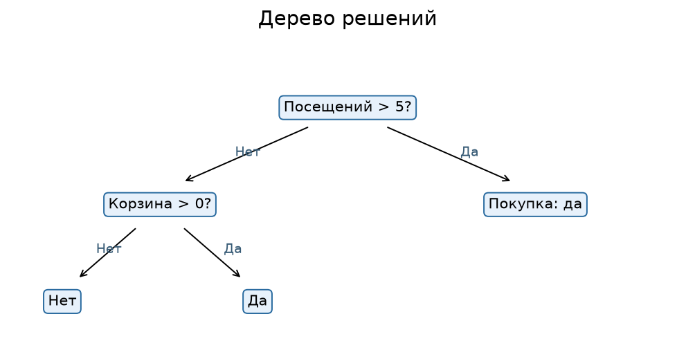
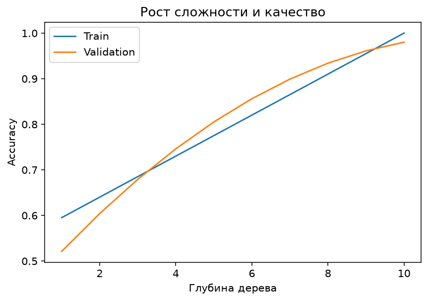
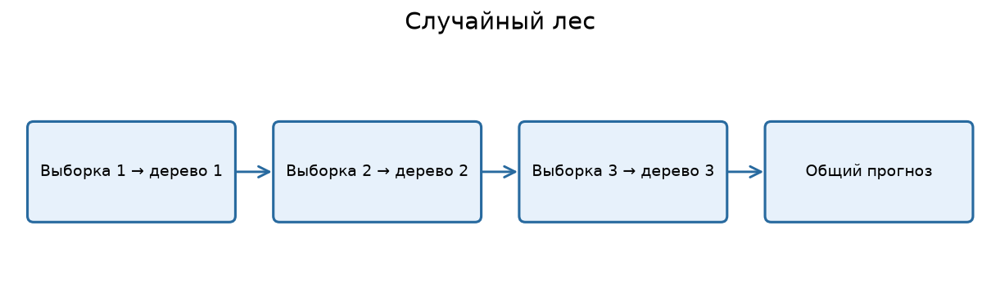

---

# Урок 1. Дерево решений: ML как последовательность вопросов

**Перед началом:** supervised learning и метрики из М6, линейные модели из М7.

**После модуля:** ты сможешь объяснить разбиения в дереве, увидеть переобучение от глубины, обучить Random Forest и не путать важность признака с доказательством причинности.

**Запуск примеров:** см. [инструкцию к теме](README.md#как-запускать-примеры).

Представь, что мы пытаемся определить, совершит ли пользователь покупку. Самый простой способ - спросить: «Он заходил на сайт больше пяти раз?» Если нет, пойдём в одну ветку. Если да, зададим следующий вопрос: «Он добавлял товары в корзину?» И снова разделим пользователей на группы.

Это похоже на обычные условия `if/else`, которые мы изучали в Python. Но есть принципиальное различие: **дерево решений учится выбирать вопросы и пороги по данным**, а не получает их в готовом виде от программиста.

## 1.1. Из чего состоит дерево?

**Корень** - первый вопрос, через который проходят все объекты.
**Внутренний узел** - дополнительное условие, например `visits_30d ≤ 5.5`.
**Ветвь** - путь, который зависит от результата проверки.
**Лист** - конечный прогноз: класс или числовое значение.



На картинке правила придуманы специально для объяснения. Обученное дерево может выбрать **совершенно другие пороги**. И это нормально: оно пытается найти такие разбиения, которые полезны для предсказания целевой переменной.

## 1.2. Дерево для классификации

В листе можно предсказать наиболее частый класс среди обучающих объектов, попавших туда. Кроме того, модель может оценить долю разных классов в листе как вероятность.

Например, в лист попали 20 пользователей: 15 совершили покупку и 5 нет. Тогда дерево может дать оценку `P(покупка) = 15/20 = 0.75`. Но такая оценка зависит от объёма листа и может быть плохо откалибрована.

## 1.3. Дерево для регрессии

Если наша цель - цена квартиры, лист вместо класса содержит число. Для обычного дерева регрессии со среднеквадратичным критерием это часто **среднее значение целевой переменной** среди обучающих примеров в листе.

Например, в лист попали цены `[6, 7, 8]` млн ₽. Прогноз будет `7` млн ₽.

Поэтому график прогноза одного дерева регрессии часто выглядит **ступеньками**, а не плавной прямой.

## 1.4. Почему деревья удобны?

Деревья могут моделировать нелинейные зависимости, взаимодействия признаков и пороговые правила. При этом не всегда требуется стандартизовать числовые признаки: сравнение вида `area_m2 > 60` не меняет смысл, если площадь переизмерить в других единицах и согласованно пересчитать порог.

Но за гибкость приходится платить: отдельное дерево легко переобучается.

**Проверь себя**

Придумай дерево из двух вопросов для классификации пользователей магазина по признакам «посещения» и «корзина». Нарисуй корень, ветви и три листа. Какие правила ты задал сам и чем такое дерево отличается от обученного?

---

# Урок 2. Обучаем своё первое дерево

Возьмём `shop_customers.csv` из предыдущих модулей. Цель - предсказать, купит ли пользователь товар в ближайшие семь дней.

## 2.1. Классификационное дерево в scikit-learn

```python
import pandas as pd
from sklearn.model_selection import train_test_split
from sklearn.tree import DecisionTreeClassifier
from sklearn.metrics import accuracy_score

customers = pd.read_csv("Данные/shop_customers.csv")
X = customers.drop(columns=["user_id", "device", "bought_next_7d"])
y = customers["bought_next_7d"]

X_train, X_test, y_train, y_test = train_test_split(
    X, y, test_size=0.2, stratify=y, random_state=42
)

model = DecisionTreeClassifier(max_depth=3, random_state=42)
model.fit(X_train, y_train)

print("Train:", accuracy_score(y_train, model.predict(X_train)))
print("Test:", accuracy_score(y_test, model.predict(X_test)))
```

Здесь `max_depth=3` ограничивает глубину. Мы не разрешаем дереву задавать сколько угодно вопросов - иначе оно может слишком точно подстроиться под обучающие примеры.

## 2.2. Нарисуем обученное дерево

```python
import matplotlib.pyplot as plt
from sklearn.tree import plot_tree

plt.figure(figsize=(16, 8))
plot_tree(
    model,
    feature_names=X.columns.tolist(),
    class_names=["Нет покупки", "Покупка"],
    filled=True,
    rounded=True,
    fontsize=9,
)
plt.show()
```

На каждом внутреннем узле увидим признак и порог, например `cart_adds_30d <= 1.5`. Сам порог `1.5` не означает половину добавления в корзину: условие просто разделяет целочисленные значения `0,1` и `2,3,…`.

## 2.3. Предсказание и вероятности

```python
print(model.predict(X_test.iloc[:5]))
print(model.predict_proba(X_test.iloc[:5]))
```

Метод `predict` возвращает класс. `predict_proba` возвращает оценки вероятностей классов, основанные на распределении классов в листьях. Такие вероятности требуют осторожной интерпретации, особенно если листья маленькие.

## 2.4. Первая задача регрессии деревом

```python
from sklearn.tree import DecisionTreeRegressor
from sklearn.metrics import mean_absolute_error

apartments = pd.read_csv("Данные/apartments.csv").dropna()
features = ["area_m2", "rooms", "floor", "metro_min", "year_built"]
X_reg = apartments[features]
y_reg = apartments["price_mln"]

X_train_reg, X_test_reg, y_train_reg, y_test_reg = train_test_split(
    X_reg, y_reg, test_size=0.2, random_state=42
)

reg = DecisionTreeRegressor(max_depth=4, random_state=42)
reg.fit(X_train_reg, y_train_reg)
print("MAE:", round(mean_absolute_error(y_test_reg, reg.predict(X_test_reg)), 3))
```

В отличие от линейной регрессии, дерево не обязано описывать цену прямой: оно может делить объекты на группы по порогам.

**Проверь себя**

Измени глубину классификационного дерева с 3 на 1 и 8. Как изменились train- и test-метрики? Не используй тест для окончательного выбора глубины - для этого позже выделим validation.

---

# Урок 3. Как дерево выбирает лучший вопрос: Gini и энтропия

Мы поняли, как дерево выглядит, но **откуда оно знает, какой вопрос задать первым?** На каждом шаге алгоритм сравнивает возможные разбиения и выбирает то, которое улучшает выбранный критерий.

В классификации один из распространённых критериев - **индекс Джини (Gini impurity)**.

## 3.1. Что такое неоднородность?

Представь узел со 100 пользователями, среди которых 50 купили товар, а 50 - нет. Здесь классы смешаны максимально сильно.

А теперь другой узел: 99 купили и один не купил. Он гораздо однороднее.

Дереву удобно создавать узлы, в которых какой-то класс начинает преобладать.

## 3.2. Формула Gini

Для классов с долями `p₁, p₂, …, pₖ`:

`Gini = 1 − Σ pᵢ²`

Для двух классов, если `p` - доля покупок:

`Gini = 1 − p² − (1−p)²`

**Пример 1.** 5 покупателей и 5 непокупателей:

`p = 0.5`
`Gini = 1 − 0.5² − 0.5² = 0.5`

**Пример 2.** 9 покупателей и 1 непокупатель:

`p = 0.9`
`Gini = 1 − 0.9² − 0.1² = 0.18`

Второй узел гораздо чище.

## 3.3. Как оцениваем разбиение?

Представь исходный узел из 10 пользователей: 5 покупок и 5 отказов. Его Gini равен 0.5.

Мы можем разделить его на два дочерних узла:

- Левый: 4 покупки, 1 отказ. `Gini = 1−(4/5)²−(1/5)² = 0.32`.
- Правый: 1 покупка, 4 отказа. `Gini = 0.32`.

В каждом дочернем узле 5 объектов, поэтому взвешенная неоднородность:

`(5/10) × 0.32 + (5/10) × 0.32 = 0.32`

Улучшение:

`0.5 − 0.32 = 0.18`

Дерево предпочитает разбиения, уменьшающие взвешенную неоднородность, с учётом ограничений на структуру и реализацию.

## 3.4. А что такое энтропия?

Ещё один критерий - энтропия:

`H = −Σ pᵢ · log₂(pᵢ)`

Для равных долей двух классов энтропия равна 1 биту; для полностью однородного узла - 0. При вычислении нулевой доли используют соглашение `0 · log(0) = 0` в смысле предела.

**И Gini, и энтропия** оценивают неоднородность, но математически по-разному. На многих задачах они дают похожие результаты. Для первого проекта можно начать с `criterion="gini"`, не пытаясь заранее объявить один критерий «лучшим навсегда».

**Проверь себя**

Вычисли Gini для узлов `[8 покупок, 2 отказа]` и `[6 покупок, 4 отказа]`. Какой из узлов чище и почему?

---

# Урок 4. Почему дерево переобучается? Глубина, листья, обрезка

Если разрешить дереву делить данные сколько угодно раз, оно способно строить очень узкие правила. Например: «если пользователь посетил сайт ровно 13 раз, возраст между 31 и 32 годами, средний чек 2790 рублей…». Эти условия могут идеально объяснять несколько обучающих пользователей, но плохо переноситься на новых.

## 4.1. Важные параметры дерева

- `max_depth` - максимальная глубина.
- `min_samples_leaf` - минимум обучающих объектов в листе.
- `min_samples_split` - минимум объектов в узле, чтобы его можно было делить.
- `max_leaf_nodes` - максимум листьев.
- `ccp_alpha` - параметр обрезки дерева по критерию cost-complexity.

Глубину не стоит увеличивать ради красивой train accuracy: она может продолжать расти, когда качество на validation уже перестало улучшаться.



## 4.2. Увидим разницу сами

```python
from sklearn.tree import DecisionTreeClassifier
from sklearn.metrics import accuracy_score

# Используем X_train, y_train, X_test, y_test из урока 2.
for depth in [1, 2, 3, 5, 10, None]:
    tree = DecisionTreeClassifier(max_depth=depth, random_state=42)
    tree.fit(X_train, y_train)
    print(
        "depth:", depth,
        "train:", round(accuracy_score(y_train, tree.predict(X_train)), 3),
        "test:", round(accuracy_score(y_test, tree.predict(X_test)), 3),
    )
```

Этот пример показывает, как меняются значения; он **не** означает, что надо выбрать глубину по тестовому результату. Для настоящей настройки выбираем её на validation или с помощью кросс-валидации.

## 4.3. Глубина — не единственное ограничение

Можно оставить большую `max_depth`, но потребовать хотя бы 20 объектов в каждом листе. Это запрещает дереву строить листья по одному-двум случайным наблюдениям.

```python
regularized_tree = DecisionTreeClassifier(
    max_depth=8,
    min_samples_leaf=20,
    random_state=42,
)
regularized_tree.fit(X_train, y_train)
```

Подобные ограничения уменьшают гибкость дерева и иногда улучшают обобщение. Однако слишком сильные ограничения могут привести к недообучению.

**Проверь себя**

Сравни дерево глубины 10 с `min_samples_leaf=1` и `min_samples_leaf=20`. Что происходит с количеством листьев и результатами на train/validation?

---

# Урок 5. Случайный лес: почему много деревьев часто лучше одного

Одно дерево может оказаться нестабильным: немного поменяли данные - и первые разбиения уже другие. А что, если обучить **много деревьев** на разных случайных версиях обучающего набора, а затем объединить их ответы?

Это идея **Random Forest**, или случайного леса.

## 5.1. Bagging простыми словами

Для каждого дерева берём случайную подвыборку исходных обучающих объектов **с возвращением** (bootstrap). Один объект может попасть несколько раз, другой не попасть ни разу. Каждое дерево строится на своей подвыборке.

Кроме того, при выборе разбиений в случайном лесе рассматривается случайное подмножество признаков. Это помогает деревьям отличаться друг от друга.

**В классификации** деревья голосуют за класс; в регрессии их числовые прогнозы усредняются.



## 5.2. Почему ансамбль устойчивее?

Если несколько деревьев ошибаются **по-разному**, объединённый прогноз может оказаться лучше прогноза отдельного дерева. Но наличие сотни деревьев не гарантирует идеальный результат, особенно если данные плохие или признаки содержат утечку.

Важно различать две идеи:

- **Bagging:** строим разнообразные модели на случайных подвыборках, затем объединяем.
- **Boosting:** строим модели последовательно, исправляя ошибки предыдущих. Это тема М9.

## 5.3. Обучаем случайный лес

```python
import pandas as pd
from sklearn.model_selection import train_test_split
from sklearn.ensemble import RandomForestClassifier
from sklearn.metrics import accuracy_score, classification_report

customers = pd.read_csv("Данные/shop_customers.csv")
X = customers.drop(columns=["user_id", "device", "bought_next_7d"])
y = customers["bought_next_7d"]

X_train, X_test, y_train, y_test = train_test_split(
    X, y, test_size=0.2, stratify=y, random_state=42
)

forest = RandomForestClassifier(
    n_estimators=200,
    min_samples_leaf=5,
    random_state=42,
    n_jobs=-1,
)
forest.fit(X_train, y_train)
pred = forest.predict(X_test)

print("Accuracy:", round(accuracy_score(y_test, pred), 3))
print(classification_report(y_test, pred, zero_division=0))
```

`n_estimators=200` означает 200 деревьев. `n_jobs=-1` разрешает использовать доступные процессорные ядра для поддерживаемых параллельных вычислений. `random_state` обеспечивает воспроизводимость случайных процедур при прочих равных условиях.

## 5.4. Нужен ли StandardScaler?

Для обычного дерева или Random Forest масштабирование числовых признаков, как правило, не требуется: алгоритм выбирает пороги по отдельным признакам. Поэтому здесь мы не добавляли `StandardScaler`.

Но это не значит, что подготовка данных вообще не нужна. Пропуски, ошибочные значения, категориальные признаки и возможная утечка информации остаются важными проблемами.

**Проверь себя**

Обучи случайный лес с 20 и 200 деревьями. Сравни время выполнения и результаты на фиксированной **валидационной** части. Почему 200 деревьев не обязаны дать строго лучший результат, чем 20?

---

# Урок 6. OOB-оценка и важность признаков

У случайного леса есть интересная особенность. Поскольку каждое дерево обучается на bootstrap-выборке, часть исходных обучающих объектов не попадёт в его набор. Их называют **out-of-bag (OOB)** для этого дерева.

## 6.1. OOB как дополнительная оценка качества

Мы можем использовать предсказания деревьев на тех обучающих объектах, которые они не видели, и получить **OOB-оценку**. Это не полная замена финального независимого теста, но полезный инструмент диагностики.

```python
from sklearn.ensemble import RandomForestClassifier

forest = RandomForestClassifier(
    n_estimators=250,
    bootstrap=True,
    oob_score=True,
    min_samples_leaf=5,
    random_state=42,
    n_jobs=-1,
)
forest.fit(X_train, y_train)

print("OOB score:", round(forest.oob_score_, 3))
```

Для классификации стандартный `oob_score_` обычно рассчитывается по accuracy. Он основан на обучающей выборке, но с использованием предсказаний только тех деревьев, которые не обучались на соответствующем объекте.

## 6.2. Что такое важность признаков?

Хотелось бы узнать, какие признаки сильнее влияли на качество модели. Например: количество посещений, добавления в корзину или средний чек?

У леса есть встроенная оценка `feature_importances_`, основанная на уменьшении неоднородности в узлах. Но у неё есть ограничения: она может быть смещена в пользу признаков с большим количеством возможных разбиений и плохо отражать роль сильно коррелированных признаков.

Поэтому часто используют **permutation importance**: перемешивают один признак на отдельной валидационной выборке и смотрят, насколько ухудшилась метрика.

```python
from sklearn.inspection import permutation_importance

importance = permutation_importance(
    forest,
    X_test,
    y_test,
    scoring="accuracy",
    n_repeats=5,
    random_state=42,
)

report = pd.Series(importance.importances_mean, index=X_test.columns)
print(report.sort_values(ascending=False).round(3))
```

Этот код демонстрирует метод. Для подбора признаков и алгоритма нужно использовать **validation**, а не окончательный test. Здесь мы только изучаем уже обученную модель.

## 6.3. «Важный» не значит «причина»

Если признак `cart_adds_30d` оказался очень важен, это не доказывает, что принудительное добавление товара в корзину вызовет покупку. Модель нашла **предсказательную зависимость**, а не причинную связь.

А если два признака очень похожи, перестановка одного может почти не ухудшить качество, потому что модель продолжит использовать второй. Поэтому значение importance зависит от метода и контекста.

**Проверь себя**

Назови три причины, по которым нельзя автоматически считать встроенную `feature_importances_` причинным объяснением работы бизнеса.

---

# Урок 7. Дерево, лес или линейная модель — что выбирать?

К этому моменту у нас уже три семейства моделей: линейные, отдельные деревья и случайный лес. Пора научиться сравнивать их по-честному.

## 7.1. Сравним на одной задаче

Построим три модели на данных покупок: логистическую регрессию, дерево и случайный лес. Чтобы не выдавать тестовую часть за инструмент настройки, сначала выделим отдельную валидационную выборку.

```python
from sklearn.model_selection import train_test_split
from sklearn.pipeline import make_pipeline
from sklearn.preprocessing import StandardScaler
from sklearn.linear_model import LogisticRegression
from sklearn.tree import DecisionTreeClassifier
from sklearn.ensemble import RandomForestClassifier
from sklearn.metrics import balanced_accuracy_score

# Предполагаем, что X и y уже загружены, как в уроке 5.
X_dev, X_test, y_dev, y_test = train_test_split(
    X, y, test_size=0.2, stratify=y, random_state=42
)
X_train, X_val, y_train, y_val = train_test_split(
    X_dev, y_dev, test_size=0.25, stratify=y_dev, random_state=42
)

models = {
    "Логистическая": make_pipeline(StandardScaler(), LogisticRegression(max_iter=1000)),
    "Дерево": DecisionTreeClassifier(max_depth=4, random_state=42),
    "Случайный лес": RandomForestClassifier(n_estimators=150, min_samples_leaf=5, random_state=42),
}

for name, model in models.items():
    model.fit(X_train, y_train)
    score = balanced_accuracy_score(y_val, model.predict(X_val))
    print(name, round(score, 3))
```

Мы использовали **balanced accuracy**, чтобы не ориентироваться только на количество объектов самого частого класса. Каждая из метрик показывает лишь часть картины, поэтому в итоговом проекте стоит оценивать ещё precision, recall и стоимость ошибок.

## 7.2. Как сделать осмысленный выбор?

**Линейная модель** часто полезна как быстрая и интерпретируемая отправная точка.
**Одно дерево** даёт наглядные правила, но легко переобучается.
**Случайный лес** часто устойчивее отдельного дерева, но крупнее, сложнее для объяснения и иногда медленнее при прогнозировании.

Нельзя по умолчанию объявлять случайный лес «лучшим». Всё зависит от данных, требований к скорости, объяснимости и результатов **честной валидации**.

В следующем модуле мы познакомимся с другим способом собрать много деревьев, который особенно силён на табличных данных: градиентным бустингом.

---

# Итоги модуля
Дерево решений - это последовательность разбиений данных по признакам. Разбиения выбираются алгоритмом, а их качество можно оценивать через уменьшение неоднородности. Чем сложнее дерево, тем выше риск подстроиться под шум.

Случайный лес использует множество деревьев, обученных на случайных версиях данных, и объединяет прогнозы. Он часто устойчивее одного дерева, но не отменяет работу с качеством данных и независимой проверкой.

**Главная мысль: не нужно вручную придумывать правила - модель может найти полезные вопросы в данных. Но найденные вопросы ещё необходимо проверить на новых объектах.**

---

# Практика: Деревья и случайный лес

**Что понадобится:** Colab или Jupyter, scikit-learn и учебные файлы покупателей и квартир.

**Цель:** понять решения дерева, заметить переобучение и сравнить дерево с лесом.

**Как сдавать:** один ноутбук с расчётами, графиками, таблицей метрик и краткими выводами.

## Часть 1. Разбираемся вручную

### Задание 1. Своё дерево вопросов

Для пользователей с признаками «посещения за месяц» и «добавления в корзину» придумай дерево глубины 2. Нарисуй его на бумаге и объясни, что означает каждый лист.

### Задание 2. Индекс Джини

Посчитай Gini для групп: `(5 покупок, 5 отказов)`, `(9 покупок, 1 отказ)`, `(10 покупок, 0 отказов)`. Упорядочь их от самой неоднородной к самой чистой.

### Задание 3. Выбираем разбиение

Исходный узел: 10 объектов, 5 класса A и 5 класса B. Вариант разбиения I: два узла по 5 объектов с составами `(4A,1B)` и `(1A,4B)`. Вариант II: два узла по 5 объектов, оба `(3A,2B)` и `(2A,3B)`. Рассчитай взвешенный Gini для обоих вариантов и выбери лучший.

## Часть 2. Деревья

### Задание 4. Классификационное дерево

Обучи `DecisionTreeClassifier(max_depth=3)` на `shop_customers.csv`. Покажи график `plot_tree`; запиши два реальных условия, которые алгоритм выбрал в верхних узлах.

### Задание 5. Переобучение

На одной **validation**-части сравни глубины 1, 3, 5, 10 и `None`. Построй график глубины против train- и validation-accuracy. Где появился разрыв?

### Задание 6. Регрессия деревом

Обучи `DecisionTreeRegressor` для `price_mln` с `max_depth=2`, `4`, `8`. Сравни MAE на validation и простым ориентиром `DummyRegressor`.

## Часть 3. Случайный лес

### Задание 7. Количество деревьев

Сравни леса из 20, 100 и 300 деревьев при одинаковом `min_samples_leaf`. Зафиксируй `random_state`. Изменилась ли метрика существенно? Почему добавление деревьев не обязательно даёт постоянный прирост?

### Задание 8. OOB

Обучи лес с `bootstrap=True` и `oob_score=True`. Выведи OOB score. Почему он полезен, но не полностью заменяет честный test?

### Задание 9. Важность признаков

Посчитай permutation importance на validation. Назови три самых важных признака. Объясни, почему этот список не доказывает причинную связь.

### Задание 10. Финальный мини-проект

Сравни логистическую регрессию, отдельное дерево и случайный лес на **одной** задаче и **одних** разбиениях. В отчёте укажи baseline, схему train/validation/test, две метрики, параметры выбранной модели и причины своего выбора. Test используй один раз после выбора.

# Финальный вопрос

**Почему случайный лес называется «ансамблем» и чем он принципиально отличается от одного очень глубокого дерева?**
