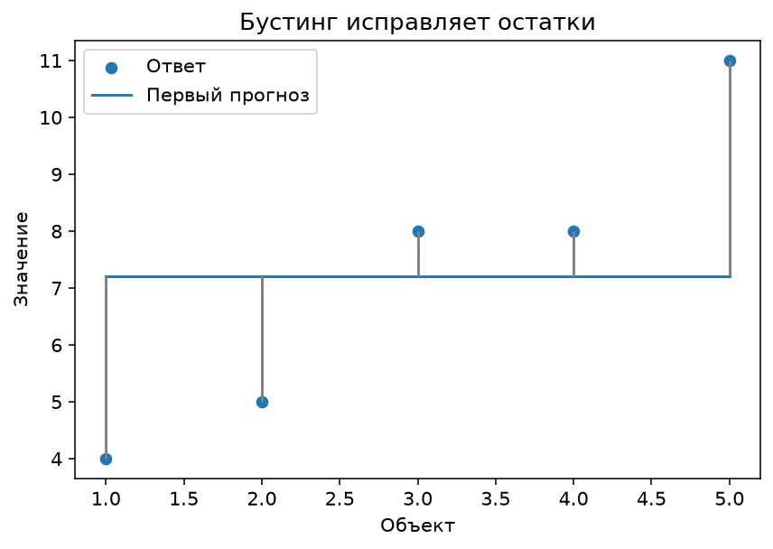
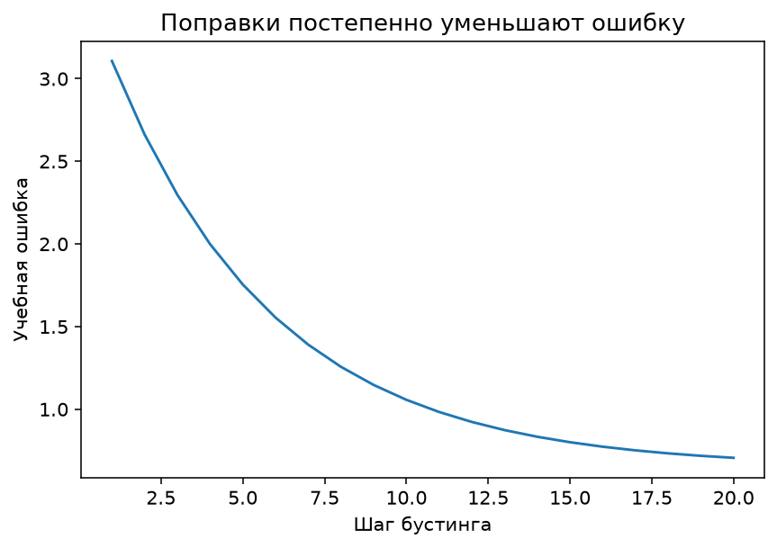
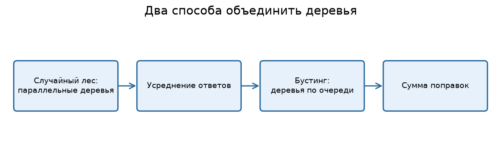

---

# Урок 1. Что такое бустинг и зачем он нужен?

**Перед началом:** деревья решений, функция потерь, градиентный спуск, train/test.

**После модуля:** ты сможешь объяснить бустинг через последовательное исправление ошибок, обучить бустинговую модель для регрессии и классификации, понимать основные гиперпараметры и не путать бустинг со случайным лесом.

**Запуск примеров:** см. [инструкцию к теме](README.md#как-запускать-примеры).

В предыдущем модуле мы узнали, что одно дерево решений часто переобучается или оказывается слишком грубым. Случайный лес решает часть проблемы: обучает много разнообразных деревьев и объединяет их ответы.

Но есть и другая идея. Что, если не обучать все деревья независимо, а заставить **каждое следующее исправлять ошибки предыдущих**?

Пример из жизни. Ты решаешь задачу, получаешь замечания и исправляешь решение. Потом получаешь новые замечания и снова корректируешь результат. Именно так можно интуитивно представить **boosting** - последовательное построение ансамбля.

## 1.1. Ансамбль как сумма моделей

Представим, что у нас уже есть первый прогноз `F₀(x)`. Мы обучаем маленькое дерево `h₁(x)`, которое даёт поправку. Новый прогноз:

`F₁(x) = F₀(x) + η · h₁(x)`

Здесь `η` (эта) - **learning rate**, или величина вклада новой модели.

После ещё одной модели:

`F₂(x) = F₁(x) + η · h₂(x)`

И так далее. С каждым шагом мы добавляем новую функцию, которая должна улучшать итоговый прогноз.

## 1.2. Что такое «слабая модель»?

В градиентном бустинге часто используют **неглубокие деревья**. Они умеют находить простые зависимости, но не обязаны идеально решать всю задачу. Сила ансамбля появляется в результате последовательных поправок.

Это не значит, что «чем слабее дерево, тем лучше». Глубину, число листьев и размер шага подбирают под задачу.

## 1.3. Почему это важно для табличных данных?

В задачах с таблицами - цены, покупки, риски, спрос, скоринг - бустинг на деревьях часто оказывается сильной отправной точкой. Он может учитывать нелинейные зависимости и взаимодействия признаков без ручного задания всех комбинаций.

Но никакой алгоритм не спасёт от неправильной цели, утечки данных и некачественной валидации. Более сложная модель не освобождает от базовых правил ML.

**Проверь себя**

Объясни в двух предложениях разницу между «усреднить независимые прогнозы» и «последовательно исправлять предыдущий прогноз».

---

# Урок 2. Разбираем бустинг вручную на трёх числах

Давай впервые буквально посчитаем идею бустинга без программирования.

## 2.1. Настоящие ответы

Представим, что у трёх объектов правильные значения:

`y = [2, 4, 6]`

Первый простой прогноз - среднее:

`F₀ = [4, 4, 4]`

Теперь найдём ошибки **со знаком** - остатки:

`r = y − F₀ = [−2, 0, 2]`

Первый объект переоценили на 2, второй угадали, третий недооценили на 2.

## 2.2. Строим исправление

Представим идеализированный учебный случай: новая небольшая модель смогла точно предсказать остатки `h₁ = [−2, 0, 2]`. В реальной задаче дерево может предсказывать их лишь приблизительно.

Выберем `η = 0.5`, то есть добавим **половину исправления**:

`F₁ = F₀ + 0.5 · h₁`

`F₁ = [4,4,4] + [−1,0,1] = [3,4,5]`

Сравним ошибки до и после.

**До поправки:**

`MSE₀ = ((4−2)² + (4−4)² + (4−6)²) / 3 = 8/3 ≈ 2.67`

**После поправки:**

`MSE₁ = ((3−2)² + (4−4)² + (5−6)²) / 3 = 2/3 ≈ 0.67`

Ошибка уменьшилась в четыре раза.



## 2.3. Следующая поправка

Остатки после первого шага:

`y − F₁ = [−1,0,1]`

Если следующий идеальный корректор снова выдаст эти остатки, получим:

`F₂ = [3,4,5] + 0.5 × [−1,0,1] = [2.5,4,5.5]`

И снова приблизимся к правильным ответам.



Это очень упрощённая ситуация: в реальных данных корректор не обязан точно предсказывать остатки, а функция потерь может быть другой. Но основная идея уже видна.

**Проверь себя**

Начни с `F₀=[5,5]`, `y=[3,7]`, выбери `η=0.25` и предположи идеальное предсказание остатка. Найди `F₁` и MSE до и после шага.

---

# Урок 3. Почему «градиентный»? Связь с производной

До этого мы говорили, что новое дерево предсказывает остатки. Почему же метод называется **градиентным бустингом**?

Ответ связан с М3. Вместо того чтобы всегда исправлять обычную разность `y − ŷ`, метод использует **направление уменьшения функции потерь**, которое определяется её производными.

## 3.1. Псевдоостатки

Для квадратичной потери `L = (y − F)² / 2` отрицательная производная по текущему прогнозу `F` равна:

`−∂L/∂F = y − F`

То есть в задаче регрессии с квадратичной ошибкой **отрицательный градиент совпадает с обычным остатком**.

Поэтому наш ручной пример с поправками по остаткам - не случайный трюк, а важный частный случай градиентного бустинга.

Для других функций потерь, например классификационной log loss, поправки определяются иначе. Поэтому неправильно утверждать, что **любой** градиентный бустинг на любой задаче просто обучает деревья на `y − ŷ`.

## 3.2. Как выглядит цикл обучения?

Упрощённо:

1. Создаём первый прогноз - например, константу, подходящую для выбранной функции потерь.
2. Рассчитываем отрицательные градиенты потерь для обучающих объектов.
3. Обучаем небольшое дерево предсказывать эти градиенты.
4. Уменьшаем вклад нового дерева с помощью learning rate.
5. Добавляем поправку к текущей модели.
6. Повторяем несколько десятков или сотен раз.

Реальные реализации могут дополнительно подбирать значения в листьях и использовать приближения второго порядка. Но новичку сначала важно освоить именно **последовательную оптимизацию**.

## 3.3. Почему не одно большое дерево?

Если сразу построить очень глубокое дерево, оно может запомнить детали обучающих объектов. Бустинг даёт другой путь: много относительно простых корректоров постепенно уточняют функцию.

Но и бустинг может переобучаться, если итераций слишком много, шаг слишком большой или отдельные деревья слишком сложны. Поэтому нужны валидация и регуляризация.

**Проверь себя**

Почему для квадратичной потери поправки можно объяснять через обычные остатки, а для любой произвольной функции потерь так делать уже нельзя?

---

# Урок 4. Random Forest против Gradient Boosting

В случайном лесе много деревьев. В бустинге тоже много деревьев. Но **то, как они создаются и объединяются**, принципиально отличается.



## 4.1. Случайный лес

Каждое дерево обычно получает bootstrap-выборку и случайность при выборе признаков для разбиений. Деревья можно обучать независимо друг от друга. Итог - усреднение или голосование.

Основная интуиция: **уменьшить нестабильность и разброс предсказаний отдельных деревьев**.

## 4.2. Градиентный бустинг

Каждое новое дерево строится **после предыдущих** и использует информацию об их ошибках в рамках выбранной функции потерь. Итог - последовательная сумма поправок.

Основная интуиция: **итеративно уменьшать ошибку, добавляя новые функции**.

## 4.3. Значит, бустинг всегда лучше?

Нет. Хотя сильные бустинговые библиотеки часто показывают отличные результаты на табличных задачах, выбор зависит от данных, вычислительного бюджета, объёма настройки и ограничений продукта.

| Свойство | Random Forest | Gradient Boosting |
|---|---|---|
| Обучение деревьев | В основном независимо | Последовательно |
| Итог | Среднее / голос | Сумма вкладов |
| Настройка | Часто проще | Часто чувствительнее к параметрам |
| Регуляризация | Глубина, листья, случайность | Глубина, листья, шаг, число итераций |
| Риск переобучения | Есть | Есть |

**Нет универсального победителя.** Всегда начинаем с baseline, выбираем по валидации и проверяем на тесте.

**Проверь себя**

Нарисуй две схемы: три дерева Random Forest «рядом» и три дерева бустинга «цепочкой». Напиши, как получается итоговый прогноз в каждом случае.

---

# Урок 5. Первый градиентный бустинг в scikit-learn

Используем уже знакомые данные квартир. Сейчас нам не нужна отдельная внешняя библиотека: в scikit-learn есть **HistGradientBoostingRegressor** - гистограммный градиентный бустинг для регрессии.

## 5.1. Почему «гистограммный»?

При построении деревьев этот алгоритм группирует числовые значения признаков в интервалы (*bins*). Это позволяет эффективнее искать разбиения на больших наборах данных.

В этой реализации также есть поддержка пропущенных значений для числовых признаков. Но сам факт поддержки `NaN` **не означает**, что можно игнорировать качество данных и смысл пропусков.

## 5.2. Обучаем модель цены

```python
import pandas as pd
from sklearn.model_selection import train_test_split
from sklearn.ensemble import HistGradientBoostingRegressor
from sklearn.dummy import DummyRegressor
from sklearn.metrics import mean_absolute_error

apartments = pd.read_csv("Данные/apartments.csv")
features = ["area_m2", "rooms", "floor", "metro_min", "year_built"]
X = apartments[features]
y = apartments["price_mln"]

X_train, X_test, y_train, y_test = train_test_split(
    X, y, test_size=0.2, random_state=42
)

baseline = DummyRegressor(strategy="mean").fit(X_train, y_train)
model = HistGradientBoostingRegressor(
    max_iter=180,
    learning_rate=0.07,
    max_leaf_nodes=12,
    min_samples_leaf=10,
    random_state=42,
)
model.fit(X_train, y_train)

print("Baseline MAE:", round(mean_absolute_error(y_test, baseline.predict(X_test)), 3))
print("Boosting MAE:", round(mean_absolute_error(y_test, model.predict(X_test)), 3))
```

Здесь мы сознательно использовали только числовые признаки. Категориальный столбец `district` пока не трогаем. В М10 разберём способы его включить.

## 5.3. Что означают параметры?

`max_iter` - максимальное число итераций бустинга, то есть шагов добавления корректирующих деревьев.
`learning_rate` - масштаб каждого вклада.
`max_leaf_nodes` - ограничивает сложность отдельных деревьев.
`min_samples_leaf` - минимальное число объектов в листьях.
`random_state` - фиксирует случайные процедуры для воспроизводимости.

Если обучающий набор маленький, слишком большое `min_samples_leaf` может не позволить деревьям делать полезные разбиения.

**Проверь себя**

Сравни `max_iter=30` и `max_iter=180` на validation, сохранив прочие параметры. Должна ли вторая модель обязательно оказаться лучше? Почему?

---

# Урок 6. Learning rate, количество деревьев и ранняя остановка

У бустинга есть важный компромисс. Маленький learning rate часто требует большего числа итераций. Большой шаг даёт более сильные обновления, но может переобучать модель или мешать устойчивому обучению.

## 6.1. Смотрим ошибку по мере обучения

У классического `GradientBoostingRegressor` есть удобный для обучения метод `staged_predict`: он показывает прогноз ансамбля после разных этапов построения.

```python
import pandas as pd
import matplotlib.pyplot as plt
from sklearn.model_selection import train_test_split
from sklearn.ensemble import GradientBoostingRegressor
from sklearn.metrics import mean_absolute_error

apartments = pd.read_csv("Данные/apartments.csv").dropna()
X = apartments[["area_m2", "rooms", "floor", "metro_min", "year_built"]]
y = apartments["price_mln"]

X_train, X_val, y_train, y_val = train_test_split(
    X, y, test_size=0.25, random_state=42
)

model = GradientBoostingRegressor(
    n_estimators=180,
    learning_rate=0.05,
    max_depth=2,
    random_state=42,
)
model.fit(X_train, y_train)

train_errors = [mean_absolute_error(y_train, p) for p in model.staged_predict(X_train)]
val_errors = [mean_absolute_error(y_val, p) for p in model.staged_predict(X_val)]

plt.plot(train_errors, label="Train MAE")
plt.plot(val_errors, label="Validation MAE")
plt.xlabel("Количество деревьев")
plt.ylabel("MAE, млн ₽")
plt.legend()
plt.show()
```

Если train-ошибка продолжает уменьшаться, а validation перестала улучшаться и начала расти, это один из признаков переобучения.

## 6.2. Что такое early stopping?

**Ранняя остановка** прекращает обучение, когда качество на выбранной валидационной части достаточно долго не улучшается. Это экономит вычисления и помогает не добавлять лишние деревья.

Для HistGradientBoosting существуют параметры `early_stopping`, `validation_fraction`, `n_iter_no_change`. Но стратегия валидации должна соответствовать природе данных: если это временной ряд, случайная внутренняя валидация может быть неподходящей.

## 6.3. Разумный подход к настройке

Не нужно сразу пробовать тысячи комбинаций. Начни с нескольких умеренных значений `learning_rate`, `max_iter` и сложности деревьев. Меняй параметры на validation, фиксируй результаты и **не выбирай модель по тесту**.

**Проверь себя**

Построй две кривые validation MAE при `learning_rate=0.05` и `0.2`. У какой модели ошибки уменьшаются быстрее в первые итерации? В каком случае начинается переобучение - если оно вообще появляется?

---

# Урок 7. Бустинг для классификации

До этого мы прогнозировали цену квартиры. Но градиентный бустинг можно использовать и для выбора класса - например, купит ли пользователь товар.

## 7.1. Обучаем классификатор

```python
import pandas as pd
from sklearn.model_selection import train_test_split
from sklearn.ensemble import HistGradientBoostingClassifier
from sklearn.metrics import roc_auc_score, average_precision_score, classification_report

customers = pd.read_csv("Данные/shop_customers.csv")
X = customers.drop(columns=["user_id", "device", "bought_next_7d"])
y = customers["bought_next_7d"]

X_train, X_test, y_train, y_test = train_test_split(
    X, y, test_size=0.2, stratify=y, random_state=42
)

model = HistGradientBoostingClassifier(
    max_iter=150,
    learning_rate=0.06,
    max_leaf_nodes=12,
    min_samples_leaf=15,
    random_state=42,
)
model.fit(X_train, y_train)
prob = model.predict_proba(X_test)[:, 1]
pred = model.predict(X_test)

print("ROC-AUC:", round(roc_auc_score(y_test, prob), 3))
print("Average precision:", round(average_precision_score(y_test, prob), 3))
print(classification_report(y_test, pred, zero_division=0))
```

Мы использовали две метрики для оценок вероятности: **ROC-AUC** и **average precision** (взвешенное среднее precision на шагах увеличения recall в определении scikit-learn). Они особенно полезны при анализе качества ранжирования, но не заменяют проверку поведения системы при выбранном рабочем пороге.

## 7.2. Почему AUC не равно вероятности покупки?

ROC-AUC измеряет способность модели **ранжировать** положительные объекты выше отрицательных по оценкам. Даже высокое ROC-AUC не гарантирует, что если модель сказала «80%», то примерно 80% таких клиентов совершат покупку. Это отдельный вопрос калибровки.

## 7.3. Важен момент прогноза

Если какие-то признаки были вычислены после наступления прогнозируемого события, даже сильный бустинг просто научится пользоваться «подсказками из будущего». Поэтому проверка данных часто важнее тонкой настройки `learning_rate`.

**Проверь себя**

Сравни бустинг с логистической регрессией на одной и той же **валидационной** выборке. Выбери основную метрику и объясни её связь с бизнес-задачей.

---

# Урок 8. XGBoost, LightGBM, CatBoost и границы бустинга

В реальных проектах встречаются разные библиотеки градиентного бустинга. Ты часто увидишь в требованиях вакансий названия **XGBoost, LightGBM и CatBoost**.

Сейчас достаточно разобраться с принципами. Не нужно превращать курс в соревнование по количеству изученных библиотек.

## 8.1. Чем различаются библиотеки?

**XGBoost** известен эффективными реализациями градиентного бустинга и широкими возможностями настройки. **LightGBM** использует подходы, ориентированные на эффективную работу с большими табличными наборами. **CatBoost** предоставляет специальные механизмы работы с категориальными признаками.

Конкретные преимущества зависят от версии библиотеки, данных и условий обучения. Нет строгого правила «CatBoost всегда лучше для всех категорий» или «LightGBM всегда самый быстрый».

## 8.2. Почему бустинг не всегда нужно выбирать первым?

Он может быть мощным, но:

- настроек больше, чем у простого baseline;
- маленькие данные иногда не дают преимуществ;
- прогнозы труднее объяснять, чем у небольшой линейной модели;
- утечка, неверная схема разделения и плохая целевая метрика никуда не исчезают;
- при изменении поведения пользователей модель может деградировать со временем.

## 8.3. Как объяснять результат модели?

Один из способов - **permutation importance** на отдельной validation-части: переставляем значения признака и измеряем ухудшение метрики. Другие популярные инструменты интерпретации, например SHAP, будем разбирать по мере необходимости, а не делать вид, что одна диаграмма полностью объясняет причинные механизмы бизнеса.

## 8.4. Схема работы в реальном проекте

1. Начать с простого baseline.
2. Сделать честную схему train/validation/test.
3. Обучить линейную модель или дерево как ориентир.
4. Обучить бустинг с умеренными параметрами.
5. Подобрать ограниченный набор гиперпараметров на validation.
6. Проверить качество и стабильность.
7. Оценить стоимость внедрения, скорость работы и объяснимость.
8. Только затем принимать решение, что лучше для продукта.

**Главная мысль:** сильная модель - не та, у которой самое модное название, а та, которая решает задачу на новых данных, в нужные сроки и с приемлемой стоимостью ошибок.

---

# Итоги модуля
Градиентный бустинг строит ансамбль **последовательно**: каждая новая модель помогает уменьшить текущую ошибку, ориентируясь на градиенты функции потерь. При квадратичной потере это удобно понимать через обычные остатки.

Ты знаешь, что такое learning rate, число итераций, сложность деревьев и early stopping; научился запускать градиентный бустинг для регрессии и классификации и понял, зачем сравнивать его с простыми алгоритмами на честной валидации.

---

# Практика: Градиентный бустинг

**Что понадобится:** бумага для ручного расчёта, Colab или Jupyter со scikit-learn и учебные CSV.

**Цель:** разобрать последовательные поправки бустинга и проверить его на регрессии и классификации.

**Как сдавать:** ручные расчёты и один ноутбук с двумя задачами и объяснениями.

## Часть 1. Считаем своими руками

### Задание 1. Первая коррекция

Пусть `y=[4,6,8]`, начальный прогноз `F₀=[6,6,6]`. Найди остатки, а затем новый прогноз при `η=0.5`, если учебное дерево идеально предсказывает остатки.

### Задание 2. Ошибка до и после

Для данных задания 1 вычисли MSE до обновления и после него. Во сколько раз уменьшилась ошибка?

### Задание 3. Слишком большой шаг

Повтори вычисление из задания 1 для `η=2.5`. Сравни новую MSE с исходной. Почему слишком большой шаг может не уменьшить, а увеличить ошибку?

## Часть 2. Регрессия

### Задание 4. Бустинг квартир

Обучи `HistGradientBoostingRegressor` на `apartments.csv` и сравни с `DummyRegressor`, линейной регрессией и случайным лесом. Используй **одни и те же** разбиения; не подбирай настройки по test.

### Задание 5. Скорость обучения

На validation сравни `learning_rate=0.03`, `0.1`, `0.3` при заранее выбранном ограничении сложности деревьев. Зафиксируй MAE и время обучения. Какие выводы можно сделать?

### Задание 6. Число итераций

Для `GradientBoostingRegressor` построй графики train/validation MAE по итерациям с `staged_predict`. Найди участок, где дальнейшее добавление деревьев почти не помогает или начинает вредить.

## Часть 3. Классификация

### Задание 7. Покупка товара

Обучи `HistGradientBoostingClassifier` на `shop_customers.csv`. Покажи матрицу ошибок и сравни ROC-AUC с логистической регрессией на validation.

### Задание 8. Порог и редкий класс

Для вероятностей классификатора попробуй пороги 0.3, 0.5 и 0.7 **на validation**. Сравни precision и recall. Почему качество при одном пороге не описывает поведение при всех порогах?

### Задание 9. Важность признаков

Оцени permutation importance на validation и опиши три наиболее заметных признака. Почему нельзя превращать этот отчёт в утверждение о причинности?

### Задание 10. Мини-отчёт как для команды

Сделай таблицу сравнения четырёх моделей, опиши схему валидации, выбранную метрику, главные ошибки и причины выбора итогового решения. Напиши отдельно, что может пойти не так после внедрения модели.

# Финальный вопрос

**Почему в градиентном бустинге новые деревья обучаются последовательно, а в случайном лесе - в основном независимо?**
