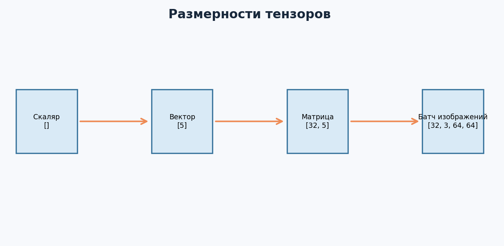
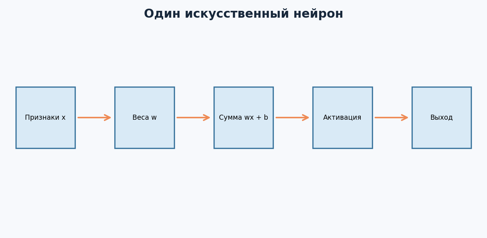
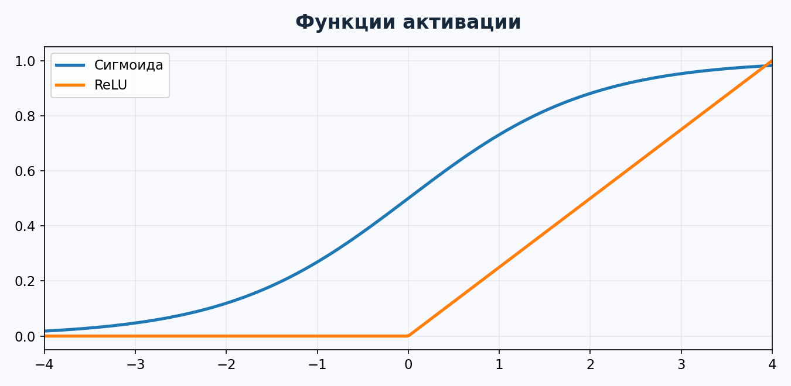
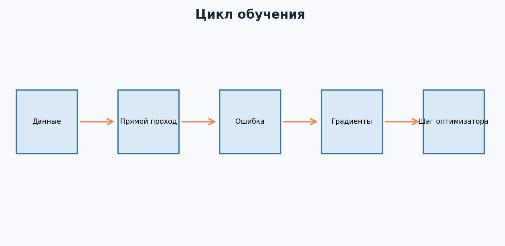
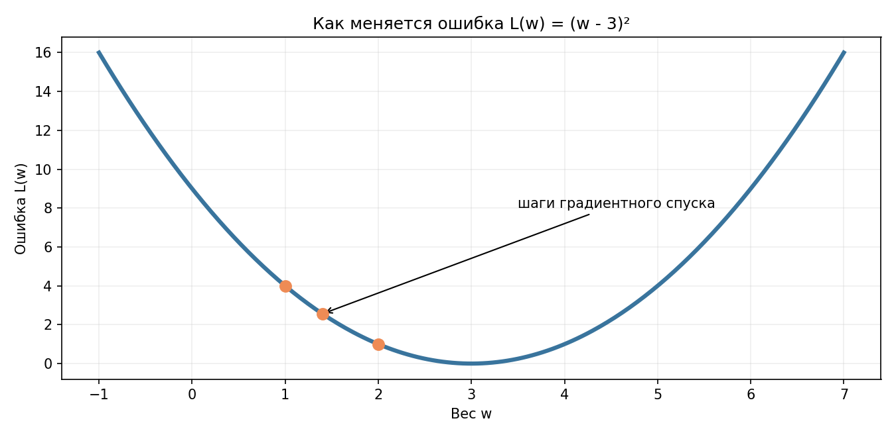
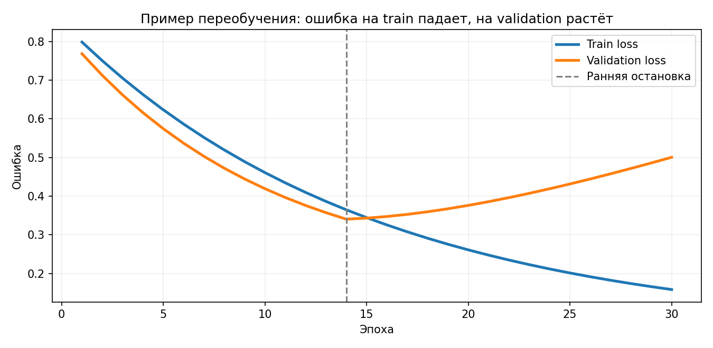

---

# Урок 1. Что такое Deep Learning и зачем он нужен?

**Перед началом:** М1–М11, Python, NumPy, pandas, функции, градиентный спуск, train/validation/test.

**После модуля:** ты поймёшь, как устроены нейроны и многослойные сети, сможешь объяснить `loss.backward()`, собрать обучение на PyTorch и честно сравнить свою сеть с классическим ML.

Примеры рассчитаны на обычный компьютер без видеокарты. Данные в `Данные/customers_deep.csv` **синтетические**; они созданы специально для курса, не содержат реальных клиентов. Запускай код из папки «Т4. Глубокое обучение», чтобы относительные пути открывались корректно.

До этого мы предсказывали покупки, оценивали стоимость квартир, строили деревья и градиентный бустинг. Иногда кажется: «А зачем вообще нейросети, если классический ML уже решает задачи?» Хороший вопрос. Для табличных данных бустинг нередко остаётся очень сильным решением. Но представь, что задача - распознать предмет на фотографии или понять смысл длинного текста. Подготовить все подходящие признаки вручную может быть сложно.

**Deep Learning (глубокое обучение)** - область машинного обучения, в которой используются нейронные сети с несколькими последовательными преобразованиями. Слово «глубокое» обычно связано с наличием нескольких обучаемых слоёв, а не с тем, что компьютер «глубоко мыслит».

## 1.1. Чем сеть отличается от знакомой линейной модели?

Линейная модель считает `ŷ = Xw + b`: из признаков получается прогноз. Нейронная сеть повторяет похожую операцию много раз. Например:

`признаки → линейное преобразование → ReLU → линейное преобразование → прогноз`

Промежуточные числовые представления сеть тоже обучается формировать. В компьютерном зрении ранние слои могут реагировать на границы и простые текстуры, а более поздние - на сложные комбинации признаков. **Это полезная интуиция, а не универсальная гарантия того, что каждый нейрон отвечает за какой-то один понятный объект.**

## 1.2. Что такое обучение нейросети?

Это всё тот же процесс из М3:

1. Берём примеры с входными данными и правильными ответами.
2. Делаем прогнозы: *forward pass* - прямой проход.
3. Считаем **функцию потерь**.
4. Вычисляем производные ошибки по параметрам: *backward pass*.
5. Обновляем веса оптимизатором.
6. Повторяем на следующих пакетах данных.

Важно: градиент показывает, как изменение веса влияет на ошибку **в текущей точке**. Обновление веса не гарантирует уменьшение ошибки на каждом отдельном шаге и не гарантирует качество на новых данных.

## 1.3. Где нейросети особенно важны?

В компьютерном зрении, распознавании и генерации речи, работе с языком, рекомендациях и некоторых задачах обработки последовательностей. Современные языковые модели - тоже нейросети, но гораздо более сложные, чем мы построим в этом модуле.

Не нужно сразу пытаться обучить собственный аналог ChatGPT. Начни с небольшой модели, которую ты можешь понять от входных данных до сохранённых весов.

**Главная идея:** нейросеть - обучаемая цепочка преобразований; принцип обучения похож на знакомый градиентный спуск.

**Проверь себя**

Придумай по одной задаче, где разумно сначала попробовать: (а) градиентный бустинг на таблице, (б) нейросеть для изображений. Объясни выбор без аргумента «нейросети моднее».

---

# Урок 2. Тензоры: новый способ работать с данными

В М1 мы говорили о векторах и матрицах. В PyTorch их обобщением служит **тензор**. Не нужно пугаться названия: в нашей работе это массив чисел, который может иметь разное количество осей и дополнительные возможности, например вычисление градиентов.

## 2.1. Что такое форма тензора — shape?

- Скаляр `5` - тензор размерности 0, `shape = ()`.
- Вектор `[1, 2, 3]` - одна ось, `shape = (3,)`.
- Таблица из 4 строк и 3 столбцов - две оси, `shape = (4, 3)`.
- Пакет из 32 RGB-фотографий размера 64×64 - обычно четыре оси, `shape = (32, 3, 64, 64)`.

**Не путай:** количество осей (`ndim`) и размеры по осям (`shape`) - разные вещи.



## 2.2. Первые тензоры в PyTorch

```python
import torch

x = torch.tensor([2.0, 1.0, 3.0])
X = torch.tensor([[2.0, 1.0, 3.0],
                  [4.0, 0.0, 2.0]])

print(x.shape)     # torch.Size([3])
print(X.shape)     # torch.Size([2, 3])
print(X.ndim)      # 2
print(X.dtype)     # torch.float32
print(X @ x)       # tensor([14., 14.])
```

Последняя операция - умножение матрицы на вектор. Первая строка: `2×2 + 1×1 + 3×3 = 14`. Вторая: `4×2 + 0×1 + 2×3 = 14`. Проверять такую арифметику полезно даже тогда, когда код написан автором урока или ИИ.

## 2.3. Тип и устройство — dtype и device

Тип `float32` хранит числа с плавающей точкой. Для меток классов часто используют `int64` (в PyTorch - `torch.long`). Для матричного умножения размеры должны подходить друг другу; для вычислений также важны совместимые типы и устройства.

```python
features = torch.tensor([[1.0, 2.0], [3.0, 4.0]], dtype=torch.float32)
labels = torch.tensor([0, 1], dtype=torch.long)
print(features.shape, labels.shape)
```

`device` показывает, где находится тензор: на CPU или GPU. Если модель на GPU, её входные данные тоже должны быть на совместимом устройстве.

## 2.4. Broadcasting — удобство и источник ошибок

```python
X = torch.tensor([[1., 2.], [3., 4.]])
b = torch.tensor([10., 20.])
print(X + b)  # [[11., 22.], [13., 24.]]
```

`b` автоматически применяется к каждой строке. Это называется *broadcasting*. Оно полезно для добавления смещения в нейронном слое, но также может незаметно сделать неверное вычисление, если формы тензоров случайно совместились.

**Главное:** при отладке нейросети первым делом проверяй `shape`, `dtype`, `device`.

**Проверь себя**

Чему равен `shape` таблицы с 100 покупателями и 5 признаками? А если модель должна выдать один logit для каждого из них? Объясни отличие форм `(100,)` и `(100, 1)`.

---

# Урок 3. Нейрон, слои и нелинейность

## 3.1. Один нейрон

Вернёмся к клиенту магазина. У него есть два признака: `x₁ = 2`, `x₂ = 1`. Нейрон использует веса `w₁ = 0.4`, `w₂ = 0.6` и смещение `b = 0.2`:

`z = x₁w₁ + x₂w₂ + b = 2×0.4 + 1×0.6 + 0.2 = 1.6`

Затем применяется функция активации. Например, **ReLU**: `ReLU(z) = max(0, z)`. В нашем случае выход равен 1.6.



Нейрон не «думает», какие признаки важны: он выполняет вычисление с обучаемыми весами. Их значения меняются во время обучения.

## 3.2. Зачем функция активации?

Представь два слоя без активаций:

`h = XW₁ + b₁`
`ŷ = hW₂ + b₂`

Если раскрыть скобки, получится `ŷ = X(W₁W₂) + (b₁W₂ + b₂)` - снова одно аффинное преобразование. Много таких слоёв без нелинейности не дадут модели новую принципиально нелинейную зависимость.

Поэтому между слоями ставят, например, ReLU. Благодаря нелинейным активациям сеть может приближать более сложные функции.



**Sigmoid** переводит число в интервал от 0 до 1. Но для бинарной классификации при обучении с `BCEWithLogitsLoss` вручную применять `Sigmoid` на последнем слое не нужно: функция потерь сама выполняет численно устойчивый вариант нужного вычисления.

## 3.3. Слои в PyTorch

```python
import torch
from torch import nn

layer = nn.Linear(in_features=2, out_features=3)
x = torch.tensor([[2.0, 1.0], [4.0, 3.0]])
y = layer(x)
print(y.shape)       # torch.Size([2, 3])
print(layer.weight.shape)  # torch.Size([3, 2])
```

Здесь два объекта, у каждого два признака. Слой выдаёт три новых числа на объект. PyTorch хранит веса `nn.Linear` в форме `(out_features, in_features)`, хотя при математическом объяснении часто используют запись `XW + b`, где матрица W записана в транспонированном расположении. **Это разные соглашения о форме весов, не разные математические операции.**

## 3.4. Многослойная сеть

```python
model = nn.Sequential(
    nn.Linear(2, 8),
    nn.ReLU(),
    nn.Linear(8, 1),
)
print(model(torch.tensor([[2.0, 1.0]])).shape)  # [1, 1]
```

Сначала два признака превращаются в восемь промежуточных чисел. Затем ReLU применяет нелинейность. Финальный слой превращает восемь чисел в одно. Пока веса случайные, прогноз не имеет полезного смысла: модель нужно обучить.

**Главное:** слои задают последовательность обучаемых преобразований, активации добавляют нелинейность.

**Проверь себя**

Нарисуй сеть `5 → 8 → 1`. Сколько входных признаков? Сколько выходных чисел на объект? Что случится, если удалить ReLU из нескольких последовательных линейных слоёв?

---

# Урок 4. Функции потерь: что нейросеть считает ошибкой?

В классическом ML мы уже использовали MSE, MAE, log loss и другие метрики. В нейросети нужно чётко разделять **функцию потерь, которую оптимизируем**, и **метрики, которые показываем в отчёте**. Например, можно обучать по кросс-энтропии, а оценивать ещё и accuracy, ROC-AUC, average precision.

## 4.1. Для регрессии — MSE

Прогноз `ŷ = [6.0, 7.0]`, истинные цены `y = [5.0, 9.0]`. Ошибки `[1, −2]`, квадраты `[1, 4]`, MSE = `(1+4)/2 = 2.5`.

```python
import torch
from torch import nn

pred = torch.tensor([[6.0], [7.0]])
true = torch.tensor([[5.0], [9.0]])
print(nn.MSELoss()(pred, true).item())  # 2.5
```

## 4.2. Для бинарной классификации — BCEWithLogitsLoss

Модель покупки выдаёт **logit** - любое вещественное число, а не вероятность. Чтобы получить вероятность, используем сигмоиду: `p = sigmoid(logit)`. Например, logit = 0 соответствует вероятности 0.5.

```python
logits = torch.tensor([[0.0], [2.0], [-2.0]])
labels = torch.tensor([[1.0], [1.0], [0.0]])

loss_fn = nn.BCEWithLogitsLoss()
print(loss_fn(logits, labels).item())
print(torch.sigmoid(logits).flatten())
```

**Здесь легко ошибиться:** если добавить `nn.Sigmoid()` в конец модели **и затем** использовать `BCEWithLogitsLoss`, сигмоида будет применена дважды по смыслу задачи, и обучение станет неверно настроенным. Для `BCEWithLogitsLoss` нужны **сырые логиты**.

## 4.3. Для нескольких классов — CrossEntropyLoss

Допустим, классифицируем изображения: `круг`, `квадрат`, `треугольник`. Нейросеть выдаёт три логита для каждого объекта, а правильные метки - целые индексы от 0 до 2.

```python
logits = torch.tensor([[1.5, 0.3, -0.4], [0.1, 2.2, 0.2]])
y = torch.tensor([0, 1], dtype=torch.long)
print(nn.CrossEntropyLoss()(logits, y).item())
```

У `CrossEntropyLoss` не нужно заранее делать `softmax` по логитам. Для предсказания класса используем `argmax`, для получения вероятностей при оценке - `softmax`.

## 4.4. Почему одной accuracy мало?

Если 95% пользователей не покупают, модель «всегда нет» имеет 95% accuracy, хотя не находит покупателей. Поэтому оценивай задачи с редким положительным классом по полноте, точности положительных предсказаний, PR-AUC/average precision и реальным бизнес-ошибкам. Выбор метрики зависит от задачи.

**Главное:** выход модели, функция потерь и формат `y` должны соответствовать друг другу.

**Проверь себя**

Какую функцию потерь ты выберешь для прогноза цены квартиры? Для бинарного «купил / не купил»? Для распознавания трёх видов фигур? Какие формы `y` ожидаются в примерах кода?

---

# Урок 5. Autograd: компьютер считает производные

В М3 мы вручную вычисляли производную функции ошибки и делали шаг градиентного спуска. В настоящей нейросети параметров может быть очень много. Неужели придётся каждый раз выводить огромную формулу? Нет. PyTorch умеет автоматически строить вычислительный граф и применять цепное правило.

## 5.1. Простейший пример

Пусть `L(w) = (w − 2)²`. Тогда производная `L'(w) = 2(w − 2)`. При `w = 0` она равна −4.

```python
import torch

w = torch.tensor(0.0, requires_grad=True)
loss = (w - 2) ** 2
loss.backward()
print(w.grad.item())  # -4.0
```

`requires_grad=True` говорит PyTorch: для этого тензора нужно отслеживать вычисления, чтобы затем можно было найти градиент. `backward()` запускает обратный проход. Результат попадает в `w.grad`.

## 5.2. Один шаг вручную

Градиентный спуск: `w_new = w_old − α × dL/dw`. При `α = 0.1` получаем `w_new = 0 − 0.1 × (−4) = 0.4`. Ошибка уменьшается с 4 до 2.56.

```python
with torch.no_grad():
    w -= 0.1 * w.grad
print('w:', w.item(), 'L:', ((w - 2) ** 2).item())
```

`torch.no_grad()` временно отключает отслеживание операций: обновление параметра само по себе не должно считаться частью вычислительного графа для очередного шага.

## 5.3. Почему нужно обнулять градиенты?

В PyTorch градиенты по умолчанию **накапливаются** при повторных `backward()`. Это бывает полезно, но в обычном цикле обучения перед очередным шагом их нужно сбросить:

```python
optimizer.zero_grad()
```

Если забыть, параметр может обновляться по сумме старых и новых градиентов, хотя ты хотел использовать только текущий пакет.

## 5.4. Разница между backpropagation и optimizer.step()

`loss.backward()` **вычисляет** градиенты, используя граф вычислений.
`optimizer.step()` **изменяет** параметры на основе градиентов и правил оптимизатора.
Это две разные операции.

**Главное:** autograd автоматизирует дифференцирование; оптимизатор отвечает за обновление параметров.

**Проверь себя**

Измени начальное `w` на 4. Вычисли производную вручную до запуска кода. Затем проверь через `backward()`; что меняется в направлении обновления?

---

# Урок 6. Оптимизатор и цикл обучения

Мы готовы собрать базовый тренировочный цикл. Пока обучим модель на игрушечных данных: `y = 2x + 1`. Шума здесь нет - задача создана только для понимания механизма.



## 6.1. Пять обязательных действий

```python
import torch
from torch import nn

torch.manual_seed(42)
X = torch.tensor([[0.], [1.], [2.], [3.]])
y = torch.tensor([[1.], [3.], [5.], [7.]])

model = nn.Linear(1, 1)
loss_fn = nn.MSELoss()
optimizer = torch.optim.SGD(model.parameters(), lr=0.05)

for epoch in range(300):
    optimizer.zero_grad()      # 1. Сброс градиентов
    pred = model(X)            # 2. Прямой проход
    loss = loss_fn(pred, y)    # 3. Функция потерь
    loss.backward()           # 4. Градиенты
    optimizer.step()          # 5. Обновление весов

print('Вес:', round(model.weight.item(), 3))
print('Смещение:', round(model.bias.item(), 3))
print('Ошибка:', round(loss.item(), 6))
```

В этой игрушечной задаче параметры должны приблизиться к `w ≈ 2`, `b ≈ 1`. Точные последние знаки зависят от случайной инициализации, числа шагов и скорости обучения.

## 6.2. SGD и Adam

**SGD** делает обновления, связанные с текущим градиентом и скоростью обучения. **Adam** использует накопленные оценки моментов градиента, из-за чего для многих нейросетевых задач он удобен как отправная точка. Но универсально лучшего оптимизатора нет.

```python
optimizer = torch.optim.Adam(model.parameters(), lr=1e-3)
```

Изменять оптимизатор лучше осмысленно и сравнивать результаты на validation, а не на test.

## 6.3. Learning rate



Слишком маленький шаг может замедлить обучение. Слишком большой - приводить к колебаниям или расходимости. Если ошибка внезапно стала `nan`, проверь данные, значения признаков, скорость обучения и корректность функции потерь.

## 6.4. Не забывай о размере пакета

Пока мы подали все четыре примера сразу. Для больших данных обучение организуют пакетами (*batches*), чтобы не загружать всё одновременно в память и регулярно обновлять параметры.

**Главное:** «обучить нейросеть» в практическом смысле - многократно выполнить понятный цикл действий.

**Проверь себя**

Поставь `lr=0.01` и `lr=0.5` в одном и том же учебном примере, сравни поведение ошибки. Не делай общих выводов по одной маленькой задаче.

---

# Урок 7. Dataset, DataLoader, эпоха и batch

В реальных данных у нас могут быть десятки тысяч пользователей или сотни тысяч изображений. Загрузить всё в один тензор иногда возможно, но не всегда удобно. Поэтому PyTorch предлагает два важных инструмента: **Dataset** и **DataLoader**.

## 7.1. Что такое Dataset?

`Dataset` описывает, как получить один объект и его метку. Для простых тензоров есть готовая реализация `TensorDataset`.

```python
import torch
from torch.utils.data import TensorDataset, DataLoader

X = torch.tensor([[1., 2.], [3., 4.], [5., 6.], [7., 8.]])
y = torch.tensor([[0.], [1.], [0.], [1.]])

dataset = TensorDataset(X, y)
print(len(dataset))
print(dataset[0])
```

## 7.2. DataLoader делает пакеты

```python
loader = DataLoader(dataset, batch_size=2, shuffle=True)

for batch_X, batch_y in loader:
    print(batch_X.shape, batch_y.shape)
```

Для четырёх объектов и размера пакета 2 получится два пакета. Перемешивание на train помогает не учиться в фиксированном порядке. Для validation и test обычно используется `shuffle=False`, поскольку обновления весов на этих частях не происходят.

## 7.3. Что такое эпоха?

**Эпоха** - один проход по всем обучающим примерам. Если объектов 1200, а batch size равен 32, то будет `ceil(1200 / 32) = 38` пакетов за эпоху, если не отбрасывать последний неполный пакет.

**Шаг оптимизатора** - одно обновление параметров. Поэтому количество шагов и эпох - разные числа.

## 7.4. Режимы train и eval

```python
model.train()  # обучение: включает training-режимы слоёв
model.eval()   # оценка: переключает слои в evaluation-режим

with torch.no_grad():
    predictions = model(X)
```

`model.eval()` особенно важен, если в сети есть Dropout или BatchNorm. Он **сам по себе не отключает** отслеживание градиентов - для этого используем `torch.no_grad()` или `torch.inference_mode()`.

## 7.5. Почему нельзя перемешивать train и test как попало?

Правила из М10 никуда не исчезли: сначала честно выделяем данные, затем обучаем масштабирование только на train. Если у пользователей несколько записей, может понадобиться групповое разбиение; для временной задачи - разбиение по времени.

**Главное:** DataLoader управляет подачей примеров, а не заменяет правильную валидацию.

**Проверь себя**

Сколько пакетов будет для 101 объекта при `batch_size=20`, если последний пакет не отбрасывать? Почему при `model.eval()` всё равно стоит оборачивать оценку в `no_grad()`?

---

# Урок 8. Практика: предсказываем покупку с помощью MLP

Вот наша первая полноценная маленькая нейросеть. Возьмём синтетические данные об интернет-магазине. Есть признаки, доступные на момент прогноза, и целевая переменная `bought_next_7d` - совершит ли пользователь покупку в следующие семь дней.

**Важная оговорка:** это пример бинарной классификации, а не готовая система маркетинговых решений. Модель на искусственных данных не доказывает, что она сработает на настоящих клиентах.

## 8.1. Читаем данные

```python
import pandas as pd

df = pd.read_csv('Данные/customers_deep.csv')
print(df.head())
print(df['bought_next_7d'].value_counts(normalize=True))
```

Не отдаём в модель `user_id`: это идентификатор, а не осмысленная числовая характеристика покупательского поведения. Включаем только пять признаков: возраст, визиты за 30 дней, покупки за 90 дней, добавления в корзину за 30 дней, средний чек прошлых покупок.

## 8.2. Разделяем и масштабируем данные

```python
from sklearn.model_selection import train_test_split
from sklearn.preprocessing import StandardScaler

features = ['age', 'visits_30d', 'purchases_90d',
            'cart_adds_30d', 'avg_check_rub']
X = df[features].to_numpy(dtype='float32')
y = df['bought_next_7d'].to_numpy(dtype='float32')

X_dev, X_test, y_dev, y_test = train_test_split(
    X, y, test_size=0.2, random_state=42, stratify=y
)
X_train, X_val, y_train, y_val = train_test_split(
    X_dev, y_dev, test_size=0.25, random_state=42,
    stratify=y_dev
)
scaler = StandardScaler()
X_train = scaler.fit_transform(X_train).astype('float32')
X_val = scaler.transform(X_val).astype('float32')
X_test = scaler.transform(X_test).astype('float32')
```

Получили примерно 60% train, 20% validation и 20% test. `scaler` обучается **только на train** - иначе информация о распределении признаков из теста повлияет на подготовку модели.

## 8.3. Архитектура MLP

**MLP (Multi-Layer Perceptron)** - сеть из полносвязных слоёв. Для табличных данных такой вариант прост и удобен в учебных целях.

```python
import torch
from torch import nn

torch.manual_seed(42)
model = nn.Sequential(
    nn.Linear(5, 16),
    nn.ReLU(),
    nn.Linear(16, 8),
    nn.ReLU(),
    nn.Linear(8, 1),  # один logit, без sigmoid
)
print(model)
```

Здесь входные пять признаков превращаются в 16 промежуточных чисел, затем в 8 и наконец в один logit.

## 8.4. Полный цикл обучения

Для удобства код целиком вынесен в `Примеры/m12_train_mlp.py`. Там используются `TensorDataset`, `DataLoader`, `BCEWithLogitsLoss`, `Adam`, валидация после эпохи, сохранение лучших весов и сравнение с линейным baseline.

Запуск из папки «Т4. Глубокое обучение»:

```bash
python Примеры/m12_train_mlp.py
```

После запуска программа напечатает метрики для validation и test. Цифры не нужно заучивать: они меняются при иной выборке и параметрах. Гораздо важнее, чтобы ученик мог объяснить, откуда берётся каждое число и почему тест используется только после выбора модели.

## 8.5. Нейросеть против логистической регрессии

Помни М7: логистическая регрессия - сильный простой baseline для бинарной классификации. Сравнивать MLP нужно не с «угадыванием на глаз», а как минимум с DummyClassifier и логистической регрессией на **тех же** данных и метриках. Не удивляйся, если на табличных данных простая модель окажется не хуже или даже лучше.

**Главное:** правильный эксперимент важнее сложности архитектуры.

**Проверь себя**

Проверь долю положительного класса и объясни, почему accuracy может обманывать. Запусти скрипт и выпиши: признаки, split, loss, optimizer, метрики, baseline. Затем замени `hidden=16` на 8 или 32 и сравни **validation**, не test.

---

# Урок 9. Переобучение, регуляризация и ранняя остановка

В начале нейросеть обычно ещё ничего не знает о данных. По мере обучения качество на train улучшается. Но существует риск, что сеть слишком подстроится под учебные примеры - особенно если данных мало, а параметров много.

## 9.1. Как распознать переобучение?

Построй график train loss и validation loss по эпохам. Если первая линия устойчиво снижается, а вторая после некоторого момента начинает расти, это может указывать на переобучение.



На рисунке - **условные кривые**, а не результат конкретного эксперимента. В реальности они могут быть неровными.

## 9.2. Как бороться?

**Больше подходящих данных.** Если проблема в нехватке представительных примеров, дополнительные качественные наблюдения часто полезнее сложных настроек.

**Уменьшить модель.** Сеть с 8 скрытыми нейронами может быть достаточной там, где 512 только запоминают шум.

**Weight decay.** Штрафует крупные веса определённым способом. В оптимизаторе AdamW это оформлено как отдельный механизм уменьшения весов:

```python
optimizer = torch.optim.AdamW(model.parameters(), lr=1e-3, weight_decay=1e-3)
```

**Dropout.** Во время обучения случайным образом выключает часть промежуточных активаций; при `eval()` механизм отключается:

```python
nn.Sequential(nn.Linear(5, 16), nn.ReLU(), nn.Dropout(p=0.2), nn.Linear(16, 1))
```

**Early stopping.** После каждой эпохи оцениваем модель на validation. Если качество долго не улучшается, останавливаем обучение и восстанавливаем лучшие веса. При этом validation не становится «честным test» - он использовался для выбора момента остановки.

## 9.3. Утечки данных не лечатся регуляризацией

Никакой Dropout не исправит ситуацию, если в признаки попала информация из будущего или тестовые данные участвовали в подборе параметров. Методологию проверки всегда нужно контролировать отдельно.

**Главное:** нужна не минимальная ошибка на train любой ценой, а устойчивое качество на новых данных.

**Проверь себя**

Нарисуй условные кривые, где сеть переобучается после десятой эпохи. Какую информацию можно использовать для ранней остановки? Почему нельзя подбирать `dropout` по окончательному test?

---

# Урок 10. CPU/GPU, сохранение модели и воспроизводимость

## 10.1. Зачем GPU?

Обучение нейросетей состоит из большого числа матричных операций. GPU может существенно ускорять подходящие вычисления, но не гарантирует ускорение для каждой маленькой задачи. Наш учебный табличный MLP прекрасно работает и на CPU.

```python
import torch

device = torch.device('cuda' if torch.cuda.is_available() else 'cpu')
print('Устройство:', device)
model = model.to(device)
# В цикле обучения переноси на то же устройство и X_batch, и y_batch.
```

Для Apple Silicon может быть доступен backend `mps`, но он зависит от сборки и оборудования; здесь ради простоты выбираем CUDA или CPU.

## 10.2. Как сохранить веса?

```python
import torch

torch.save(model.state_dict(), 'm12_weights.pt')
```

Чтобы загрузить веса, необходимо создать **такую же архитектуру**:

```python
new_model = nn.Sequential(
    nn.Linear(5, 16), nn.ReLU(),
    nn.Linear(16, 8), nn.ReLU(),
    nn.Linear(8, 1)
)
state = torch.load('m12_weights.pt', map_location='cpu', weights_only=True)
new_model.load_state_dict(state)
new_model.eval()
```

В реальном проекте нужно сохранять не только веса, но и порядок признаков, параметры масштабирования, настройки порога и версию кода. Иначе можно получить воспроизводимую модель, но неправильные прогнозы.

## 10.3. Что делает код воспроизводимым?

Зафиксируй генераторы случайных чисел, версии пакетов, входной датасет, схему разбиения и гиперпараметры. Но даже при одинаковом seed результаты разных устройств и алгоритмов не обязательно будут побитово идентичны.

```python
import random
import numpy as np
import torch

random.seed(42)
np.random.seed(42)
torch.manual_seed(42)
```

## 10.4. Как оформлять эксперимент?

Сохраняй таблицу экспериментов: архитектура, learning rate, batch size, число эпох, лучшая validation-метрика, test-метрика **только для окончательного решения**. Не меняй параметры после просмотра test, иначе тест перестанет быть независимой проверкой.

## 10.5. Мини-проект: нейросеть для покупки

Готовый учебный скрипт: `Примеры/m12_train_mlp.py`. Для портфолио можно оформить репозиторий с постановкой задачи, схемой данных, baseline, графиком ошибки, методикой валидации и честными ограничениями.

**Главное:** хороший ML-эксперимент - не только обученная сеть, но и воспроизводимый процесс получения результата.

**Проверь себя**

Что произойдёт, если сохранить только веса, но забыть порядок входных признаков? Чем отличается `model.eval()` от `torch.no_grad()`? Почему не стоит загружать веса из недоверенных файлов без проверки источника?

---

# Итоги модуля
Теперь ты знаешь, что нейросеть - это композиция преобразований с обучаемыми весами; тензоры хранят данные; `forward` вычисляет прогноз; loss измеряет ошибку; `backward` считает градиенты; optimizer меняет параметры. А train, validation, test защищают нас от самообмана.

Самое важное: **Deep Learning не отменяет классический ML**. Для задач с небольшими табличными данными линейная модель или бустинг могут оказаться сильнее сети. Хороший специалист сравнивает подходы, а не выбирает технологию по популярности.

---

# Практика: Deep Learning и PyTorch
**Как работать:** задания 1–6 можно решить вручную; 7–15 - в Python. Подсказки и примеры находятся в уроках.

## Часть 1. Понимание формул

### Задание 1. Один нейрон

Входы `x=[3,2]`, веса `w=[0.5,-1]`, смещение `b=1`. Посчитай `z=x·w+b` и результат ReLU(z). Объясни разницу между z и выходом после активации.

### Задание 2. Размерности

Для 64 покупателей с 5 признаками назови форму входного тензора. Для `nn.Linear(5, 12)` - форму выхода. Для следующего `nn.Linear(12, 1)` - итоговую форму.

### Задание 3. Ошибка MSE

Прогнозы `[2,4,6]`, ответы `[1,5,5]`. Найди MSE вручную.

### Задание 4. Градиент

`L(w)=(w-3)²`, начальный `w=1`, скорость `α=0.1`. Найди производную и вес после одного шага. Уменьшилась ли ошибка?

### Задание 5. Параметры слоя

Сколько обучаемых параметров содержит `nn.Linear(5, 3)` при включённом bias? Сколько весов и сколько смещений?

### Задание 6. Пакеты

Есть 103 объекта. `batch_size=16`, последний неполный batch не отбрасывается. Сколько пакетов получится за эпоху? Сколько объектов в последнем?

## Часть 2. Работаем с PyTorch

### Задание 7. Тензоры

Создай матрицу 3×2 и вектор длины 2. Вычисли их матричное произведение. Проверь форму результата и вручную рассчитай хотя бы одну строку.

### Задание 8. Autograd

Вычисли в PyTorch производную `(w−5)²` при `w=2`. Сравни с ручным ответом. Повтори после изменения w.

### Задание 9. Полносвязная сеть

Собери `nn.Sequential` с входом 5 признаков, скрытым слоем 10 нейронов, ReLU и одним выходным логитом. Выведи shape прогноза на трёх объектах.

### Задание 10. Полный цикл

Запусти учебный цикл из урока 6 для `y=2x+1`. Сохраняй loss каждые 20 эпох и построй график. Объясни его поведение.

### Задание 11. Первые данные

Прочитай `Данные/customers_deep.csv`: посчитай долю покупок, проверь пропуски, выдели пять числовых признаков. Почему `user_id` не стоит автоматически подавать как число?

### Задание 12. Сравни сети

Запусти `Примеры/m12_train_mlp.py`. Сравни `hidden=8`, `16`, `32` по validation average precision. Последний test не используй для выбора архитектуры.

### Задание 13. Регуляризация

Добавь `Dropout(0.2)` или `weight_decay=1e-3`. Сравни поведение train и validation. Объясни, почему одна настройка не обязана улучшить метрику.

### Задание 14. Baseline

Сравни нейросеть с логистической регрессией и DummyClassifier. Используй одинаковые split и метрики. Напиши вывод, если сеть оказалась хуже.

### Задание 15. Финальный мини-проект

Составь короткий отчёт: постановка задачи, момент прогноза, признаки, доля класса, схема split, архитектура, loss, optimizer, две метрики, baseline, ошибки, ограничения. Отдельно объясни, почему **высокая точность на синтетических данных не доказывает готовность продукта**.

## Финальный вопрос

Объясни другу без формул, зачем в нейросети нужны функция активации, функция потерь и градиент. Если можешь последовательно объяснить путь от данных до обновления веса - цель М12 достигнута.
