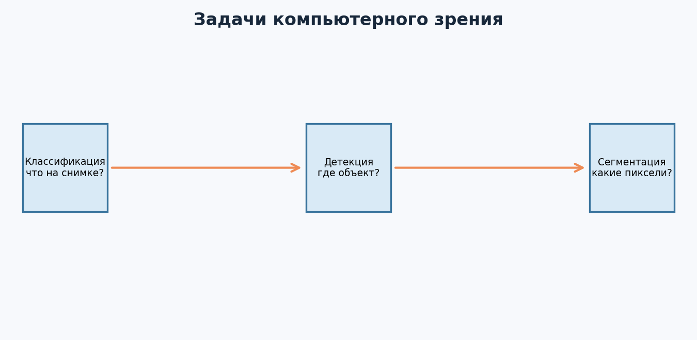
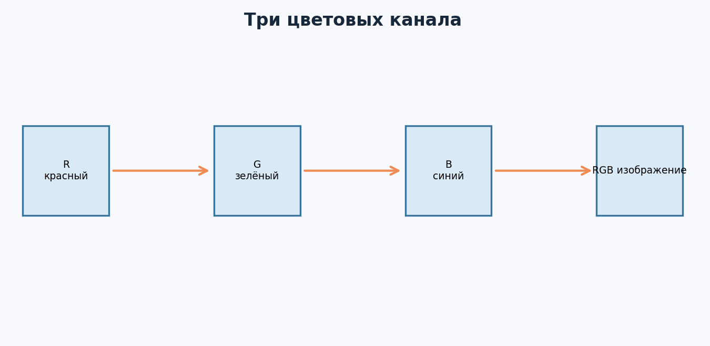
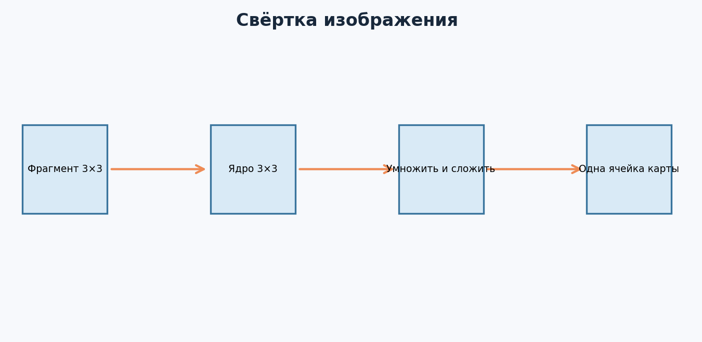
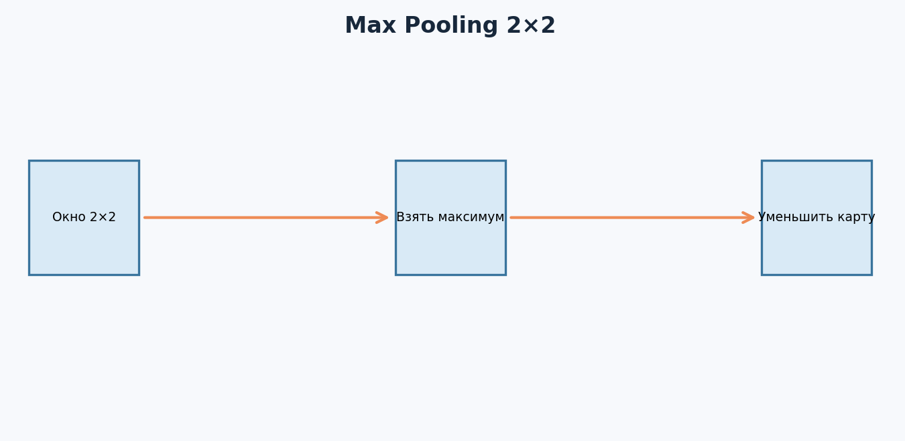
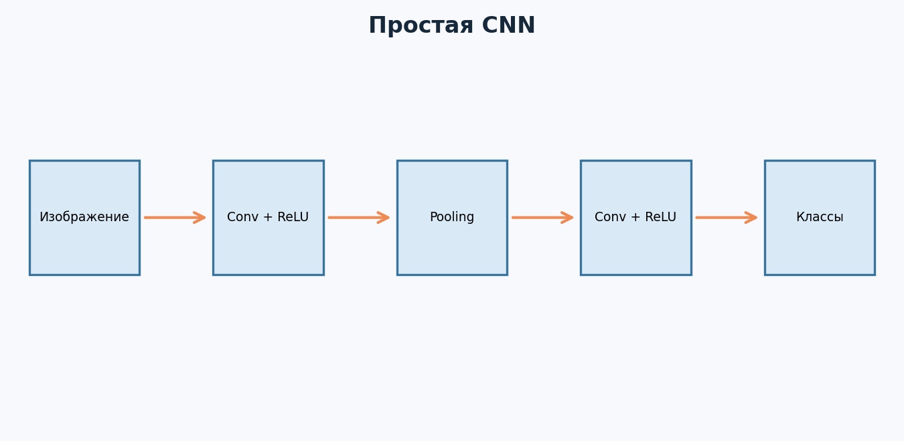
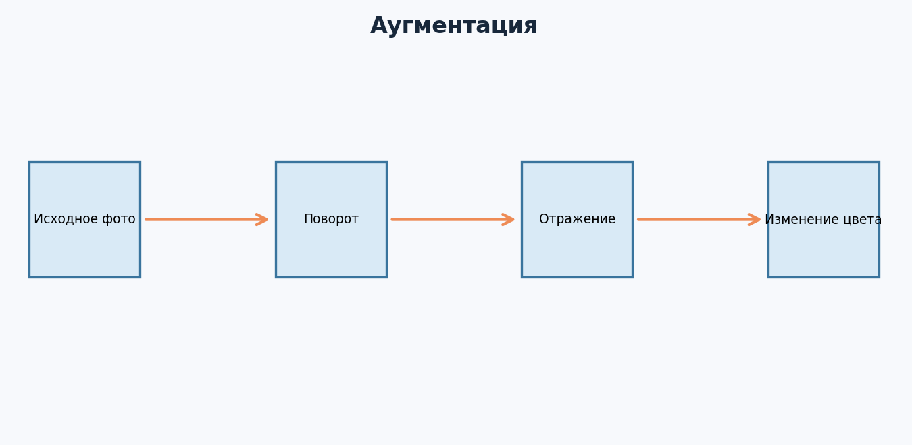
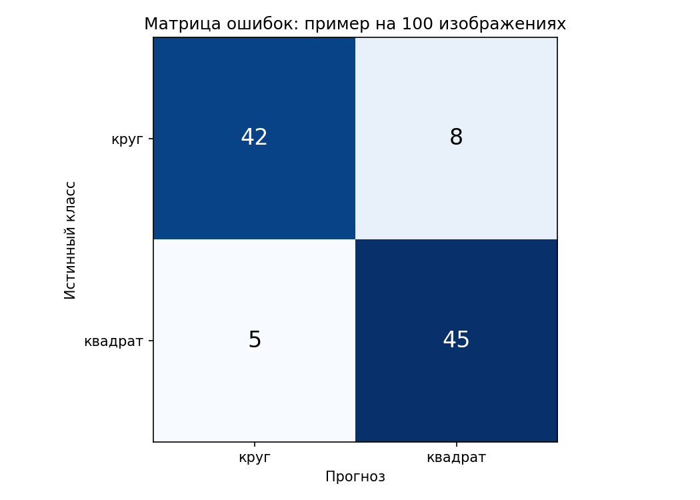

---

# Урок 1. Что такое Computer Vision и какие задачи он решает?

**Перед началом:** М12 (PyTorch, тензоры, `nn.Module`, обучение), NumPy, matplotlib, train/validation/test.

**После модуля:** ты поймёшь, как компьютер представляет фотографию, чем CNN отличается от обычной полносвязной сети, сможешь обучить классификатор изображений и объяснить, как проверять детекцию и сегментацию.

В модуле есть **синтетический** набор `Данные/shapes`: цветные круги и квадраты на светлом фоне. Он создан для тренировки механики CV. Высокая accuracy на этих картинках не означает, что модель распознает сложные реальные фотографии.

Представь: человеку достаточно секунды, чтобы посмотреть на фотографию и сказать «здесь кошка». А компьютер получает набор чисел - яркость и цвет каждого пикселя. Откуда ему взять понятие «кошка»? Нужно научиться находить закономерности в изображениях.

**Computer Vision (компьютерное зрение)** - направление, в котором мы разрабатываем методы анализа изображений и видео. Здесь применяют и классические алгоритмы, и нейронные сети. В этом модуле будем концентрироваться на глубоком обучении.

## 1.1. Три основные задачи

**Классификация:** «Что изображено?» На входе фото, на выходе класс: `кошка`, `собака`, `птица`. В простейшем случае один класс на изображение.

**Детекция объектов (object detection):** «Какие объекты есть и где они находятся?» На выходе метки, ограничивающие прямоугольники (*bounding boxes*) и оценки уверенности.

**Сегментация:** «Какие именно пиксели относятся к объекту?» На выходе маска. Семантическая сегментация отвечает за класс пикселя, instance segmentation различает отдельные экземпляры одного класса.



## 1.2. Где это используют?

На производстве - поиск дефектов на изделиях. В магазинах - распознавание товаров. В сельском хозяйстве - анализ снимков полей. В медицине - помощь при анализе медицинских изображений **под контролем специалистов**, а не автоматическая замена врача. В транспорте - обнаружение объектов и элементов дорожной сцены.

Любая красивая демонстрация на учебных изображениях должна сопровождаться вопросом: «На каких настоящих данных модель работает, а на каких ошибается?» Ошибки CV бывают связаны с освещением, поворотом, фоном, размытием, качеством камеры и различиями между источниками данных.

## 1.3. Постановка нашей учебной задачи

Мы начнём с простого: отличать изображения **кругов** от изображений **квадратов**. Наша цель - изучить весь процесс:

`картинка → тензор → CNN → логиты двух классов → loss → обучение → тест`

Позднее ту же схему можно применить к более реалистичным классам, но сначала нужно разобраться в инструментах.

**Главное:** разные задачи CV требуют разной разметки, архитектуры и метрик.

**Проверь себя**

Определи тип задачи: «Есть ли дефект на фото изделия?», «Где на фото трещина?», «Какие пиксели занимают трещину?». Объясни, как изменится формат правильного ответа.

---

# Урок 2. Изображения как матрицы чисел: пиксели, RGB и тензоры

В М1 мы превращали квартиры в векторы. Изображение тоже можно представить числами. У каждого пикселя есть координаты и цвет, а у цветного изображения обычно три канала - красный, зелёный и синий.

## 2.1. Что хранится в пикселе?

В распространённом восьмибитном RGB-представлении каждый канал хранит целое число от 0 до 255. Например, красный пиксель `[255, 0, 0]`, белый - `[255, 255, 255]`, чёрный - `[0, 0, 0]`. Многие изображения также имеют прозрачность, другие цветовые пространства и глубину цвета - пока начнём с обычного RGB.



## 2.2. Открываем изображение в Python

```python
from PIL import Image
import numpy as np

image = Image.open('Данные/shapes/train/circle/train_circle_000.png').convert('RGB')
array = np.asarray(image)
print('Размер изображения:', image.size)  # (ширина, высота)
print('Размер NumPy:', array.shape)        # (64, 64, 3)
print('Первый пиксель:', array[0, 0])
```

В NumPy порядок осей: **высота, ширина, каналы**, или `HWC`. В распространённом формате изображений PyTorch: **каналы, высота, ширина**, или `CHW`.

```python
from torchvision import transforms

tensor = transforms.ToTensor()(image)
print(tensor.shape)  # [3, 64, 64]
print(float(tensor.min()), float(tensor.max()))
```

`ToTensor()` для обычного RGB-изображения преобразует значения 0–255 в числа с плавающей точкой 0–1 и переставляет оси. Для изображений другого формата и типов данных поведение нужно проверять отдельно.

## 2.3. Пакет изображений

Одна картинка: `(3, 64, 64)`. 32 картинки вместе: `(32, 3, 64, 64)`. Первая ось `N` - количество объектов в batch.

Вот типичный источник ошибок:

```python
# Неверно для Conv2d: [64, 64, 3]
# Ожидается: [N, C, H, W]
```

Если у тебя ошибка вида `expected 3 channels, but got 64`, первым делом проверь порядок осей.

## 2.4. Почему нельзя просто подать фотографию целиком в линейную модель?

Технически можно расплющить изображение: `64×64×3 = 12288` чисел - один длинный вектор. Но соседние пиксели связаны: края, текстуры и детали изображения имеют пространственную структуру. Если полностью забыть о соседстве, модели может понадобиться слишком много параметров и данных.

Поэтому для классического глубокого компьютерного зрения придумали **свёрточные сети (CNN)**.

**Главное:** картинка - не «магия», а тензор пикселей; порядок его осей принципиален.

**Проверь себя**

Сколько чисел в RGB-изображении 100×200? Какой будет shape одного такого изображения в PyTorch? А пакета из 16 изображений?

---

# Урок 3. Свёртка: как нейросеть замечает локальные признаки

Представь, что ты хочешь обнаружить вертикальную границу на изображении. Вместо того чтобы анализировать всю картинку сразу, можно двигать маленькое окно по разным участкам и вычислять для каждого участка специальную оценку.

Так появляется **свёртка**: локальный фильтр последовательно обрабатывает соседние пиксели. В нейросетях коэффициенты фильтра **обучаются**, а не всегда задаются вручную.

## 3.1. Фильтр 3×3 — вычисление руками

Возьмём фрагмент изображения:

```
1  0  1
2  1  0
1  2  0
```

И фильтр:

```
 1   0  -1
 1   0  -1
 1   0  -1
```

Накладываем фильтр на фрагмент: перемножаем числа в одинаковых позициях и складываем.

`(1−1) + (2−0) + (1−0) = 3`

То есть результат применения фильтра к этому окну - число `3`.



Строго говоря, в большинстве библиотек глубокого обучения операция называется `convolution`, но вычислительно обычно соответствует **кросс-корреляции** без переворота ядра. Для практической работы с CNN важно понимать движущееся окно и обучаемые коэффициенты.

## 3.2. Карта признаков

Если передвигать фильтр по изображению, он будет выдавать число для каждого положения. Результат образует новую матрицу - **карту признаков (feature map)**. Разные фильтры могут реагировать на разные локальные структуры.

Размер выхода при stride=1, dilation=1:

`H_out = H_in + 2×padding − kernel_size + 1`

Например, изображение `64×64` и ядро 3×3 без padding дают `62×62`. Если `padding=1`, результат снова будет `64×64`.

## 3.3. Свёртка в PyTorch

```python
import torch
from torch import nn

conv = nn.Conv2d(in_channels=3, out_channels=8,
                 kernel_size=3, padding=1)
x = torch.randn(4, 3, 64, 64)
y = conv(x)
print(y.shape)   # [4, 8, 64, 64]
```

На входе четыре цветных изображения. На выходе - восемь карт признаков для каждого. Свёрточный слой содержит обучаемые фильтры и, по умолчанию, смещения.

## 3.4. Зачем разделять локальные фильтры между всеми положениями?

Один и тот же набор коэффициентов применяется по всей картинке. Это называется **совместным использованием весов** (*weight sharing*). Благодаря ему число параметров не растёт пропорционально числу пикселей так сильно, как у полностью связанного слоя с сопоставимым выходом.

CNN полезна, когда локальные структуры важны и могут встречаться в разных местах изображения. Но она не гарантирует нечувствительность ко всем сдвигам, поворотам и масштабам - это зависит от архитектуры, данных и обучения.

**Главное:** свёрточная сеть ищет локальные закономерности, повторно используя одни и те же обучаемые фильтры.

**Проверь себя**

Как изменится shape тензора `(10, 3, 32, 32)` после `Conv2d(3, 5, kernel_size=3, padding=0, stride=1)`? А после того же слоя с `padding=1`?

---

# Урок 4. Pooling и архитектура CNN

В предыдущем уроке мы получили карту признаков. Но при больших изображениях её размер может быть очень большим. Один из способов сократить пространственные размеры - **pooling**.

## 4.1. Max Pooling вручную

Представим матрицу:

```
1  3  2  1
4  2  5  0
0  1  3  8
2  4  1  6
```

Разбиваем её на непересекающиеся блоки 2×2, из каждого оставляем максимум:

```
4  5
4  8
```



В PyTorch:

```python
pool = nn.MaxPool2d(kernel_size=2)
print(pool(torch.randn(1, 8, 64, 64)).shape)  # [1, 8, 32, 32]
```

MaxPooling не обучает коэффициенты. Он просто применяет фиксированное правило. Но за уменьшение размеров приходится платить потерей части информации.

## 4.2. Как выглядит классическая маленькая CNN?



Для нашей задачи кругов и квадратов возьмём компактную сеть:

```python
import torch
from torch import nn

model = nn.Sequential(
    nn.Conv2d(3, 8, kernel_size=3, padding=1),
    nn.ReLU(),
    nn.MaxPool2d(2),
    nn.Conv2d(8, 16, kernel_size=3, padding=1),
    nn.ReLU(),
    nn.MaxPool2d(2),
    nn.Flatten(),
    nn.Linear(16 * 16 * 16, 32),
    nn.ReLU(),
    nn.Linear(32, 2),
)
print(model(torch.randn(4, 3, 64, 64)).shape)  # [4, 2]
```

Проверим размеры:

- Вход: `(4, 3, 64, 64)`.
- После первой свёртки: `(4, 8, 64, 64)`.
- После первого pooling: `(4, 8, 32, 32)`.
- После второй свёртки: `(4, 16, 32, 32)`.
- После второго pooling: `(4, 16, 16, 16)`.
- После `Flatten`: `(4, 4096)`.
- На выходе: `(4, 2)` - два логита классов.

Почему внутри `Linear` число `16 * 16 * 16`? Потому что осталось **16 каналов по 16×16 чисел**. Если изменить исходный размер изображения, этот расчёт может перестать работать - тогда нужно менять архитектуру или использовать адаптивный pooling.

## 4.3. Последний слой и функция потерь

У нас два класса, поэтому два логита и `nn.CrossEntropyLoss`. Правильная метка - индекс `0` или `1`, тип `torch.long`. Не делай `softmax` до передачи в `CrossEntropyLoss`.

**Главное:** CNN последовательно преобразует изображение в компактные признаки, а затем в оценки классов.

**Проверь себя**

Проследи формы для входа `(1,3,64,64)` и предложенной архитектуры. Объясни, почему после `Flatten` не остаётся отдельной оси каналов.

---

# Урок 5. Данные для CV: разметка, аугментации и утечки

Мы можем написать идеальную архитектуру и получить плохую модель, если неправильно собрали данные. Для CV вопрос «Как устроен датасет?» часто важнее вопроса «Сколько слоёв в сети?».

## 5.1. Подготовленный набор изображений

В материалах модуля есть папки:

```text
 Данные/shapes/
   train/circle/  train/square/
   val/circle/    val/square/
   test/circle/   test/square/
```

Каждый PNG - независимое синтетически созданное изображение размером 64×64. Круг или квадрат находится приблизительно в центре, фон светлый, цвет и положение немного меняются. Во всех частях классы сбалансированы.

Для реальных фотографий нужно следить за качеством меток, авторскими правами и разрешением на использование изображений.

## 5.2. Загружаем изображения через ImageFolder

```python
from torchvision import datasets, transforms

train_ds = datasets.ImageFolder(
    'Данные/shapes/train',
    transform=transforms.ToTensor(),
)
print(train_ds.classes)      # ['circle', 'square']
print(len(train_ds))
image, label = train_ds[0]
print(image.shape, label)    # [3, 64, 64], 0 или 1
```

`ImageFolder` обычно получает метку из имени вложенной папки. Не полагайся на память: всегда проверяй `class_to_idx`, чтобы не перепутать классы при интерпретации прогнозов.

## 5.3. Что такое аугментация?

Аугментация - случайное преобразование обучающего изображения, которое должно сохранять правильную метку. Например, небольшой поворот или сдвиг.



```python
train_tf = transforms.Compose([
    transforms.RandomRotation(10, fill=(230, 230, 230)),
    transforms.ToTensor(),
])
val_tf = transforms.ToTensor()
```

**Только train** получает случайные аугментации. Validation и test должны отражать честный сценарий проверки, а не случайно изменяться при каждом измерении. При этом некоторые преобразования недопустимы: например, вертикальное отражение снимка с важной ориентацией может изменить смысл.

## 5.4. Утечки в изображениях

Представь 20 фотографий одного изделия, снятых с разных ракурсов. Если почти одинаковые снимки попали и в train, и в test, тест может оказаться слишком лёгким. Аналогично в медицине часто нужно разделять по пациентам, а в производстве - по устройствам, партиям или датам.

Поэтому **сначала** продумываем схему split, **потом** применяем аугментации только к train. Дубли и почти дубли между частями надо отдельно проверять.

**Главное:** честная проверка начинается со сбора и разделения изображений, а не с выбора CNN.

**Проверь себя**

Почему нельзя сначала увеличить каждую фотографию пятью поворотами, а затем случайно разделить все получившиеся изображения на train/test? Предложи правильный порядок.

---

# Урок 6. Практика: обучаем свою первую CNN

Теперь соберём то, что раньше делали по отдельности: загрузка изображений, DataLoader, свёрточная сеть, loss, оптимизатор и оценка.

## 6.1. Создаём DataLoader

```python
from torch.utils.data import DataLoader
from torchvision import datasets, transforms

train_ds = datasets.ImageFolder('Данные/shapes/train', transform=transforms.ToTensor())
val_ds = datasets.ImageFolder('Данные/shapes/val', transform=transforms.ToTensor())

train_loader = DataLoader(train_ds, batch_size=32, shuffle=True)
val_loader = DataLoader(val_ds, batch_size=32, shuffle=False)
```

## 6.2. Обучение на одном пакете

Предположим, `model` - CNN из урока 4:

```python
import torch
from torch import nn

loss_fn = nn.CrossEntropyLoss()
optimizer = torch.optim.Adam(model.parameters(), lr=1e-3)

model.train()
images, labels = next(iter(train_loader))
optimizer.zero_grad()
logits = model(images)
loss = loss_fn(logits, labels)
loss.backward()
optimizer.step()

print('Вход:', images.shape)  # [32,3,64,64]
print('Выход:', logits.shape) # [32,2]
```

Это **один** шаг. Чтобы обучение было полноценным, перебираем все пакеты, повторяем несколько эпох и после каждой эпохи проверяем validation без обновления весов.

## 6.3. Полный готовый скрипт

В материалах курса есть исполняемый пример:

```bash
python Примеры/m13_train_cnn.py --epochs 25
```

Он обучает маленькую CNN на локальных синтетических фигурах, печатает train/validation-метрики по эпохам, восстанавливает лучшие веса и **один раз в конце** оценивает модель на отдельном test.

Если результат неожиданно плохой, проверь: правильно ли соответствуют папки классов, не забыли ли `model.train()` и `model.eval()`, что действительно передаёшь в `CrossEntropyLoss`, и сколько эпох прошло.

## 6.4. Интерпретируем выход

На выходе модель выдаёт два логита. Чтобы получить вероятности классов для демонстрации, можно применить `softmax`:

```python
with torch.no_grad():
    probs = torch.softmax(model(images[:1]), dim=1)
print(probs, probs.sum(dim=1))
```

Однако уверенность softmax не обязательно калибрована. Значение 0.99 не гарантирует, что среди всех таких прогнозов 99% будут правильными.

**Главное:** теперь у тебя есть полный цикл обучения классификатора изображений - от пикселей до теста.

**Проверь себя**

Уменьши число фильтров или увеличь batch size. Сравни **валидационное** качество и время. Что меняется в числах параметров и размере промежуточных тензоров?

---

# Урок 7. Transfer Learning: используем уже обученную сеть

Обучать компьютер распознавать сложные изображения с нуля может быть дорого: нужны данные, вычисления и время. Поэтому в настоящих проектах часто используют **предобученные модели** (*pretrained models*).

## 7.1. Идея переноса обучения

Модель уже обучалась на большом наборе изображений и приобрела полезные представления. Мы используем её как основу для новой задачи - например, различать виды растений.

Два распространённых подхода:

**Feature extractor:** замораживаем основную часть сети и обучаем только новый классификатор.

**Fine-tuning:** размораживаем часть или все слои и осторожно продолжаем обучение на новой задаче, обычно с меньшей скоростью.

## 7.2. Пример ResNet18

**Этот пример требует интернета при первой загрузке предобученных весов** и не включён в обязательную офлайн-практику.

```python
from torchvision.models import resnet18, ResNet18_Weights
from torch import nn

weights = ResNet18_Weights.DEFAULT
model = resnet18(weights=weights)
for p in model.parameters():
    p.requires_grad = False

in_features = model.fc.in_features
model.fc = nn.Linear(in_features, 2)
print(model.fc)
```

Параметры последнего нового слоя остаются обучаемыми. Для изображений нужно использовать правильную предобработку, соответствующую предобученным весам (размеры, нормализация). В torchvision есть `weights.transforms()`, которая задаёт подходящую предобработку для inference. Для аугментации train понадобится согласованная отдельная цепочка преобразований.

## 7.3. Когда transfer learning может не помочь?

Если новые изображения принципиально отличаются от фотографий, на которых была предобучена сеть (например, специфичные медицинские снимки), перенос может работать не так хорошо. Нельзя просто взять готовые веса и объявить задачу решённой: нужен независимый тест на данных из реальных условий.

## 7.4. Почему полезно начать с маленькой CNN?

Потому что ты понимаешь все основные шаги, а не прячешь их в одной строчке вызова большой архитектуры. Позже transfer learning станет понятным расширением знакомого workflow.

**Главное:** предобученная модель - отправная точка, а не гарантия качества.

**Проверь себя**

Представь, что у тебя 200 фотографий необычных деталей станка. Когда разумно попробовать предобученную модель? Какие вопросы нужно задать о данных и метках до обучения?

---

# Урок 8. Детекция и сегментация: дальше классификации

Классификация отвечает на вопрос «Что находится на изображении?». Но если на фото пять объектов, нужно знать ещё и их расположение.

## 8.1. Что такое bounding box?

Ограничивающий прямоугольник часто задают координатами `x_min, y_min, x_max, y_max`. Например, объект находится в пределах `(10,20,40,60)` при координатах изображения. Это не просто метка класса: нужно предсказать расположение.

## 8.2. IoU — Intersection over Union

**IoU** измеряет долю пересечения прямоугольников по отношению к площади их объединения.

`IoU = площадь пересечения / площадь объединения`

Представим два прямоугольника размером 4×4 с перекрытием 2×4. Площадь каждого 16, пересечение 8, объединение `16 + 16 − 8 = 24`. Значит:

`IoU = 8 / 24 = 1/3 ≈ 0.333`

Если прямоугольники совпадают, IoU равен 1; если не пересекаются, равен 0.

## 8.3. Почему одной accuracy мало?

В детекции важно, правильно ли найдены объекты, насколько точны рамки, сколько объектов пропущено и сколько ложных. Часто используют **mAP**, но для понимания его корректного вычисления нужно разобраться с разными порогами IoU, precision–recall и правилами сопоставления предсказаний с объектами. Пока достаточно понять, почему метрика классификации не отвечает на эти вопросы.

## 8.4. Сегментация и маски

При семантической сегментации каждая точка изображения получает метку класса. Например, «фон» или «дефект». При instance segmentation отдельно различаются разные объекты одного класса.

Маску можно представить матрицей из 0 и 1. Для бинарной сегментации можно оценивать **IoU** или **Dice** на уровне масок. При этом качество на маленьком объекте может сильно меняться даже от нескольких ошибочных пикселей.

## 8.5. Объекты реального мира

Детекция пешеходов, медицинская сегментация и промышленный контроль качества - потенциально высокорисковые задачи. Требуются репрезентативные данные, тщательная проверка, мониторинг ошибок и подходящие процедуры человеческого контроля.

**Главное:** чем сложнее выход модели, тем более специализированная разметка и проверка нужны.

**Проверь себя**

Два прямоугольника площадью 20 и 30 пересекаются на площади 10. Найди IoU. Объясни отличие bounding box от пиксельной маски.

---

# Урок 9. Оценка CV-модели и финальный мини-проект

Обучить CNN и увидеть 98% на простых кругах - ещё не конец работы. Нужно объяснить, **что именно проверили**, какие ошибки допустили и почему оценке можно доверять.

## 9.1. Confusion matrix

Для бинарной классификации полезно посмотреть, сколько кругов классифицировано как квадраты и наоборот.



Например, на рисунке 100 картинок, из которых модель верно распознала 87. Accuracy = 87%. Но можно дополнительно рассчитать метрики отдельно для каждого класса.

## 9.2. Какие картинки нужно просматривать?

Не только случайные успешные примеры. Начни с **ошибок**: изображения, где модель ошиблась с высокой уверенностью, где объект слишком маленький или почти сливается с фоном. Ищи повторяющиеся причины.

Может оказаться, что модель использует цвет фигуры вместо её формы. Это особенно вероятно, если цвета классов сильно различаются в обучающем наборе. Наш генератор специально варьирует цвет, но это не заменяет настоящую проверку на разнообразных данных.

## 9.3. Правильный финальный отчёт

Отчёт должен содержать:

- Постановку задачи и форматы входа/выхода.
- Описание происхождения датасета, классов и ограничений.
- Правило разделения train/validation/test.
- Архитектуру и размерности тензоров.
- Loss, optimizer, epochs, learning rate, batch size.
- Baseline и метрики.
- Матрицу ошибок, примеры ошибок и выводы.
- Предложение следующего эксперимента **без повторного подбора по test**.

## 9.4. Что положить в GitHub?

README с кратким описанием задачи, код обучения, инструкции запуска, изображения с примерами (если есть право их публиковать), таблицу результатов и ограничения. Не загружай приватные фотографии или датасеты без разрешения.

**Главное:** качественный CV-проект - не только сеть, но и проверяемая методология.

**Проверь себя**

Почему метрика на искусственных кругах и квадратах не позволяет утверждать, что модель умеет обнаруживать реальные дефекты на заводе? Какие новые данные нужно собрать?

---

# Итоги модуля
Теперь ты можешь объяснить весь путь:

`RGB-изображение → тензор (N,C,H,W) → свёртки → активации и pooling → логиты → loss → обновление весов → проверка на test`

Ты также знаешь, чем отличаются классификация, детекция и сегментация, почему аугментации применяют только к train, когда полезен transfer learning и зачем проверять реальные ошибки вместо одной красивой accuracy.

---

# Практика: Computer Vision
**Как работать:** первые шесть заданий - расчёты и объяснения; остальные - PyTorch и маленький CV-проект. Все примеры и изображения доступны локально.

## Часть 1. Понимание изображений и CNN

### Задание 1. RGB

Для изображения 64×64 с тремя каналами найди число значений пикселей. Сколько значений в пакете из 10 таких изображений? Назови формы в NumPy и PyTorch.

### Задание 2. Цвет пикселя

Запиши RGB для чисто красного, зелёного и синего пикселя в диапазоне 0–255. Что примерно будет означать `[255,255,255]`?

### Задание 3. Свёртка руками

Применяй фильтр `[[1,0], [0,-1]]` к фрагменту `[[2,3], [4,5]]`: перемножь поэлементно и сложи.

### Задание 4. Размеры

Что получится из входа `(8,3,32,32)` после `Conv2d(3,4,kernel_size=3,padding=1,stride=1)` и `MaxPool2d(2)`? Покажи оба shape.

### Задание 5. Pooling

Для матрицы `[[2,1,8,3],[5,4,1,7],[0,9,2,6],[3,1,4,5]]` вычисли max pooling 2×2, stride 2.

### Задание 6. IoU

Один прямоугольник площадью 24, другой - 16, площадь пересечения - 8. Найди площадь объединения и IoU.

## Часть 2. Практика на изображениях

### Задание 7. Загрузи изображение

Открой один PNG из `Данные/shapes`, преобразуй в NumPy и PyTorch. Выведи shape, минимальное и максимальное значение.

### Задание 8. Проверь классы

Создай `ImageFolder`, выведи `class_to_idx` и количество картинок каждого класса в train. Объясни, почему нельзя угадывать числовые метки.

### Задание 9. Сверточный слой

Создай `Conv2d(3, 8, kernel_size=3, padding=1)`. Проверь выходную форму для пакета из 4 изображений 64×64.

### Задание 10. Первая CNN

Запусти `python Примеры/m13_train_cnn.py --epochs 25`. Запиши validation и test accuracy, время и основные гиперпараметры. Почему test нужно оценивать только после выбора настроек?

### Задание 11. Эксперимент с архитектурой

Измени число фильтров с 8/16 на 4/8. Сравни время и validation accuracy. Сколько параметров исчезло? Для подсчёта используй `sum(p.numel() for p in model.parameters())`.

### Задание 12. Аугментации

Добавь небольшой случайный поворот на **train**. Сравни validation. Объясни, почему увеличение датасета за счёт аугментации нужно делать **после**, а не до исходного разделения на train/test.

### Задание 13. Сложные примеры

Сделай несколько своих картинок: круг на тёмном фоне, квадрат другого цвета, маленькую фигуру в углу. Проверь обученную модель. Опиши, почему это тест устойчивости, а не доказательство качества.

### Задание 14. Тип задачи

Для трёх формулировок - «есть ли дефект», «где дефект», «какие пиксели дефектны» - укажи тип CV-задачи, формат метки и подходящую семейство метрик.

### Задание 15. Финальный мини-проект

Подготовь короткий CV-отчёт: постановка, описание синтетических данных, схема обучения, формы тензоров, архитектура, матрица ошибок, минимум три ошибочных или сложных примера, ограничения и честный план перехода к настоящим фотографиям.

## Финальный вопрос

Почему применение CNN к изображениям обычно удобнее, чем расплющивание картинки в большой вектор для единственного полносвязного слоя? Когда этот ответ может зависеть от размера данных и архитектуры?
