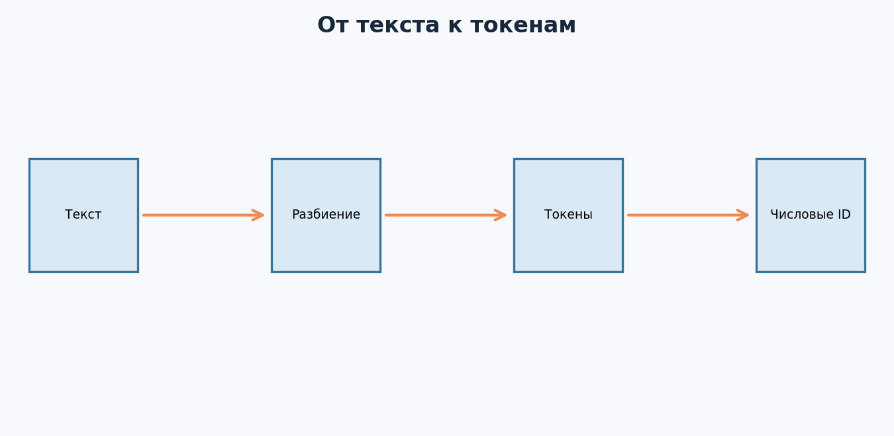
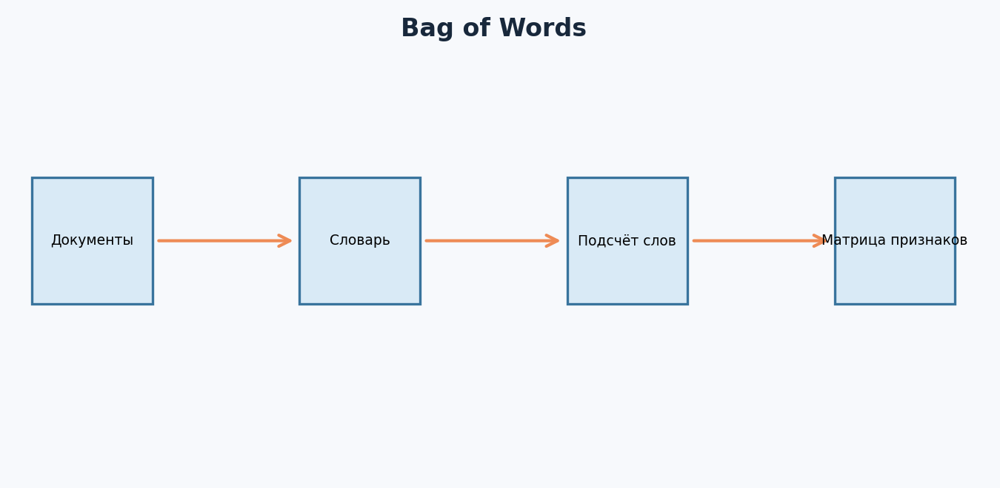
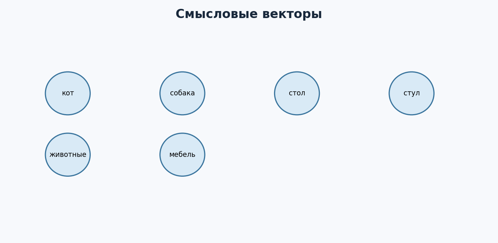
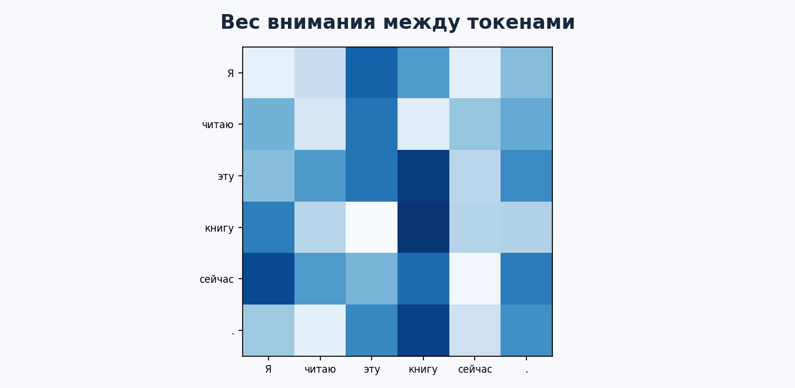
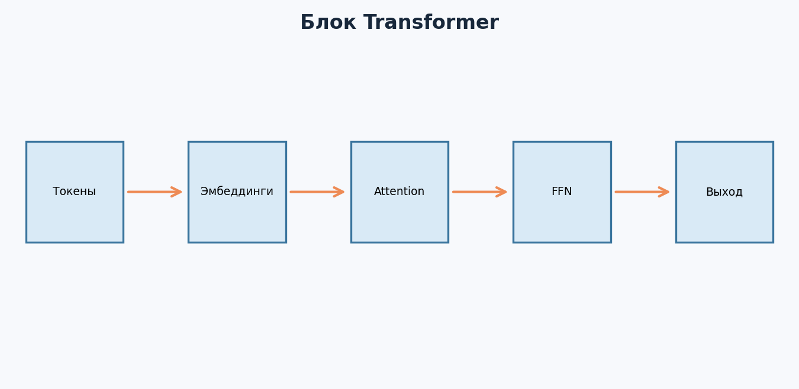
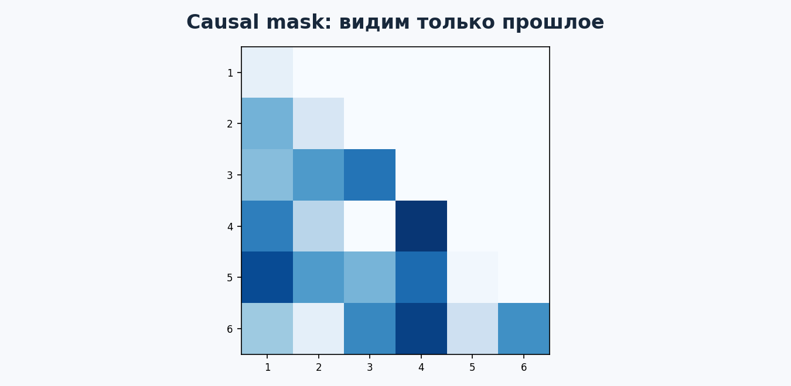
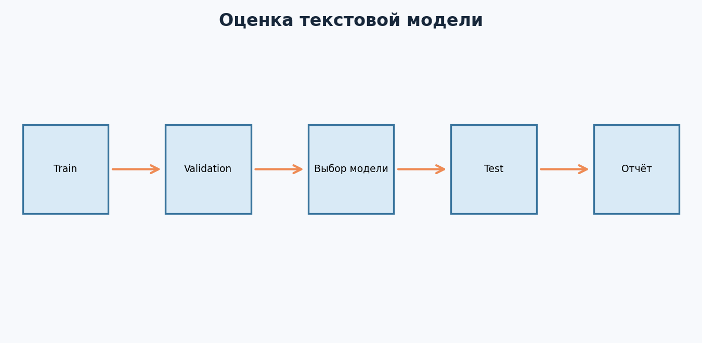
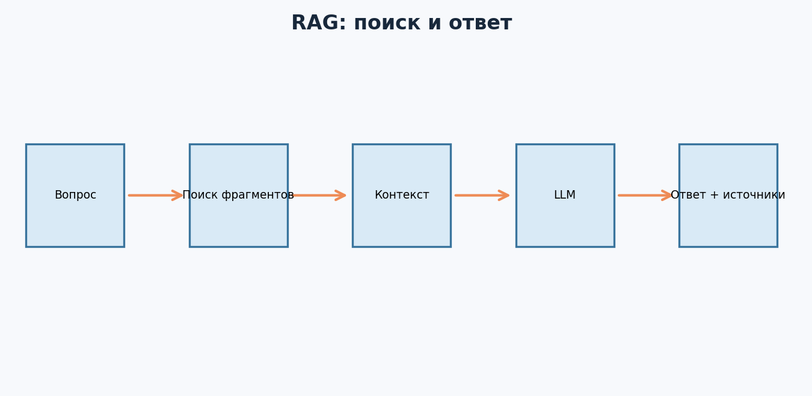

---

# Урок 1. Что такое NLP? От слов к задачам машинного обучения

**Перед началом:** М1–М13: векторы, вероятности, линейные модели, PyTorch, функция потерь и валидация.

**После модуля:** ты сможешь объяснить токенизацию, TF-IDF, эмбеддинги и механизм attention; поймёшь общую архитектуру Transformer, обучишь простой классификатор русскоязычных текстов и узнаешь, как использовать предобученные языковые модели без самообмана.

В `Данные/movie_reviews_ru.csv` лежат 72 **не настоящих, а специально написанных для курса** коротких отзыва. Это маленький учебный набор для понимания механики, а не полноценный корпус для оценки качества модели в реальном продукте. Обязательные примеры выполняются локально. Большие предобученные модели в дополнительных блоках требуют загрузки весов и могут работать медленно на CPU.

Представь, что интернет-магазин каждый день получает тысячи сообщений: «Доставка опоздала», «Товар отличный», «Не могу вернуть деньги», «Где мой заказ?». Человек может прочитать текст и понять настроение или тему. А компьютер получает последовательность символов. Как научить его работать с языком?

**NLP (Natural Language Processing)** - обработка естественного языка, область на стыке лингвистики, машинного обучения и программирования. Здесь мы учим системы извлекать информацию из текста, относить его к категориям, искать похожие документы, переводить, отвечать на вопросы и генерировать текст.

## 1.1. Какие задачи существуют?

**Классификация текста:** положительный или отрицательный отзыв, спам или обычное письмо, тема обращения.

**NER - распознавание именованных сущностей:** находим в тексте имена, названия организаций и географические объекты.

**Поиск и семантическое сходство:** сопоставляем вопрос с подходящими документами.

**Суммаризация и перевод:** преобразуем один текст в другой.

**Генерация:** продолжение текста, диалог, составление ответа с соблюдением инструкции.

Разные задачи требуют разных метрик. Accuracy может подходить для некоторых классификаций, но не объясняет фактическую правильность длинного ответа.

## 1.2. Почему текст сложнее чисел в таблице?

«Банк» может означать финансовую организацию или берег реки (в другом языке и контексте); одно слово в разных предложениях меняет смысл. Порядок слов тоже важен: «собака укусила человека» и «человек укусил собаку» содержат почти одинаковые слова, но рассказывают о разном.

Добавь опечатки, сленг, отрицания, длинные документы, разные языки - и станет понятно, почему NLP развивалось от простых счётчиков слов к контекстным нейросетевым моделям.

## 1.3. Наш учебный проект

Начнём с понятной задачи: определить тональность короткого отзыва о фильме. `1` - положительный, `0` - отрицательный. Сначала обучим классический baseline на TF-IDF, а уже затем разберём, зачем нужны Transformer и предобученные модели.

**Главное:** в NLP всегда нужно определять задачу, единицу текста, целевую метку и способ честной проверки.

**Проверь себя**

Для сообщений «Как вернуть товар?» и «Спасибо, всё отлично» сформулируй две разные NLP-задачи и назови метки. Объясни, почему «любая нейросеть для текста» - слишком расплывчатая постановка.

---

# Урок 2. Токенизация: как текст превращается в числа

Компьютеру нужны числа, но текст состоит из символов. Первый шаг - превратить строку в последовательность небольших единиц, **токенов**, а затем сопоставить им числовые идентификаторы.

## 2.1. Игрушечный пример

Представим фразу:

`«Кот спит дома.»`

Для учебного примера разделим её на токены: `Кот`, `спит`, `дома`, `.`. Создадим словарь: `Кот → 41`, `спит → 8`, `дома → 92`, `. → 3`. Получаем последовательность ID:

`[41, 8, 92, 3]`



В реальных современных моделях токены **не обязаны совпадать со словами**. Это могут быть кусочки слов, знаки пунктуации и специальные управляющие токены. Русское слово, которое выглядит как одна единица для человека, токенизатор модели может разделить на несколько частей.

## 2.2. Самый простой код

```python
text = 'Кот спит дома'
tokens = text.lower().split()
print(tokens)  # ['кот', 'спит', 'дома']
```

Метод `split()` делит по пробелам - это **не полноценный токенизатор**, а простая демонстрация идеи. Он не решает все вопросы пунктуации и морфологии.

## 2.3. Что такое словарь — vocabulary?

Словарь связывает известные токены и их числовые ID. В учебной реализации можно написать:

```python
vocab = {'<pad>': 0, '<unk>': 1, 'кот': 2, 'спит': 3, 'дома': 4}
ids = [vocab.get(token, vocab['<unk>']) for token in tokens]
print(ids)  # [2, 3, 4]
```

`<unk>` - специальный токен для неизвестного слова. `<pad>` часто используют для выравнивания последовательностей разной длины внутри одного пакета.

## 2.4. Проблема разной длины

Первое предложение имеет три токена, второе - десять. Если мы хотим подать их в один тензор фиксированной формы, нужно задать правило обрезки и заполнения. Например, добавляем ID нулевого padding-токена и маску, чтобы модель не считала padding настоящим содержимым.

Важно: обрезка слишком длинного текста может выбросить ключевую информацию, а неправильная маска - заставить модель учитывать пустые позиции.

## 2.5. Что такое токенизация в LLM?

У каждой предобученной модели обычно свой токенизатор и свой словарь. Нельзя произвольно заменить его своим набором ID и ожидать, что предобученные веса сохранят смысл. При использовании готовой модели загружай **совместимый токенизатор**.

**Главное:** токены - способ перевести текст в последовательность чисел; их границы зависят от конкретного токенизатора.

**Проверь себя**

Создай маленький словарь из пяти слов и `<unk>`. Преврати две короткие фразы в ID. Что произойдёт с неизвестным словом? Почему нельзя вручную менять номера токенов у готовой модели?

---

# Урок 3. Bag of Words и TF-IDF — сильный простой baseline

Прежде чем использовать большую языковую модель, попробуем способ, который легко понять и объяснить. Представим текст как вектор: у каждого слова свой столбец, а значение показывает, сколько раз оно встретилось.

## 3.1. Bag of Words (мешок слов)

Возьмём предложения:

1. `кот спит`
2. `собака спит`
3. `кот играет`

Словарь: `[кот, собака, спит, играет]`.

Получаем векторы:

1. `[1, 0, 1, 0]`
2. `[0, 1, 1, 0]`
3. `[1, 0, 0, 1]`



Просто? Да. Но есть недостаток: **порядок слов потерян**. «Не рекомендую фильм» и «Рекомендую фильм» имеют сильное пересечение слов, но разный смысл.

## 3.2. Зачем нужен TF-IDF?

В текстах есть часто встречающиеся слова, которые не всегда помогают различать документы. TF-IDF повышает относительный вес слов, характерных для конкретного документа, и снижает влияние слов, встречающихся почти везде. Существует несколько вариантов формулы и сглаживания; нам сейчас важна идея, а не запоминание одной реализации.

## 3.3. Первый текстовый классификатор

В материалах курса есть `Данные/movie_reviews_ru.csv` с колонками `text` и `label`. Попробуем связку **TF-IDF + логистическая регрессия**.

```python
import pandas as pd
from sklearn.model_selection import train_test_split
from sklearn.pipeline import make_pipeline
from sklearn.feature_extraction.text import TfidfVectorizer
from sklearn.linear_model import LogisticRegression
from sklearn.metrics import classification_report

reviews = pd.read_csv('Данные/movie_reviews_ru.csv')
X_train, X_test, y_train, y_test = train_test_split(
    reviews['text'], reviews['label'], test_size=0.25,
    random_state=42, stratify=reviews['label']
)
model = make_pipeline(
    TfidfVectorizer(ngram_range=(1, 2)),
    LogisticRegression(max_iter=1000),
)
model.fit(X_train, y_train)
print(classification_report(y_test, model.predict(X_test), zero_division=0))
```

Важный принцип из М10: `TfidfVectorizer` находится **внутри Pipeline**. Его словарь и статистики должны обучаться только на train, а не на всей таблице до split.

## 3.4. Почему одного такого теста недостаточно?

У нас всего 72 коротких искусственно написанных отзыва. Несколько нетипичных фраз могут сильно изменить качество. Даже если accuracy получилась высокой, это не означает готовность к реальным пользовательским отзывам, сарказму, опечаткам и новой тематике.

В `Примеры/m14_text_baseline.py` есть более аккуратный вариант с train/validation/test, подбором силы регуляризации по validation и сравнением с DummyClassifier.

**Главное:** простой baseline обязателен: иногда он решает задачу достаточно хорошо, а иногда показывает, чего нам не хватает.

**Проверь себя**

Почему TF-IDF нужно обучать только на train? Какой смысл имеют n-граммы `(1, 2)`? Придумай две фразы с одинаковыми словами, но противоположным смыслом.

---

# Урок 4. Эмбеддинги: слова как векторы

Bag of Words хранит счётчики по словарю. Векторы получаются очень длинными и разреженными: большинство значений - нули. В нейросетях часто используются **эмбеддинги** - плотные векторные представления токенов или целых текстов.

## 4.1. Интуиция

Представь, что словам `кошка`, `кот` и `собака` в условном двумерном пространстве соответствуют точки, расположенные сравнительно близко друг к другу, а словам `самолёт` и `аэропорт` - другая область.



Это **иллюстративная картинка**, а не результат конкретно обученной модели. В настоящих эмбеддингах измерений обычно намного больше, а «близость по смыслу» зависит от модели, контекста и того, что именно мы сравниваем.

## 4.2. Обучаемая таблица эмбеддингов

Представим словарь из 1000 токенов и размер вектора 16. Тогда таблица эмбеддингов содержит `1000 × 16` чисел. Каждому ID соответствует одна строка этой таблицы.

```python
import torch
from torch import nn

embedding = nn.Embedding(num_embeddings=1000, embedding_dim=16)
ids = torch.tensor([[2, 5, 7], [4, 1, 9]])
E = embedding(ids)
print(E.shape)  # [2, 3, 16]
```

Здесь 2 предложения по 3 токена, каждому токену соответствует вектор из 16 чисел. Изначально эти векторы не обязательно содержат полезный смысл: в процессе обучения их значения изменяются.

## 4.3. Слова и предложения — не одно и то же

Для поиска похожих документов обычно нужны **векторы целых фраз или документов**. Такие представления можно получать специальными моделями эмбеддингов. Просто усреднить токенные векторы иногда помогает, но не всегда хорошо передаёт смысл, отрицания и порядок слов.

## 4.4. Косинусное сходство

В М1 мы уже считали:

`cos(a, b) = (a·b) / (||a|| × ||b||)`

Оно позволяет сравнивать направления ненулевых векторов и часто используется при поиске похожих текстов. Но для конкретной модели и задачи важно проверить, какой способ сравнения рекомендован и как он работает на реальных данных.

**Главное:** эмбеддинг - не готовое «понимание языка», а обучаемое числовое представление, полезность которого определяется задачей и проверкой.

**Проверь себя**

Если `nn.Embedding(500, 32)` получает тензор ID формы `(4, 10)`, какой будет выходной shape? Сколько чисел хранится в таблице эмбеддингов без дополнительных параметров?

---

# Урок 5. Почему контекст важен? От последовательностей к attention

Возьмём два предложения:

- «Не понравился фильм».
- «Понравился фильм».

Слова похожи, но одно «не» меняет смысл. Модели нужно учитывать не только наличие слов, но и то, **как они связаны друг с другом**.

## 5.1. Что не умеет простой мешок слов?

Bag of Words не знает порядка. Он может отличить наличие «не», но не всегда поймёт, какое слово отрицается и к чему относится отрицание. Это особенно важно в длинных и сложных текстах.

## 5.2. Идея последовательной модели

Ранние нейросетевые подходы часто обрабатывали текст последовательно: слово за словом. Например, RNN поддерживает внутреннее состояние, которое изменяется при чтении токенов. Так модель может учитывать предыдущий контекст.

Однако длинные зависимости сложны для простых RNN. Варианты LSTM и GRU улучшали способность учитывать более дальний контекст, но последовательная обработка мешает максимально эффективно параллелить вычисления по токенам.

## 5.3. Идея attention

А что, если при обработке каждого слова модель могла бы **напрямую учитывать другие слова** и определять, какие из них важнее для текущего представления? Эта идея называется *attention* - механизм внимания.

Например, в выражении «Она положила книгу на стол, потому что он был свободен» для интерпретации слова «он» полезно учитывать контекст. Правда, attention сам по себе не гарантирует корректного разрешения местоимений - он лишь предоставляет способ обмена информацией между позициями.

## 5.4. Почему важно понимать этот механизм?

Self-attention - один из ключевых строительных блоков архитектуры Transformer. Из Transformer выросло множество современных языковых моделей, в том числе большие генеративные модели.

**Главное:** контекст помогает различать похожие слова и предложения; attention даёт механизму модели доступ к информации из других позиций последовательности.

**Проверь себя**

Придумай два предложения с одинаковыми словами, но разным смыслом из-за порядка. Почему модель, которая видит только счётчики слов, сталкивается с ограничением?

---

# Урок 6. Self-Attention: объясняем формулу на числах

Теперь - центральный урок модуля. Не нужно сразу разбирать огромный Transformer. Возьмём несколько коротких векторов и посмотрим, как работает **одна операция внимания**.

## 6.1. Что такое Query, Key и Value?

Для каждого токена Transformer строит три представления:

- **Q (query)** - запрос: какую информацию ищет текущая позиция?
- **K (key)** - ключ: по чему определять совместимость другой позиции с запросом?
- **V (value)** - содержимое, которое будет использовано при смешивании представлений.

Это не словарь с настоящими вопросами и ответами. Q, K, V - числовые векторы, которые получаются обучаемыми линейными преобразованиями эмбеддингов.

## 6.2. Формула scaled dot-product attention

`Attention(Q,K,V) = softmax(QKᵀ / √dₖ) V`

Разберём смысл по шагам:

1. Умножаем запросы `Q` на транспонированные ключи `Kᵀ`: получаем оценки совместимости позиций.
2. Делим их на `√dₖ`, чтобы масштаб скалярных произведений не становился слишком большим при увеличении размерности ключей.
3. Применяем `softmax` по каждой строке: получаем неотрицательные веса, сумма которых равна 1.
4. Используем эти веса для смешивания векторов `V`.

**Не путай:** веса attention - это коэффициенты смешивания представлений, а не готовые вероятности истинности фактов и не обязательно надёжные объяснения того, почему модель выдала конкретный ответ.

## 6.3. Один ручной числовой пример

Пусть у нас два токена с простыми векторами:

`Q = K = V = [[1, 0], [0, 1]]`

Размерность ключей `dₖ = 2`. Тогда:

`QKᵀ = [[1, 0], [0, 1]]`

После деления на `√2 ≈ 1.414` получаем:

`[[0.707, 0], [0, 0.707]]`

Применим softmax к первой строке `[0.707, 0]`. Получится примерно `[0.67, 0.33]`. Для второй - `[0.33, 0.67]`.

Поскольку `V` - единичная матрица, результирующие векторы после умножения совпадут с весами:

`[[0.67, 0.33], [0.33, 0.67]]`

Получилось, что каждый токен сохранил больший вес за собой, но получил часть информации о другом.

## 6.4. Проверим в PyTorch

```python
import math
import torch

Q = torch.eye(2)
K = torch.eye(2)
V = torch.eye(2)

scores = (Q @ K.T) / math.sqrt(K.shape[-1])
weights = torch.softmax(scores, dim=-1)
output = weights @ V

print(weights.round(decimals=2))
print(output.round(decimals=2))
```

Современные библиотеки умеют выполнять attention эффективнее, чем ручной набор матричных операций, но этот пример нужен для понимания математики.

## 6.5. Матрица внимания на трёх словах



На картинке показаны **условные** веса для слов «кот», «ловит», «мышь». Каждая строка суммируется до 1. В реальном Transformer веса вычисляются из обучаемых Q и K, могут отличаться между головами и слоями и зависеть от маски.

**Главное:** self-attention вычисляет, какую долю информации из разных токенов использовать для обновления представления каждого токена.

**Проверь себя**

Для весов `[0.2,0.8]` и векторов `V₁=[1,0]`, `V₂=[0,2]` найди взвешенную сумму. Сколько получится компонент? Почему сумма весов равна единице после softmax?

---

# Урок 7. Transformer: Attention, позиции, маски и головы

Мы разобрали один attention. Но настоящие архитектуры Transformer содержат несколько обучаемых преобразований, нормализацию, остаточные связи, позиционную информацию и часто много одинаковых по типу блоков.

## 7.1. Зачем нужна информация о позиции?

Обычный self-attention без специальных механизмов не кодирует порядок токенов в том виде, в каком это нужно для последовательного языка. Поэтому Transformer использует позиционные представления или другие способы учесть положение токена.

В зависимости от архитектуры позиционная информация может добавляться к эмбеддингам либо учитываться внутри внимания, например через относительные позиции.

## 7.2. Transformer-блок



Упрощённо блок включает:

**Self-Attention** - смешивает информацию между токенами.

**Feed-Forward Network** - обрабатывает представление каждого токена небольшим полносвязным преобразованием с нелинейностью.

**Residual connections** - добавляют вход к выходу соответствующего подблока, что помогает обучать глубокие сети.

**Layer Normalization** - нормализует активации по определённому правилу.

На схеме связи и нормализация опущены ради простоты. Не стоит считать её точной схемой любой конкретной модели.

## 7.3. Multi-head attention

Вместо единственного внимания используются несколько **голов** с разными обучаемыми проекциями. Разные головы могут обнаруживать разные закономерности, но не обязательно существует простое человеческое толкование каждой головы.

## 7.4. Causal mask

Генеративная модель, которая предсказывает следующий токен, во время обработки позиции не должна видеть будущие токены. Для этого используют **причинную маску** (causal mask).



На диаграмме зелёным выделены позиции, доступные при вычислении текущего токена, красным - будущие, которые скрыты. Иначе модель могла бы «подглядывать» в правильный ответ при обучении.

**Padding mask** решает другую задачу: исключает пустые токены, добавленные ради одинаковой длины предложений.

## 7.5. Encoder, decoder и encoder–decoder

Разные модели используют разные организации блоков:

- **Encoder-only** часто подходит для построения контекстных представлений, классификации и извлечения информации.
- **Decoder-only** часто используется для авторегрессионной генерации следующего токена.
- **Encoder–decoder** особенно естественен для задач преобразования одной последовательности в другую - например, перевода или суммаризации.

Это не жёсткое правило для всех моделей, а распространённая классификация архитектур.

**Главное:** Transformer - это не один магический механизм, а система из attention, нелинейных преобразований и служебных структур, способных обрабатывать контекст.

**Проверь себя**

Почему генеративному decoder нельзя видеть будущий токен при предсказании текущего? Чем causal mask отличается от padding mask? Объясни, для чего модели нужна позиционная информация.

---

# Урок 8. Предобучение, fine-tuning и большие языковые модели

## 8.1. Что такое pretraining?

Большие языковые модели обычно сначала обучаются на огромных коллекциях текстов с выбранной **задачей предобучения**. Например, авторегрессионная языковая модель предсказывает следующий токен по предыдущему контексту. Во время такого обучения изменяются её веса.

Модель изучает статистические закономерности языка и множество связей, присутствующих в данных. Но предсказание токенов само по себе не означает гарантированного понимания, правдивости или надёжности каждого ответа.

## 8.2. Что такое fine-tuning?

**Fine-tuning** - дальнейшее обучение предобученной модели на специальном наборе данных под конкретную задачу. Например, разметка тональности отзывов или классификация запросов службы поддержки.

Идея похожа на transfer learning из М13: переносим знания из большой исходной задачи на более узкую.

## 8.3. Почему не нужно обучать LLM с нуля новичку?

Это может требовать огромного количества вычислений, качественно подготовленных данных, сложного распределённого обучения и систем оценки. На уровне первого ML-портфолио разумнее:

- изучить готовые модели и их ограничения;
- сделать baseline на простом алгоритме;
- сравнить его с предобученной моделью;
- при необходимости сделать небольшое дообучение доступной архитектуры;
- оценить качество, стоимость, скорость, приватность и воспроизводимость.

## 8.4. Различие между training и inference

**Training** - обновляем веса.
**Inference** - используем уже обученную модель для вычисления выходов; обычно веса при этом не меняются.

В API-моделях часто доступен только inference, иногда дополнительные механизмы настройки. Важно не путать составление текста запроса (*prompting*) с градиентным обучением весов.

## 8.5. Что такое галлюцинация?

Генеративная модель может выдавать убедительно звучащие, но фактически неверные утверждения. Особенно это критично, когда вопрос требует свежих сведений или точной ссылки на документ. Поэтому для важных задач нужны проверка источников, оценка неопределённости и понятные условия отказа от ответа.

**Главное:** предобученная модель - мощная основа, но её результаты необходимо проверять на конкретной задаче и данных.

**Проверь себя**

Сравни три действия: написали промпт, дообучили классификатор на своих метках, обучили языковую модель с нуля. В каких случаях меняются веса и какие данные для этого необходимы?

---

# Урок 9. Использование готовых моделей через Hugging Face

В прошлом модуле ты узнал про предобученную ResNet. В NLP похожую роль играют языковые модели из публичных репозиториев. Один из популярных способов работать с ними - библиотека **Transformers**.

## 9.1. Для чего нужен pipeline?

`pipeline()` объединяет загрузку подходящей модели, токенизатор и вычисление результата для типовой задачи. Это удобная точка входа для inference.

**Дополнительный пример с доступом в интернет и отдельной установкой пакета:**

```bash
pip install transformers accelerate sentencepiece
```

```python
from transformers import pipeline

model_id = 'cardiffnlp/twitter-xlm-roberta-base-sentiment'
classifier = pipeline('text-classification', model=model_id)
print(classifier('Отличный фильм, мне понравилось!'))
```

Эта конкретная модель обучалась главным образом на тональности сообщений из социальных сетей на нескольких языках. Её использование на русскоязычных **отзывах о фильмах** - перенос на другую предметную область, а не проверенное обещание точности. Результаты могут отличаться, в том числе из-за языка и домена. Модель может быть большой для CPU, а первоначальная загрузка требует интернет-соединения.

## 9.2. Как работает совместный токенизатор?

Если мы отдельно загружаем модель, нужно использовать соответствующий токенизатор.

```python
from transformers import AutoTokenizer, AutoModelForSequenceClassification

model_id = 'cardiffnlp/twitter-xlm-roberta-base-sentiment'
tokenizer = AutoTokenizer.from_pretrained(model_id)
model = AutoModelForSequenceClassification.from_pretrained(model_id)

encoded = tokenizer('Мне понравился фильм', return_tensors='pt', truncation=True)
print(encoded['input_ids'].shape)
```

Обычно токенизатор создаёт не только IDs, но и `attention_mask`, указывающую действительные позиции при padding. Формы зависят от длины текста и параметров токенизации.

## 9.3. Fine-tuning готовой модели — отдельная задача

Для fine-tuning нужны размеченные данные, совместимая архитектура, правильная функция потерь, схема проверки и вычислительные ресурсы. Современная библиотека предоставляет `Trainer` и `TrainingArguments`, но интерфейсы меняются между версиями; рабочий шаблон лучше брать из официального актуального tutorial и фиксировать версии пакетов.

**На этом этапе не требуется скачивать и дообучать большую модель.** Начни с обязательного офлайн-baseline и анализа его ошибок.

## 9.4. Как выбирать модель?

Не по одной строке «самая популярная». Проверь:

- назначение и языки;
- длину контекста и ограничения;
- размер и требования к памяти;
- лицензию и условия использования;
- происхождение обучающих данных, если известно;
- публичные оценки и собственный тест на нужном домене.

**Главное:** готовая NLP-модель - удобный инструмент, но требует проверки совместимости с задачей.

**Проверь себя**

Почему модель тональности твитов не обязательно хорошо определяет тональность длинных отзывов? Почему для предобученных весов важно использовать правильный токенизатор?

---

# Урок 10. Как оценивать NLP-модель и находить ошибки

В M10 мы учились не выбирать модель по test. В NLP эта идея становится ещё важнее: короткие тексты легко повторяются, метки бывают спорными, а тематика сообщений меняется.

## 10.1. Утечки через дубли и шаблоны

Представь два почти одинаковых отзыва:

- «Отличный фильм, актёры прекрасные!»
- «Отличный фильм: актёры просто прекрасные».

Если первый попал в train, а второй в test, модель могла выучить не общую закономерность, а конкретную фразу. Для больших корпусов требуется проверять точные и близкие дубли; иногда - разделять по автору, фильму, компании или времени.

## 10.2. Accuracy, precision, recall, F1

Для тональности полезно смотреть качество по каждому классу. Например, если модель хорошо распознаёт положительные отзывы, но постоянно пропускает отрицательные, общая accuracy этого не покажет достаточно подробно.

**Confusion matrix** позволяет увидеть, какие классы путаются друг с другом. `classification_report` выводит precision, recall и F1 для классов при заданной схеме меток.



## 10.3. Сложные случаи

Отдельно протестируй:

- отрицания: «неплохо», «совсем не понравилось»;
- иронию и сарказм;
- длинные и короткие тексты;
- новые названия, редкие слова, опечатки;
- смену темы: отзывы о фильмах против отзывов о технике.

На маленьком искусственном датасете эти проверки особенно важны: он не покрывает разнообразие языка.

## 10.4. Оценка генеративной модели

Для свободной генерации нельзя просто считать accuracy по классам. Нужны подходящие критерии: фактическая корректность, полнота, соответствие инструкции, отсутствие выдуманных ссылок, устойчивость к неподходящим запросам, стоимость и скорость ответа. Если ответ может влиять на важные решения, должна быть продумана процедура проверки человеком.

**Главное:** NLP-метрики нужны для честной оценки конкретной задачи; одна высокая цифра не заменяет ручного анализа.

**Проверь себя**

Составь таблицу из 10 коротких фраз, на которых базовая модель тональности может ошибаться. Для каждой запиши возможную причину ошибки, не выдавая свои предположения за фактический результат модели.

---

# Урок 11. RAG и итоговый мини-проект: задаём вопросы к документам

Представим, что компания хочет ассистента, который отвечает на вопросы сотрудников по внутренним регламентам. Нельзя просто надеяться, что языковая модель «всё помнит»: документы обновляются, часть информации непублична, а уверенный ответ может быть неправильным.

Один из способов улучшить работу с источниками - **RAG (Retrieval-Augmented Generation)**, или генерация с извлечением информации.

## 11.1. Идея RAG

1. Получаем вопрос пользователя.
2. Ищем релевантные документы или фрагменты.
3. Передаём найденный контекст вместе с вопросом языковой модели.
4. Получаем ответ и, по возможности, показываем проверяемые ссылки на фрагменты.



Важное отличие от fine-tuning: в обычном RAG **не требуется обновлять веса языковой модели**. Мы подаём ей дополнительную информацию во время ответа. Но RAG не устраняет галлюцинации автоматически: поиск может вернуть нерелевантные сведения, а генерация - неправильно их интерпретировать.

## 11.2. Первый поиск по документам — без LLM и без интернета

Чтобы понять механизм поиска, возьмём три небольших документа о ML:

```python
from sklearn.feature_extraction.text import TfidfVectorizer
from sklearn.metrics.pairwise import cosine_similarity

docs = [
    'Для классификации используем метрики precision и recall.',
    'Среднеквадратичная ошибка нужна для оценки регрессии.',
    'Кросс-валидация помогает сравнивать модели на разных частях данных.',
]
question = 'Какие метрики использовать для классификации?'

vectorizer = TfidfVectorizer(analyzer='char', ngram_range=(3, 5))
D = vectorizer.fit_transform(docs)
q = vectorizer.transform([question])
scores = cosine_similarity(q, D)[0]
idx = int(scores.argmax())
print('Ближайший документ:', docs[idx])
print('Сходство:', round(float(scores[idx]), 3))
```

Мы сделали **лексический поиск по символьным n-граммам**, а не полноценный семантический поиск. Но уже разобрались в первой половине RAG: `вопрос → числовое представление → ранжирование фрагментов`. Следующий этап - качественные эмбеддинги документов и отдельная система генерации ответа.

## 11.3. Чего нельзя забывать про данные

Учитывай доступ пользователя к документам, приватность, права на данные и обновления информации. Если система ищет по частным документам, нельзя автоматически отправлять их в сторонний сервис без разрешения. Отдельно проверяй, не содержит ли найденный текст инструкций, которые пытаются подменить правила системы.

## 11.4. Финальный проект М14: тональность отзывов

Для первого завершённого проекта предлагаю **не начинать с RAG**, а закончить знакомую задачу классификации тональности. Используй `Примеры/m14_text_baseline.py` и подготовь отчёт:

- что предсказываем и на каких данных;
- почему корпус учебный и малый;
- как сделан split;
- какой baseline и TF-IDF-модель;
- какие метрики на validation и test;
- какие примеры вызывают ошибки;
- почему следующий шаг может быть предобученная модель;
- чего не хватает для реальной работы.

Затем, как **дополнительный проект**, расширь наш поиск по трём документам до 20 фрагментов конспектов курса и попробуй возвращать найденный абзац вместе с названием источника. Это честный простой retrieval-проект, даже без LLM.

**Главное:** хороший NLP-проект показывает не только прогноз, но и способность объяснить, что модель знает, где ошибается и откуда взялся ответ.

**Проверь себя**

В чём отличие TF-IDF-поиска от генерации ответа? Почему выдача найденного абзаца со ссылкой проще для проверки, чем свободный текст LLM?

---

# Итоги модуля
От текста до предсказания мы прошли такой путь:

`текст → токенизация → числа → представления → модель → результат → проверка качества`

На простом уровне эти представления могут быть счётчиками слов. В нейросетях используются эмбеддинги. Self-attention помогает позициям обмениваться информацией; Transformer объединяет attention с другими слоями. Большие языковые модели используют эту основу в гораздо большем масштабе, но подчиняются тем же принципам: данные, параметры, функция потерь, оптимизация и проверка результатов.

Самое полезное, что можно вынести: **сначала формулируй задачу и делай понятный baseline, затем выбирай более сложную модель только при обоснованной необходимости**.

---

# Практика: NLP, Attention, Transformers и LLM
**Как работать:** 1–7 - без сложных библиотек и на бумаге; 8–16 - Python и итоговый проект.

## Часть 1. Текст и числа

### Задание 1. Токены

Придумай учебный словарь с токенами `<pad>`, `<unk>`, `кот`, `спит`, `дома` и назначь ID. Запиши ID для фразы «кот спит дома». Что произойдёт с неизвестным словом?

### Задание 2. Bag of Words

Словарь `[кот, собака, спит, играет]`. Запиши векторы для «собака играет» и «кот спит спит» при учёте числа вхождений.

### Задание 3. Эмбеддинги

Сколько параметров у `nn.Embedding(200, 8)`? Какой shape будет на входе ID `(5, 12)` и на выходе embedding?

### Задание 4. Косинусное сходство

Для `a=[1,0]`, `b=[2,0]`, `c=[0,3]` найди `cos(a,b)` и `cos(a,c)`.

### Задание 5. Softmax-веса

Даны веса `[0.25,0.75]` и значения `V₁=[2,0]`, `V₂=[0,4]`. Найди взвешенную сумму, как в одном шаге внимания.

### Задание 6. Attention и размерности

Для `Q` формы `(4, 8)` и `K` формы `(4, 8)` найди форму `QKᵀ`. Если `V` имеет форму `(4, 6)`, какой shape у окончательного выхода?

### Задание 7. Causal mask

Нарисуй допустимые связи для четырёх токенов авторегрессионной модели. Может ли токен 2 смотреть на токен 4? Может ли токен 4 смотреть на токен 2?

## Часть 2. NLP на практике

### Задание 8. Корпус отзывов

Загрузи `Данные/movie_reviews_ru.csv`. Посчитай число отзывов и баланс классов. Прочитай несколько текстов и объясни ограничения такого датасета.

### Задание 9. TF-IDF

Собери `TfidfVectorizer` и выведи размер матрицы признаков. Найди несколько слов с наибольшими весами для выбранного отзыва, не называя эти веса «доказательством смысла».

### Задание 10. Честное разделение

Сделай train/validation/test. Объясни, почему нельзя сначала обучить TF-IDF на всём корпусе. Найди точные дубликаты текстов, если они есть.

### Задание 11. Baseline

Запусти `python Примеры/m14_text_baseline.py`. Сравни DummyClassifier и TF-IDF + LogisticRegression на одинаковой test-части **после** выбора настроек по validation.

### Задание 12. Сложные фразы

Протестируй модель на «Неплохо, но скучновато», «Ну и замечательный фильм… даже досмотреть не смог», «Не могу сказать, что фильм плохой». Обсуди неоднозначность меток и наличие сарказма.

### Задание 13. Attention в PyTorch

Запусти код из урока 6 для Q = K = V = единичной матрице 2×2. Проверь, что строки attention суммируются до 1. Затем измени V и объясни изменение результата.

### Задание 14. Готовая модель (необязательно)

Если есть ресурсы и интернет, запусти предобученную модель из урока 9 на нескольких текстах. Сравни предсказания со своим baseline. Не делай вывод об общем превосходстве по трём предложениям.

### Задание 15. Простой retrieval

Расширь пример поиска по трём документам до десяти фрагментов конспектов. По пяти вопросам проверь, нашёлся ли корректный фрагмент. Запиши ошибки поиска.

### Задание 16. Финальный проект

Составь краткий отчёт о классификаторе отзывов: задача, данные, метки, split, baseline, признаки, метрики, ошибки, ограничения, идеи следующего эксперимента. Отдельно укажи, почему игрушечный корпус из 72 отзывов не позволяет уверенно оценить качество на реальном пользовательском потоке.

## Финальный вопрос

Попробуй простыми словами объяснить разницу между **токенизацией, эмбеддингом, self-attention, Transformer, fine-tuning и RAG**. Если видишь, как эти инструменты соединяются, фундамент современного NLP у тебя уже есть.
