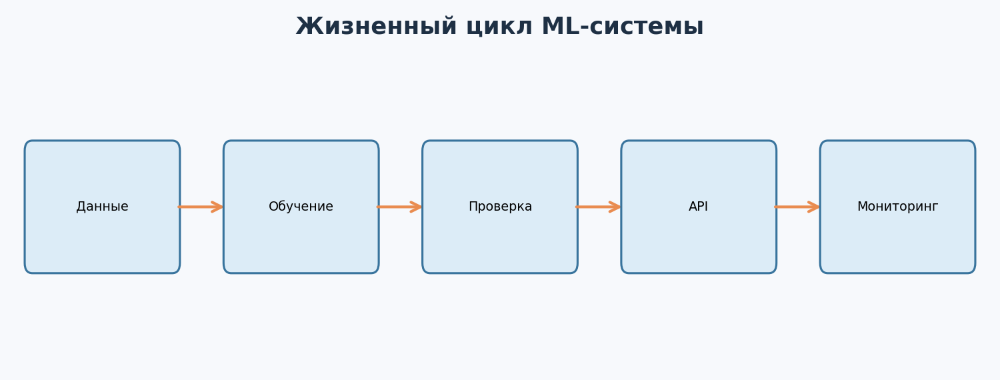
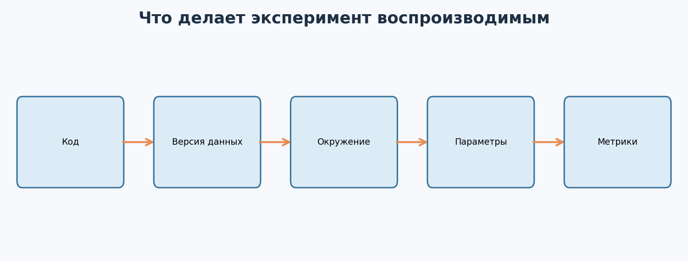
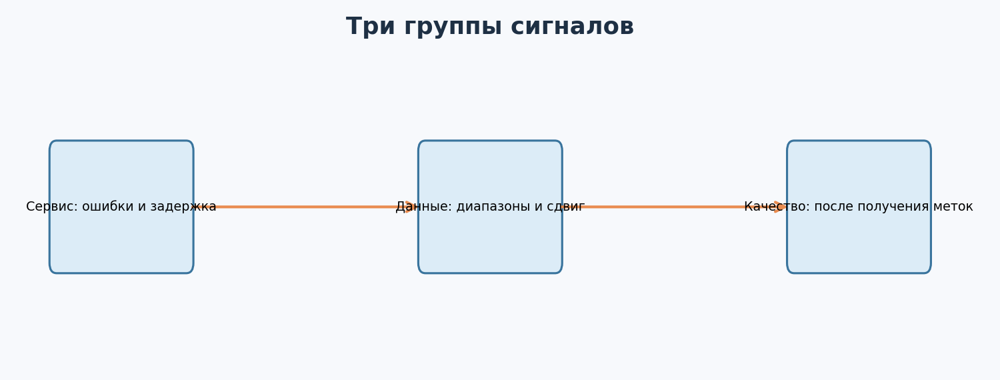
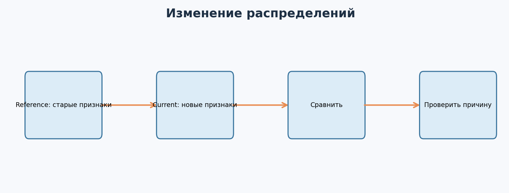
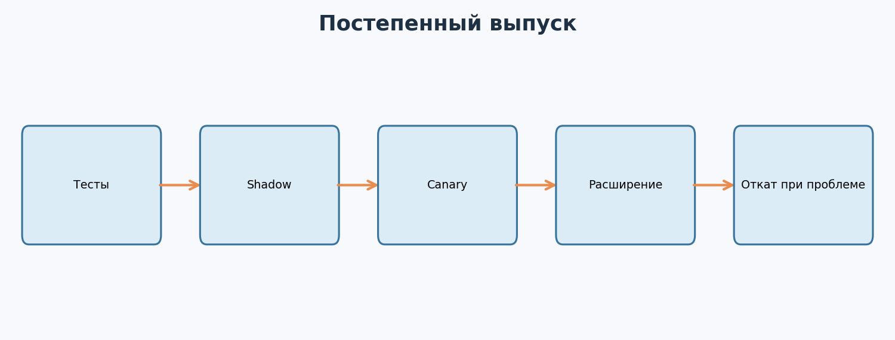

---

# Урок 1. Почему одной обученной модели недостаточно?

**Перед началом:** М4–М14 - Python, pandas, scikit-learn, проверка качества, основы нейросетей.  
**После модуля:** ты соберёшь минимальную систему: подготовка данных → обучение → сохранение модели → API → тесты → мониторинг. Научишься объяснять, зачем нужны версии, CI, воспроизводимость, проверка качества и план отката.

> Наш пример - **синтетический** интернет-магазин. Никаких реальных покупателей, реальных финансовых метрик или доступов к облаку. Развёртывание в публичном интернете оставляем отдельным необязательным этапом: сначала научимся делать безопасный и воспроизводимый локальный сервис.




Представь: ты провёл исследование, обучил классификатор, получил хорошую ROC-AUC, красиво оформил ноутбук и показал результат руководителю. А тебе отвечают: «Классно. А как нашим сервисам отправлять запросы к этой модели? Кто заметит, если она сломается? И как вернуть старую версию?»

Вот здесь и начинается **MLOps** - практики, помогающие разрабатывать, проверять, доставлять, наблюдать и обновлять ML-системы. Название объединяет *Machine Learning* и *Operations*. Идея близка к DevOps, но у ML есть дополнительная сложность: поведение зависит не только от кода, но и от **данных и весов**.

## 1.1. Три состояния одного решения

**Ноутбук:** исследователь запускает ячейки вручную, смотрит метрики. Хорошо для эксперимента, но результат может зависеть от порядка запуска, окружения и локальных файлов.

**Программа:** определённый скрипт получает определённые данные, обучает модель и сохраняет результат. Такой процесс уже можно повторить.

**Сервис:** другая программа отправляет признаки, получает прогноз; сервис обновляется, проверяется и наблюдается после выпуска.

Например, модель прогнозирует вероятность покупки в ближайшие семь дней. Для одного пользователя нужны признаки, существовавшие **на момент прогноза**: число посещений за прошлую неделю, добавления в корзину, предыдущие заказы и факт показа скидки. Факт будущей покупки - это **метка для обучения**, а не входной признак.

## 1.2. Разные типы отказов

- Сервер недоступен - проблема доступности.
- Входное поле переименовали - проблема контракта данных.
- Данные изменились - возможный дрейф.
- Модель возвращает числа, но стала принимать плохие решения - проблема качества.
- Новые веса оказались хуже старых - проблема выпуска и отката.

Одна метрика accuracy не обнаружит все эти ситуации.

## 1.3. Чем будем заниматься в модуле?

Мы создадим маленький **ML-сервис** с двумя запросами: `/health` проверит, что сервис работает, а `/predict` вернёт вероятность покупки. Будем использовать scikit-learn для обучения и FastAPI для веб-интерфейса.

**Главное:** хороший ML-проект - не файл с весами, а полный путь от определения данных до наблюдения за прогнозами в эксплуатации.

**Проверь себя**

Придумай по одному примеру: (а) модель работает, но API не работает; (б) API работает, но качество модели ухудшилось. Почему это разные проблемы?

---

# Урок 2. Воспроизводимость: чтобы «у меня работает» стало «работает у команды»

## 2.1. Почему результаты отличаются?

Один человек обучил модель и получил ROC-AUC 0.79. Другой запустил «тот же код» и получил 0.73. Причины могут быть разные: другая версия данных, случайное разделение, отличающаяся версия библиотеки, другой набор признаков или изменение гиперпараметра.

Поэтому хорошая практика - фиксировать **код, данные, окружение, параметры и способ оценки**.



## 2.2. Структура проекта

В материалах темы файлы разложены так:

```text
Т5. Собеседование/
├── Данные/
│   ├── purchase_snapshots.csv
│   ├── reference_traffic.csv
│   └── current_traffic.csv
├── Примеры/
│   ├── generate_datasets.py
│   ├── m15_train.py
│   ├── m15_api.py
│   ├── m15_monitor.py
│   ├── test_m15_api.py
│   └── model/             # создаётся при обучении
├── requirements.txt
└── README.md
```

Здесь всё имеет свою роль: `Данные` - учебные исходные данные, `Примеры` - код, `model` - **результат обучения**, `requirements.txt` - список необходимых библиотек.

## 2.3. Подготавливаем окружение

В командной строке из папки «Т5. Собеседование»:

```bash
python -m venv .venv
# Linux/macOS:
source .venv/bin/activate
# Windows PowerShell:
# .venv\Scripts\Activate.ps1

python -m pip install -r requirements.txt
```

В разных операционных системах команды активации отличаются. Если окружение уже подготовлено - можно продолжать.

## 2.4. Версии и seed

Случайное зерно (*seed*) задаёт воспроизводимую последовательность псевдослучайных чисел. Например, `random_state=42` в `train_test_split` позволяет повторить то же разделение при одинаковых входах и окружении. Но один seed **не гарантирует полностью идентичный результат** для всех библиотек, ускорителей и многопоточных вычислений.

В Git фиксируем код и конфигурацию. Данные и большие модели лучше хранить отдельно или версионировать специальными инструментами, особенно если они большие или чувствительные. Файл `.env` с токенами доступа никогда не публикуем.

**Главное:** воспроизводимый эксперимент должен оставлять след: что запустили, на каких данных, с какими настройками и что получили.

**Проверь себя**

Представь, что коллега прислал только `model.joblib`. Назови хотя бы пять вещей, которые необходимо выяснить, прежде чем использовать модель в новом сервисе.

---

# Урок 3. От данных к модели: правильная граница во времени

Начнём с учебной бизнес-задачи: интернет-магазин хочет оценивать вероятность того, что пользователь совершит покупку в следующие семь дней.

## 3.1. Что лежит в CSV?

Открой `Данные/purchase_snapshots.csv`. Там есть колонки:

| Колонка | Смысл |
|---|---|
| `snapshot_date` | День, в который делаем прогноз |
| `visits_7d` | Посещения за последние 7 дней |
| `cart_adds_7d` | Добавления в корзину за последние 7 дней |
| `prior_orders` | Число заказов до момента прогноза |
| `discount_seen` | Была ли показана скидка до прогноза: 0 или 1 |
| `bought_next_7d` | Была ли покупка после прогноза: целевая метка |

**Важно:** это данные, искусственно созданные скриптом. Они показывают форму ML-задачи, но не отражают реальную конверсию какого-либо магазина.

## 3.2. Почему нельзя перемешивать прошлое и будущее?

Если система должна делать прогноз сегодня, она не может знать, что произойдёт завтра. Даже если все столбцы выглядят числовыми, нужно разобраться, **когда значение стало известно**.

Поэтому в учебном проекте используем хронологическое разделение:

- Train - более ранние даты.
- Validation - следующие даты, используем для выбора порога.
- Test - самые поздние даты, оставленные для итоговой оценки.

Это ближе к будущей эксплуатации, чем случайное перемешивание снимков во времени. В реальном проекте надо ещё проверять пользователей, задержку появления меток и пересечения окон наблюдений.

## 3.3. Почему предобработка должна обучаться только на train?

Допустим, ты стандартизируешь числовой признак и используешь среднее по **всем** данным, включая test. Даже если не используешь метки, тестовая информация уже повлияла на обработку. Это методологически неверно для честной оценки.

Поэтому используем `Pipeline`, который объединяет заполнение пропусков, стандартизацию и классификатор.

```python
from sklearn.pipeline import make_pipeline
from sklearn.impute import SimpleImputer
from sklearn.preprocessing import StandardScaler
from sklearn.linear_model import LogisticRegression

model = make_pipeline(
    SimpleImputer(strategy='median'),
    StandardScaler(),
    LogisticRegression(max_iter=1000, random_state=42),
)
```

Каждый трансформер обучается только тогда, когда мы вызываем `fit()` на обучающей части. В последующем `predict()` использует уже найденные параметры.

**Главное:** тестировать ML-модель нужно на данных, которые имитируют момент реального прогноза и не повлияли на обучение.

**Проверь себя**

Можно ли использовать в качестве признака «получил письмо после покупки», если хотим предсказывать покупку заранее? Почему?

---

# Урок 4. Обучаем модель и сохраняем артефакт

## 4.1. Запускаем готовый учебный скрипт

Из папки «Т5. Собеседование»:

```bash
python Примеры/generate_datasets.py
python Примеры/m15_train.py
```

Первый скрипт генерирует учебные CSV с фиксированным зерном. Второй читает таблицу, делит данные по датам, обучает логистическую регрессию и печатает результаты на test.

В `Примеры/model/` появятся:

```text
purchase_model.joblib
metadata.json
```

Первый файл содержит сохранённый sklearn Pipeline. Второй - описание версии, порядка признаков, порога и метрик.

## 4.2. Что измерять?

Для вероятностной модели полезны разные метрики:

**ROC-AUC:** насколько модель в среднем ранжирует положительные случаи выше отрицательных.

**Average Precision / PR-подход:** особенно полезен, когда положительный класс редок.

**Brier score:** средний квадрат разности предсказанных вероятностей и меток 0/1; меньше - лучше. Помогает оценить качество вероятностных прогнозов.

**Precision / Recall при выбранном пороге:** насколько качественно модель принимает конкретное бинарное решение.

Нельзя выбрать модель только по «красивому» одному числу без понимания цены ошибок.

## 4.3. Как выбираем порог?

Классификатор возвращает вероятность. Для решения «кому отправить предложение» нужен порог: например, `p >= 0.35`. В скрипте выбираем порог по **валидационной** части, затем переобучаем Pipeline на train+validation и один раз измеряем качество на test.

Выбранный критерий в учебном коде - F1. Это **демонстрация механики**, а не доказательство, что F1 лучший бизнес-критерий: реальному магазину нужны стоимость контакта, маржинальность и ограничения на число сообщений.

## 4.4. Почему недостаточно сохранить веса?

В реальной системе нужно сохранить и преобразования признаков, и их порядок. Если при обучении ты стандартизировал данные, а при прогнозе подашь необработанные числа, результат будет некорректным.

Поэтому мы сохраняем весь Pipeline: `SimpleImputer → StandardScaler → LogisticRegression`.

**Безопасность:** загрузка недоверенных файлов `joblib` и `pickle` может выполнять произвольный код. Загружай только артефакты проверенного происхождения. Версии библиотек тоже должны быть совместимы; не следует считать сериализованную модель универсальным форматом для разных сред.

**Главное:** модель - это не только коэффициенты; это ещё предобработка, схема данных, порог, метрики и версия.

**Проверь себя**

В скрипте найди место, где выбирается порог. Объясни, почему было бы неправильно оптимизировать его по test.

---

# Урок 5. Трекинг экспериментов: как не забыть, какая версия лучше?

После десятка экспериментов легко запутаться: «Чем run_07 отличался от run_09? Почему мы решили увеличить регуляризацию? И какой датасет использовали?»

**Трекинг экспериментов** - это запись параметров, метрик и артефактов каждого запуска.

## 5.1. Минимальный журнал

В самом простом случае достаточно CSV:

| Run | Что поменяли | ROC-AUC val | PR-AUC val | Комментарий |
|---|---|---|---|---|
| A | Логистическая регрессия | 0.72 | 0.49 | Baseline |
| B | Новый признак | 0.74 | 0.51 | Проверить утечки |
| C | Иной порог | 0.74 | 0.51 | Меняет решения, не AUC |

Числа здесь **иллюстративные**, а не результаты нашего скрипта. Записывать нужно реальные измерения после запуска.

## 5.2. Зачем MLflow?

MLflow Tracking позволяет сохранять для экспериментов параметры, метрики, версии кода и артефакты, а затем сравнивать результаты в интерфейсе.

**Необязательный пример** (для него отдельно установи `pip install mlflow`):

```python
import mlflow

mlflow.set_experiment('ml-course-purchases')

with mlflow.start_run(run_name='baseline'):
    mlflow.log_param('model', 'logistic_regression')
    mlflow.log_param('random_state', 42)
    mlflow.log_metric('validation_roc_auc', 0.74)  # демонстрационное число
```

Обрати внимание: этот код **только записывает метрики**, но сам не обучает модель. В настоящем эксперименте числа должны приходить из расчётов. Возможности автологирования и интерфейс MLflow следует сверять с установленной версией.

**Главное:** сравнивать модели можно, только когда известны условия сравнения, а test не используется для бесконечного подбора решений.

**Проверь себя**

Опиши, почему run C с иным порогом может изменить precision и recall, но не изменит ROC-AUC, если сами вероятностные прогнозы остались прежними.

---

# Урок 6. API: как другая программа получает прогноз?

Пока наша модель живёт в файле. Но интернет-магазину нужен способ отправить признаки пользователя и получить ответ. Для этого создадим **API**, то есть понятный интерфейс взаимодействия программ.

## 6.1. Наш API-контракт

Сервис принимает JSON:

```json
{
  "visits_7d": 8,
  "cart_adds_7d": 2,
  "prior_orders": 3,
  "discount_seen": 1
}
```

И возвращает JSON примерно такой формы:

```json
{
  "purchase_probability": 0.7341,
  "positive_decision": true,
  "threshold": 0.3,
  "model_version": "tutorial-v1"
}
```

Здесь `0.7341` - **пример формата**, а не гарантированное значение для этих входных данных. Точное значение получишь при запуске собственного сервиса.

## 6.2. Запускаем сервер

Сначала выполни обучение из предыдущего урока. Затем из корня пакета:

```bash
python -m uvicorn m15_api:app --app-dir Примеры --host 127.0.0.1 --port 8000
```

Открой в браузере `http://127.0.0.1:8000/docs`. FastAPI автоматически покажет интерактивную документацию, где можно попробовать POST-запрос к `/predict`.


## 6.3. Что находится внутри?

Открой `Примеры/m15_api.py`. Там есть:

- модель запроса `PurchaseRequest` с описанием обязательных полей;
- `Field(ge=0)` - запрет отрицательных значений;
- endpoint `/health` для простой проверки доступности;
- endpoint `/predict`, который превращает JSON в DataFrame с правильным порядком столбцов;
- загрузка модели и порога из локальных артефактов.

Мы также проверяем согласованность числа добавлений в корзину и посещений **в рамках правил нашего синтетического датасета**. В реальном магазине такой инвариант не всегда верен, поэтому он должен определяться бизнес-семантикой, а не слепо копироваться.

## 6.4. Зачем возвращать версию модели?

Если прогнозы внезапно изменились, команда должна уметь ответить: какой код и какая модель обработали конкретный запрос? Версия помогает расследовать ошибки и сравнивать поведение до и после релиза.

**Важно:** `GET /health` здесь демонстрирует доступность приложения и загруженного артефакта, но не проверяет, что система действительно даёт полезные прогнозы или что все её внешние зависимости здоровы.

**Главное:** API превращает вычисления в интерфейс, которым могут пользоваться другие системы.

**Проверь себя**

В интерактивной странице `/docs` передай отрицательное число посещений. Что происходит и почему это лучше, чем молча принять неверные данные?

---

# Урок 7. Автоматические тесты и CI: ловим ошибки раньше пользователей

Представь, что разработчик переименовал `cart_adds_7d` в `carts`, а клиент продолжает отправлять старый JSON. Такой релиз может сломать приложение. Проверять это только вручную - рискованно.

## 7.1. Три уровня проверок

**Unit-тест:** маленькая функция ведёт себя ожидаемо.

**API-тест:** `/predict` возвращает нужную структуру, обрабатывает корректные и некорректные запросы.

**Проверка ML-контракта:** модель загружается, порядок признаков соответствует метаданным, вероятности попадают в `[0,1]`, данные на входе имеют корректную схему.

Не стоит писать тест вида «вероятность для Ивана всегда ровно 0.837» при переобучаемой модели: он будет ломаться после любого законного обновления весов. Гораздо полезнее проверять стабильные условия и отдельно утверждённые модельные метрики.

## 7.2. Запускаем тесты

```bash
python -m pytest -q Примеры/test_m15_api.py
```

В примере пять проверок: health, корректный прогноз, недопустимое отрицательное значение, противоречивый запрос и значение скидки вне диапазона.

## 7.3. Что такое CI?

**Continuous Integration** - автоматический запуск проверок, например при отправке изменений в Git-репозиторий. Вместо «перед релизом не забыть запустить тесты» мы создаём правило: тесты должны запускаться постоянно.

В `Примеры/github_actions_ci.yml` лежит пример GitHub Actions workflow. Чтобы использовать его в своём репозитории, скопируй содержимое в `.github/workflows/tests.yml`.

Он выполняет последовательность:

```text
Изменение кода → установка Python → установка библиотек
                → генерация учебных данных → обучение модели → тесты
```

Для реальной системы обычно добавляют линтер, проверку уязвимостей, ограничения по метрикам и проверку исходных артефактов. Версии сторонних GitHub Actions и их источники нужно проверять перед использованием.

**Главное:** автоматические тесты не гарантируют качество модели в бизнесе, но сокращают риск технических поломок.

**Проверь себя**

Придумай один тест для неправильного типа `discount_seen` и один - для ситуации, когда файл модели отсутствует.

---

# Урок 8. Docker и деплой: одинаковые условия запуска

На твоём ноутбуке установлен один набор библиотек. На сервере - другой. Приложение запускается локально, но падает после переноса. Чтобы уменьшить количество подобных проблем, используют **контейнеризацию**.

## 8.1. Что такое Docker?

Образ Docker описывает приложение и большую часть его программного окружения: базовую систему, Python, зависимости, код и команду запуска. Контейнер - запущенный экземпляр такого образа.

Он не устраняет абсолютно все различия между машинами: архитектура процессора, права доступа, оборудование и внешние сервисы по-прежнему имеют значение. Но контейнер помогает стандартизировать важную часть окружения.

## 8.2. Наш Dockerfile

Открой `Примеры/Dockerfile`. Там используются команды:

- `FROM` - базовый образ с Python;
- `WORKDIR` - рабочая папка;
- `COPY` - добавление файлов;
- `RUN` - установка зависимостей;
- `CMD` - запуск сервера.

Сначала обучи модель **локально**. Убедись, что файлы лежат в `Примеры/model/`. Затем:

```bash
docker build -f Примеры/Dockerfile -t course-buy-api .
docker run --rm -p 8000:8000 course-buy-api
```

После этого сервис можно проверить по адресу `http://127.0.0.1:8000/docs`.

> Эти команды требуют установленного и работающего Docker. В учебном пакете они подготовлены как пример; запуск Docker в конкретной среде ученика зависит от операционной системы.

## 8.3. Что такое деплой?

**Deploy** - доставка новой версии приложения в среду, где им будут пользоваться. Это может быть облако, виртуальная машина или внутренний сервер компании.

Для публичного сервиса дополнительно нужны HTTPS, аутентификация/авторизация, ограничения запросов, секреты через безопасные механизмы, сетевые правила, наблюдаемость, права доступа и продуманная обработка персональных данных.

Наша демонстрация намеренно запускается локально и **не должна восприниматься как готовый production-сервис**.

**Главное:** Docker помогает переносить согласованное окружение, но безопасность и надёжность сервиса требуют дополнительных мер.

**Проверь себя**

Объясни разницу между образом и контейнером. Почему нельзя хранить пароль к базе в Dockerfile?

---

# Урок 9. Мониторинг: модель может работать и при этом ошибаться

Допустим, API успешно отвечает на запросы. Значит ли это, что прогнозы хорошие? Не обязательно.

Сервис может быть технически доступен, но данные покупателей меняются. Например, после рекламной кампании среднее число посещений выросло с трёх до шести. Модель обучалась на других условиях.



## 9.1. Три группы сигналов

**Технические:** доступность, частота ошибок, p50/p95 задержки, время загрузки модели, число запросов.

**Данные:** доля пропусков, диапазоны значений, новые категории, изменение распределений входных признаков.

**Качество прогнозов:** precision, recall, прибыль, частота ошибок - при условии, что **пришли настоящие метки** и мы можем корректно связать их с прогнозами.

У покупки в течение семи дней метка появляется не сразу. Если прогноз сделан сегодня, уже завтра мы ещё не можем честно оценить его семидневный исход.

## 9.2. Что такое data drift?

**Data drift** - изменение распределения входных данных относительно некоторого эталона. В нашем примере новая аудитория может чаще заходить на сайт. Это повод внимательно проверить модель, но **сам по себе дрейф не доказывает ухудшение прогноза**.



Попробуй:

```bash
python Примеры/m15_monitor.py
```

Скрипт сравнивает два синтетических набора данных и выводит средние значения и Population Stability Index (PSI). Метод расчёта здесь упрощён: границы корзин задаются по reference, а пустые корзины сглаживаются. Универсального «магического» порога PSI, пригодного для всех задач, нет.

## 9.3. Что делать при тревожном сигнале?

Сначала проверить источник данных и изменение контракта. Затем оценить, какие пользователи или периоды пострадали. Если доступны метки - сравнить качество по времени и сегментам. И только после диагностики принимать решение об откате, переобучении или изменении продукта.

Следить только за одной средней метрикой опасно: модель может работать хорошо в целом, но плохо в важной группе пользователей.

**Главное:** мониторинг отвечает на вопрос «что происходит сейчас?», а не только «какая accuracy была три месяца назад?».

**Проверь себя**

Назови три возможные причины роста среднего `visits_7d`, не связанные с ошибкой ML-модели. Как бы ты их различил?

---

# Урок 10. Переобучение, откат и ответственность

Представь, что команда обучила новую модель. Её offline-метрики лучше. Можно ли сразу заменить старую на всех пользователях? Иногда это рискованно.

## 10.1. Почему хороший offline-score не всегда означает лучший продукт?

Данные могут не отражать новую аудиторию, техническая задержка новой модели может быть слишком большой, а бизнес-метрика - расходиться с ML-метрикой. Поэтому выпуск новой модели часто строят постепенно.



**Теневая проверка (shadow mode):** новая модель считает ответы параллельно, но не влияет на то, что видит пользователь. Можно сравнить задержки, стабильность и прогнозы.

**Canary:** новая версия получает небольшую долю реальных запросов, а команда следит за заранее выбранными сигналами.

**Постепенное расширение:** долю увеличивают только при выполнении критериев безопасности и качества.

**Rollback:** если обнаружены проблемы, трафик возвращают на предыдущую проверенную версию.

## 10.2. Что такое переобучение в эксплуатации?

Не путай два разных значения слова:

- *Overfitting*, или переобучение в теории ML, - модель слишком сильно подстроилась под учебные данные.
- *Retraining*, или повторное обучение, - мы обучаем новую версию на новых данных.

Оно не обязательно должно происходить каждый день. Частота зависит от задачи, скорости изменения данных и стоимости обновления.

## 10.3. Мини-чеклист перед выпуском

Перед релизом стоит ответить:

1. На каких данных и когда обучали модель? Есть ли право использовать эти данные?
2. На чём сравнивали с baseline и предыдущей версией?
3. Проверяли ли целостность feature pipeline и правильность схемы?
4. Как измеряются качество и техническая стабильность?
5. Кто принимает решение об откате, как именно происходит rollback?
6. Как защищены артефакты, доступы и пользовательские данные?

В серьёзных проектах требования могут быть существенно строже - особенно там, где решения сильно влияют на людей.

**Главное:** MLOps - это про доверие, управляемость и предсказуемость всего ML-жизненного цикла.

**Проверь себя**

Offline ROC-AUC выросла, но p95 latency ухудшилась вдвое. Предложи план проверки перед выпуском.

---

# Практика: Собираем первый ML-сервис

Работа рассчитана примерно на 2–4 часа. Не нужно аренду облачного сервера: достаточно локальной среды Python. **Вопросы и задачи сначала решаем самостоятельно.**

## Часть 1. Понимание системы

### Задание 1. Карта MLOps

Нарисуй цепочку «данные → обучение → проверка → сохранение → API → мониторинг». Под каждым блоком напиши по одной возможной ошибке и способу её обнаружения.

### Задание 2. Утечка будущего

Есть признаки `prior_orders`, `visits_7d`, `bought_next_7d`, `cart_adds_7d`. Что можно подавать модели при прогнозировании будущей покупки, а что нельзя? Почему?

### Задание 3. Проверка данных

Придумай минимум пять условий корректности входящего JSON для учебного магазина. Что делать, если поле отсутствует или его значение некорректно?

### Задание 4. Метрики

У модели A ROC-AUC = 0.81, у B = 0.80. Но B отвечает вдвое быстрее. Какую модель выбрать для API? Какие дополнительные сведения нужны?

## Часть 2. Практика с кодом

### Задание 5. Воспроизводимый запуск

Запусти `generate_datasets.py` и `m15_train.py`. Запиши размеры train/validation/test, выбранный порог и три итоговые метрики. Затем запусти обучение ещё раз и сравни числа.

### Задание 6. Проверяем baseline

Добавь сравнение своей модели с `DummyClassifier(strategy='prior')` на test. Сравни как минимум average precision и Brier score; поясни разницу.

### Задание 7. Меняем порог

На validation попробуй пороги 0.2, 0.3, 0.5, 0.7. Построй таблицу precision/recall и объясни, что меняется. **Не используй test для выбора порога.**

### Задание 8. Первый API-запрос

Запусти `/docs` и получи прогноз для пользователя с 8 посещениями, 2 добавлениями в корзину, 3 прошлыми заказами и показанной скидкой. Запиши JSON-ответ.

### Задание 9. Ошибка входных данных

Отправь `visits_7d = -2`. Какой статус ответа получил? Почему сервер не должен молча заменять его на ноль?

### Задание 10. Новая проверка

Добавь API-тест, который проверяет, что `discount_seen = 3` отклоняется. Запусти всю тестовую подборку.

### Задание 11. Замер времени

Отправь 30 последовательных локальных запросов к API. Измерь длительность каждого, приблизительно оцени среднее и 95-й перцентиль. Напиши, почему этого недостаточно для оценки под реальной нагрузкой.

### Задание 12. Сравнение распределений

Запусти `m15_monitor.py`. Выбери признак с наибольшим изменением и предложи две возможные причины его сдвига.

## Часть 3. Инженерное мышление

### Задание 13. План выпуска

У тебя есть модель v1 и новая v2. Составь план shadow → canary → расширение. Укажи две условия остановки и способ отката.

### Задание 14. Безопасность

Найди четыре вещи, которые нельзя случайно выкладывать в открытый GitHub-репозиторий ML-сервиса. Объясни, почему `joblib.load` нельзя применять к неизвестным файлам.

### Задание 15. Мини-отчёт

Подготовь технический отчёт на одну страницу: проблема, входной контракт, данные, split, baseline, метрики, как запустить сервис, известные ограничения, что будешь мониторить. Он понадобится в М18 для портфолио.

---

# Итоги модуля

Теперь ты понимаешь, почему недостаточно просто обучить модель и сохранить файл с весами. Мы прошли весь путь от данных до доступного через API прогноза и рассмотрели то, что происходит **после выпуска**: проверку входных данных, автоматические тесты, контроль версий, мониторинг и откат.

**Главная мысль:** ML-инженер отвечает не только за качество модели в ноутбуке, но и за надёжность решения, которым смогут пользоваться другие люди и системы.

**Дальше:** в М16 посмотрим на более широкую картину - как спроектировать ML-систему целиком, когда у неё появляются реальные пользователи, большие объёмы данных и ограничения по задержке.

## Полезная документация

- [FastAPI: First Steps](https://fastapi.tiangolo.com/tutorial/first-steps/) - основы API.
- [scikit-learn: Model Persistence](https://scikit-learn.org/stable/model_persistence.html) - способы сохранения и риски загрузки.
- [MLflow: Tracking Quickstart](https://mlflow.org/docs/latest/ml/getting-started/quickstart/) - журнал экспериментов.
- [GitHub Actions: documentation](https://docs.github.com/en/actions) - CI.
- [Docker: Get Started](https://docs.docker.com/get-started/) - контейнеризация.

> API, версии и команды установки могут изменяться. Перед публикацией видеоурока полезно сверять их с актуальной официальной документацией и запущенным учебным проектом.

## Финальный вопрос

Объясни, почему хорошая метрика модели не гарантирует надёжную работу ML-сервиса.
