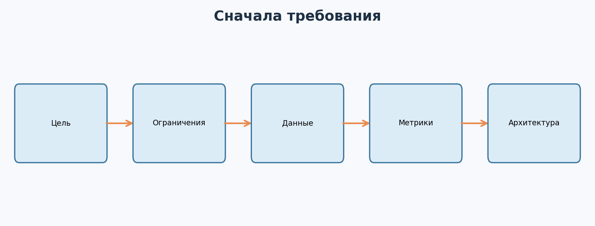
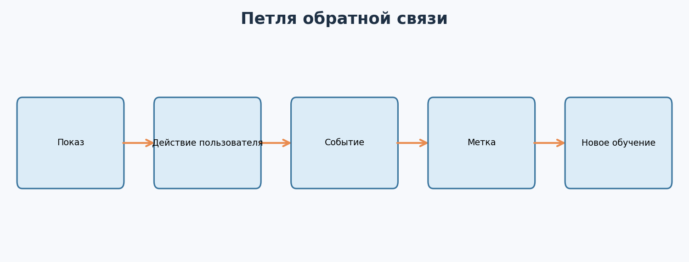
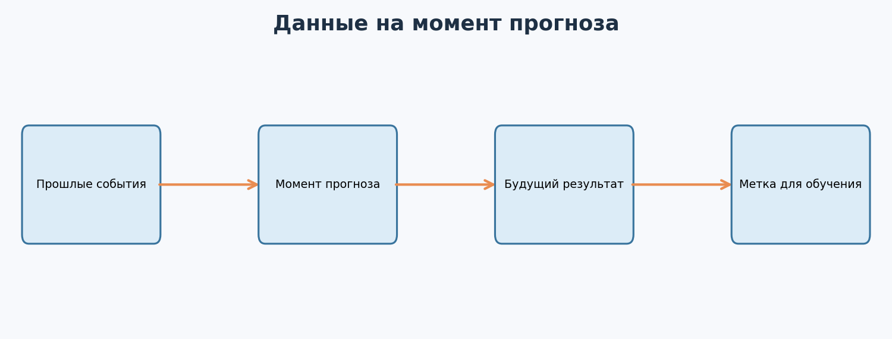
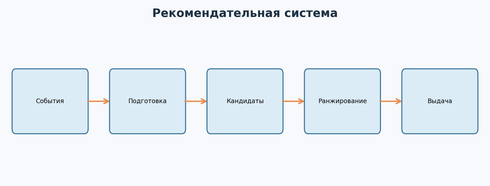
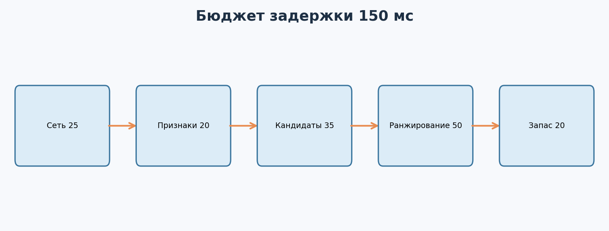

---

# Урок 1. Что такое ML System Design и чем он отличается от выбора алгоритма?

**Перед началом:** М6–М15 - классический ML, метрики, пайплайны, MLOps.  
**После модуля:** ты сможешь декомпозировать бизнес-задачу, описать данные и метки, набросать offline/online-архитектуру, выбрать baseline, оценить нагрузку и объяснить риски на собеседовании по ML System Design.

> Мы будем проектировать **учебную рекомендательную систему для интернет-магазина**. Все нагрузки, ограничения и SLA ниже специально придуманы для тренировки. Это не описание инфраструктуры какой-либо реальной компании.




Представь, что к тебе приходит менеджер продукта: «Мы хотим персональные рекомендации на главной странице. Давай использовать нейросеть!»

Можно сразу спросить, сколько слоёв будет в модели. Но это плохой первый вопрос.

Сначала нужно выяснить, **какую проблему мы решаем**. Хотим увеличить покупки? Помочь пользователю быстрее находить нужный товар? Уменьшить число нерелевантных показов? А если рекомендация ошибётся - что произойдёт?

**Machine Learning System Design** - это проектирование всей системы машинного обучения: от постановки задачи и данных до модели, инфраструктуры, эксплуатации и проверки результата.

## 1.1. Не только модель

В проекте есть несколько связанных частей:

1. **Продуктовая цель:** ради чего мы строим систему.
2. **Данные и метки:** из чего модель будет учиться.
3. **Обучение:** как получим и проверим модель.
4. **Serving:** как её прогноз станет доступен продукту.
5. **Мониторинг и обновление:** как система будет жить после релиза.

Модель может иметь высокую offline-метрику и одновременно быть неподходящей для продукта, если отвечает слишком медленно, нарушает приватность или требует данных, которые появляются только завтра.

## 1.2. Уточняющие вопросы

Когда тебе дают расплывчатую задачу, начни с вопросов:

- Кто конечный пользователь?
- Какое решение система должна принять?
- Как выглядит успех для бизнеса?
- Какие данные доступны **в момент прогноза**?
- Сколько запросов ожидается?
- Насколько быстро нужен ответ?
- Что делать, если модель недоступна?
- Какие ограничения по приватности, бюджету и безопасности?

Эти вопросы не являются «отговорками». Они определяют архитектуру.

## 1.3. Формулируем нашу задачу

Предположим, на главной странице магазина нужно показать пять релевантных товаров.

**Учебная цель:** увеличить долю покупок, связанных с рекомендациями, не ухудшая пользовательский опыт.

**Учебные ограничения:** до 200 запросов в секунду в пик и целевой p95 времени ответа до 150 мс.

Это не обещания: реальные целевые значения определяются нагрузочными тестами, продуктом и бюджетом.

**Главное:** перед выбором модели нужно определить цель, ограничения и критерии успеха.

**Проверь себя**

Тебе поручили «предсказывать отток клиентов». Какие пять вопросов ты задашь прежде, чем открыть ноутбук?

---

# Урок 2. Требования, метрики и цена ошибок

## 2.1. Как бизнес-цель превращается в ML-задачу?

«Повысить продажи» - слишком общая цель. Модель может оценивать вероятность клика по товару, вероятность покупки или ожидаемую ценность рекомендации.

Например, если прогнозируем вероятность клика:

`P(click | user, item, context)`

Вход - пользователь, товар и контекст показа. Выход - оценка вероятности клика. Но **клик - лишь промежуточная метрика**: пользователи могут кликать на привлекательные карточки и не покупать ничего.

## 2.2. Offline и online метрики

**Offline:** качество на отложенных данных, например Recall@K, NDCG@K, log loss и калибровка в зависимости от постановки.

**Online:** доля кликов, покупки, выручка, удовлетворённость, жалобы. Для надёжных причинных выводов часто нужен рандомизированный эксперимент.

**Guardrails:** показатели, которые не должны ухудшиться: время загрузки страницы, частота ошибок, скорость сервиса, разнообразие товаров, жалобы.

Сильный кандидат не произносит «оптимизируем accuracy», не спросив, что именно считает правильным ответом.

## 2.3. Как выбрать одну основную метрику?

Представим две рекомендательные модели.

- A показывает популярные товары и получает много кликов.
- B предлагает менее очевидные, но подходящие товары; кликов немного меньше, а покупок больше.

Какая лучше? Это зависит от заранее согласованной продуктовой цели и допустимых побочных эффектов.

## 2.4. Какая цена ошибки?

В разных задачах ошибки имеют разную стоимость. В рекомендациях неудачный показ может быть относительно недорогим. В антифроде неправильная блокировка может мешать реальному клиенту, а пропущенное мошенничество - привести к потерям. В медицинских решениях цена ошибки может быть очень высокой. Поэтому архитектуру и метрики нельзя переносить без адаптации.

**Главное:** хорошая offline-метрика - только часть доказательства полезности ML-системы.

**Проверь себя**

Придумай две ситуации, где рост CTR не означает улучшение продукта. Какие онлайн-показатели ты добавил бы?

---

# Урок 3. Данные, события, метки и point-in-time

Рекомендации невозможно честно обучить без понимания того, **что пользователю было показано и когда**.

## 3.1. Что логировать?

Представим следующую последовательность:

1. Пользователь открыл главную страницу.
2. Система показала товар A в позиции 1 и товар B в позиции 2.
3. Пользователь нажал на B.
4. Позже пользователь купил товар B.

Полезны события **impression**, **click** и **purchase**. При этом события должны иметь согласованные идентификаторы показа и товара, временные метки и допустимый по правилам приватности контекст.



## 3.2. Что такое метка для обучения?

Если задача - прогнозировать клик, метка 1 может означать, что после показа пользователь кликнул на товар в установленном временном окне. Метка 0 - показ был, но клика не произошло в этом окне.

Важно: **отсутствие клика не означает отсутствия интереса**. Возможно, пользователь не заметил товар, изменил задачу или не дождался загрузки страницы. Позиция карточки тоже влияет на вероятность клика.

Если собрать только положительные клики и забыть обо всех показах без клика, датасет не отразит реальную задачу.

## 3.3. Утечка во времени

Ты знаешь, что в будущем пользователь купит товар. Но можно ли использовать эту покупку как признак для более раннего прогноза? Нет.

**Point-in-time correctness** - свойство, при котором каждый обучающий пример использует только информацию, доступную к моменту прогноза.



Например, 10 июня мы хотим предсказать покупку за следующие семь дней. Признак «число покупок за последние 30 дней» можно вычислить по истории **до 10 июня**. Покупки 11–17 июня используются для формирования метки, но не признака.

## 3.4. Что такое train-serving skew?

Это расхождение между тем, как признаки рассчитывались при обучении, и тем, как они получаются в реальном сервисе.

Например, на обучении `cart_adds_7d` считает все добавления за семь дней, а в serving - только за календарную неделю. Названия совпадают, смысл разный, качество может пострадать.

Помогают единые определения, совместные преобразования, проверка свежести признаков и тесты контрактов.

**Главное:** схема данных должна учитывать время, доступность информации и механизм появления меток.

**Проверь себя**

Для прогноза «купит ли человек товар в следующие 24 часа» придумай три допустимых и два запрещённых признака.

---

# Урок 4. Baseline и двухэтапные рекомендации

Представь маркетплейс с миллионом товаров. Если мы будем для каждого запроса запускать тяжёлую нейросеть по каждому товару, время ответа может оказаться неприемлемым.

Поэтому многие рекомендательные системы строят в несколько этапов.

## 4.1. Сначала самый простой baseline

Представим, что у нас вообще нет ML-модели. Можно рекомендовать:

- популярные товары в категории;
- недавно просмотренные товары;
- новинки в интересующей категории;
- товары, которые часто покупают вместе.

Зачем? Чтобы понять, какую дополнительную ценность приносит сложная система. Если нейросеть не превосходит простую сортировку по популярности, мы пока не доказали её полезность.

## 4.2. Candidate generation - получаем кандидатов

Первый этап, **retrieval**, выбирает относительно небольшой набор релевантных товаров из очень большого каталога. Например, из миллиона товаров - несколько сотен.

Механизмы могут быть разными: популярность, похожесть по эмбеддингам, коллаборативная фильтрация, правила каталога.

## 4.3. Ranking - сортируем кандидатов

Второй этап получает уже не миллион, а условно 300 кандидатов и оценивает их подробнее. Можно использовать дополнительные признаки: история взаимодействий, цена, категория, наличие товара, контекст запроса.

Финальная система выбирает пять товаров для показа и применяет ограничения: например, не рекомендовать недоступный товар и не показывать пять почти одинаковых карточек.



## 4.4. Почему не одна «самая умная» модель?

Потому что система ищет компромисс между:

- качеством;
- временем ответа;
- стоимостью вычислений;
- сложностью обслуживания;
- свежестью данных.

Сложная модель может быть полезной на этапе ranking, но слишком дорогой для просмотра всего каталога.

**Главное:** в реальных системах хороший процесс выбора кандидатов и понятные правила часто не менее важны, чем архитектура нейросети.

**Проверь себя**

Предложи три способа рекомендовать новые товары, у которых ещё нет истории кликов. Почему это называется проблемой cold start?

---

# Урок 5. Offline и online: как данные попадают в продакшен?

## 5.1. Offline-путь

Раз в определённый период мы собираем разрешённые события, формируем обучающие примеры, строим признаки, обучаем модели и проверяем их на отложенных данных.

Пример:

```text
События → проверка качества → набор train/val/test
        → обучение → offline-оценка → артефакт модели
```

Тут важна воспроизводимость. Через месяц мы должны суметь восстановить, на каких данных обучалась выпущенная версия.

## 5.2. Online-путь

Пользователь открывает страницу. Система должна быстро:

1. Получить доступные признаки пользователя и контекста.
2. Сформировать кандидатов.
3. Рассчитать оценки релевантности.
4. Убрать недоступные или запрещённые товары.
5. Вернуть список рекомендаций.

Некоторые признаки можно хранить в кеше, другие рассчитывать на лету. Если данные устарели, система должна знать, что делать: использовать безопасное значение по умолчанию, простую рекомендательную логику или отказаться от рекомендации.

## 5.3. Feature store - это не просто таблица

**Feature store** - инструменты и процессы для согласованного хранения, расчёта и предоставления признаков. Его задача - помочь использовать одни и те же определения данных при offline-обучении и online-прогнозе.

Но это не обязательная покупка или библиотека на каждом проекте. Для небольшого сервиса достаточно понятных общих функций, проверок схемы и аккуратного хранения таблиц.

## 5.4. Сколько вообще данных нужно обновлять?

Ответ зависит от того, насколько быстро меняется задача.

- Количество прошлых заказов может обновляться после события покупки.
- Текущий остаток товара требует более свежей информации.
- Долгосрочный эмбеддинг товара можно пересчитывать реже.

Неправильно требовать обновлять всё каждую секунду просто «потому что real-time круче».

**Главное:** хорошая архитектура отличает медленно меняющиеся признаки от тех, чья свежесть критически важна.

**Проверь себя**

Раздели признаки «категория товара», «остаток на складе», «сумма прошлых покупок», «последний клик» на требующие частого и редкого обновления. Объясни компромиссы.

---

# Урок 6. Нагрузка, задержка и масштабирование

Даже самая точная модель не поможет пользователю, если рекомендации загружаются несколько секунд и он уходит со страницы.

## 6.1. Три базовых показателя

**Throughput** - сколько запросов система обрабатывает за единицу времени.

**Latency** - сколько времени занимает обработка отдельного запроса.

**Availability** - какую долю времени сервис доступен по согласованному определению.

Часто смотрят не только среднюю задержку, но и p95: например, p95 = 150 мс означает, что в измеренной совокупности примерно 95% запросов обработались за 150 мс или быстрее.

## 6.2. Учебный бюджет задержки

Предположим, продукт поставил цель p95 = 150 мс. Мы распределим **целевой бюджет**:

| Этап | Бюджет |
|---|---:|
| Сеть и инфраструктура | 20 мс |
| Получение признаков | 25 мс |
| Поиск кандидатов | 30 мс |
| Ranking | 45 мс |
| Фильтрация | 15 мс |
| Резерв | 15 мс |
| **Итого** | **150 мс** |



Это **планирование**, не гарантия. В частности, нельзя просто сложить p95 отдельных компонентов и заявить, что получили p95 всей системы: этот показатель нужно измерять по полному времени каждого запроса.

## 6.3. Прикинем нагрузку вручную

Допустим, **средняя** нагрузка - 50 запросов в секунду в течение суток.

Тогда запросов за день примерно:

`50 × 60 × 60 × 24 = 4 320 000`

Если каждое событие занимает **условно** 2 КБ, только сырые события дадут порядка 8.64 ГБ за сутки в десятичном измерении, без учёта индексов, копий, инфраструктурных метаданных и резервирования.

При пике 200 RPS системе нужны резервы мощности. Средняя и пиковая нагрузка - разные величины.

## 6.4. Как ускорять систему?

- Кешировать части ответа, которые редко меняются.
- Отдельно делать candidate generation и ranking.
- Использовать пакетную предобработку, где это возможно.
- Уменьшать размер модели или применять более быстрый inference.
- Ограничивать число кандидатов и сложность дорогих операций.
- Применять fallback, если критически важная зависимость недоступна.

Каждое ускорение нужно проверять: кеширование может сделать рекомендации устаревшими, а уменьшение модели - снизить качество.

**Главное:** System Design - поиск компромисса между качеством, задержкой, стоимостью и надёжностью.

**Проверь себя**

Если средняя нагрузка выросла с 50 до 75 RPS, как изменится количество запросов за сутки при той же равномерной нагрузке? Что ещё нужно проверить перед масштабированием?

---

# Урок 7. Дрейф, cold start, fallback и неприятные случаи

Когда рассказываешь об архитектуре, мало нарисовать стрелки. Нужно продумать, **как система ведёт себя, когда всё идёт не по плану**.

## 7.1. Cold start

**Новый пользователь:** о его предпочтениях мало информации.

**Новый товар:** у него почти нет показов и кликов.

Если модель зависит только от истории взаимодействий, она может плохо работать в этих случаях.

Простейшие решения: популярные товары по контексту, содержательные признаки каталога, смешивание персонализированных и неперсонализированных рекомендаций, контролируемое исследование новых товаров.

## 7.2. Что делать при недоступности модели?

Допустим, ranker не отвечает. Продукт может вернуть заранее подготовленные популярные товары вместо пустой главной страницы. Но fallback нужно заранее согласовать с продуктом и проверить, что он не нарушает важные ограничения каталога.

## 7.3. Как обнаружить деградацию?

В М15 мы уже разбирали дрейф данных, технические метрики и качество модели. Здесь добавим продуктовые сигналы:

- число показов на сессию;
- CTR и покупки по позициям;
- разнообразие каталога;
- доля новых товаров;
- жалобы и скрытия рекомендаций;
- ошибки и задержки по устройствам.

Модель может увеличить CTR за счёт однотипных приманок. Поэтому без guardrails легко «улучшить» не тот результат.

## 7.4. Смещение обратной связи

Если система всё чаще показывает популярные товары, именно по ним будет больше кликов. Затем следующая модель может считать их ещё более популярными. Это петля обратной связи.

События, собранные под действием старой политики рекомендаций, не являются случайной выборкой всех возможных показов. Для корректного сравнения методов и исследований могут потребоваться специальные статистические подходы и контролируемое исследование.

**Главное:** система должна оставаться полезной даже при недостатке истории, свежих данных и технических сбоях.

**Проверь себя**

Составь fallback для нового пользователя, у которого нет истории просмотров, а персональный ranker временно недоступен.

---

# Урок 8. Запуск эксперимента: как доказать, что изменения помогают?

Твоя новая рекомендательная модель показывает offline NDCG@10 выше baseline. Достаточно ли этого для выпуска? Не обязательно.

## 8.1. Offline-оценка

Проверяем качество на отложенных данных. Важно, чтобы такие данные не «подсматривали» будущие события, а схема оценки соответствовала способу показа рекомендаций.

Но offline-оценка отражает исторические взаимодействия и не всегда предсказывает реакцию пользователей на **новую** политику рекомендаций.

## 8.2. A/B-тест

Часть пользователей по правилам эксперимента видит старый вариант, часть - новый. Сравниваем заранее выбранную основную метрику и guardrails.

При корректном случайном распределении можно оценить причинное влияние изменения системы с учётом статистической неопределённости. Однако нужно помнить о подводных камнях: повторные посещения, пересечение групп, сезонность, влияние других экспериментов и досрочный просмотр p-value.

## 8.3. Что такое онлайн-проверка без риска?

Прежде чем влиять на пользователей, полезно провести **shadow**-проверку: убедиться, что система выдерживает нагрузку и возвращает корректные ответы. Затем - ограниченный canary.

Не путай canary и A/B-тест. Canary чаще используют для безопасного выпуска, а A/B - для оценки влияния варианта на продуктовую метрику. На практике процессы могут сочетаться, но у них разные цели.

## 8.4. После A/B-теста

Положительный результат одного эксперимента ещё не означает, что модель будет успешной при любых изменениях аудитории. Поэтому нужны наблюдаемость, возможность отката и регулярная переоценка условий применения.

**Главное:** прирост offline-score - аргумент для проверки, а не доказательство продуктового эффекта.

**Проверь себя**

Придумай дизайн A/B-теста рекомендательной системы: основная метрика, две защитные метрики, единица рандомизации и срок ожидания результата (без выдуманного статистического обоснования срока).

---

# Урок 9. Данные пользователей, приватность, безопасность и стоимость

В теоретических схемах часто рисуют «логируем всё». Но в реальном продукте так делать нельзя.

## 9.1. Принцип минимизации данных

Собираем и храним только те данные, которые действительно необходимы для задачи и разрешены применимыми правилами. Там, где возможно, используем агрегаты и псевдонимизацию, ограничиваем доступы и сроки хранения.

Особенно опасны секреты доступа, несанкционированное использование пользовательских событий и публикация сырых приватных датасетов в открытых репозиториях.

## 9.2. Безопасность ML-системы

Нужно учитывать обычные технические угрозы и специфические риски:

- посторонние получают доступ к API;
- подменяется артефакт модели;
- недостоверные данные попадают в обучение;
- подают некорректные или злонамеренные входы;
- по логам можно восстановить приватную информацию;
- зависимости имеют известные уязвимости.

Важный принцип из М15: **нельзя загружать произвольный файл модели из недоверенного источника**. Для рабочего решения нужны контроль происхождения и проверка артефактов.

## 9.3. Стоимость системы

Допустим, онлайн-модель настолько тяжёлая, что требует дорогой GPU круглосуточно. Возможно, аналогичную пользу даст более лёгкая модель на CPU. Или можно заранее посчитать часть признаков и кандидатов.

При выборе решения учитываем не только стоимость обучения, но и серверы для serving, хранение событий, сетевой трафик, поддержку и стоимость инженерной сложности.

## 9.4. Где люди особенно важны?

Если ML влияет на кредитные решения, медицину, доступ к услугам или другие значимые последствия, необходимы дополнительные проверки качества, справедливости, объяснимости, соблюдения нормативных требований и человеческого контроля. Учебную рекомендательную систему нельзя бездумно копировать в такие области.

**Главное:** система должна быть полезной, но также законной, безопасной и экономически разумной.

**Проверь себя**

Выбери три поля пользовательского события, которые можно было бы не собирать для нашей задачи, и объясни почему.

---

# Урок 10. Как отвечать на интервью по ML System Design?

Теперь представим, что на собеседовании тебе говорят: «Спроектируй рекомендации для интернет-магазина».

Не нужно за две минуты рисовать десять баз данных и огромную нейросеть. Гораздо сильнее выглядит последовательное, аргументированное рассуждение.

## 10.1. Структура ответа

**Шаг 1. Уточняем задачу:** пользователи, цель, бизнес-метрика, цена ошибок.

**Шаг 2. Фиксируем предположения:** какие данные доступны, примерные нагрузки, требуемая задержка, бюджет.

**Шаг 3. Выбираем baseline:** популярные товары или простая модель.

**Шаг 4. Определяем данные:** события, метка, момент прогноза, обработка будущей информации.

**Шаг 5. Проектируем offline/online:** кто обучает, где лежит модель, откуда приходят признаки, как работает inference.

**Шаг 6. Оцениваем систему:** offline-метрики, онлайн-эксперимент, guardrails.

**Шаг 7. Называем риски:** cold start, дрейф, задержки, утечки, приватность, отказ сервиса.

**Шаг 8. Предлагаем развитие:** что делать в MVP, что масштабировать позже.

## 10.2. Почему честные предположения важнее «правильного» ответа?

У собеседовательного задания редко есть единственная идеальная архитектура. Разные ограничения приводят к разным решениям. Хороший ответ объясняет, **почему был выбран именно такой компромисс**.

## 10.3. Короткий пример

Вопрос: «Нужен прогноз задержки доставки для тысячи заказов в день». Ты можешь ответить:

«Для начала выясню, когда нужен прогноз: при оформлении заказа или после передачи курьеру. Проверю, какие признаки доступны в этот момент. Для baseline возьму простую регрессию или медиану времени по маршруту. Данные разделю по времени и буду измерять MAE, а также долю очень больших ошибок. Если задержка допускает пакетное обновление, не буду строить сложный online inference. Для сервиса предусмотрю fallback и мониторинг изменения маршрутов».

Это уже System Design-мышление - даже без названия модного алгоритма.

**Главное:** тебя оценивают за системность, ясные допущения и умение находить ограничения.

**Проверь себя**

За 3 минуты объясни свою архитектуру рекомендаций, а потом попроси знакомого задать тебе два неприятных вопроса: «Что если всё сломается?» и «Почему не обойтись без ML?».

---

# Практика: Спроектируй ML-систему

Все задания можно выполнять **на бумаге, в Markdown или на виртуальной доске**. Код не обязателен. На выполнение всего блока - ориентировочно 3–5 часов.

## Часть 1. Постановка задачи

### Задание 1. Уточняющие вопросы

Тебе сказали: «Сделай рекомендации на главной странице». Запиши 10 уточняющих вопросов к продуктовой команде.

### Задание 2. Бизнес и ML-метрики

Предложи одну основную онлайн-метрику, две защитные метрики и одну offline-метрику для ранжирования. Объясни, что каждая измеряет.

### Задание 3. Baseline

Опиши систему рекомендаций без ML: какие товары показываем, какие данные используем и почему она может быть сильным первым решением.

### Задание 4. Холодный старт

Придумай стратегию для нового пользователя и нового товара. Укажи хотя бы один риск для каждого случая.

## Часть 2. Данные и архитектура

### Задание 5. Схема события

Спроектируй запись `impression`: назови обязательные поля, время, идентификаторы и одно поле, которое лучше **не логировать**, если оно не нужно задаче.

### Задание 6. Временная утечка

Пользователь увидел товар 10 мая, а купил его 12 мая. Можно ли использовать покупку 12 мая в признаках модели, которая должна была предсказать клик на показ 10 мая? Обоснуй.

### Задание 7. Двухэтапная система

Нарисуй схему «каталог → кандидаты → ranking → фильтрация → топ-5». Выбери приблизительное число кандидатов и объясни компромисс.

### Задание 8. Offline/online

Раздели компоненты: вычисление долгосрочных эмбеддингов, получение цены товара, обучение модели, ранжирование текущего запроса, подсчёт месячной популярности. Что должно выполняться заранее, а что - онлайн?

### Задание 9. Feature contract

Признак `cart_adds_7d` на обучении означает сумму за 168 часов, а в serving - за календарную неделю. В чём ошибка? Как проверить и исправить?

## Часть 3. Нагрузка и надёжность

### Задание 10. Нагрузка

Если средняя нагрузка 75 RPS в течение суток, сколько запросов получится за день? Если одно событие занимает 2 КБ, каков ориентировочный объём только этих событий в десятичном измерении?

### Задание 11. Latency budget

Распредели 150 мс между получением признаков, retrieval, ranking, фильтрацией, сетью и резервом. Объясни, почему сумма бюджетов сама по себе не доказывает p95 системы.

### Задание 12. Отказ системы

Ранжирующая модель недоступна 3 минуты. Что вернёт главная страница? Какие метрики и оповещения должны сработать?

### Задание 13. Мониторинг

Придумай три технических, три ML/данных и три продуктовых сигнала мониторинга. Для одного сигнала опиши возможную ложную тревогу.

## Часть 4. Проверка и защита решения

### Задание 14. A/B-тест

Предложи дизайн онлайн-эксперимента. Что рандомизируем? Какие метрики сравниваем? Как не ошибиться из-за повторных сессий одного человека?

### Задание 15. Приватность

Назови способы сократить риски при хранении и обработке событий рекомендаций: минимизация, срок хранения, контроль доступа, безопасное логирование.

### Задание 16. Цена сложной модели

У тяжёлой модели offline NDCG@10 = 0.43, у лёгкой = 0.42. Тяжёлая стоит в десять раз дороже при эксплуатации. Как решать, какую выпускать? Какие данные тебе нужны?

### Задание 17. Архитектурное интервью

Подготовь 5–7-минутный ответ «Спроектируй рекомендации для магазина». Используй структуру из урока 10. Нарисуй одну итоговую схему и зафиксируй свои предположения.

### Задание 18. Второй кейс

Перенеси тот же подход на задачу **прогноза задержки доставки**. Чем изменятся метки, признаки, требования к скорости, метрики и fallback?

---

# Итоги модуля

Теперь у тебя есть не только знание алгоритмов, но и способ думать о ML как о продуктовой и инженерной системе. Ты умеешь задавать правильные вопросы, различать offline и online, проектировать поток данных, находить риск утечек и объяснять, какие метрики показывают реальную пользу.

**Главная мысль:** хорошая архитектура начинается не с названия модели, а с требований и честных компромиссов.

**Дальше:** в М17 попробуем применить эти навыки в условиях ограниченного времени - на учебном хакатонном спринте: от первого baseline до воспроизводимого решения и аккуратного submission.

## Дополнительное чтение

- [Google: Rules of Machine Learning](https://developers.google.com/machine-learning/guides/rules-of-ml) - зачем начинать с простого.
- [Google: Recommendation Systems](https://developers.google.com/machine-learning/recommendation) - кандидаты, ranking, оценка.
- [scikit-learn: Model Evaluation](https://scikit-learn.org/stable/modules/model_evaluation.html) - метрики и ограничения.
- [Google: Data Leakage](https://developers.google.com/machine-learning/data-prep/construct/split-data) - разбиения и утечки данных.

## Финальный вопрос

Объясни, как требования к пользователям и задержке меняют архитектуру рекомендательной системы.
