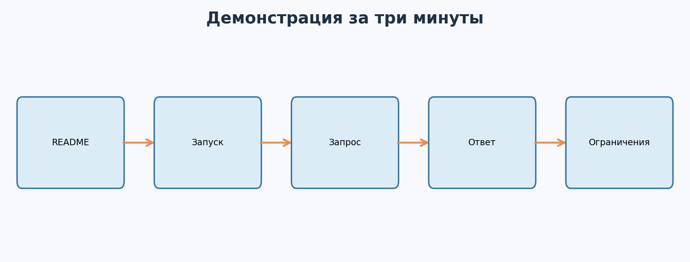

---

# Урок 1. Хакатон как ограниченный проект

**Перед началом:** М6–М16: постановка ML-задачи, метрики, валидация, API и командная работа с Git.

**После модуля:** ты сможешь провести короткий ML-спринт от идеи до работающей демонстрации, не потеряв проверяемость результата.

Хакатон даёт мало времени и много вариантов. Команда может потратить весь день на модель и не успеть показать продукт. Поэтому сначала разберись, что должно работать к моменту защиты.

## 1.1. Что считается готовым результатом?

Для нашего учебного спринта это **локально запускаемый сервис**, который получает признаки клиента и возвращает вероятность покупки. Есть исходные данные, скрипт обучения, тесты API, README с командами и короткая демонстрация. Учебные данные из М15 синтетические, поэтому метрики не описывают реальную эффективность бизнеса.

## 1.2. Ограничения спринта

Представь команду из двух человек и один рабочий день. Через восемь часов нужно показать работающий сценарий. На этом этапе достаточно одной понятной модели, одного API-запроса и воспроизводимого запуска.

Запиши критерии готовности до начала работы:

1. Новый участник запускает проект по README.
2. Входной контракт проверяется тестом.
3. Метрики рассчитаны на отложенной части.
4. Демонстрация занимает не больше трёх минут.
5. Ограничения и следующие шаги названы честно.

**Главное:** готовность означает проверяемый путь пользователя, а не максимальное число технологий.

**Проверь себя**

Сформулируй одну задачу хакатона в виде «пользователь отправляет ... и получает ...». Что ты покажешь, если интернета на защите не будет?

---

# Урок 2. От идеи к плану на один день

## 2.1. Сначала сценарий

Нарисуй цепочку:



Участник защиты открывает README, запускает сервис, отправляет запрос, видит ответ и объясняет, откуда взялась модель. Это основа демонстрации.

## 2.2. Раздели работу на короткие этапы

| Время | Результат |
| --- | --- |
| 0–1 час | Задача, данные, метрика, контракт API |
| 1–3 час | Baseline, split, первый сквозной запуск |
| 3–5 час | API, тесты, обработка ошибок |
| 5–7 час | README, визуализация, проверка чистого запуска |
| 7–8 час | Репетиция и запас на поломки |

Время условное. Если сервис и данные уже есть из М15, потрать освободившиеся часы на качество объяснения и проверку сценария.

## 2.3. Что отложить?

Функции, без которых демонстрация всё равно решает задачу, перенеси в список после хакатона. Например, новый сложный алгоритм, облачный деплой и дашборд мониторинга не обязательны для первого рабочего сценария.

**Главное:** явный план помогает закончить основной сценарий вовремя.

**Проверь себя**

Для идеи «помощник по отзывам» выпиши минимальный сценарий и три функции, которые можно отложить.

---

# Урок 3. Данные и честная проверка за короткое время

## 3.1. Проверка данных за 20 минут

Открой `Данные/sprint_checklist.csv`. Это маленький журнал задач спринта, а не набор для обучения. Для ML-части используй `Данные/purchase_snapshots.csv` из М15.

Перед обучением проверь размер таблицы, пропуски, классы, дубликаты и временные границы. Назови признаки, доступные в момент прогноза. `bought_next_7d` используется только как метка.

## 3.2. Зафиксируй baseline

Выполни скрипт М15. Запиши метрики логистической регрессии и простой константной модели на одном test. Если новая идея не улучшила результат или слишком сложна для запуска, baseline всё равно остаётся рабочим решением.

## 3.3. Не подгоняйся под test

Выбор порога и гиперпараметров делай на validation. Test открывай после выбора подхода. Если пробовал множество вариантов и каждый раз смотрел на test, итоговая цифра уже перестала быть независимой оценкой.

**Главное:** короткий срок не отменяет честную методику проверки.

**Проверь себя**

Почему нельзя выбрать порог по test даже на хакатоне? Какую информацию о данных надо показать рядом с метрикой?

---

# Урок 4. Работа вдвоём через Git

## 4.1. Кто за что отвечает?

Один участник ведёт данные и обучение, второй собирает API и демонстрацию. Оба знают входной контракт и умеют запустить весь проект. Если один человек недоступен, защита не должна остановиться.

## 4.2. Маленькие изменения

Перед началом договоритесь о названиях полей. После каждого законченного шага делайте небольшой коммит. Перед объединением проверяйте тесты и выполняйте демонстрационный запрос.

```bash
git status
git diff --check
python -m pytest -q Примеры/test_m15_api.py
```

Тесты требуют, чтобы предварительно была обучена модель М15. Секреты, персональные данные и временные файлы модели не добавляй в публичный репозиторий.

## 4.3. Один владелец демонстрации

Назначьте человека, который делает финальную проверку: запускает сервер, отправляет запрос, открывает README и следит за временем. Второй участник готовится объяснить модель и её ограничения.

**Главное:** общий контракт и частые маленькие проверки уменьшают риск сломанной сборки.

**Проверь себя**

Придумай конфликт между скриптом обучения и API, который возникнет, если переименовать поле без согласования.

---

# Урок 5. Демонстрация и защита

## 5.1. Сценарий на три минуты

1. **Проблема:** какой вопрос решаем и для кого.
2. **Вход:** какие данные доступны до решения.
3. **Действие:** один запрос к API.
4. **Результат:** ответ сервиса и что он означает.
5. **Проверка:** baseline, test-метрика, известные ограничения.
6. **Следующий шаг:** что нужно для реального пилота.

Не показывай десять минут установки зависимостей. Подготовь запущенный сервис, а команды оставь в README для воспроизведения.

## 5.2. Скриншоты и доказательства

Сохрани изображение ответа `/docs` или вывод тестов в папку своего проекта. Подпиши, какая версия и какие данные использовались. Не подменяй реальный результат нарисованной картинкой.

## 5.3. Вопросы жюри

Тебя могут спросить, почему выбрана эта модель, как получены метрики, что случится при недоступности сервиса и как оценить пользу для бизнеса. Ответ «пока не проверяли на настоящих данных» лучше выдуманного обещания.

**Главное:** убедительная защита показывает работающий сценарий и границы его применимости.

**Проверь себя**

Объясни за 30 секунд, почему test-метрика на синтетических данных не гарантирует результат на настоящих покупателях.

---

# Урок 6. После спринта: разбор и упаковка

## 6.1. Что записать сразу?

Сохрани команды запуска, фактические результаты, возникшие ошибки и ограничения. Отметь, какие идеи не успели проверить. В `Данные/sprint_checklist.csv` можно отмечать состояние этапов, но сам отчёт должен объяснять выводы словами.

## 6.2. Что показывать в портфолио?

Укажи свою роль и вклад команды. Если использовал готовую основу М15, скажи об этом. Опиши, что именно разработал во время спринта: API, тесты, метрику или демонстрацию. М18 поможет оформить это в репозиторий.

**Главное:** результат хакатона ценен, когда можно проверить твой личный вклад и повторить демонстрацию.

**Проверь себя**

Напиши две честные строки для резюме о командном учебном проекте, не приписывая себе работу напарника.

---

# Итоги модуля

Ты разобрал путь от идеи до короткой защиты: постановка задачи, ограниченный план, baseline, честная оценка, совместная работа и демонстрация. На хакатоне главное уметь закончить и показать работающий путь, а затем назвать его ограничения.

---

# Практика: хакатонный спринт

**Что понадобится:** материалы М15, Python, Git и один рабочий день. Можно выполнять одному, обозначив роли как этапы работы.

**Цель:** собрать и защитить локальный ML-сервис на синтетических данных.

**Как сдавать:** ссылка на репозиторий или архив, README, результаты тестов, один скриншот ответа API и короткий отчёт о личном вкладе.

## Часть 1. План

### Задание 1. Постановка

Опиши пользователя, входные данные, выход сервиса и момент прогноза. Назови метрику модели и один продуктовый показатель, который потребовал бы проверки в реальном пилоте.

### Задание 2. Ограничения

Запиши пять критериев готовности и две функции, которые оставишь на потом.

### Задание 3. Расписание

Распредели восемь часов между данными, моделью, API, тестами, README и репетицией. Заложи резерв времени.

## Часть 2. Реализация

### Задание 4. Данные

Проверь пропуски, временные границы и классы в `Данные/purchase_snapshots.csv`. Объясни, почему целевая метка не является признаком.

### Задание 5. Baseline

Обучи модель М15, запиши размер split, выбранный порог и метрики. Сравни с константным baseline.

### Задание 6. API

Запусти `/health` и `/predict`. Сохрани успешный ответ и ответ на неверный запрос.

### Задание 7. Тесты

Добавь один тест входного контракта и запусти подборку. Зафиксируй команду и результат.

### Задание 8. README

Опиши установку, обучение, запуск сервера, запрос и ограничения так, чтобы напарник повторил сценарий без устных подсказок.

## Часть 3. Защита

### Задание 9. Демонстрация

Проведи показ за три минуты. Засеки время и убери шаги, которые не помогают понять результат.

### Задание 10. Вопросы

Подготовь ответы на вопросы о данных, метриках, утечке, ошибках API и реальном пилоте.

### Задание 11. Ретроспектива

Напиши, что получилось, что не успели и какую одну проверку проведёшь следующей.

## Финальный вопрос

Объясни, чем работающий хакатонный прототип отличается от готового продукта и какие проверки нужны между ними.
