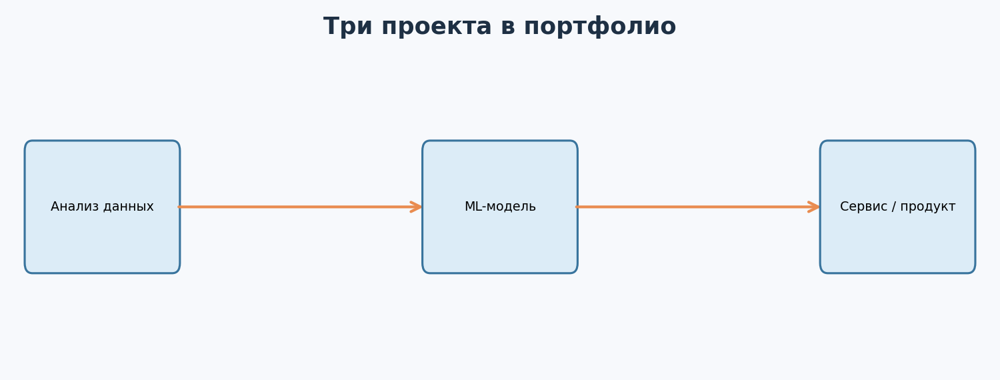
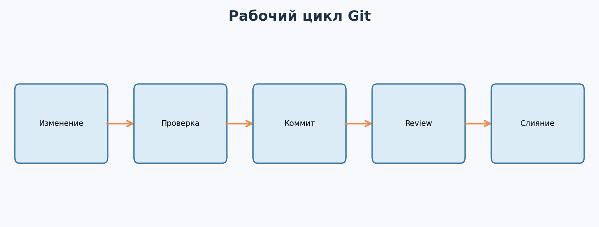
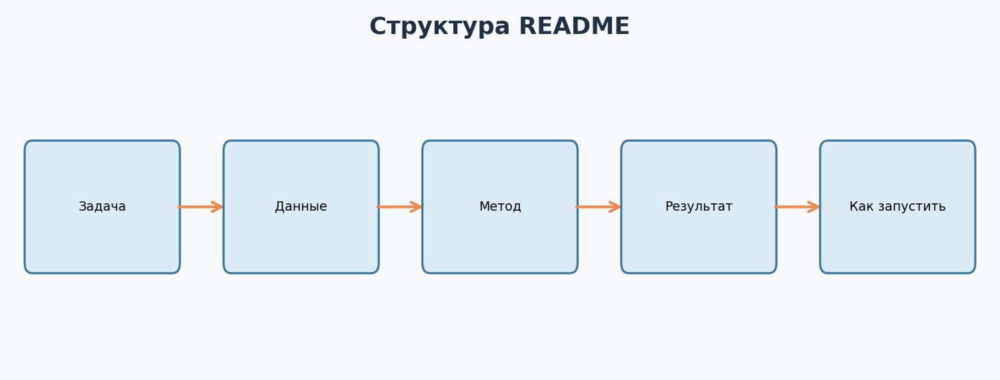
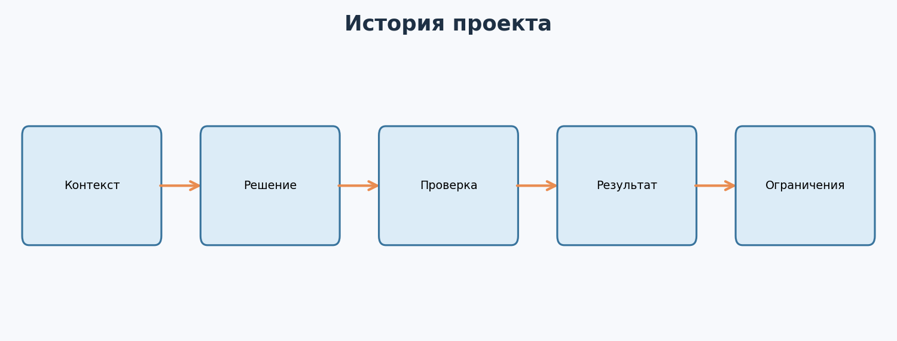

---

# Урок 1. Зачем ML-специалисту портфолио?

**Перед началом:** М6–М17 - минимум два завершённых проекта по ML, в том числе практики с моделями и хакатонный спринт.  
**После модуля:** ты соберёшь понятный GitHub-профиль, оформленные репозитории, README с реальными метриками и ограничениями, короткие описания проектов и честные формулировки для резюме.

> Портфолио не гарантирует оффер, но делает твой опыт **проверяемым**. Нельзя выдавать учебные синтетические результаты за коммерческие, приписывать себе командную работу целиком или публиковать чужие закрытые датасеты.




Представь двух кандидатов на стажировку. Оба пишут: «Знаю Python, pandas, scikit-learn и PyTorch». Но у первого нет примеров работы. Второй показывает репозиторий, где чётко сформулирована задача, есть baseline, воспроизводимый запуск, честная валидация и разбор ошибок.

Кого проще предметно оценить? Конечно, второго. Дело не в красивых значках технологий, а в **следах решения реальной или учебной задачи**.

## 1.1. Что портфолио должно доказывать?

Умение:

- сформулировать постановку ML-задачи;
- разобраться с данными и не допустить явных утечек;
- выбрать простой baseline;
- построить корректную валидацию;
- провести и описать эксперименты;
- воспроизвести результат;
- объяснить ограничения и возможное продолжение.

Для ML Engineer дополнительно полезно показать сервисный код, API, тесты, контейнеризацию и работу с ошибками. Для Data Scientist может быть важнее исследование данных, экспериментальный дизайн и качество анализа.

## 1.2. Сколько проектов нужно?

Не существует магического числа. **Два-три сильных проекта** обычно помогают лучше, чем десятки одинаковых копий учебных ноутбуков без выводов.

В рамках нашего курса у тебя уже есть потенциальные кандидаты:

1. Классическая модель для табличных данных из М6–М11.
2. Deep Learning / CV / NLP из М12–М14.
3. End-to-end модель с API и тестами из М15.
4. Хакатонная задача из М17, если материалы разрешено публиковать.

Не нужно обязательно показывать все четыре. Выбери те, которые лучше всего раскрывают нужную роль.

## 1.3. Как читает портфолио рекрутер?

Человек может бегло посмотреть профиль, увидеть названия репозиториев и открыть один README. Поэтому первые строки проекта должны быстро объяснять, **что ты сделал, зачем и что получилось**.

Название вроде `my_new_final_project2` не помогает. Название вроде `delivery-eta-prediction` сразу сообщает тему.

**Главное:** портфолио - не каталог инструментов, а доказательство того, как ты решаешь задачи.

**Проверь себя**

Выбери два проекта из курса. Для каждого напиши одним предложением: «Я решал задачу ..., используя ..., качество проверял через ...».

---

# Урок 2. Git и GitHub: базовый рабочий процесс

Когда проект состоит из нескольких файлов и экспериментов, очень легко потерять изменения. Появляются папки `project_new`, `project_final`, `project_final2`. Git нужен, чтобы сохранять историю изменений осмысленно.

## 2.1. Git - не то же самое, что GitHub

**Git** - система контроля версий на твоём компьютере.

**GitHub** - платформа, на которой можно хранить Git-репозитории, сотрудничать и показывать открытые проекты.

Можно пользоваться Git без GitHub. И существуют другие сервисы для Git.

## 2.2. Первый репозиторий

В папке проекта:

```bash
git init
git status
git add README.md
git commit -m "docs: describe the ML problem"
```

Для успешного commit Git может попросить настроить имя и email. Это локальные настройки автора коммитов; не нужно публиковать лишние личные данные.

`git status` показывает изменённые и отслеживаемые файлы. `git add` выбирает изменения для коммита. `git commit` создаёт снимок состояния проекта.

## 2.3. Осмысленные коммиты

Хорошие сообщения:

- `feat: add baseline validation`
- `fix: prevent target leakage`
- `test: check missing feature input`
- `docs: explain model limitations`

Они помогают понять историю решений. Точная форма сообщений - не жёсткое требование, но последовательность полезна.

## 2.4. Ветки и pull request

Когда работаешь с командой, часто используют отдельную ветку для новой функции:

```bash
git switch -c feature/add-metrics
```

После изменений открывают pull request, где коллеги могут посмотреть код и замечания. Только после проверок изменения объединяются с основной веткой.



## 2.5. Чего нельзя делать?

Нельзя отправлять в открытый репозиторий реальные ключи API, пароли, приватные данные пользователей, закрытый код работодателя и материалы, запрещённые к публикации правилами хакатона.

`.gitignore` помогает не добавлять определённые файлы, но он **не удалит секреты, уже попавшие в историю Git**. При утечке реальный ключ нужно немедленно отозвать или заменить и исправить историю по соответствующим инструкциям.

**Главное:** Git показывает не только итоговый код, но и то, как проект развивался.

**Проверь себя**

Сделай три коммита в учебном репозитории: создание README, добавление baseline, описание валидации. Проверь историю через `git log --oneline`.

---

# Урок 3. Структура профессионального ML-репозитория

Представь, что другой человек скачал твой проект. Он не знает, где обучать модель, что считать исходными данными и как запустить инференс. Если всё лежит в одной папке, эксперимент трудно воспроизвести.

## 3.1. Пример аккуратной структуры

```text
delivery-eta-prediction/
├── README.md
├── requirements.txt
├── .gitignore
├── data/                # если данные разрешено публиковать
├── notebooks/           # исследовательские эксперименты
├── src/
│   ├── train.py
│   ├── predict.py
│   └── features.py
├── tests/
├── reports/
│   ├── metrics.csv
│   └── figures/
└── docs/
```

Это не единственная правильная структура. Для маленького проекта она может быть проще. Важнее, чтобы человек понимал, **какой файл за что отвечает**.

## 3.2. Не превращай репозиторий в мусорную корзину

Часто встречаются:

- десятки промежуточных ноутбуков без пояснений;
- случайно выгруженные гигабайтные CSV;
- файлы с паролями;
- сохранённые модели неизвестного происхождения;
- фотографии рабочего стола с чувствительной информацией;
- папка `outputs`, в которой непонятно, что является финальной версией.

Для больших данных и моделей лучше использовать отдельное разрешённое хранилище и инструкцию воспроизведения.

## 3.3. README как точка входа

Пусть в README будет команда:

```bash
python -m pip install -r requirements.txt
python src/train.py
```

Если она не работает в чистой среде, это проблема проекта. Поэтому важно хотя бы один раз пройти весь процесс установки заново.

Для нашего пакета можно использовать готовые примеры из М15 и М17: только в README точно укажи, что запускается из корня и какие данные синтетические.

**Главное:** структура должна облегчать запуск, проверку и развитие проекта, а не демонстрировать максимальное число папок.

**Проверь себя**

Нарисуй файловую структуру одного своего проекта. Назови минимум три лишних файла, которые следует убрать перед публикацией.

---

# Урок 4. README, который объясняет проект за минуту

Представь, что открываешь репозиторий незнакомого человека. На первой странице написано: «Здесь мой ML-код, всё внутри». Понятно ли, что решает проект и чем он интересен? Не очень.

Хороший README отвечает на вопросы: **что, зачем, как проверяли, что получили, как запустить и где ограничения**.



## 4.1. Рабочая структура

**Заголовок:** «Прогноз времени доставки - учебная регрессия».

**Задача:** по расстоянию, загрузке курьера и контексту предсказать срок доставки.

**Данные:** синтетический датасет, 1080 обучающих строк и 270 строк для submission; реальных пользователей нет.

**Метрика:** MAE в минутах, локальный split со случайным зерном.

**Baseline:** DummyRegressor; сравнение с RandomForest.

**Запуск:** две команды установки зависимостей и запуска скрипта.

**Результаты:** реальные числа после запуска, а не написанные «от балды» для красоты.

**Ограничения:** искусственные данные, нет реальной временной динамики, не проверялась работа в продакшене.

## 4.2. Не прячь главное в конце

Первый экран README должен дать читателю причину продолжить:

> «Учебный проект прогноза времени доставки. Реализованы baseline и RandomForest, выбор по validation MAE, подготовка `submission.csv`, воспроизводимый запуск. Данные синтетические; проект демонстрирует подход, а не готовность к внедрению».

Затем можно подробно описывать алгоритмы, таблицы и изображения.

## 4.3. Что делать со скриншотами?

Графики и снимки интерфейса полезны, если что-то объясняют. Например, матрица ошибок, график зависимости качества от глубины дерева, API-документация или схема pipeline.

Но скриншот сам по себе не заменяет выводы. Под ним должно быть объяснение: **что изображено и почему это важно**.

## 4.4. Готовый шаблон

В пакете есть `templates/README_project_template.md`. Скопируй его в свой репозиторий и заполни все места вида `[ЗАПОЛНИТЬ]`. Не оставляй в опубликованном проекте чужие или выдуманные числа.

**Главное:** README - часть инженерной работы, а не второстепенное украшение репозитория.

**Проверь себя**

Открой README одного своего проекта. Может ли человек, не видевший твой курс, понять смысл работы за минуту? Перепиши первые пять строк.

---

# Урок 5. Валидация и эксперименты как доказательство качества

Одна из самых сильных частей ML-портфолио - не красивый график, а **достоверность результатов**.

## 5.1. Показываем baseline и улучшение

Плохо:

«Обучил CatBoost, качество отличное».

Лучше:

«Сравнил DummyRegressor и модель на деревьях на одном split. Основная метрика - MAE. Признаки обрабатываются внутри Pipeline. Зафиксировал seed и результат на validation; финальная test-оценка не использовалась для подбора».

Если число MAE указано в README, его можно проверить запуском кода или отчётом. Не меняй вручную значение ради красивой презентации.

## 5.2. Что делать, если модель не улучшила baseline?

Это тоже полезный результат. Опиши:

- какая была гипотеза;
- как её проверяли;
- что получилось;
- почему это могло не сработать;
- что попробовал бы дальше.

Работодатель может оценить честное рассуждение выше необоснованного заявления об успехе.

## 5.3. Анализ ошибок

Средняя метрика скрывает отдельные сложные случаи. Для прогноза доставки можно посмотреть ошибки при дождливой погоде, больших расстояниях или высокой загрузке курьеров.

Важно, чтобы эти группы были достаточно представлены, иначе выводы могут оказаться нестабильными.

## 5.4. Что стоит показать на графиках?

График «истинные значения против прогнозов», распределение абсолютных ошибок, качество по сегментам, важность признаков при корректной интерпретации, обучение/валидация по эпохам для нейросети.

**Главное:** сильный проект демонстрирует не только модель, но и то, почему результатам можно доверять.

**Проверь себя**

Для проекта из М17 составь таблицу: baseline, финальная модель, split, основная метрика, два известных ограничения.

---

# Урок 6. Три уровня проектов: Data Science, Deep Learning и End-to-end

Один репозиторий не обязан доказывать всё на свете. Гораздо лучше, когда разные проекты показывают разные навыки.

## 6.1. Проект по табличному ML

Например, прогноз стоимости квартиры или времени доставки.

В нём показываем EDA, постановку, baseline, обработку пропусков/категорий, корректный split, модели и анализ ошибок.

## 6.2. Проект по Deep Learning

Например, CNN для простого распознавания изображений или NLP-классификатор отзывов.

Показываем архитектуру, тензоры, цикл обучения, train/validation/test, мониторинг потерь, анализ ошибок и честные ограничения учебного датасета.

## 6.3. End-to-end проект

Например, классификатор покупок из М15.

Помимо ML-метрик демонстрируем API, входной контракт, тесты, Dockerfile и наблюдение за качеством данных.


## 6.4. Как выбрать под вакансию?

Для Data Scientist полезно выделить исследовательскую часть, проверку гипотез и интерпретацию результатов.

Для ML Engineer полезны качество кода, Python, воспроизводимость, API и эксплуатационные ограничения.

Для AI Engineer могут быть важны работа с готовыми языковыми моделями, RAG, оценка качества и безопасная интеграция.

Границы профессий пересекаются и зависят от компании. Не нужно подменять реальный опыт перечислением модных названий.

**Главное:** портфолио должно отвечать на вопрос «какие задачи этот человек способен решать?».

**Проверь себя**

Выбери направление работы и упорядочь три потенциальных проекта по полезности именно для него. Объясни свой выбор.

---

# Урок 7. Как рассказывать о проекте на собеседовании?

При обсуждении портфолио тебе почти наверняка зададут вопрос: «А почему ты выбрал эту модель?».

Если отвечать «потому что так было в уроке», разговор быстро закончится.

## 7.1. Структура хорошего ответа



**Проблема:** «Нужно было прогнозировать время доставки».

**Твоё решение:** «Сначала построил DummyRegressor, затем Pipeline с OneHotEncoder и RandomForest».

**Проверка:** «Зафиксировал split и MAE, сравнил модели на одинаковых данных, проверил формат submission».

**Результат:** «Модель улучшила локальную метрику относительно baseline» - только если это действительно подтверждено запуском.

**Ограничения:** «Данные синтетические, поэтому качество на реальных заказах неизвестно».

## 7.2. Не приписывай себе чужой вклад

Если проект командный, объясни, какие решения принимал именно ты. Можно сказать:

«В команде из трёх человек я отвечал за валидацию, таблицу экспериментов и финальную сборку submission. Архитектуру модели разрабатывали вместе».

Не следует говорить «я обучил всё», если ключевые части сделали другие участники.

## 7.3. Если использовал ChatGPT

Это само по себе не делает проект плохим. Но ты должен понимать и уметь объяснить код, проверить выводы и исправить ошибку без слепого копирования.

Интервьюер может попросить написать маленькую функцию или объяснить смысл метрики. Поэтому **понимание важнее красивого репозитория**.

**Главное:** на собеседовании ты защищаешь свои решения, а не список импортов в Python.

**Проверь себя**

Запиши трёхминутное видео, где без чтения исходника объясняешь один проект. После просмотра выпиши непонятные места и улучши ответ.

---

# Урок 8. Профиль GitHub, лицензии и демонстрация

## 8.1. Настрой профиль

Укажи краткое описание направления интересов, ссылки на 2–3 лучших проекта и актуальный способ связи, который ты действительно хочешь публиковать.

У GitHub есть специальный profile README: для подходящих аккаунтов его можно оформить через публичный репозиторий, название которого совпадает с именем пользователя. Платформенные детали стоит проверять по официальной документации.

## 8.2. Закреплённые проекты

Старайся, чтобы названия и описания были понятны без открытия исходников.

Например:

**`delivery-eta-prediction`** - «Сравнение baseline и RandomForest для регрессии времени доставки; воспроизводимый CSV submission».

**`purchase-propensity-api`** - «Pipeline + FastAPI + тесты для учебной модели вероятности покупки».

## 8.3. Лицензия и права на данные

Открытый GitHub-репозиторий автоматически не делает **любой** вложенный датасет свободным для распространения. Проверь права на исходные изображения, таблицы, тексты, код и модели.

Если у данных есть ограничения или соглашение о неразглашении, используй синтетический пример и инструкции получения разрешённых данных. Не выкладывай исходники из закрытых хакатонов и внутренних проектов без разрешения.

## 8.4. Живое демо

Для сервиса можно показать GIF или короткий ролик, где ты отправляешь запрос и получаешь прогноз. Демонстрация должна быть воспроизводима: можно не держать дорогостоящий сервер постоянно включённым, если есть локальные инструкции запуска.

**Главное:** профессиональный профиль - ясная структура, уважение к лицензиям и реальная воспроизводимость.

**Проверь себя**

Проверь три своих потенциальных проекта: можно ли публиковать данные, код и изображения? Отметь, где нужны разрешения или замена данных.

---

# Урок 9. Проект в резюме: как говорить о результате честно

## 9.1. Чего лучше избегать?

«Эксперт по AI, Machine Learning, Deep Learning, Big Data, MLOps и Kubernetes» - если человек только закончил курс, такое заявление выглядит недостоверным.

Не нужно писать «3 года коммерческого опыта», если три года ты смотрел уроки. Не нужно выдавать учебный проект за заказ от компании.

## 9.2. Сильный формат описания

У каждого проекта можно выделить:

**Задача → личный вклад → техническое решение → измеримый результат → ссылка.**

Например:

> «Учебный проект: прогноз времени доставки на синтетических данных. Построил baseline и RandomForest Pipeline, разработал валидацию по MAE, оформил генерацию submission и воспроизводимый запуск. Результаты и ограничения - в README».

Если у тебя есть **проверенные цифры**, можно указать улучшение относительно baseline с названием выборки и метрики. Если нет - не выдумывай.

## 9.3. На какие роли откликаться?

Начинающий специалист может рассматривать стажировки и junior-позиции, а также смежные роли: Data Analyst, Junior Data Scientist, ML Engineer Intern, AI Engineer Intern - в зависимости от программы вакансии и реальных навыков.

Зарплаты, требования и доступность ролей зависят от региона, компании и времени. На этом этапе важно не цепляться за одно название, а читать **содержание обязанностей**.

**Главное:** резюме - краткое и проверяемое описание опыта, а не каталог нереализованных амбиций.

**Проверь себя**

Перепиши строку «Знаю ML» в две конкретные, честные строки о решённых учебных задачах и проверенных результатах.

---

# Урок 10. Итоговый portfolio review: готов ли проект к показу?

Перед тем как прикрепить репозиторий к отклику, оцени его глазами человека, который ничего о тебе не знает.

## 10.1. Проверка по семи вопросам

1. Понятно ли название проекта?
2. Объяснена ли задача за первые пять строк README?
3. Есть ли описание датасета и прав на него?
4. Описаны ли split, baseline, метрики и ограничения?
5. Можно ли выполнить команды запуска в чистом окружении?
6. Нет ли секретов, приватной информации и лишних файлов?
7. Можешь ли ты на собеседовании объяснить каждую важную часть решения?

Если на несколько вопросов ответ «нет» - не беда. Это конкретный план улучшения.

## 10.2. Что показать как минимум?

Один хороший README, один воспроизводимый эксперимент, один визуальный результат и краткое описание ошибок уже могут сделать учебный проект понятным.

## 10.3. Как оценивать прогресс?

Не считай только количество репозиториев и звёзд. Оцени, насколько проще стало воспроизводить проект, объяснять ограничения и обсуждать результаты с другим человеком.

**Главное:** портфолио закончено не тогда, когда появились красивые картинки, а когда другой человек может понять и проверить твою работу.

**Проверь себя**

Попроси знакомого за пять минут найти в твоём README команду запуска, итоговую метрику и описание ограничений. Где он запнулся?

---

# Практика: Собираем первое ML-портфолио

Здесь мало просто прочитать. Цель блока - подготовить **проверяемые артефакты**, которые можно приложить к резюме. На работу может потребоваться несколько вечеров.

## Часть 1. Аудит текущих проектов

### Задание 1. Инвентаризация

Составь таблицу всех своих проектов: тема, задача, стек, собственный вклад, метрика, доступные данные, ограничения, готовность к публикации.

### Задание 2. Выбор проектов

Выбери 2–3 лучших проекта под целевую роль. Объясни, какие разные навыки показывает каждый.

### Задание 3. Названия и описания

Придумай короткие, понятные названия репозиториев и однострочные описания. Убери `final`, `new`, `best`, если они ничего не объясняют.

## Часть 2. Git и безопасность

### Задание 4. История Git

Создай учебный репозиторий и сделай три осмысленных коммита. Покажи вывод `git log --oneline`.

### Задание 5. Проверка секретов

Проверь `.gitignore`, историю коммитов, случайные `.env`, токены, скачанные датасеты, крупные артефакты и логи. Составь список того, что нельзя публиковать.

### Задание 6. Права на данные

Для каждого проекта выясни: кому принадлежат данные, разрешена ли публикация, можно ли показывать скриншоты и результаты конкурса.

## Часть 3. README и воспроизводимость

### Задание 7. README с нуля

Заполни `templates/README_project_template.md` для выбранного проекта. Не оставляй плейсхолдеры и выдуманные числа.

### Задание 8. Чистый запуск

Скопируй репозиторий в новую папку или попроси другого человека открыть проект. Попробуй выполнить инструкции и запиши всё, что пришлось уточнять.

### Задание 9. Метрики и ограничения

Добавь честный baseline, схему разделения данных, метрики и минимум три ограничения проекта.

### Задание 10. Одна полезная визуализация

Сделай один график, который отвечает на вопрос: как модель ошибается, что улучшилось после эксперимента или как устроен pipeline. Напиши под ним вывод.

## Часть 4. Презентация и резюме

### Задание 11. Краткая карточка проекта

Напиши 80–120 слов о проекте: постановка, твой вклад, способ проверки, результат, ограничения, ссылка.

### Задание 12. Три минуты объяснения

Запиши устный разбор одного проекта. Не подсматривай в код. Ответь: почему выбрали модель, как исключили утечки, с чем сравнивали.

### Задание 13. Честные пункты резюме

Составь 2–3 пункта о своих учебных проектах. Никаких выдуманных работодателей, сроков и бизнес-эффектов.

### Задание 14. Профиль GitHub

Заполни описание, закрепи лучшие репозитории, добавь разрешённый контакт и, по желанию, profile README.

### Задание 15. Комментарии другого человека

Попроси знакомого или однокурсника проверить понятность репозитория. Получи минимум три замечания и внеси конкретные улучшения.

### Задание 16. Финальный аудит

Оцени выбранный проект по семи вопросам из урока 10. Для каждого «нет» поставь конкретную исправляемую задачу и критерий готовности.

---

# Итоги модуля

Ты научился превращать результаты обучения в понятные инженерные истории: от задачи и baseline до честных метрик, кода, ссылок и воспроизводимого запуска. Теперь у тебя есть база, на которой можно строить резюме и обсуждение на техническом интервью.

**Главная мысль:** хорошее портфолио не скрывает ограничения проекта - оно показывает, что ты их понимаешь и умеешь проверять результат.

**Дальше:** в М19 разберём, как грамотно использовать AI-помощников, развивать профессиональную репутацию, искать вакансии, проходить собеседования и оценивать первое предложение о работе.

## Полезная документация

- [GitHub: About READMEs](https://docs.github.com/en/repositories/managing-your-repositorys-settings-and-features/customizing-your-repository/about-readmes).
- [GitHub: Profile README](https://docs.github.com/en/account-and-profile/how-tos/profile-customization/managing-your-profile-readme).
- [GitHub: Push protection](https://docs.github.com/en/code-security/concepts/secret-security/command-line-push-protection).
- [Git: Getting Started](https://git-scm.com/book/en/v2/Getting-Started-About-Version-Control).

## Финальный вопрос

Объясни, по каким файлам и результатам другой человек сможет проверить твой вклад в ML-проект.
