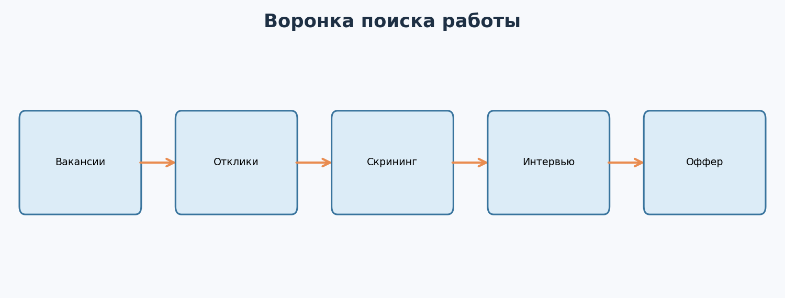
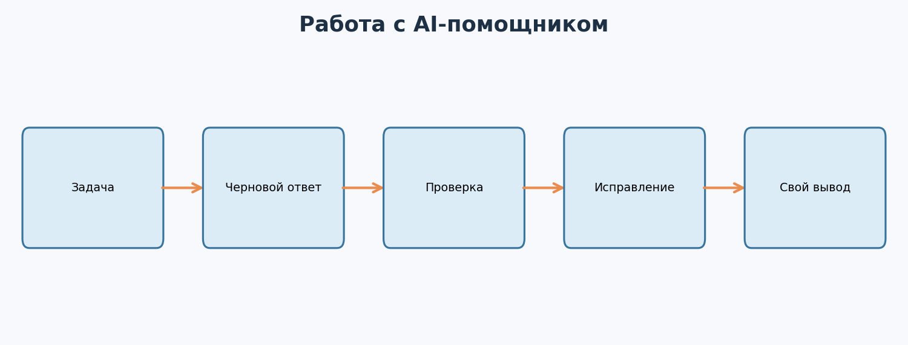
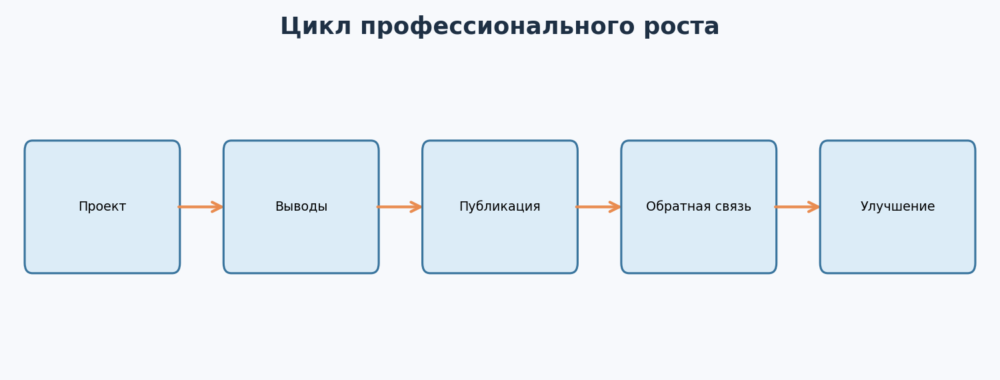
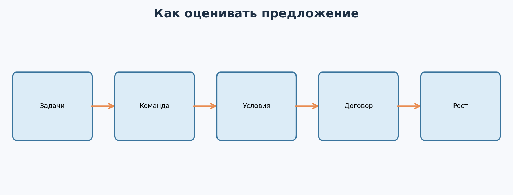

---

# Урок 1. Как выглядит рынок ML-профессий и какую роль выбрать?

**Перед началом:** М1–М18, особенно проекты из М12–М18 и опыт объяснения моделей и метрик.  

**После модуля:** ты составишь план поиска первой позиции, подготовишь резюме и проектные истории, научишься использовать AI как помощника, пройдёшь пробные интервью и поймёшь, как сравнивать предложения о работе.

> Цель - создать **понятный и честный процесс** выхода на рынок. Этот модуль не обещает оффер к конкретной дате и не приписывает тебе опыта, которого нет. Вакансии, требования и зарплаты меняются; их нужно проверять по конкретному рынку, стране и времени.




Ты прошёл математику, Python, анализ данных, классическое ML, глубокое обучение, MLOps и практические проекты. Теперь вопрос: **на какие вакансии вообще откликаться?**

## 1.1. Названия могут обманывать

**Data Analyst** чаще решает вопросы бизнеса с помощью данных, отчётов, SQL, статистики и визуализации. Иногда аналитика становится стартовой точкой для дальнейшего ML.

**Data Scientist** исследует данные, строит и оценивает модели, проверяет гипотезы, иногда проектирует эксперименты.

**ML Engineer** чаще фокусируется на создании и эксплуатации ML-систем: обучение, пайплайны, инфраструктура, serving, качество кода.

**AI Engineer** может разрабатывать приложения на основе готовых языковых или мультимодальных моделей, retrieval, RAG, инструментов и API.

Но обязанности сильно зависят от компании. В одной организации Data Scientist пишет production-сервисы, в другой ML Engineer много занимается экспериментами.

## 1.2. Как выбирать роль?

Не начинай с самой красивой зарплаты в интернете. Начни с задач, которые тебе нравились в курсе.

- Если тебе интересны данные, закономерности и эксперименты - присмотрись к аналитике и Data Science.
- Если нравится архитектура, API и надёжность сервисов - к ML Engineering.
- Если увлекают LLM-приложения, RAG и оценка ответов - к AI Engineering.

Можно откликаться на несколько смежных направлений, если подготовил отдельное резюме и релевантные проекты.

## 1.3. Что обычно означает junior?

Не «человек, который ничего не знает», а специалист, способный решать ограниченные задачи с поддержкой команды и умеющий объяснять свою работу.

Важно показывать не только навыки, но и способность получать обратную связь, проверять предположения и аккуратно работать с данными.

## 1.4. Изучаем вакансии как данные

Открой 15–20 **актуальных** вакансий интересующей тебя роли. Сохрани требования в таблицу. Раздели их на:

- обязательные для большинства просмотренных вакансий;
- встречающиеся иногда;
- специфичные для отдельных компаний.

Не пытайся изучить абсолютно всё перед первым откликом. Выдели пробелы, которые действительно мешают пройти на целевую роль.

**Главное:** выбирай направление по реальным обязанностям и собственным навыкам, а не только по названию вакансии.

**Проверь себя**

Сравни три вакансии: стажёр DS, junior ML Engineer, junior AI Engineer. Заполни таблицу «основные задачи - требования - мои доказательства».

---

# Урок 2. AI-помощник: ускоряет работу или мешает учиться?

Мы изучали машинное обучение в эпоху, когда языковые модели умеют помогать с кодом, документацией и анализом. Игнорировать такие инструменты необязательно. Но и доверять каждому ответу опасно.

## 2.1. Хорошее использование AI

Можно попросить:

- объяснить трассировку ошибки Python;
- предложить варианты тестов;
- найти потенциальную утечку в твоей постановке;
- помочь переписать README понятнее;
- сыграть роль интервьюера;
- составить список гипотез для исследования.

Но **генерация правдоподобного текста ≠ проверка его правильности**.

## 2.2. Один рабочий цикл



**Сформулируй:** какие входы, задача, ограничения и критерий качества.

**Попроси вариант:** функцию, тест или объяснение.

**Проверь:** запусти код, сравни с документацией, протестируй нестандартные случаи.

**Объясни:** почему это решение работает и где не работает.

## 2.3. Хороший запрос к AI

Плохо:

> «Напиши мне нормальный ML-код».

Лучше:

> «У меня открытый учебный датасет регрессии. Использую scikit-learn Pipeline и MAE. Проверь этот фрагмент на утечки данных, неверный split и неочевидные ошибки. Не выдумывай результаты. Для каждого подозрения назови конкретную строку и предложи тест, которым я могу подтвердить проблему».

Важная деталь - просьба дать **проверяемые способы**, а не просто уверенное мнение.

## 2.4. Чего не делать?

- Не отправлять секреты и персональные данные в сторонний сервис без соответствующего разрешения и правового основания.
- Не копировать закрытый код работодателя в инструмент, не разрешённый политиками организации.
- Не использовать AI на оценочном задании, если это запрещено правилами.
- Не верить неподтверждённым ссылкам, цифрам или API, которые модель могла придумать.
- Не выдавать полностью чужую работу за свою.

**Главное:** AI должен сокращать рутину и расширять проверку, а не заменять понимание.

**Проверь себя**

Возьми небольшой фрагмент собственного учебного кода. Попроси AI придумать пять тестов. Реализуй минимум два и покажи, какую ошибку или крайний случай они проверяют.

---

# Урок 3. Как проверять ответы AI и не строить проекты на галлюцинациях

## 3.1. Почему уверенный ответ может быть неверным?

Генеративная модель создаёт правдоподобный ответ, но может ошибаться в датах, функциях библиотек, ссылках на документацию, математических формулах и причинах найденной ошибки.

Например, AI может предложить несуществующий параметр у `RandomForestRegressor`. Код выглядит убедительно, но падает при запуске.

## 3.2. Три уровня проверки

**Выполнить:** запускается ли код в твоём окружении?

**Сравнить:** соответствует ли пример официальной документации установленной версии библиотеки?

**Проверить смысл:** решает ли код исходную задачу честно - без утечки, подмены метрики и неверных предположений?

Сильный специалист проверяет не только синтаксис, но и **валидность постановки**.

## 3.3. AI-помощник при создании RAG

В М14 мы познакомились с retrieval-augmented generation. Представим, что AI отвечает на вопросы по документам.

Проверяем отдельно:

1. Нашёл ли поиск релевантный фрагмент?
2. Верно ли генератор использовал найденный фрагмент?
3. Не придумал ли фактов, которых нет в источниках?
4. Умеет ли система признать отсутствие ответа?

Одна хорошая демонстрация не заменяет систематическое тестирование набора вопросов.

## 3.4. Как вести журнал ошибок AI?

Например:

| Вопрос | Ответ AI | Что проверили | Результат |
|---|---|---|---|
| «Какой параметр нужен?» | Назвал имя аргумента | Сверили сигнатуру | Не существовал |
| «Почему плохая MAE?» | Указал на масштаб | Сравнили по сегментам | Причина другая |

Записывай реальные примеры, не приписывай AI ошибки, которых он не совершал. Такой журнал поможет использовать инструменты осознаннее.

**Главное:** AI-помощник может быть полезным соавтором гипотез, но проверка остаётся частью твоей работы.

**Проверь себя**

Напиши три вопроса к своему ML-проекту, ответ на которые **обязательно нужно проверять** запуском или документацией. Почему?

---

# Урок 4. Личный бренд без пафоса: зачем он нужен новичку?

Слова «личный бренд» часто ассоциируются с бесконечными постами о продуктивности. Но для начинающего ML-специалиста это не обязательно.

**Профессиональная репутация** - это то, какие реальные задачи с тобой связывают и насколько тебе доверяют.

## 4.1. Репутация строится из работы



Сделал проект → понятно описал метод → получил вопросы и комментарии → улучшил работу → показал обновлённый результат.

Это полезный процесс даже при очень небольшой аудитории.

## 4.2. Что можно публиковать?

- Краткие разборы учебных моделей.
- Ошибки валидации и способы их обнаружения.
- Сравнение baseline и улучшений.
- Маленькие, точные иллюстрации математических понятий.
- Заметки после открытых соревнований с соблюдением правил.
- Объяснения библиотек на собственном примере.

Не нужно публиковать пост каждый день. Достаточно сделать несколько содержательных материалов, которые показывают реальные навыки.

## 4.3. Формат хорошего поста

**Проблема:** что хотелось проверить.

**Действие:** что именно ты изменил.

**Результат:** что измерил и где.

**Ограничения:** почему результат нельзя автоматически переносить на весь мир.

Например:

> «В учебном проекте прогноза времени доставки сравнил константный baseline и случайный лес. Использовал одинаковую валидацию по MAE. Модель с признаками показала меньшую ошибку. Данные синтетические, поэтому это демонстрация подхода, а не результат реального логистического сервиса. Код и воспроизведение - по ссылке».

## 4.4. Где публиковать?

Можно использовать GitHub, профессиональные соцсети, технологические сообщества, тематические чаты и личные заметки. Подойдут те каналы, где есть релевантная аудитория и ты готов нормально отвечать на вопросы.

Не выбирай площадку только по числу подписчиков. Важнее качество общения и возможность показать работу.

**Главное:** личный бренд - это не обещания, а последовательные полезные следы твоей работы.

**Проверь себя**

Напиши короткий пост на 100–150 слов о проекте из М17. Обязательно укажи одну проверяемую метрику, ограничения и ссылку на код.

---

# Урок 5. Нетворкинг: как знакомиться с профессиональным сообществом?

«Найти знакомства» звучит не очень понятно, особенно если ты пока новичок. Но профессиональные связи часто возникают из простого взаимодействия: кто-то посмотрел твой код, помог разобраться с ошибкой или дал комментарий к проекту.

## 5.1. Что действительно работает?

- Участвовать в открытых обсуждениях по существу.
- Давать полезные комментарии к чужим проектам.
- Задавать конкретные вопросы, предварительно описав, что уже проверил.
- Участвовать в хакатонах и учебных командах.
- Аккуратно обращаться за обратной связью.

## 5.2. Как выглядит хороший вопрос?

Плохо:

«Помогите, модель плохая, ничего не работает».

Лучше:

«В учебной регрессии по доставке RandomForest показывает MAE 5.4 на случайном split. Меня беспокоит, что заказы одной зоны могут быть связаны. Проверил group split - качество стало ниже. Есть ли ещё типичные источники утечки для такой постановки?»

Число 5.4 здесь **пример**, если используешь его публично - замени на собственный результат.

## 5.3. Как просить посмотреть репозиторий?

Коротко представь контекст, объясни, какой именно вопрос хочешь решить, и дай человеку возможность отказаться. Не отправляй длинный поток сообщений и не ожидай бесплатной подробной консультации.

Например:

> «Привет! Я учусь ML и собрал открытый проект по прогнозу времени доставки. Пытаюсь разобраться, насколько корректно сделал validation split. Если будет возможность, буду благодарен за один комментарий именно по схеме валидации. Ссылка: [репозиторий]».

Это понятнее, чем безадресное «Возьмите меня на работу».

## 5.4. Уважение границ

Не добавляй людей в массовые рассылки без согласия, не публикуй чужие приватные сообщения и не требуй ответа в короткий срок.

**Главное:** профессиональные связи строятся на взаимном уважении и конкретной полезности.

**Проверь себя**

Составь два сообщения: просьбу о code review и сообщение после совместного хакатона. Они должны быть короткими, конкретными и без давления.

---

# Урок 6. Резюме и сопроводительные сообщения: показываем факты, а не обещания

Теперь у тебя есть GitHub-проекты. Как превратить их в резюме, которое легко прочитать?

## 6.1. Структура резюме начинающего специалиста

**Короткий заголовок:** какую роль рассматриваешь.

**Навыки:** только те инструменты и концепции, которые можешь объяснить и использовать.

**Проекты:** задача, личный вклад, способ проверки, результат, ссылка.

**Образование и дополнительная подготовка:** без выдуманных дипломов или квалификаций.

**Контакты:** актуальные и подходящие для публичного резюме.

## 6.2. Как написать про проект?

Слабая формулировка:

«Изучал Python и машинное обучение».

Более конкретная:

«Разработал учебный pipeline классификации с предобработкой признаков, хронологической валидацией и сохранением модели; реализовал FastAPI endpoint и автоматические тесты».

Если добавляешь метрики, обязательно укажи тип данных и условия их измерения. Не называй учебный симулятор «системой, внедрённой в крупном магазине».

## 6.3. Адаптация под вакансию

Представим вакансию, где важны Python, SQL, метрики классификации и A/B-тесты. В резюме логично выше поставить соответствующие проекты и доказательства, а не описание случайной CNN для фигур.

Но адаптация не означает подделку опыта. Меняем **порядок акцентов и примеров**, а не факты.

## 6.4. Сопроводительное сообщение

Достаточно 4–6 предложений: почему интересна роль, какие требования умеешь закрывать и где можно проверить работу.

Например:

> «Здравствуйте! Меня заинтересовала стажировка по Machine Learning. В учебных проектах я работал с Python, scikit-learn, валидацией и метриками; отдельно собрал небольшой ML API с тестами. Особенно интересны задачи по табличным данным и внедрению моделей. Репозитории с инструкциями воспроизведения: [ссылки]. Буду рад обсудить, насколько мой профиль подходит вашей команде».

Не нужно рассылать одному человеку по несколько одинаковых сообщений.

**Главное:** резюме и письмо должны помогать собеседнику быстро увидеть твой релевантный вклад.

**Проверь себя**

Создай две версии одного резюме: Data Scientist Intern и ML Engineer Intern. Подчеркни различия в порядке проектов и формулировках навыков.

---

# Урок 7. Где искать вакансии и как вести воронку откликов?

Поиск работы - это процесс, который легче контролировать, если фиксировать действия и обратную связь.

## 7.1. Каналы поиска

В зависимости от страны и целевой роли можно использовать карьерные страницы компаний, площадки вакансий, программы стажировок, профессиональные сообщества, рекомендации знакомых и мероприятия.

Названия сервисов и условия доступа меняются. Проверяй вакансии на **официальных страницах компаний**, если в описании есть сомнения. Не переводите деньги за «обязательную проверку» или гарантированное трудоустройство и не сообщайте секреты в сомнительных формах.

## 7.2. Как оценивать вакансию?

Смотри не только на название.

- Какие задачи будут в первые месяцы?
- Есть ли наставник и code review?
- Какой стек используется на самом деле?
- Сколько задач - аналитика, сколько - ML, сколько - backend?
- Как проходит технический отбор?
- Разрешён ли удалённый формат, если это важно?

Если вакансия требует всё на свете, это не обязательно означает, что все требования одинаково обязательны. Но важно не игнорировать принципиальные ограничения роли.

## 7.3. Таблица откликов

В шаблоне `templates/job_search_tracker.csv` есть поля:

`company,role,source,applied_on,status,next_action,next_action_date,notes`

Ведём не только число откликов, но и их качество. Например, если на многие целевые вакансии не приходит приглашений, полезно проверить соответствие резюме требованиям и понятность проектов.


Числа на рисунке **придуманы для схемы** и ничего не обещают про твою конверсию или сроки.

## 7.4. Почему нельзя оценивать себя по одной неделе?

Рынок зависит от сезона, региона, числа открытых позиций, внутренних процессов компаний и конкретных требований. Отказ не доказывает, что ты неспособен работать в ML; но он может содержать полезную обратную связь.

**Главное:** превращай отклики в управляемую систему с конкретными следующими действиями и регулярным анализом.

**Проверь себя**

Найди десять реальных вакансий по своей роли. Внеси их в трекер и для каждой объясни, какой проект из портфолио лучше всего подтверждает нужный навык.

---

# Урок 8. HR-скрининг: как рассказать о себе без выдуманных заслуг?

На первом интервью рекрутер обычно хочет понять, кто ты, какая роль тебе интересна, почему рассматриваешь компанию и насколько совпадают ожидания.

## 8.1. Короткое представление

Достаточно 45–60 секунд:

«Я изучаю машинное обучение и уже сделал несколько учебных проектов: табличную классификацию, CNN и ML-сервис с API. Особенно интересны задачи построения воспроизводимых моделей и валидации. Сейчас ищу первую роль, где смогу развиваться в команде и работать над реальными данными».

Это пример: адаптируй его под свой **фактический** опыт.

## 8.2. Вопрос «почему именно ML?»

Сильный ответ не должен состоять только из слов «потому что зарплаты высокие» или «ИИ - это будущее».

Можно объяснить, какой тип задач тебе понравился: поиск закономерностей, проверка гипотез, работа с данными или превращение модели в сервис.

## 8.3. «У вас нет коммерческого опыта?»

Не пытайся обойти вопрос. Честно ответь:

«Да, коммерческого ML-опыта пока нет. Зато я могу показать воспроизводимые учебные проекты, где самостоятельно выбирал метрики, проверял утечки и писал код. Мне важна возможность учиться у более опытных коллег и брать постепенно усложняющиеся задачи».

## 8.4. Что спросить у рекрутера?

- Какие задачи ожидают в первые три месяца?
- Как устроены наставничество и code review?
- Какие этапы отбора впереди?
- Какие результаты считаются успешными для новичка?

Это поможет избежать ситуации, когда название вакансии звучит интересно, но работа совсем не подходит твоим целям.

**Главное:** HR-интервью - не экзамен на идеальную биографию, а разговор о соответствии ожиданий и роли.

**Проверь себя**

Запиши своё представление на 60 секунд. Удали из него слова, которые нельзя подтвердить примерами проектов.

---

# Урок 9. Техническое интервью: Python, SQL, ML и статистика

На техническом этапе могут проверять не только библиотеки, но и **мышление**: умеешь ли ты разобраться в задаче и обосновать решение.

## 9.1. Python

Вспомни структуры данных, словари, списки, циклы, функции, исключения, работу с файлами и базовую сложность алгоритмов.

Например, задача:

> Дан список чисел `[2, 2, 5, 7, 7, 7]`. Верни словарь частот.

Можно решить простым циклом:

```python
numbers = [2, 2, 5, 7, 7, 7]
counts = {}
for x in numbers:
    counts[x] = counts.get(x, 0) + 1
print(counts)  # {2: 2, 5: 1, 7: 3}
```

Здесь важны не только синтаксис, но и способность объяснить, что происходит на каждой строке.

## 9.2. SQL

Для аналитики и ML часто нужно уметь получать данные запросами: `SELECT`, `WHERE`, `GROUP BY`, `JOIN`, агрегаты и базовые оконные функции. Эти темы могли встречаться в М5; перед интервью полезно повторить их отдельно.

Пример вопроса: «Найди количество заказов по каждому пользователю за месяц». Важно понять таблицы, фильтр по времени, идентификатор пользователя и корректную агрегацию.

## 9.3. ML и математика

Типичные вопросы:

- Чем классификация отличается от регрессии?
- Когда accuracy может вводить в заблуждение?
- Что такое переобучение?
- Зачем нужны train/validation/test?
- Когда использовать временной split?
- Почему нельзя обучать scaler на всём датасете до split?
- Чем Random Forest отличается от градиентного бустинга?
- Почему требуется калибровка вероятностей?
- Как связаны градиент и обновление весов?

Отвечай через понятный пример, а не воспроизводи абзац из книги.

## 9.4. A/B-тесты и статистика

Помни, что p-value не является вероятностью истинности нулевой гипотезы. Умей объяснить разницу между процентами и процентными пунктами, влияние размера выборки и смысл доверительного интервала.

## 9.5. Если не знаешь ответа

Лучше честно обозначить границу знания и начать рассуждать, чем уверенно выдумать формулу или технологию.

**Главное:** на интервью проверяют способность думать и объяснять, а не только узнавать знакомые названия.

**Проверь себя**

Выбери пять вопросов из этого урока. Ответь на каждый вслух за 1–2 минуты, приведя пример из собственного проекта.

---

# Урок 10. Live coding, домашнее тестовое и ML System Design

## 10.1. Live coding

Часто интервьюер наблюдает, как ты решаешь задачу. Старайся проговаривать план:

1. Переформулировать условие и уточнить крайние случаи.
2. Привести маленький пример.
3. Предложить простое рабочее решение.
4. Реализовать и проверить.
5. Обсудить сложность и возможные улучшения.

Не обязательно с первой секунды придумывать самый оптимальный алгоритм.

## 10.2. Домашнее тестовое

Если дают датасет и просят построить модель, сначала выясни требования:

- метрика;
- допустимые библиотеки;
- ограничения по времени и ресурсам;
- формат сдачи;
- правила использования внешних инструментов;
- что важно в отчёте.

Затем действуй по знакомому циклу: EDA → baseline → корректная валидация → улучшения → README.

Соблюдай условия тестового: если использование AI запрещено, не используй его для решения. Если сроки или объём задания неразумны, можно вежливо уточнить ожидания до начала работы.

## 10.3. ML System Design

В М16 мы научились начинать с требований. На интервью можно предложить компактную архитектуру:

**Цель → метрика → данные/метка → split → baseline → offline/online → мониторинг → риски**.

Для рекомендации, антифрода и прогноза доставки решения будут различаться. Не вставляй в ответ готовую схему без учёта конкретной задачи.

## 10.4. Как использовать пробные интервью?

Попроси AI или знакомого задавать вопросы **по одному**, давать возможность отвечать самостоятельно и после ответа просить объяснить слабые места. Пусть не подсказывает решение сразу.

Пример промпта:

> «Проведи пробное собеседование на junior ML Engineer. Один вопрос за раз. Сначала дай мне ответить, затем оцени точность, полноту, практические примеры и предложи один вопрос на углубление. Не придумывай факты обо мне».

**Главное:** лучший тренажёр - тот, где приходится думать самостоятельно, а не читать правильный ответ заранее.

**Проверь себя**

Проведи два mock interview по 20–30 минут: один по Python/ML, второй - по проекту и system design. Зафиксируй три темы для повторения.

---

# Урок 11. Обратная связь, отказы и план улучшения

Поиск первой работы может включать много откликов и отказов. Они не всегда сопровождаются объяснением. Но там, где есть содержательная обратная связь, её можно использовать.

## 11.1. Как разбирать процесс?

Смотри на этап, где возникает трудность:

**Нет ответов на релевантные отклики:** пересмотри соответствие требованиям, ясность резюме, ссылки на проекты и формат подачи.

**Не проходишь первый скрининг:** тренируй короткое объяснение своего опыта, мотивации и выбора роли.

**Сложности с технической частью:** определи конкретные темы - например, SQL, метрики, Python или утечки данных.

**Трудности с объяснением проектов:** пересмотри README и сформулируй собственные решения, компромиссы и ошибки.

## 11.2. Не делай вывод по одной попытке

Одно собеседование может не совпасть с твоими сильными сторонами или потребностями команды. Но если одна и та же проблема повторяется, это повод прицельно потренироваться.

## 11.3. План на две недели

Не нужно переписывать весь курс с начала. Выбери одну наиболее частую проблему и создай тренировочный цикл:

- несколько коротких задач;
- один подробный разбор проекта;
- пробное интервью;
- проверка прогресса;
- новые отклики на релевантные роли.

**Главное:** обратная связь полезна, когда превращается в конкретное действие, а не в абстрактное «надо учить всё».

**Проверь себя**

Придумай три возможных отказа на разных этапах. Для каждого предложи один проверяемый шаг улучшения.

---

# Урок 12. Первое предложение о работе: как оценить оффер?

Представь: тебе пришло предложение от компании. Ты прошёл собеседования, команда заинтересована, и перед тобой документ с условиями. Что теперь?

## 12.1. Не только зарплата



Сравни:

**Роль:** какие задачи будешь решать и насколько они приближают к твоей цели.

**Команду:** есть ли более опытные коллеги, наставник, процессы проверки кода.

**Компенсацию:** фиксированная часть, бонус, налоги, валюта и условия выплаты.

**Условия:** график, формат работы, испытательный срок, отпуск и другие значимые договорённости.

**Развитие:** чему реально научишься в первые месяцы и какая зона ответственности появится.

## 12.2. Gross и net

В объявлениях может быть указана сумма **до налогов** или **после удержаний**. Правила различаются по стране, типу договора и статусу работника. Поэтому не сравнивай два числа, пока не убедился, что они указаны на одинаковой основе.

То же касается бонусов и долей в компании: потенциальная сумма не всегда равна гарантированной выплате.

## 12.3. Как задавать вопросы о предложении?

Нормально уточнить письменно:

- какая фиксированная компенсация и период выплаты;
- какие показатели влияют на бонус;
- кто будет руководителем;
- какой формат работы и рабочий график;
- что ожидается в испытательный период;
- когда нужно дать ответ и что произойдёт после согласия.

Не нужно подписывать документ, содержание которого непонятно. Юридически значимые условия лучше проверить по применимому законодательству и при необходимости у профильного специалиста.

## 12.4. Переговоры без ультиматумов

Можно вежливо обозначить ожидания и спросить, есть ли возможность обсудить компенсацию или другие условия.

Пример:

> «Спасибо за предложение! Мне очень интересны задачи команды и возможность работать над ML-проектами. Хотел бы уточнить структуру компенсации и возможности пересмотра условий по итогам испытательного периода. Также подскажите, есть ли пространство для обсуждения фиксированной части?»

Переговоры не гарантируют повышения, а поведение должно учитывать твои реальные альтернативы и контекст.

## 12.5. А если оффера пока нет?

Цель курса - не внушить, что после определённого числа уроков компания обязательно сделает предложение. Мы строим основу, с которой можно дальше работать: навыки, проекты, связи, понимание рынка и повторяемый процесс подготовки.

**Главное:** первое предложение нужно оценивать вдумчиво: по задачам, людям, развитию и понятным условиям, а не только по одной цифре.

**Проверь себя**

Представь два вымышленных оффера: A - выше оклад, но мало ML-задач; B - ниже оклад, но есть наставник и реальные ML-проекты. Составь матрицу критериев и объясни, какие дополнительные вопросы задашь.

---

# Практика: Готовимся к первой работе

Это выпускной блок курса. Он не заменяет реальные собеседования, но помогает перейти от «я закончил курс» к конкретным действиям.

## Часть 1. AI-инструменты и проектная дисциплина

### Задание 1. Хороший AI-запрос

Составь промпт для проверки своего ML Pipeline на утечки. Укажи контекст, ограничения и то, что именно AI должен подтвердить с помощью тестов.

### Задание 2. Проверка AI-ответа

Попроси AI предложить изменение кода. Самостоятельно проверь его запуском, документацией и минимум двумя крайними случаями. Зафиксируй, что оказалось правильным и неправильным.

### Задание 3. Безопасность

Составь список данных, которые нельзя без разрешения отправлять стороннему AI: секреты, приватный код, пользовательские данные. Объясни, что можно использовать вместо них.

## Часть 2. Профессиональная репутация

### Задание 4. Пост о проекте

Подготовь короткий технический разбор одного проекта: задача, решение, метрика, ограничение и ссылка.

### Задание 5. Code review

Попроси коллегу или участника сообщества проверить один конкретный аспект твоего открытого проекта. Зафиксируй полученные замечания и изменения.

### Задание 6. Профиль

Обнови краткое описание профессиональных интересов и закрепи 2–3 сильных проекта с понятными названиями.

## Часть 3. Рынок и отклики

### Задание 7. Разбор вакансий

Собери 15 актуальных вакансий в выбранном регионе/формате. Выпиши часто встречающиеся требования без предположения, что одно название роли означает одинаковую работу везде.

### Задание 8. Матрица навыков

Напротив каждого требования поставь: умею и могу показать; знаю теорию, нужна практика; не изучал. Выбери три приоритетных пробела.

### Задание 9. Две версии резюме

Подготовь варианты под две смежные роли. Все факты должны оставаться одинаковыми - меняются акценты и порядок проектов.

### Задание 10. Сопроводительное сообщение

Напиши сообщение на 4–6 предложений для одной конкретной вакансии. Укажи релевантный проект и ссылку на него.

### Задание 11. Трекер поиска работы

Используй `templates/job_search_tracker.csv`. Добавь 10 вакансий и укажи реальное следующее действие для каждой. Не выдумывай этапы, которых ещё не было.

## Часть 4. Интервью

### Задание 12. Самопрезентация

Запиши на видео представление длительностью около минуты. Оно должно объяснять целевую роль, два реальных примера работы и мотивацию.

### Задание 13. Python-кодинг

Без подсказок напиши функцию, которая считает частоты чисел в списке. Добавь тесты для пустого списка, повторов и отрицательных чисел.

### Задание 14. ML-вопросы

Письменно объясни: переобучение, leakage, разницу precision/recall, временной split, отличие Random Forest от бустинга. Для каждого дай практический пример.

### Задание 15. Презентация портфолио

За три минуты расскажи о проекте по структуре «задача → решение → валидация → результат → ограничения». Другой человек должен уметь задать уточняющие вопросы.

### Задание 16. ML System Design

За 7 минут представь архитектуру рекомендаций или прогноза задержки доставки по шаблону М16. Отдельно назови fallback и план оценки качества.

### Задание 17. Пробное интервью

Проведи mock interview без подсказок по ходу ответа. После него зафиксируй три сильные стороны и три темы, которые нужно подтянуть.

## Часть 5. Оффер и выпускной план

### Задание 18. Сравнение офферов

Составь матрицу критериев для двух **вымышленных** предложений: роль, наставничество, технологии, компенсация, формат, перспектива обучения. Не ищи универсально правильный ответ.

### Задание 19. Вопросы работодателю

Напиши семь вопросов, которые задашь при получении реального предложения, прежде чем принимать решение.

### Задание 20. План на 30 дней

Составь личный план, где есть: улучшение проектов, повторение слабых тем, практика интервью, поиск целевых вакансий и регулярный анализ результатов. Не ставь заведомо невыполнимую норму откликов.

---

# Финал курса. От «ничего не знаю» до самостоятельной работы над ML-проектом

В самом начале курса всё выглядело сложным.

Линейная алгебра, вероятности, производные, Python, нейросети, обучение моделей, MLOps и системный дизайн - десятки незнакомых слов.

Но теперь ты знаешь, как связаны эти части.

**Математика** помогла понять, как представлять данные, оценивать неопределённость и изменять параметры модели.

**Python и анализ данных** позволили превратить ручные вычисления в программы и исследовать реальные структуры таблиц.

**Классическое ML** научило выбирать алгоритмы, строить baseline, сравнивать метрики и избегать утечек.

**Глубокое обучение** показало, как устроены нейронные сети, работа с изображениями, текстом и вниманием.

**MLOps и System Design** помогли увидеть, как модель становится частью работающего продукта.

**Хакатоны и портфолио** превратили знания в проверяемые результаты.

**Карьерная часть** дала инструменты, чтобы рассказать о своей работе, искать подходящие задачи и проходить собеседования без необходимости что-то приукрашивать.

И здесь важно сказать главное.

**Завершение курса - это не конец обучения и не автоматический оффер.**

Но теперь у тебя есть гораздо более ценная вещь: понимание того, что именно делать дальше, как проверять свою работу и как становиться сильнее на реальных задачах.

Не обязательно знать все алгоритмы наизусть. В работе постоянно появляются новые инструменты, библиотеки и архитектуры. Гораздо важнее научиться задавать правильные вопросы, объяснять свои решения, находить ошибки и спокойно осваивать новое.

Искусственный интеллект будет продолжать менять программирование. Но именно поэтому способность **понимать, проверять и применять технологии** остаётся важной.

Начни с одного хорошего проекта. Доведи его до воспроизводимого состояния. Получи обратную связь. Покажи людям, что сделал. Пробуй новые задачи. Не бойся задавать вопросы.

**Ну что - теперь не просто учимся ML, а используем его для решения задач. Удачи на твоём пути в IT!**

## Полезные материалы

- [GitHub Skills](https://skills.github.com/) - практика работы с GitHub.
- [scikit-learn Documentation](https://scikit-learn.org/stable/) - проверка алгоритмов и API.
- [PyTorch Tutorials](https://docs.pytorch.org/tutorials/) - примеры глубокого обучения.
- [Google Machine Learning Crash Course](https://developers.google.com/machine-learning/crash-course) - дополнительные учебные объяснения.

> Важное замечание: карьерные советы зависят от страны, рынка, года и конкретной вакансии. Для контрактов, налогов и компенсации сверяй факты по действующим документам и местным правилам.

## Финальный вопрос

Объясни, какие проверяемые доказательства твоих навыков ты покажешь работодателю и как оценишь первое предложение.
